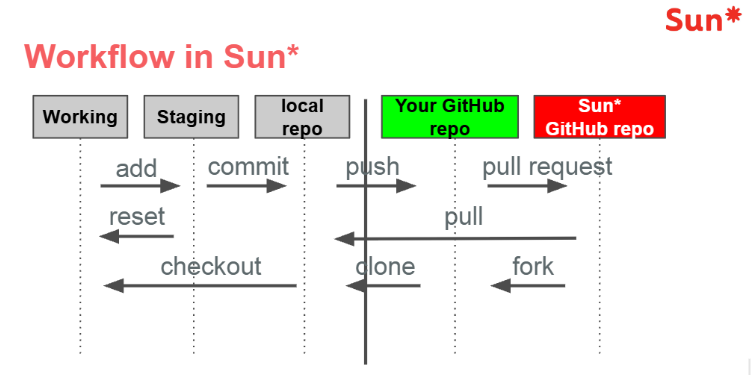

# Git & Git Workflow — Tổng hợp kiến thức

> **Mục tiêu:** Nắm vững Git cơ bản, quản lý branch, phân biệt merge/rebase và thực hiện quy trình làm việc nhóm qua Fork → Pull Request (PR).
>
> **Lưu ý:** Quy trình **Sun\*** bên dưới là *fork-based workflow* dùng trong nhóm, không hoàn toàn giống mô hình **Git Flow** kinh điển. Trong ví dụ dùng nhánh `master`; nếu dự án dùng `main`, hãy thay `master` bằng `main`.

## 1. Git Basics — Những khái niệm cơ bản

| Thuật ngữ | Ý nghĩa |
|---|---|
| **Repository (repo)** | Kho lưu trữ mã nguồn và lịch sử thay đổi. |
| **Working directory** | Thư mục chứa các file bạn đang chỉnh sửa. |
| **Staging area (index)** | Nơi chọn các thay đổi chuẩn bị đưa vào commit. |
| **Commit** | Bản ghi một tập hợp thay đổi tại một thời điểm. |
| **Branch** | Nhánh phát triển, là con trỏ đến một commit. |
| **Remote** | Kho Git nằm ở nơi khác, thường trên GitHub. |
| **`origin`** | Tên remote thường được tạo tự động khi clone, trong quy trình này trỏ về fork của bạn. |
| **`sun` / `upstream`** | Tên remote tự đặt, trỏ về repository gốc của nhóm/công ty. |
| **Pull Request (PR)** | Yêu cầu nhóm review và hợp nhất code từ nhánh của bạn vào nhánh đích. |

### Các lệnh Git cơ bản

```bash
git status                        # Xem file đã sửa, được stage, chưa được stage
git add <file>                    # Đưa một file vào staging area
git add .                         # Stage các thay đổi trong thư mục hiện tại
git commit -m "feat: add login"    # Tạo commit
git log --oneline                 # Xem lịch sử commit ngắn gọn
git log --oneline --graph --all --decorate  # Xem cây lịch sử các branch
git remote -v                    # Xem danh sách remote và URL
git branch                       # Xem các branch local
git branch -a                    # Xem branch local và remote-tracking
```

## 2. Git Branching — Quản lý nhánh

Branch cho phép phát triển tính năng hoặc sửa lỗi độc lập mà không sửa trực tiếp nhánh chính.

```bash
git switch master                # Chuyển sang nhánh chính
git switch -c feature/login      # Tạo và chuyển sang branch mới
git switch feature/login         # Chuyển sang branch đã có
git branch -d feature/login      # Xóa branch local đã được merge
```

> `git checkout -b feature/login` là cú pháp cũ tương đương `git switch -c feature/login`.

**Nguyên tắc:** Trong quy trình làm việc nhóm này, nên tạo nhánh riêng cho mỗi tính năng hoặc bug fix, thay vì commit trực tiếp lên `master`.

## 3. Merge và Rebase — Khác nhau thế nào?

### `git merge`

Hợp nhất lịch sử của hai branch. Khi hai nhánh đã tách nhau, Git thường tạo **merge commit**.

```bash
git switch feature/login
git merge master
```

### `git rebase`

Đặt các commit riêng của branch hiện tại lên trên commit mới nhất của branch đích, tạo lịch sử tuyến tính hơn. **Rebase viết lại commit history** (thường làm đổi commit hash).

```bash
git switch feature/login
git rebase master
```

| Tiêu chí | Merge | Rebase |
|---|---|---|
| Lịch sử | Giữ cấu trúc phân nhánh | Thường tuyến tính, dễ đọc |
| Commit hash cũ | Thường giữ nguyên | Các commit được phát lại có hash mới |
| Merge commit | Có thể tạo | Không tạo merge commit theo cách rebase thông thường |
| Phù hợp | Gộp nhánh, giữ lịch sử đầy đủ | Cập nhật nhánh tính năng trước khi PR |

**Lưu ý:** Tránh rebase các commit trên branch dùng chung nếu người khác đang dựa vào chúng, trừ khi cả nhóm đã thống nhất.

## 4. Git Workflow của Sun\* — Fork → Clone → Branch → PR



### Bước 1. Fork repository

Vào GitHub của dự án gốc và nhấn **Fork** để tạo một bản sao repository trên tài khoản cá nhân. Bạn có thể làm việc độc lập trong fork của mình mà không cần quyền push trực tiếp vào repository gốc.

### Bước 2. Clone fork về máy

**HTTPS:**

```bash
git clone https://github.com/<your-github-account>/<repo-name>.git
```

**SSH:**

```bash
git clone git@github.com:<your-github-account>/<repo-name>.git
```

Sau đó chuyển vào thư mục dự án:

```bash
cd <repo-name>
```

### Bước 3. Thêm remote trỏ về repo gốc

```bash
git remote add sun https://github.com/framgia/<repo-name>.git
git remote -v
```

Trong quy trình này:

- **`origin`** → fork trên GitHub cá nhân.
- **`sun`** → repository gốc của công ty.

Tên `sun` chỉ là quy ước; nhiều dự án sử dụng tên `upstream`.

### Bước 4. Tạo branch làm việc

```bash
git switch master
git switch -c feature/login
```

Có thể dùng cú pháp tương đương:

```bash
git checkout -b feature/login
```

### Bước 5. Add và Commit

```bash
git status
git add .
git commit -m "feat: implement login form"
```

- `git add`: chọn các thay đổi đưa vào **staging area**.
- `git commit`: ghi nhận các thay đổi đã stage vào lịch sử Git ở local.

### Bước 6. Cập nhật nhánh chính và Rebase

Trong khi bạn đang phát triển, đồng đội có thể đã cập nhật `master` trên repo gốc. Hãy lấy các thay đổi mới về trước khi tạo PR.

**Quy trình trong ghi chú gốc:**

```bash
git checkout master
git pull sun master
git checkout feature/login
git rebase master
```

**Biến thể tường minh, tránh tạo merge commit ngoài ý muốn trên `master`:**

```bash
git fetch sun
git switch master
git merge --ff-only sun/master
git switch feature/login
git rebase master
```

`--ff-only` chỉ cho phép cập nhật khi có thể fast-forward; nếu `master` local đã diverge, lệnh sẽ dừng để bạn kiểm tra.

### Bước 7. Xử lý conflict khi Rebase

Nếu cùng đoạn code bị thay đổi không tương thích, Git sẽ tạm dừng quá trình rebase.

1. Xem những file đang conflict:

   ```bash
   git status
   ```

2. Mở file, tìm dấu conflict:

   ```text
   <<<<<<< HEAD
   Code từ phía nền hiện tại
   =======
   Code từ commit đang được phát lại
   >>>>>>> <commit>
   ```

3. Sửa nội dung thành phiên bản đúng, rồi đánh dấu đã xử lý:

   ```bash
   git add <file>
   git rebase --continue
   ```

4. Nếu còn conflict, lặp lại đến khi hoàn thành.

Nếu muốn hủy toàn bộ rebase đang thực hiện:

```bash
git rebase --abort
```

> Trong lúc rebase, Git có thể hiển thị trạng thái **detached HEAD / no branch**. Đây là trạng thái tạm thời, không có nghĩa branch đã bị xóa. Khi xử lý conflict, **không tự tạo commit bằng `git commit`**; hãy dùng `git rebase --continue`.

### Bước 8. Push code và tạo Pull Request

**Lần đầu push nhánh:**

```bash
git push -u origin feature/login
```

Sau đó mở GitHub và tạo **Pull Request** từ branch trên fork (`origin`) vào nhánh đích của repository gốc (`sun`). Đồng đội review, yêu cầu chỉnh sửa (nếu có), rồi merge.

**Nếu branch đã push trước đó và vừa được rebase:**

```bash
git push --force-with-lease origin feature/login
```

`--force-with-lease` an toàn hơn `-f` / `--force`: Git sẽ từ chối nếu remote branch đã thay đổi ngoài những gì bạn đang biết, giúp hạn chế ghi đè commit của người khác.

## 5. Gộp nhiều Commit — Amend và Interactive Rebase

### Cách 1. `git commit --amend`

Dùng khi muốn bổ sung thay đổi hoặc đổi message của **commit gần nhất**.

```bash
# Sửa file rồi stage
git add .
git commit --amend
```

Nếu chỉ muốn đổi message:

```bash
git commit --amend -m "feat: implement login and validation"
```

**Chú ý:** Amend tạo commit mới với hash mới. Hạn chế amend commit đã được chia sẻ trên nhánh người khác cùng sử dụng.

### Cách 2. `git rebase -i HEAD~n`

Dùng để gộp hoặc chỉnh sửa **n commit gần nhất**:

```bash
git rebase -i HEAD~3
```

Ví dụ trình soạn thảo hiển thị:

```text
pick a1b2c3d feat: add login UI
pick d4e5f6g fix: login validation
pick h7i8j9k fix: button styling
```

Để gộp thành một commit:

```text
pick a1b2c3d feat: add login UI
squash d4e5f6g fix: login validation
squash h7i8j9k fix: button styling
```

- `pick`: giữ commit làm nền.
- `squash` / `s`: gộp vào commit trước và cho phép chỉnh message.
- `fixup` / `f`: gộp vào commit trước, thường bỏ message của commit được gộp.

Nếu các commit này đã push, việc rebase sẽ viết lại lịch sử; khi cần cập nhật remote, dùng `git push --force-with-lease` và bảo đảm không ảnh hưởng đồng đội.

## 6. Git Fetch và Git Pull

### `git fetch`

Tải commit và thông tin branch mới từ remote về **remote-tracking branches** mà không tự merge/rebase vào branch làm việc.

```bash
git fetch sun
git log --oneline --graph master..sun/master
```

### `git pull`

Về cơ bản, `git pull` thực hiện **fetch rồi tích hợp thay đổi** vào branch hiện tại (merge hoặc rebase tùy cấu hình/cờ lệnh).

```bash
git pull sun master            # Fetch + tích hợp master từ remote sun
git pull --rebase sun master   # Fetch + rebase thay vì merge
git pull --ff-only sun master  # Chỉ cập nhật nếu fast-forward được
```

| Lệnh | Tải thay đổi từ remote | Tự cập nhật branch hiện tại |
|---|---|---|
| `git fetch` | Có | Không |
| `git pull` | Có | Có, nếu tích hợp thành công |

## 7. Git Status và Git Log

### Kiểm tra trạng thái bằng `git status`

```bash
git status
git status -sb  # Hiển thị trạng thái ngắn gọn và tên branch
```

Bạn có thể xem: branch hiện tại, file đã chỉnh sửa, file chưa được track, file đã stage, conflict và trạng thái rebase.

### Xem lịch sử bằng `git log`

```bash
git log
git log --oneline
git log --oneline --graph
git log --oneline --graph --all --decorate
```

Các tham số hữu ích:

- `--oneline`: mỗi commit một dòng.
- `--graph`: thể hiện quan hệ branch/merge bằng sơ đồ ký tự.
- `--all`: hiển thị các ref có liên quan ngoài branch hiện tại.
- `--decorate`: hiển thị tên branch/tag bên cạnh commit.

## 8. Checklist thực hành trước khi mở PR

- [ ] Đang làm việc trên branch riêng, đúng mục đích.
- [ ] Đã chạy/test lại phần code thay đổi.
- [ ] Đã `git status` để tránh đưa nhầm file hoặc secret vào commit.
- [ ] Đã cập nhật `master` từ repo gốc (`sun`).
- [ ] Đã rebase branch tính năng nếu đó là quy ước của nhóm.
- [ ] Đã giải quyết hết conflict, kiểm tra lại sau khi rebase.
- [ ] Đã gom/sửa commit khi cần thiết, không viết lại lịch sử dùng chung tùy tiện.
- [ ] Đã push lên fork (`origin`) và tạo PR đúng nhánh đích.

## 9. Tóm tắt luồng lệnh thường dùng

```bash
# Thiết lập một lần
git clone https://github.com/<your-github-account>/<repo-name>.git
cd <repo-name>
git remote add sun https://github.com/framgia/<repo-name>.git

# Bắt đầu tính năng mới
git fetch sun
git switch master
git merge --ff-only sun/master
git switch -c feature/login

# Lập trình và ghi nhận thay đổi
git add .
git commit -m "feat: implement login"

# Đồng bộ trước khi mở PR
git fetch sun
git switch master
git merge --ff-only sun/master
git switch feature/login
git rebase master

# Nếu conflict: sửa file, sau đó
git add <file>
git rebase --continue

# Push và tạo PR trên GitHub
git push -u origin feature/login
```

**Ghi nhớ:** `origin` là fork cá nhân, `sun` là repo gốc; `merge` giữ cấu trúc lịch sử, còn `rebase` phát lại commit trên nền mới; khi buộc phải force-push branch của mình sau rebase, ưu tiên `--force-with-lease`.
