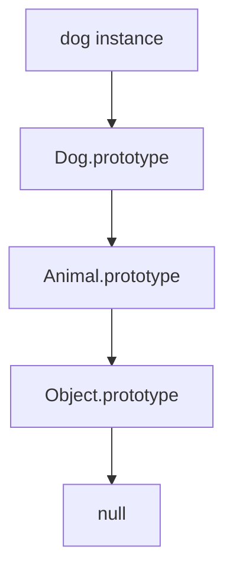
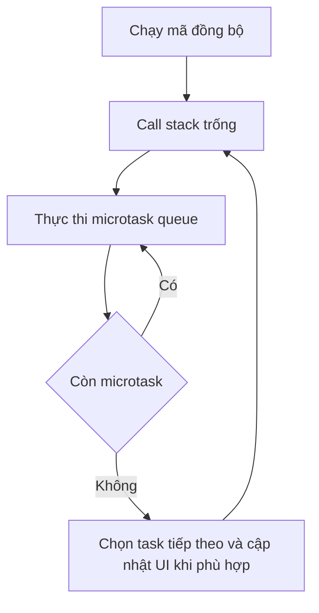

# JavaScript Study Notes

> **TL;DR:** Bộ tài liệu JavaScript bằng tiếng Việt theo lộ trình **36 chương từ nhập môn đến nâng cao**, chọn lọc và diễn giải từ **MDN Web Docs** và **W3Schools**. Mỗi chương trình bày kiến thức cốt lõi, nguyên lý hoạt động, ví dụ code được giải thích chi tiết, lỗi thường gặp và liên kết đến bài gốc; dành cho người nghiên cứu JavaScript, lập trình frontend và cần tài liệu tra cứu lâu dài.

| Thuộc tính | Thông tin |
| :--- | :--- |
| Phạm vi | JavaScript Core, ECMAScript, DOM, Browser APIs, các mẫu ứng dụng phân tích sẵn |
| Số chương | 36 chương (0–35), 8 phần |
| Mức độ | Nhập môn → nền tảng → trung cấp → nâng cao |
| Nguồn kiến thức | **Chỉ** MDN và W3Schools |
| Ngôn ngữ | Tiếng Việt, giữ thuật ngữ kỹ thuật tiếng Anh |
| Ngày biên soạn | 26-10-2026 |
| Định dạng | GitHub Flavored Markdown (GFM), Mermaid, GitHub Alerts |

> [!IMPORTANT]
> Đây là **tài liệu học tập biên soạn lại**, không phải bản sao toàn văn hoặc bản chụp tất cả trang của hai website. Ví dụ được viết lại theo kiến thức hai nguồn; các trang gốc ở cuối từng chương để kiểm chứng, đọc thêm và kiểm tra tương thích tính năng.

## Mục lục

- [Phạm vi và cấu trúc tài liệu](#phạm-vi-và-cấu-trúc-tài-liệu)
  - [Cấu trúc nội dung từng chương](#cấu-trúc-nội-dung-từng-chương)
  - [Phạm vi và cách diễn giải nguồn](#phạm-vi-và-cách-diễn-giải-nguồn)
  - [Quy ước đọc code](#quy-ước-đọc-code)
- [Phần 0 Tổng quan và nhập môn](#phần-0-tổng-quan-và-nhập-môn)
- [Chương 0 Tổng quan và chuẩn bị học JavaScript](#chương-0-tổng-quan-và-chuẩn-bị-học-javascript)
  - [0.1 Kiến thức cốt lõi](#01-kiến-thức-cốt-lõi)
  - [0.2 Cơ chế và ví dụ minh họa](#02-cơ-chế-và-ví-dụ-minh-họa)
  - [0.3 Lỗi thường gặp và best practices](#03-lỗi-thường-gặp-và-best-practices)
  - [0.4 Phân tích ví dụ và mở rộng kiến thức](#04-phân-tích-ví-dụ-và-mở-rộng-kiến-thức)
  - [0.5 Nguồn tham khảo](#05-nguồn-tham-khảo)
- [Phần I JavaScript Fundamentals](#phần-i-javascript-fundamentals)
- [Chương 1 Syntax Statements và Comments](#chương-1-syntax-statements-và-comments)
  - [1.1 Kiến thức cốt lõi](#11-kiến-thức-cốt-lõi)
  - [1.2 Cơ chế và ví dụ minh họa](#12-cơ-chế-và-ví-dụ-minh-họa)
  - [1.3 Lỗi thường gặp và best practices](#13-lỗi-thường-gặp-và-best-practices)
  - [1.4 Phân tích ví dụ và mở rộng kiến thức](#14-phân-tích-ví-dụ-và-mở-rộng-kiến-thức)
  - [1.5 Nguồn tham khảo](#15-nguồn-tham-khảo)
- [Chương 2 Variables Scope và Hoisting](#chương-2-variables-scope-và-hoisting)
  - [2.1 Kiến thức cốt lõi](#21-kiến-thức-cốt-lõi)
  - [2.2 Cơ chế và ví dụ minh họa](#22-cơ-chế-và-ví-dụ-minh-họa)
  - [2.3 Lỗi thường gặp và best practices](#23-lỗi-thường-gặp-và-best-practices)
  - [2.4 Phân tích ví dụ và mở rộng kiến thức](#24-phân-tích-ví-dụ-và-mở-rộng-kiến-thức)
  - [2.5 Nguồn tham khảo](#25-nguồn-tham-khảo)
- [Chương 3 Data Types và Type Conversion](#chương-3-data-types-và-type-conversion)
  - [3.1 Kiến thức cốt lõi](#31-kiến-thức-cốt-lõi)
  - [3.2 Cơ chế và ví dụ minh họa](#32-cơ-chế-và-ví-dụ-minh-họa)
  - [3.3 Lỗi thường gặp và best practices](#33-lỗi-thường-gặp-và-best-practices)
  - [3.4 Phân tích ví dụ và mở rộng kiến thức](#34-phân-tích-ví-dụ-và-mở-rộng-kiến-thức)
  - [3.5 Nguồn tham khảo](#35-nguồn-tham-khảo)
- [Chương 4 Expressions và Operators](#chương-4-expressions-và-operators)
  - [4.1 Kiến thức cốt lõi](#41-kiến-thức-cốt-lõi)
  - [4.2 Cơ chế và ví dụ minh họa](#42-cơ-chế-và-ví-dụ-minh-họa)
  - [4.3 Lỗi thường gặp và best practices](#43-lỗi-thường-gặp-và-best-practices)
  - [4.4 Phân tích ví dụ và mở rộng kiến thức](#44-phân-tích-ví-dụ-và-mở-rộng-kiến-thức)
  - [4.5 Nguồn tham khảo](#45-nguồn-tham-khảo)
- [Chương 5 Conditional Statements](#chương-5-conditional-statements)
  - [5.1 Kiến thức cốt lõi](#51-kiến-thức-cốt-lõi)
  - [5.2 Cơ chế và ví dụ minh họa](#52-cơ-chế-và-ví-dụ-minh-họa)
  - [5.3 Lỗi thường gặp và best practices](#53-lỗi-thường-gặp-và-best-practices)
  - [5.4 Phân tích ví dụ và mở rộng kiến thức](#54-phân-tích-ví-dụ-và-mở-rộng-kiến-thức)
  - [5.5 Nguồn tham khảo](#55-nguồn-tham-khảo)
- [Chương 6 Loops và Iteration](#chương-6-loops-và-iteration)
  - [6.1 Kiến thức cốt lõi](#61-kiến-thức-cốt-lõi)
  - [6.2 Cơ chế và ví dụ minh họa](#62-cơ-chế-và-ví-dụ-minh-họa)
  - [6.3 Lỗi thường gặp và best practices](#63-lỗi-thường-gặp-và-best-practices)
  - [6.4 Phân tích ví dụ và mở rộng kiến thức](#64-phân-tích-ví-dụ-và-mở-rộng-kiến-thức)
  - [6.5 Nguồn tham khảo](#65-nguồn-tham-khảo)
- [Chương 7 Error Handling](#chương-7-error-handling)
  - [7.1 Kiến thức cốt lõi](#71-kiến-thức-cốt-lõi)
  - [7.2 Cơ chế và ví dụ minh họa](#72-cơ-chế-và-ví-dụ-minh-họa)
  - [7.3 Lỗi thường gặp và best practices](#73-lỗi-thường-gặp-và-best-practices)
  - [7.4 Phân tích ví dụ và mở rộng kiến thức](#74-phân-tích-ví-dụ-và-mở-rộng-kiến-thức)
  - [7.5 Nguồn tham khảo](#75-nguồn-tham-khảo)
- [Phần II Core JavaScript](#phần-ii-core-javascript)
- [Chương 8 Functions](#chương-8-functions)
  - [8.1 Kiến thức cốt lõi](#81-kiến-thức-cốt-lõi)
  - [8.2 Cơ chế và ví dụ minh họa](#82-cơ-chế-và-ví-dụ-minh-họa)
  - [8.3 Lỗi thường gặp và best practices](#83-lỗi-thường-gặp-và-best-practices)
  - [8.4 Phân tích ví dụ và mở rộng kiến thức](#84-phân-tích-ví-dụ-và-mở-rộng-kiến-thức)
  - [8.5 Nguồn tham khảo](#85-nguồn-tham-khảo)
- [Chương 9 Scope Closures và this](#chương-9-scope-closures-và-this)
  - [9.1 Kiến thức cốt lõi](#91-kiến-thức-cốt-lõi)
  - [9.2 Cơ chế và ví dụ minh họa](#92-cơ-chế-và-ví-dụ-minh-họa)
  - [9.3 Lỗi thường gặp và best practices](#93-lỗi-thường-gặp-và-best-practices)
  - [9.4 Phân tích ví dụ và mở rộng kiến thức](#94-phân-tích-ví-dụ-và-mở-rộng-kiến-thức)
  - [9.5 Nguồn tham khảo](#95-nguồn-tham-khảo)
- [Chương 10 Strings](#chương-10-strings)
  - [10.1 Kiến thức cốt lõi](#101-kiến-thức-cốt-lõi)
  - [10.2 Cơ chế và ví dụ minh họa](#102-cơ-chế-và-ví-dụ-minh-họa)
  - [10.3 Lỗi thường gặp và best practices](#103-lỗi-thường-gặp-và-best-practices)
  - [10.4 Phân tích ví dụ và mở rộng kiến thức](#104-phân-tích-ví-dụ-và-mở-rộng-kiến-thức)
  - [10.5 Nguồn tham khảo](#105-nguồn-tham-khảo)
- [Chương 11 Numbers BigInt và Math](#chương-11-numbers-bigint-và-math)
  - [11.1 Kiến thức cốt lõi](#111-kiến-thức-cốt-lõi)
  - [11.2 Cơ chế và ví dụ minh họa](#112-cơ-chế-và-ví-dụ-minh-họa)
  - [11.3 Lỗi thường gặp và best practices](#113-lỗi-thường-gặp-và-best-practices)
  - [11.4 Phân tích ví dụ và mở rộng kiến thức](#114-phân-tích-ví-dụ-và-mở-rộng-kiến-thức)
  - [11.5 Nguồn tham khảo](#115-nguồn-tham-khảo)
- [Chương 12 Dates Times và Internationalization](#chương-12-dates-times-và-internationalization)
  - [12.1 Kiến thức cốt lõi](#121-kiến-thức-cốt-lõi)
  - [12.2 Cơ chế và ví dụ minh họa](#122-cơ-chế-và-ví-dụ-minh-họa)
  - [12.3 Lỗi thường gặp và best practices](#123-lỗi-thường-gặp-và-best-practices)
  - [12.4 Phân tích ví dụ và mở rộng kiến thức](#124-phân-tích-ví-dụ-và-mở-rộng-kiến-thức)
  - [12.5 Nguồn tham khảo](#125-nguồn-tham-khảo)
- [Chương 13 Arrays](#chương-13-arrays)
  - [13.1 Kiến thức cốt lõi](#131-kiến-thức-cốt-lõi)
  - [13.2 Cơ chế và ví dụ minh họa](#132-cơ-chế-và-ví-dụ-minh-họa)
  - [13.3 Lỗi thường gặp và best practices](#133-lỗi-thường-gặp-và-best-practices)
  - [13.4 Phân tích ví dụ và mở rộng kiến thức](#134-phân-tích-ví-dụ-và-mở-rộng-kiến-thức)
  - [13.5 Nguồn tham khảo](#135-nguồn-tham-khảo)
- [Chương 14 Objects](#chương-14-objects)
  - [14.1 Kiến thức cốt lõi](#141-kiến-thức-cốt-lõi)
  - [14.2 Cơ chế và ví dụ minh họa](#142-cơ-chế-và-ví-dụ-minh-họa)
  - [14.3 Lỗi thường gặp và best practices](#143-lỗi-thường-gặp-và-best-practices)
  - [14.4 Phân tích ví dụ và mở rộng kiến thức](#144-phân-tích-ví-dụ-và-mở-rộng-kiến-thức)
  - [14.5 Nguồn tham khảo](#145-nguồn-tham-khảo)
- [Chương 15 Sets Maps và Weak Collections](#chương-15-sets-maps-và-weak-collections)
  - [15.1 Kiến thức cốt lõi](#151-kiến-thức-cốt-lõi)
  - [15.2 Cơ chế và ví dụ minh họa](#152-cơ-chế-và-ví-dụ-minh-họa)
  - [15.3 Lỗi thường gặp và best practices](#153-lỗi-thường-gặp-và-best-practices)
  - [15.4 Phân tích ví dụ và mở rộng kiến thức](#154-phân-tích-ví-dụ-và-mở-rộng-kiến-thức)
  - [15.5 Nguồn tham khảo](#155-nguồn-tham-khảo)
- [Chương 16 Regular Expressions](#chương-16-regular-expressions)
  - [16.1 Kiến thức cốt lõi](#161-kiến-thức-cốt-lõi)
  - [16.2 Cơ chế và ví dụ minh họa](#162-cơ-chế-và-ví-dụ-minh-họa)
  - [16.3 Lỗi thường gặp và best practices](#163-lỗi-thường-gặp-và-best-practices)
  - [16.4 Phân tích ví dụ và mở rộng kiến thức](#164-phân-tích-ví-dụ-và-mở-rộng-kiến-thức)
  - [16.5 Nguồn tham khảo](#165-nguồn-tham-khảo)
- [Phần III Intermediate JavaScript](#phần-iii-intermediate-javascript)
- [Chương 17 Prototype Inheritance và Classes](#chương-17-prototype-inheritance-và-classes)
  - [17.1 Kiến thức cốt lõi](#171-kiến-thức-cốt-lõi)
  - [17.2 Cơ chế và ví dụ minh họa](#172-cơ-chế-và-ví-dụ-minh-họa)
  - [17.3 Lỗi thường gặp và best practices](#173-lỗi-thường-gặp-và-best-practices)
  - [17.4 Phân tích ví dụ và mở rộng kiến thức](#174-phân-tích-ví-dụ-và-mở-rộng-kiến-thức)
  - [17.5 Nguồn tham khảo](#175-nguồn-tham-khảo)
- [Chương 18 Destructuring Spread và Rest](#chương-18-destructuring-spread-và-rest)
  - [18.1 Kiến thức cốt lõi](#181-kiến-thức-cốt-lõi)
  - [18.2 Cơ chế và ví dụ minh họa](#182-cơ-chế-và-ví-dụ-minh-họa)
  - [18.3 Lỗi thường gặp và best practices](#183-lỗi-thường-gặp-và-best-practices)
  - [18.4 Phân tích ví dụ và mở rộng kiến thức](#184-phân-tích-ví-dụ-và-mở-rộng-kiến-thức)
  - [18.5 Nguồn tham khảo](#185-nguồn-tham-khảo)
- [Chương 19 Iterators và Generators](#chương-19-iterators-và-generators)
  - [19.1 Kiến thức cốt lõi](#191-kiến-thức-cốt-lõi)
  - [19.2 Cơ chế và ví dụ minh họa](#192-cơ-chế-và-ví-dụ-minh-họa)
  - [19.3 Lỗi thường gặp và best practices](#193-lỗi-thường-gặp-và-best-practices)
  - [19.4 Phân tích ví dụ và mở rộng kiến thức](#194-phân-tích-ví-dụ-và-mở-rộng-kiến-thức)
  - [19.5 Nguồn tham khảo](#195-nguồn-tham-khảo)
- [Chương 20 JavaScript Modules](#chương-20-javascript-modules)
  - [20.1 Kiến thức cốt lõi](#201-kiến-thức-cốt-lõi)
  - [20.2 Cơ chế và ví dụ minh họa](#202-cơ-chế-và-ví-dụ-minh-họa)
  - [20.3 Lỗi thường gặp và best practices](#203-lỗi-thường-gặp-và-best-practices)
  - [20.4 Phân tích ví dụ và mở rộng kiến thức](#204-phân-tích-ví-dụ-và-mở-rộng-kiến-thức)
  - [20.5 Nguồn tham khảo](#205-nguồn-tham-khảo)
- [Phần IV Asynchronous JavaScript](#phần-iv-asynchronous-javascript)
- [Chương 21 Asynchronous Programming và Event Loop](#chương-21-asynchronous-programming-và-event-loop)
  - [21.1 Kiến thức cốt lõi](#211-kiến-thức-cốt-lõi)
  - [21.2 Cơ chế và ví dụ minh họa](#212-cơ-chế-và-ví-dụ-minh-họa)
  - [21.3 Lỗi thường gặp và best practices](#213-lỗi-thường-gặp-và-best-practices)
  - [21.4 Phân tích ví dụ và mở rộng kiến thức](#214-phân-tích-ví-dụ-và-mở-rộng-kiến-thức)
  - [21.5 Nguồn tham khảo](#215-nguồn-tham-khảo)
- [Chương 22 Promises](#chương-22-promises)
  - [22.1 Kiến thức cốt lõi](#221-kiến-thức-cốt-lõi)
  - [22.2 Cơ chế và ví dụ minh họa](#222-cơ-chế-và-ví-dụ-minh-họa)
  - [22.3 Lỗi thường gặp và best practices](#223-lỗi-thường-gặp-và-best-practices)
  - [22.4 Phân tích ví dụ và mở rộng kiến thức](#224-phân-tích-ví-dụ-và-mở-rộng-kiến-thức)
  - [22.5 Nguồn tham khảo](#225-nguồn-tham-khảo)
- [Chương 23 Async Await](#chương-23-async-await)
  - [23.1 Kiến thức cốt lõi](#231-kiến-thức-cốt-lõi)
  - [23.2 Cơ chế và ví dụ minh họa](#232-cơ-chế-và-ví-dụ-minh-họa)
  - [23.3 Lỗi thường gặp và best practices](#233-lỗi-thường-gặp-và-best-practices)
  - [23.4 Phân tích ví dụ và mở rộng kiến thức](#234-phân-tích-ví-dụ-và-mở-rộng-kiến-thức)
  - [23.5 Nguồn tham khảo](#235-nguồn-tham-khảo)
- [Chương 24 Fetch API và JSON](#chương-24-fetch-api-và-json)
  - [24.1 Kiến thức cốt lõi](#241-kiến-thức-cốt-lõi)
  - [24.2 Cơ chế và ví dụ minh họa](#242-cơ-chế-và-ví-dụ-minh-họa)
  - [24.3 Lỗi thường gặp và best practices](#243-lỗi-thường-gặp-và-best-practices)
  - [24.4 Phân tích ví dụ và mở rộng kiến thức](#244-phân-tích-ví-dụ-và-mở-rộng-kiến-thức)
  - [24.5 Nguồn tham khảo](#245-nguồn-tham-khảo)
- [Phần V JavaScript trong trình duyệt](#phần-v-javascript-trong-trình-duyệt)
- [Chương 25 DOM Manipulation](#chương-25-dom-manipulation)
  - [25.1 Kiến thức cốt lõi](#251-kiến-thức-cốt-lõi)
  - [25.2 Cơ chế và ví dụ minh họa](#252-cơ-chế-và-ví-dụ-minh-họa)
  - [25.3 Lỗi thường gặp và best practices](#253-lỗi-thường-gặp-và-best-practices)
  - [25.4 Phân tích ví dụ và mở rộng kiến thức](#254-phân-tích-ví-dụ-và-mở-rộng-kiến-thức)
  - [25.5 Nguồn tham khảo](#255-nguồn-tham-khảo)
- [Chương 26 Events và Forms](#chương-26-events-và-forms)
  - [26.1 Kiến thức cốt lõi](#261-kiến-thức-cốt-lõi)
  - [26.2 Cơ chế và ví dụ minh họa](#262-cơ-chế-và-ví-dụ-minh-họa)
  - [26.3 Lỗi thường gặp và best practices](#263-lỗi-thường-gặp-và-best-practices)
  - [26.4 Phân tích ví dụ và mở rộng kiến thức](#264-phân-tích-ví-dụ-và-mở-rộng-kiến-thức)
  - [26.5 Nguồn tham khảo](#265-nguồn-tham-khảo)
- [Chương 27 Browser APIs](#chương-27-browser-apis)
  - [27.1 Kiến thức cốt lõi](#271-kiến-thức-cốt-lõi)
  - [27.2 Cơ chế và ví dụ minh họa](#272-cơ-chế-và-ví-dụ-minh-họa)
  - [27.3 Lỗi thường gặp và best practices](#273-lỗi-thường-gặp-và-best-practices)
  - [27.4 Phân tích ví dụ và mở rộng kiến thức](#274-phân-tích-ví-dụ-và-mở-rộng-kiến-thức)
  - [27.5 Nguồn tham khảo](#275-nguồn-tham-khảo)
- [Chương 28 Graphics và Legacy Web Techniques](#chương-28-graphics-và-legacy-web-techniques)
  - [28.1 Kiến thức cốt lõi](#281-kiến-thức-cốt-lõi)
  - [28.2 Cơ chế và ví dụ minh họa](#282-cơ-chế-và-ví-dụ-minh-họa)
  - [28.3 Lỗi thường gặp và best practices](#283-lỗi-thường-gặp-và-best-practices)
  - [28.4 Phân tích ví dụ và mở rộng kiến thức](#284-phân-tích-ví-dụ-và-mở-rộng-kiến-thức)
  - [28.5 Nguồn tham khảo](#285-nguồn-tham-khảo)
- [Phần VI Advanced JavaScript](#phần-vi-advanced-javascript)
- [Chương 29 Debugging Best Practices và Performance](#chương-29-debugging-best-practices-và-performance)
  - [29.1 Kiến thức cốt lõi](#291-kiến-thức-cốt-lõi)
  - [29.2 Cơ chế và ví dụ minh họa](#292-cơ-chế-và-ví-dụ-minh-họa)
  - [29.3 Lỗi thường gặp và best practices](#293-lỗi-thường-gặp-và-best-practices)
  - [29.4 Phân tích ví dụ và mở rộng kiến thức](#294-phân-tích-ví-dụ-và-mở-rộng-kiến-thức)
  - [29.5 Nguồn tham khảo](#295-nguồn-tham-khảo)
- [Chương 30 Metaprogramming](#chương-30-metaprogramming)
  - [30.1 Kiến thức cốt lõi](#301-kiến-thức-cốt-lõi)
  - [30.2 Cơ chế và ví dụ minh họa](#302-cơ-chế-và-ví-dụ-minh-họa)
  - [30.3 Lỗi thường gặp và best practices](#303-lỗi-thường-gặp-và-best-practices)
  - [30.4 Phân tích ví dụ và mở rộng kiến thức](#304-phân-tích-ví-dụ-và-mở-rộng-kiến-thức)
  - [30.5 Nguồn tham khảo](#305-nguồn-tham-khảo)
- [Chương 31 Typed Arrays và Binary Data](#chương-31-typed-arrays-và-binary-data)
  - [31.1 Kiến thức cốt lõi](#311-kiến-thức-cốt-lõi)
  - [31.2 Cơ chế và ví dụ minh họa](#312-cơ-chế-và-ví-dụ-minh-họa)
  - [31.3 Lỗi thường gặp và best practices](#313-lỗi-thường-gặp-và-best-practices)
  - [31.4 Phân tích ví dụ và mở rộng kiến thức](#314-phân-tích-ví-dụ-và-mở-rộng-kiến-thức)
  - [31.5 Nguồn tham khảo](#315-nguồn-tham-khảo)
- [Chương 32 Memory và Resource Management](#chương-32-memory-và-resource-management)
  - [32.1 Kiến thức cốt lõi](#321-kiến-thức-cốt-lõi)
  - [32.2 Cơ chế và ví dụ minh họa](#322-cơ-chế-và-ví-dụ-minh-họa)
  - [32.3 Lỗi thường gặp và best practices](#323-lỗi-thường-gặp-và-best-practices)
  - [32.4 Phân tích ví dụ và mở rộng kiến thức](#324-phân-tích-ví-dụ-và-mở-rộng-kiến-thức)
  - [32.5 Nguồn tham khảo](#325-nguồn-tham-khảo)
- [Chương 33 ECMAScript và JavaScript Evolution](#chương-33-ecmascript-và-javascript-evolution)
  - [33.1 Kiến thức cốt lõi](#331-kiến-thức-cốt-lõi)
  - [33.2 Cơ chế và ví dụ minh họa](#332-cơ-chế-và-ví-dụ-minh-họa)
  - [33.3 Lỗi thường gặp và best practices](#333-lỗi-thường-gặp-và-best-practices)
  - [33.4 Phân tích ví dụ và mở rộng kiến thức](#334-phân-tích-ví-dụ-và-mở-rộng-kiến-thức)
  - [33.5 Nguồn tham khảo](#335-nguồn-tham-khảo)
- [Phần VII Các mẫu ứng dụng và hệ thống hóa kiến thức](#phần-vii-các-mẫu-ứng-dụng-và-hệ-thống-hóa-kiến-thức)
- [Chương 34 Phân tích các mẫu ứng dụng JavaScript](#chương-34-phân-tích-các-mẫu-ứng-dụng-javascript)
  - [34.1 Kiến thức cốt lõi](#341-kiến-thức-cốt-lõi)
  - [34.2 Cơ chế và ví dụ minh họa](#342-cơ-chế-và-ví-dụ-minh-họa)
  - [34.3 Lỗi thường gặp và best practices](#343-lỗi-thường-gặp-và-best-practices)
  - [34.4 Phân tích ví dụ và mở rộng kiến thức](#344-phân-tích-ví-dụ-và-mở-rộng-kiến-thức)
  - [34.5 Nguồn tham khảo](#345-nguồn-tham-khảo)
- [Chương 35 Tổng hợp cơ chế JavaScript và Reference](#chương-35-tổng-hợp-cơ-chế-javascript-và-reference)
  - [35.1 Kiến thức cốt lõi](#351-kiến-thức-cốt-lõi)
  - [35.2 Cơ chế và ví dụ minh họa](#352-cơ-chế-và-ví-dụ-minh-họa)
  - [35.3 Lỗi thường gặp và best practices](#353-lỗi-thường-gặp-và-best-practices)
  - [35.4 Phân tích ví dụ và mở rộng kiến thức](#354-phân-tích-ví-dụ-và-mở-rộng-kiến-thức)
  - [35.5 Nguồn tham khảo](#355-nguồn-tham-khảo)
- [Bảng tra cứu nhanh Cheat Sheet](#bảng-tra-cứu-nhanh-cheat-sheet)
  - [Biến kiểu dữ liệu và so sánh](#biến-kiểu-dữ-liệu-và-so-sánh)
  - [Arrays objects và collections](#arrays-objects-và-collections)
  - [Functions và async](#functions-và-async)
  - [DOM browser và network](#dom-browser-và-network)
  - [Các cặp khái niệm dễ nhầm](#các-cặp-khái-niệm-dễ-nhầm)
- [Thuật ngữ trọng tâm](#thuật-ngữ-trọng-tâm)
- [Tài liệu gốc và nguyên tắc cập nhật](#tài-liệu-gốc-và-nguyên-tắc-cập-nhật)
  - [Danh sách nguồn được phép](#danh-sách-nguồn-được-phép)
  - [Quy tắc bảo trì Knowledge Base](#quy-tắc-bảo-trì-knowledge-base)

[↓ Đọc nội dung](#phạm-vi-và-cấu-trúc-tài-liệu)


---

## Phạm vi và cấu trúc tài liệu

### Cấu trúc nội dung từng chương

Mỗi chương là một đơn vị kiến thức độc lập, có **trọng tâm khái niệm**, phần giải thích nguyên lý, ví dụ code, **phân tích đầu vào và kết quả**, các tình huống dễ gây lỗi và liên kết tài liệu gốc. Các ví dụ được phân tích sẵn theo từng bước; toàn bộ nội dung tập trung vào lý thuyết và giải thích cơ chế.

Đối với một API, việc giải thích tập trung vào **đầu vào, đầu ra, tác dụng phụ, điều kiện phát sinh lỗi và tính tương thích**. Đối với đoạn code, tài liệu trình bày tuần tự vì sao từng biểu thức hoặc bước xử lý tạo ra kết quả được nêu.

### Phạm vi và cách diễn giải nguồn

- **MDN JavaScript Guide:** trục chính giải thích cú pháp, cơ chế ngôn ngữ và khái niệm. [Mở Guide](https://developer.mozilla.org/en-US/docs/Web/JavaScript/Guide).
- **MDN JavaScript Reference:** nơi tra cứu cú pháp, exceptions và đặc tả cho hàm, đối tượng, statement. [Mở Reference](https://developer.mozilla.org/en-US/docs/Web/JavaScript/Reference).
- **MDN Web APIs:** nguồn tương ứng cho những phần **không thuộc ECMAScript**, ví dụ DOM, Fetch, Canvas. [Mở Web APIs](https://developer.mozilla.org/en-US/docs/Web/API).
- **W3Schools JavaScript Tutorial:** ví dụ minh họa ngắn, debugging, DOM, Browser APIs và các mẫu ứng dụng. [Mở Tutorial](https://www.w3schools.com/js/).
- Tài liệu này ưu tiên **giải thích lại bằng lời của người biên soạn**, không sao chép dài nội dung gốc. Các mục hiện đại như `Temporal`, `using`, `await using` cần kiểm tra compatibility ở thời điểm sử dụng.

### Quy ước đọc code

| Ký hiệu | Ý nghĩa |
| :--- | :--- |
| `javascript` | JavaScript độc lập hoặc ví dụ chạy được trong Console |
| `html` | Cấu trúc cần tạo trong file HTML |
| `// ...` | Comment trong đoạn code |
| `> [!WARNING]` | Nguy cơ phổ biến hoặc cảnh báo an toàn |
| `> [!IMPORTANT]` | Quy tắc cần nắm chắc |
| `> [!TIP]` | Mẹo áp dụng thực tế |

> [!NOTE]
> Một số ví dụ cần chạy trong browser, cần HTML tương ứng hoặc truy cập mạng. Chúng được ghi rõ tại từng chương. JavaScript Core và Browser APIs được phân biệt xuyên suốt.

[↑ Về đầu trang](#mục-lục)

---

## Phần 0 Tổng quan và nhập môn

Khái niệm JavaScript, ranh giới ngôn ngữ với runtime và cách một đoạn mã tương tác với trình duyệt.

[↑ Về đầu trang](#mục-lục)

---

## Chương 0 Tổng quan và chuẩn bị học JavaScript

> **Trọng tâm kiến thức:** Phân biệt ngôn ngữ JavaScript với môi trường chạy, biết tạo trang HTML chạy script và sử dụng Developer Tools.

### 0.1 Kiến thức cốt lõi

**JavaScript** là ngôn ngữ lập trình đa mô hình, có kiểu động và hàm là giá trị bậc nhất. Trình duyệt cung cấp các Web API như DOM và `fetch`; bản thân những API này **không phải** cú pháp hay đối tượng lõi của ECMAScript. ECMAScript là tiêu chuẩn định nghĩa ngôn ngữ JavaScript.

| Thành phần | Vai trò | Ví dụ |
| :--- | :--- | :--- |
| ECMAScript | Quy định cú pháp và ngữ nghĩa ngôn ngữ | `let`, `Promise`, `Array` |
| JavaScript engine | Phân tích và thực thi mã | Engine nhúng trong trình duyệt |
| Runtime / host | Cung cấp môi trường và API ngoài ngôn ngữ | Browser DOM, timers |
| HTML / CSS | Cấu trúc và kiểu hiển thị | `button`, `color` |

**Các hình thức thực thi:** JavaScript có thể chạy trong Console, từ file `.js` liên kết qua `<script defer>` hoặc `<script type="module">`, và được quan sát bằng breakpoint cùng Console trong DevTools. Script đặt trong `head` với `defer` được thực thi sau khi HTML phân tích xong; module có hành vi trì hoãn tương tự theo mặc định.

> [!NOTE]
> JavaScript và Java là hai ngôn ngữ khác nhau. Không đánh đồng Browser JavaScript với mọi môi trường JavaScript khác.

### 0.2 Cơ chế và ví dụ minh họa

Ví dụ gồm hai file `index.html` và `main.js`, được browser xử lý như sau:

```html
<!doctype html>
<html lang="vi">
  <head>
    <meta charset="UTF-8" />
    <script src="main.js" defer></script>
  </head>
  <body>
    <button id="hello">Nhấn để chào</button>
  </body>
</html>
```

```javascript
const button = document.querySelector('#hello');
button.addEventListener('click', () => {
  console.log('Hello JavaScript');
});
```

Dòng đầu lấy phần tử DOM; dòng sau đăng ký callback cho sự kiện click. Khi người dùng nhấn nút, **Developer Tools → Console** hiển thị `Hello JavaScript`.

### 0.3 Lỗi thường gặp và best practices

> [!TIP]
> Ba điểm then chốt khi đọc ví dụ kỹ thuật là **giá trị đầu vào**, **kết quả đầu ra** và **nguyên nhân tạo ra kết quả**.

> [!WARNING]
> Không nhầm `document` hoặc `window` là đối tượng JavaScript chuẩn có trong mọi runtime.

### 0.4 Phân tích ví dụ và mở rộng kiến thức

**Vì sao sự kiện được xử lý sau khi nhấn nút?** `querySelector('#hello')` trả về phần tử có `id="hello"`. `addEventListener` chỉ **đăng ký** hàm xử lý; nó không gọi hàm ngay. Mỗi lần sự kiện `click` phát sinh, browser gọi callback và lệnh `console.log` ghi một dòng ra Console. `defer` giúp script chạy sau khi HTML đã được phân tích, nên phần tử nút đã tồn tại khi `querySelector` thực thi.

**Giới hạn môi trường:** `document` được browser cung cấp. Trong một JavaScript runtime không có DOM, lệnh `document.querySelector` không sử dụng được. Ngược lại, những API lõi như `Array`, `Map`, `Promise` thuộc ngôn ngữ JavaScript và không phụ thuộc riêng vào DOM.

### 0.5 Nguồn tham khảo

- **MDN:** [https://developer.mozilla.org/en-US/docs/Web/JavaScript/Guide/Introduction](https://developer.mozilla.org/en-US/docs/Web/JavaScript/Guide/Introduction)
- **W3Schools:** [https://www.w3schools.com/js/js_intro.asp](https://www.w3schools.com/js/js_intro.asp)

[↑ Về đầu trang](#mục-lục)

---

## Phần I JavaScript Fundamentals

Nắm cú pháp, dữ liệu, biểu thức và luồng điều khiển chương trình.

[↑ Về đầu trang](#mục-lục)

---

## Chương 1 Syntax Statements và Comments

> **Trọng tâm kiến thức:** Đọc được cú pháp JavaScript, phân biệt expression với statement và viết comment đúng mục đích.

### 1.1 Kiến thức cốt lõi

Một **expression** tạo ra giá trị, ví dụ `2 + 3` hoặc `user.name`. Một **statement** thực hiện hành động hoặc điều khiển luồng, ví dụ `if`, `for`, `return`. JavaScript phân biệt chữ hoa chữ thường (`user` khác `User`), hỗ trợ Unicode trong identifier và dùng `{}` để gom các câu lệnh thành block.

| Cú pháp | Ý nghĩa | Lưu ý |
| :--- | :--- | :--- |
| `// ...` | Comment một dòng | Không dùng để che giấu dữ liệu bí mật |
| `/* ... */` | Comment nhiều dòng | Không lồng comment khối |
| `;` | Kết thúc statement | Có Automatic Semicolon Insertion nhưng không nên phụ thuộc mù quáng |
| `'...'`, `"..."`, `` `...` `` | String literal | Backtick hỗ trợ nội suy |
| `{ ... }` | Block | Không phải lúc nào cũng tạo scope cho `var` |

Tư duy về **statement vs expression** giúp hiểu vì sao `const x = if (...) {}` không hợp lệ, trong khi `const x = condition ? a : b` hợp lệ.

### 1.2 Cơ chế và ví dụ minh họa

```javascript
const unitPrice = 120_000;
const quantity = 3;
const subtotal = unitPrice * quantity; // expression trả về 360000

if (subtotal > 300_000) { // statement điều kiện
  console.log(`Tổng tiền: ${subtotal}`);
}
```

Dấu gạch dưới trong số (`120_000`) chỉ giúp tăng khả năng đọc, không ảnh hưởng giá trị. Comment nên giải thích **lý do** quyết định thay vì mô tả lại điều code đã thể hiện.

### 1.3 Lỗi thường gặp và best practices

> [!WARNING]
> Việc tự động chèn dấu `;` không giải quyết mọi trường hợp. Các dòng mở đầu bằng `(` hoặc `[` sau một expression có thể khiến parser hiểu khác dự tính.

### 1.4 Phân tích ví dụ và mở rộng kiến thức

`120_000` là numeric literal có dấu phân tách hàng nghìn; giá trị thực vẫn là `120000`. Biểu thức `unitPrice * quantity` tạo kết quả `360000` rồi được gán cho `subtotal`. Phần `if` là một **statement**: nó quyết định có thực hiện khối lệnh tiếp theo hay không.

Phần `${subtotal}` trong template literal được thay bằng giá trị số rồi tạo ra chuỗi hoàn chỉnh. Vì `360000 > 300000` là `true`, Console nhận **`Tổng tiền: 360000`**. Trường hợp điều kiện sai, khối `if` bị bỏ qua và ví dụ không ghi dòng nào.

### 1.5 Nguồn tham khảo

- **MDN:** [https://developer.mozilla.org/en-US/docs/Web/JavaScript/Guide/Grammar_and_types](https://developer.mozilla.org/en-US/docs/Web/JavaScript/Guide/Grammar_and_types)
- **W3Schools:** [https://www.w3schools.com/js/js_syntax.asp](https://www.w3schools.com/js/js_syntax.asp)

[↑ Về đầu trang](#mục-lục)

---

## Chương 2 Variables Scope và Hoisting

> **Trọng tâm kiến thức:** Nắm `var`, `let`, `const`, lexical scope, hoisting, TDZ và shadowing.

### 2.1 Kiến thức cốt lõi

| Đặc điểm | `var` | `let` | `const` |
| :--- | :---: | :---: | :---: |
| Phạm vi | Function / global | Block | Block |
| Gán lại binding | Có | Có | Không |
| Khai báo lại cùng scope | Có | Không | Không |
| Truy cập trước khai báo | Thường nhận `undefined` trong phạm vi khai báo | TDZ gây `ReferenceError` | TDZ gây `ReferenceError` |

**Hoisting** mô tả việc khai báo được thiết lập khi tạo scope, không có nghĩa mã nguồn thật sự bị di chuyển. `let` và `const` tồn tại trong scope từ đầu block nhưng không được truy cập trước dòng khởi tạo (**Temporal Dead Zone**). `const` giữ nguyên **binding**, không làm object bất biến; thuộc tính trong object vẫn sửa được trừ khi có biện pháp khác. **Shadowing** là biến trong scope con trùng tên biến scope cha.

### 2.2 Cơ chế và ví dụ minh họa

```javascript
const config = { theme: 'light' };
config.theme = 'dark'; // hợp lệ: chỉ thay đổi thuộc tính

let counter = 0;
if (true) {
  let counter = 5; // shadowing
  console.log(counter); // 5
}
console.log(counter); // 0

function test() {
  console.log(value); // undefined vì var được hoist
  var value = 10;
}
test();
```

Bản thân `const config = {...}` không ngăn `config.theme = ...`; nó chỉ ngăn `config = {...}`.

### 2.3 Lỗi thường gặp và best practices

> [!IMPORTANT]
> Mặc định dùng `const`; chỉ dùng `let` khi phải gán lại; hạn chế `var` trong code mới.

> [!CAUTION]
> `typeof undeclaredName` trả `"undefined"` nhưng `typeof` trên biến lexical đang ở TDZ vẫn có thể ném `ReferenceError`.

### 2.4 Phân tích ví dụ và mở rộng kiến thức

Có hai quy tắc khác nhau ở đây. Thứ nhất, `const` cố định **binding**, không đóng băng toàn bộ object; `config.theme = 'dark'` vì vậy hợp lệ. Thứ hai, `let counter = 5` được khai báo trong block `if` là biến khác với `counter` bên ngoài: Console lần lượt ghi **`5`**, rồi **`0`**.

Khi gọi `test()`, `var value` tồn tại trong function scope trước khi dòng gán `10` chạy, với giá trị ban đầu là `undefined`. Vì thế lần `console.log(value)` đầu tiên in **`undefined`**. Nếu thay bằng `let value`, việc đọc trước vị trí khai báo sẽ ném `ReferenceError` do **Temporal Dead Zone**. `Object.freeze(config)` lại là cơ chế hạn chế thay đổi thuộc tính cấp ngoài của object (shallow), khác mục đích của `const`.

### 2.5 Nguồn tham khảo

- **MDN:** [https://developer.mozilla.org/en-US/docs/Web/JavaScript/Guide/Grammar_and_types](https://developer.mozilla.org/en-US/docs/Web/JavaScript/Guide/Grammar_and_types)
- **W3Schools:** [https://www.w3schools.com/js/js_scope.asp](https://www.w3schools.com/js/js_scope.asp)

[↑ Về đầu trang](#mục-lục)

---

## Chương 3 Data Types và Type Conversion

> **Trọng tâm kiến thức:** Phân biệt primitive với object, coercion, equality và truthy/falsy.

### 3.1 Kiến thức cốt lõi

JavaScript có **7 primitive types**: `undefined`, `null`, `boolean`, `number`, `bigint`, `string`, `symbol`; ngoài ra có kiểu **object**. Primitive không có identity kiểu object; object được so sánh theo tham chiếu. Hàm, mảng và ngày tháng là object. `typeof null` trả `"object"` vì đặc thù lịch sử, không phải `null` là object thực sự.

| Biểu thức | Kết quả | Vì sao |
| :--- | :--- | :--- |
| `typeof 7n` | `"bigint"` | BigInt literal |
| `Number('42')` | `42` | Chuyển string thành number |
| `Number('abc')` | `NaN` | Chuyển đổi thất bại |
| `Boolean('false')` | `true` | String không rỗng là truthy |
| `0 == false` | `true` | So sánh lỏng có coercion |
| `0 === false` | `false` | Khác kiểu |

Falsy thường gặp: `false`, `0`, `-0`, `0n`, `""`, `null`, `undefined`, `NaN`. Mảng rỗng `[]` và object rỗng `{}` đều truthy. `NaN` khác mọi giá trị, kể cả chính nó; dùng `Number.isNaN()` để kiểm tra.

### 3.2 Cơ chế và ví dụ minh họa

```javascript
const raw = ' 25 ';
const age = Number(raw);
if (Number.isNaN(age)) throw new TypeError('Tuổi không hợp lệ');

console.log(age === 25); // true
console.log([] === []); // false - hai object khác tham chiếu
console.log(Object.is(NaN, NaN)); // true
console.log(null ?? 'chưa có'); // 'chưa có'
```

`Object.is()` khác `===` ở một số trường hợp đặc biệt như `NaN` và `+0`/`-0`.

### 3.3 Lỗi thường gặp và best practices

> [!WARNING]
> Không dùng `if (value)` nếu giá trị hợp lệ có thể là `0` hoặc chuỗi rỗng. Kiểm tra `value == null` (nếu chủ ý gộp null/undefined) hoặc điều kiện tường minh.

### 3.4 Phân tích ví dụ và mở rộng kiến thức

`Number(' 25 ')` loại bỏ whitespace bao quanh rồi phân tích số thành `25`; `Number.isNaN(25)` là `false` nên không phát sinh ngoại lệ. So sánh `age === 25` nhận **`true`** do cả kiểu và giá trị khớp.

`[] === []` là **`false`** vì mỗi literal mảng tạo một object riêng; object được so sánh theo danh tính tham chiếu. `Object.is(NaN, NaN)` trả **`true`**, trong khi `NaN === NaN` là `false`. Cuối cùng, `null ?? 'chưa có'` trả chuỗi fallback vì toán tử `??` chỉ thay thế khi vế trái là `null` hoặc `undefined`. Các khác biệt này giải thích tại sao kiểm tra đầu vào và lựa chọn phép so sánh phải gắn với kiểu dữ liệu.

### 3.5 Nguồn tham khảo

- **MDN:** [https://developer.mozilla.org/en-US/docs/Web/JavaScript/Guide/Grammar_and_types](https://developer.mozilla.org/en-US/docs/Web/JavaScript/Guide/Grammar_and_types)
- **W3Schools:** [https://www.w3schools.com/js/js_type_conversion.asp](https://www.w3schools.com/js/js_type_conversion.asp)

[↑ Về đầu trang](#mục-lục)

---

## Chương 4 Expressions và Operators

> **Trọng tâm kiến thức:** Sử dụng toán tử, ưu tiên thực thi, short circuit, optional chaining và nullish coalescing.

### 4.1 Kiến thức cốt lõi

| Nhóm | Toán tử tiêu biểu | Ứng dụng |
| :--- | :--- | :--- |
| Số học | `+ - * / % **` | Tính toán |
| So sánh | `=== !== > >= < <=` | Điều kiện |
| Logic | `&& \|\| !` | Kết hợp điều kiện; trả toán hạng, không bắt buộc Boolean |
| Giá trị thiếu | `??`, `??=` | Chỉ fallback với `null`/`undefined` |
| An toàn truy cập | `?.` | Dừng truy cập khi vế trái nullish |
| Gán | `= += -= &&= \|\|=` | Cập nhật biến |
| Có điều kiện | `condition ? a : b` | Chọn expression |

**Short-circuit:** `a && b` không đánh giá `b` khi `a` falsy; `a || b` không đánh giá `b` khi `a` truthy; `a ?? b` chỉ dùng `b` khi `a` nullish. Luôn dùng ngoặc khi biểu thức logic phức tạp và kiểm tra bảng độ ưu tiên để tránh hiểu nhầm.

### 4.2 Cơ chế và ví dụ minh họa

```javascript
const account = { settings: { volume: 0 } };

console.log(account.settings?.volume ?? 50); // 0
console.log(account.settings?.volume || 50); // 50

const enabled = false;
const message = enabled ? 'Bật' : 'Tắt';
console.log(message); // Tắt
```

Ở ví dụ trên `0` là giá trị âm lượng hợp lệ nên `??` là lựa chọn thích hợp hơn `||`.

### 4.3 Lỗi thường gặp và best practices

> [!CAUTION]
> Không trộn `??` trực tiếp với `&&` hoặc `||` khi không có ngoặc; cú pháp JavaScript yêu cầu nhóm rõ ràng.

### 4.4 Phân tích ví dụ và mở rộng kiến thức

Cùng dữ liệu `volume: 0`, hai biểu thức cho kết quả khác nhau: `?.volume ?? 50` trả **`0`** còn `?.volume || 50` trả **`50`**. `?.` ngắt truy cập thuộc tính nếu giá trị ngay trước nó là nullish; sau đó `??` chỉ dùng fallback khi kết quả nullish. `||` lại dùng fallback với mọi giá trị falsy, gồm `0`, `false` và `''`.

Với `enabled = false`, biểu thức điều kiện `enabled ? 'Bật' : 'Tắt'` trả **`'Tắt'`**. Toán tử ba ngôi là một expression: giá trị của nó có thể gán cho biến hoặc truyền tiếp vào hàm, khác với `if` vốn là statement.

### 4.5 Nguồn tham khảo

- **MDN:** [https://developer.mozilla.org/en-US/docs/Web/JavaScript/Guide/Expressions_and_operators](https://developer.mozilla.org/en-US/docs/Web/JavaScript/Guide/Expressions_and_operators)
- **W3Schools:** [https://www.w3schools.com/js/js_operators.asp](https://www.w3schools.com/js/js_operators.asp)

[↑ Về đầu trang](#mục-lục)

---

## Chương 5 Conditional Statements

> **Trọng tâm kiến thức:** Lựa chọn if else, switch và toán tử ba ngôi dựa trên nhu cầu.

### 5.1 Kiến thức cốt lõi

`if...else` thích hợp cho điều kiện bất kỳ, nhiều ngưỡng hoặc khoảng giá trị. `switch` thích hợp khi cùng so sánh một expression với nhiều giá trị; phép khớp các `case` theo cơ chế **strict comparison**. `case` thiếu `break` có thể đi tiếp sang nhánh sau (**fall-through**). Toán tử ba ngôi (`?:`) nên dùng cho hai kết quả ngắn và rõ ràng.

| Cấu trúc | Dùng khi | Tránh |
| :--- | :--- | :--- |
| `if / else if` | Nhiều biểu thức Boolean | Lồng quá sâu |
| `switch` | Phân loại giá trị rời rạc | Quên `break` |
| `?:` | Một biểu thức chọn hai kết quả | Ternary lồng nhau |

### 5.2 Cơ chế và ví dụ minh họa

```javascript
function shippingFee(area, total) {
  if (total >= 500_000) return 0;
  switch (area) {
    case 'urban': return 20_000;
    case 'rural': return 35_000;
    default: throw new Error('Khu vực không hỗ trợ');
  }
}

console.log(shippingFee('urban', 300_000)); // 20000
```

Sử dụng **guard clauses** (`return` sớm) có thể giảm nhiều tầng `else`.

### 5.3 Lỗi thường gặp và best practices

> [!TIP]
> Với điều kiện phức tạp, trích thành biến có tên thể hiện ý nghĩa: `const isEligible = age >= 18 && verified;`.

### 5.4 Phân tích ví dụ và mở rộng kiến thức

Với `shippingFee('urban', 300_000)`, điều kiện miễn phí `total >= 500_000` sai nên `switch` xét `area`. Trường hợp `'urban'` trả ngay **`20000`**, vì vậy không có `break` và không rơi xuống nhánh khác.

Nếu tổng đơn hàng đạt ít nhất `500000`, `return 0` dừng hàm trước khi xem khu vực; đây là **guard clause**. Nếu khu vực không khớp case nào và không đủ điều kiện miễn phí, `default` ném `Error`. Một `case` không có `return` hoặc `break` có thể tiếp tục chạy sang `case` kế tiếp (*fall-through*), đôi khi hữu ích nhưng dễ tạo lỗi logic ngoài ý muốn.

### 5.5 Nguồn tham khảo

- **MDN:** [https://developer.mozilla.org/en-US/docs/Web/JavaScript/Guide/Control_flow_and_error_handling](https://developer.mozilla.org/en-US/docs/Web/JavaScript/Guide/Control_flow_and_error_handling)
- **W3Schools:** [https://www.w3schools.com/js/js_if_else.asp](https://www.w3schools.com/js/js_if_else.asp)

[↑ Về đầu trang](#mục-lục)

---

## Chương 6 Loops và Iteration

> **Trọng tâm kiến thức:** Dùng vòng lặp đúng loại và phân biệt for in với for of.

### 6.1 Kiến thức cốt lõi

| Cấu trúc | Lặp qua | Điểm mạnh |
| :--- | :--- | :--- |
| `for` | Bộ đếm, index | Chủ động điều khiển chỉ số |
| `while` | Khi điều kiện còn đúng | Số vòng chưa biết trước |
| `do...while` | Tương tự while | Luôn chạy ít nhất một lần |
| `for...of` | Các **giá trị** của iterable | Mảng, string, Set, Map |
| `for...in` | Tên các **enumerable string keys** | Thường dùng với object, lưu ý thuộc tính kế thừa |

`break` dừng vòng lặp; `continue` bỏ qua lượt hiện tại. `for...in` không lý tưởng để duyệt giá trị mảng vì nó làm việc với key dạng string và có thể gồm enumerable inherited properties. Các array methods thường diễn đạt phép biến đổi danh sách tốt hơn vòng lặp thủ công.

### 6.2 Cơ chế và ví dụ minh họa

```javascript
const cart = [120_000, 80_000, 50_000];
let total = 0;
for (const price of cart) total += price;
console.log(total); // 250000

const user = { name: 'Lan', role: 'member' };
for (const key of Object.keys(user)) {
  console.log(key, user[key]);
}
```

`Object.keys()` lấy các enumerable own string keys, thường dễ kiểm soát hơn `for...in` khi duyệt object dữ liệu.

### 6.3 Lỗi thường gặp và best practices

> [!WARNING]
> `await` trong `for...of` chạy tuần tự; `array.forEach(async () => ...)` **không chờ** các callback hoàn tất. Xem thêm các chương bất đồng bộ.

### 6.4 Phân tích ví dụ và mở rộng kiến thức

Trong `for...of`, biến `price` lần lượt mang giá trị `120000`, `80000` và `50000`. Qua ba lần cộng, `total` trở thành **`250000`**. `for...of` tiêu thụ iterable và truy cập **giá trị** của từng phần tử thay vì chỉ số thuộc tính.

`Object.keys(user)` tạo mảng `['name', 'role']` cho object ví dụ; vòng lặp sau đó in hai cặp **`name Lan`** và **`role member`**. `for...in` duyệt enumerable string keys, kể cả các key kế thừa phù hợp, trong khi `Object.keys` giới hạn ở own enumerable string keys. Đây là lý do `Object.keys` thường rõ ràng hơn với object dữ liệu thông thường.

### 6.5 Nguồn tham khảo

- **MDN:** [https://developer.mozilla.org/en-US/docs/Web/JavaScript/Guide/Loops_and_iteration](https://developer.mozilla.org/en-US/docs/Web/JavaScript/Guide/Loops_and_iteration)
- **W3Schools:** [https://www.w3schools.com/js/js_loop_for.asp](https://www.w3schools.com/js/js_loop_for.asp)

[↑ Về đầu trang](#mục-lục)

---

## Chương 7 Error Handling

> **Trọng tâm kiến thức:** Phân biệt lỗi cú pháp, runtime, logic và biết sử dụng try catch finally.

### 7.1 Kiến thức cốt lõi

**Syntax error** ngăn mã được parse; **runtime error** xuất hiện khi thực thi; **logic error** cho kết quả sai dù code vẫn chạy. `throw` có thể ném bất kỳ giá trị nào, nhưng nên ném `Error` hoặc lớp con để có message/stack. `try/catch` chỉ bắt lỗi xảy ra trong đường thực thi tương ứng; lỗi Promise bất đồng bộ cần `.catch()` hoặc `await` trong `try`.

| Thành phần | Chức năng |
| :--- | :--- |
| `try` | Thử thực hiện đoạn có thể lỗi |
| `catch (error)` | Xử lý exception |
| `finally` | Cleanup dù thành công hoặc lỗi |
| `throw new Error(...)` | Báo lỗi có chủ đích |
| `TypeError`, `RangeError` | Các lớp lỗi phổ biến |

### 7.2 Cơ chế và ví dụ minh họa

```javascript
function parseScore(text) {
  const score = Number(text);
  if (!Number.isFinite(score) || score < 0 || score > 10) {
    throw new RangeError('Điểm phải từ 0 đến 10');
  }
  return score;
}

try {
  console.log(parseScore('12'));
} catch (error) {
  console.error(error.name, error.message);
} finally {
  console.log('Đã kết thúc kiểm tra');
}
```

Thông báo lỗi nên diễn đạt điều kiện sai và cách sửa, thay vì báo `Error` chung chung.

### 7.3 Lỗi thường gặp và best practices

> [!CAUTION]
> Tránh `catch {}` rỗng làm nuốt lỗi. Không dùng exception để thay thế mọi kiểm tra điều kiện thông thường.

### 7.4 Phân tích ví dụ và mở rộng kiến thức

`parseScore('12')` chuyển chuỗi thành số `12`, nhưng điều kiện `score > 10` đúng nên ném một `RangeError`. Dòng `console.log` bên trong `try` vì thế không được thực thi; `catch` ghi **`RangeError Điểm phải từ 0 đến 10`** và `finally` luôn ghi **`Đã kết thúc kiểm tra`**.

`throw` thay đổi luồng điều khiển đồng bộ tới handler phù hợp gần nhất. `finally` chạy cả khi có lỗi lẫn không có lỗi (ngoại trừ một số tình huống host thoát bất thường). Riêng lỗi ném từ callback timer chạy sau đó không nằm trong call stack của một `try/catch` đã hoàn thành; bất đồng bộ cần xử lý lỗi đúng tại callback hoặc qua cơ chế Promise tương ứng.

### 7.5 Nguồn tham khảo

- **MDN:** [https://developer.mozilla.org/en-US/docs/Web/JavaScript/Guide/Control_flow_and_error_handling](https://developer.mozilla.org/en-US/docs/Web/JavaScript/Guide/Control_flow_and_error_handling)
- **W3Schools:** [https://www.w3schools.com/js/js_errors.asp](https://www.w3schools.com/js/js_errors.asp)

[↑ Về đầu trang](#mục-lục)

---

## Phần II Core JavaScript

Làm việc với functions, closures, dữ liệu và các built-in quan trọng.

[↑ Về đầu trang](#mục-lục)

---

## Chương 8 Functions

> **Trọng tâm kiến thức:** Hiểu hàm là giá trị, cách truyền tham số, return, arrow, callback, recursion, call apply bind.

### 8.1 Kiến thức cốt lõi

**Function declaration** được hoist; **function expression** tạo function tại lúc expression được đánh giá. **Arrow function** dùng lexical `this`, không có `arguments` riêng và không thể dùng làm constructor với `new`. `return` trả giá trị và kết thúc lời gọi; không có `return` thì kết quả là `undefined`.

| Khả năng | Function thường | Arrow function |
| :--- | :---: | :---: |
| `this` phụ thuộc cách gọi | Có | Không, nhận từ scope ngoài |
| Có thể dùng `new` nếu constructible | Có, ví dụ function thường | Không |
| Có `arguments` riêng | Có | Không |
| Cú pháp ngắn gọn | Trung bình | Có |

Tham số mặc định được dùng khi argument là `undefined`; rest parameter gom các đối số còn lại thành array. Function là **first-class value**: gán vào biến, truyền vào hàm, trả về từ hàm khác.

### 8.2 Cơ chế và ví dụ minh họa

```javascript
function sum(...values) {
  return values.reduce((total, value) => total + value, 0);
}

function withTax(rate = 0.1) {
  return (price) => price * (1 + rate); // trả về một hàm
}

const addVAT = withTax(0.08);
console.log(sum(1, 2, 3)); // 6
console.log(addVAT(100));  // 108

function greet(name) { return `Hello ${name}`; }
const user = { name: 'Minh' };
console.log(greet.call(null, user.name)); // Hello Minh
```

`call` và `apply` cho phép truyền `this` lúc gọi; `bind` tạo một function mới ràng buộc `this` và/hoặc các đối số đầu.

### 8.3 Lỗi thường gặp và best practices

> [!IMPORTANT]
> Đặt tên hàm theo hành vi; hàm nhỏ, tham số rõ ràng và kết quả có thể kiểm chứng thường dễ bảo trì hơn một hàm dài có nhiều side effects.

### 8.4 Phân tích ví dụ và mở rộng kiến thức

`sum(1, 2, 3)` thu các đối số vào array `values = [1,2,3]`. `reduce` có giá trị khởi đầu bằng `0` rồi cộng dồn thành **`6`**. Giá trị khởi đầu cũng làm ví dụ hoạt động với danh sách rỗng.

`withTax(0.08)` không tính giá ngay mà **trả về một function**. Function được trả ra ghi nhớ `rate = 0.08` của lần gọi trước; nên `addVAT(100)` bằng **`108`**. Đây là kết hợp giữa higher-order function và closure. Cuối cùng, `greet.call(null, user.name)` in **`Hello Minh`**; trong hàm `greet`, tham số `name` mới là dữ liệu được dùng, nên giá trị `this` được truyền qua `call` không ảnh hưởng kết quả.

### 8.5 Nguồn tham khảo

- **MDN:** [https://developer.mozilla.org/en-US/docs/Web/JavaScript/Guide/Functions](https://developer.mozilla.org/en-US/docs/Web/JavaScript/Guide/Functions)
- **W3Schools:** [https://www.w3schools.com/js/js_function_definition.asp](https://www.w3schools.com/js/js_function_definition.asp)

[↑ Về đầu trang](#mục-lục)

---

## Chương 9 Scope Closures và this

> **Trọng tâm kiến thức:** Giải thích lexical environment, closure và ngữ cảnh this bằng ví dụ tái sử dụng.

### 9.1 Kiến thức cốt lõi

**Closure** xảy ra khi function có thể truy cập các binding từ lexical scope nơi nó được tạo, ngay cả sau khi scope ngoài kết thúc lời gọi. Closure giúp đóng gói state, tạo factory functions và cấu hình callback. Khái niệm closure khác `this`: lexical variable lookup phụ thuộc **nơi function định nghĩa**, còn `this` của function thường phần lớn phụ thuộc **cách function được gọi**.

| Tình huống | `this` trong function thường |
| :--- | :--- |
| `obj.method()` | Thường là `obj` |
| `fn.call(context)` | `context` xác định tường minh |
| `new Fn()` | Instance mới |
| Gọi `fn()` trong strict mode | `undefined` |

Arrow function giữ `this` từ lexical context, vì vậy không nên mặc định dùng arrow cho mọi object method.

### 9.2 Cơ chế và ví dụ minh họa

```javascript
function createCounter(start = 0) {
  let count = start;
  return {
    increment() { count += 1; return count; },
    getValue() { return count; }
  };
}

const counter = createCounter(10);
console.log(counter.increment()); // 11
console.log(counter.getValue());  // 11

const profile = {
  name: 'Mai',
  sayName() { return this.name; }
};
console.log(profile.sayName()); // Mai
```

Ở đây `count` không nằm trên object trả về; hai methods cùng tham chiếu binding do closure lưu giữ.

### 9.3 Lỗi thường gặp và best practices

> [!WARNING]
> Trong loop dùng `var`, các callback có thể cùng tham chiếu một binding; dùng `let` trong `for` tạo binding phù hợp từng iteration. Closure không tự tạo một bản copy snapshot của mọi giá trị.

### 9.4 Phân tích ví dụ và mở rộng kiến thức

`createCounter(10)` tạo một lexical environment chứa `count = 10`. Hai method `increment` và `getValue` cùng giữ quyền truy cập môi trường đó dù `createCounter` đã trả về. Lần gọi `increment()` tăng `count` lên `11`; `getValue()` sau đó đọc lại cùng một binding và trả **`11`**. Không có property công khai tên `count` trên object trả về.

`profile.sayName()` là lời gọi theo dạng `object.method()`, vì vậy `this` bên trong method trỏ đến `profile` và cho kết quả **`'Mai'`**. Nếu tách method ra biến rồi gọi như function thông thường, `this` không còn tự động là `profile`; trong strict mode nó là `undefined` và việc truy cập `this.name` có thể ném `TypeError`.

### 9.5 Nguồn tham khảo

- **MDN:** [https://developer.mozilla.org/en-US/docs/Web/JavaScript/Guide/Closures](https://developer.mozilla.org/en-US/docs/Web/JavaScript/Guide/Closures)
- **W3Schools:** [https://www.w3schools.com/js/js_function_closures.asp](https://www.w3schools.com/js/js_function_closures.asp)

[↑ Về đầu trang](#mục-lục)

---

## Chương 10 Strings

> **Trọng tâm kiến thức:** Biết thao tác chuỗi, template literals, Unicode và tính bất biến của string.

### 10.1 Kiến thức cốt lõi

String là chuỗi các **UTF-16 code units** và không thể sửa ký tự tại chỗ. Có thể tạo string bằng dấu nháy đơn, kép hoặc template literal. Phương thức phổ biến: `includes`, `startsWith`, `endsWith`, `slice`, `replace`, `replaceAll`, `trim`, `split`, `toUpperCase`, `toLowerCase`. Nhiều phép xử lý tạo string **mới**.

| Phương thức | Ví dụ | Mục đích |
| :--- | :--- | :--- |
| `slice(0, 3)` | `'Java'.slice(0,3)` | Lấy đoạn con |
| `trim()` | `' a '.trim()` | Xóa khoảng trắng đầu/cuối |
| `split(',')` | `'a,b'.split(',')` | Tách thành array |
| `includes('a')` | `'Java'.includes('a')` | Kiểm tra chứa chuỗi |
| `replaceAll('a','x')` | `'banana'` | Thay nhiều chỗ |

**Unicode:** `.length` đếm code units, không nhất thiết đếm ký tự người dùng nhìn thấy. Với code point ngoài BMP, `Array.from(text)` thường hữu ích hơn `.split('')`, nhưng ngay cả code points cũng chưa phải grapheme clusters hoàn chỉnh.

### 10.2 Cơ chế và ví dụ minh họa

```javascript
const raw = '  javaScript,react,vue  ';
const tags = raw.trim().split(',').map((s) => s.toLowerCase());
console.log(tags); // ['javascript', 'react', 'vue']

const name = 'Lan';
console.log(`Xin chào, ${name.toUpperCase()}!`);

const emoji = '😊';
console.log(emoji.length);       // 2 UTF-16 code units
console.log([...emoji].length); // 1 code point
```

### 10.3 Lỗi thường gặp và best practices

> [!CAUTION]
> Đừng dùng `innerHTML` với string nhận từ người dùng để hiển thị chữ; dùng `textContent` để tránh biến input thành HTML được diễn giải.

### 10.4 Phân tích ví dụ và mở rộng kiến thức

`trim()` loại bỏ whitespace đầu/cuối chuỗi, `split(',')` tách các tag thành array, còn `map(s => s.toLowerCase())` biến đổi mỗi phần tử. Vì whitespace chỉ bị xóa ở hai đầu **toàn bộ chuỗi**, phần tử cuối có thể còn dấu cách tùy dữ liệu đầu vào; trong ví dụ này `trim` xóa phần trống bên ngoài nên kết quả là **`['javascript', 'react', 'vue']`**.

Template literal nội suy kết quả `name.toUpperCase()` thành **`Xin chào, LAN!`**. Đối với `'😊'`, `.length` bằng **`2`** vì JS đếm UTF-16 code units. Trải chuỗi thành array bằng `[...emoji]` duyệt Unicode code points nên length bằng **`1`**; tuy vậy một grapheme hiển thị vẫn có thể gồm nhiều code points.

### 10.5 Nguồn tham khảo

- **MDN:** [https://developer.mozilla.org/en-US/docs/Web/JavaScript/Guide/Numbers_and_strings](https://developer.mozilla.org/en-US/docs/Web/JavaScript/Guide/Numbers_and_strings)
- **W3Schools:** [https://www.w3schools.com/js/js_string_methods.asp](https://www.w3schools.com/js/js_string_methods.asp)

[↑ Về đầu trang](#mục-lục)

---

## Chương 11 Numbers BigInt và Math

> **Trọng tâm kiến thức:** Hiểu IEEE 754, NaN, kiểm tra số, BigInt, Math và tạo số ngẫu nhiên.

### 11.1 Kiến thức cốt lõi

`Number` thường dùng biểu diễn dấu phẩy động IEEE 754 double precision; số thập phân có thể không biểu diễn chính xác. `Number.MAX_SAFE_INTEGER` giới hạn dải integer chính xác với `Number`. `BigInt` phù hợp số nguyên lớn nhưng không trộn trực tiếp với `Number` trong phép cộng. `Math` có `floor`, `ceil`, `round`, `max`, `min`, `abs`, `random`.

| Phương thức / khái niệm | Dùng khi |
| :--- | :--- |
| `Number.isFinite(x)` | Cần số hữu hạn |
| `Number.isInteger(x)` | Cần integer |
| `Number.isNaN(x)` | Kiểm tra NaN, không coercion |
| `Math.trunc(x)` | Bỏ phần thập phân |
| `BigInt('...')` | Integer lớn |
| `.toFixed(2)` | Format số thành **string** hai chữ số thập phân |

`Math.random()` phù hợp mô phỏng / UI đơn giản, **không phù hợp** tạo token bảo mật.

### 11.2 Cơ chế và ví dụ minh họa

```javascript
console.log(0.1 + 0.2 === 0.3); // false
console.log(Math.abs(0.1 + 0.2 - 0.3) < Number.EPSILON); // true

const large = 9_007_199_254_740_993n;
console.log(large + 2n); // 9007199254740995n

function randomInt(min, max) { // khoảng [min, max], dùng cho demo
  return Math.floor(Math.random() * (max - min + 1)) + min;
}
```

### 11.3 Lỗi thường gặp và best practices

> [!WARNING]
> Với tiền tệ, không cộng dồn số thực một cách thiếu kiểm soát. Có thể lưu đơn vị nhỏ nhất như đồng/xu bằng integer theo đặc thù bài toán và kiểm tra giới hạn an toàn.

### 11.4 Phân tích ví dụ và mở rộng kiến thức

`0.1 + 0.2` không biểu diễn chính xác `0.3` dưới dạng số nhị phân dấu phẩy động, nên so sánh `===` trả **`false`**. Hiệu tuyệt đối giữa hai giá trị rất nhỏ và nhỏ hơn `Number.EPSILON`, khiến phép kiểm tra thứ hai trả **`true`**. `Number.EPSILON` không phải tolerance dùng chung cho mọi độ lớn; khi so sánh số lớn cần xét sai số tương đối hoặc quy tắc miền ứng dụng.

Suffix `n` tạo một `BigInt` chính xác cho số nguyên lớn. Biểu thức `9007199254740993n + 2n` trả **`9007199254740995n`**, không mất độ chính xác theo `Number`. Hàm `randomInt` ánh xạ số thực từ `Math.random()` vào khoảng nguyên đóng `[min,max]`, nhưng không phù hợp để tạo mã bí mật hoặc dữ liệu yêu cầu độ ngẫu nhiên mật mã.

### 11.5 Nguồn tham khảo

- **MDN:** [https://developer.mozilla.org/en-US/docs/Web/JavaScript/Guide/Numbers_and_strings](https://developer.mozilla.org/en-US/docs/Web/JavaScript/Guide/Numbers_and_strings)
- **W3Schools:** [https://www.w3schools.com/js/js_numbers.asp](https://www.w3schools.com/js/js_numbers.asp)

[↑ Về đầu trang](#mục-lục)

---

## Chương 12 Dates Times và Internationalization

> **Trọng tâm kiến thức:** Dùng Date và Intl, hiểu timestamp, UTC, timezone và khái niệm Temporal.

### 12.1 Kiến thức cốt lõi

`Date` lưu một thời điểm bằng số mili giây kể từ Unix epoch; việc hiển thị có thể theo giờ địa phương hoặc UTC. `new Date('2026-10-26T09:00:00Z')` có `Z` nghĩa là UTC. Tránh giả định kết quả format giống nhau ở mọi timezone. `Intl.DateTimeFormat`, `Intl.NumberFormat`, `Intl.Collator` hỗ trợ định dạng và so sánh theo locale.

| Công cụ | Mục đích | Lưu ý |
| :--- | :--- | :--- |
| `Date.now()` | Timestamp hiện tại ms | Không phải thời gian đơn điệu |
| `toISOString()` | Biểu diễn ISO UTC | Kết thúc bằng `Z` |
| `Intl.DateTimeFormat` | Format ngày theo locale/timezone | Thiết lập `timeZone` khi cần |
| `Intl.NumberFormat` | Format số, tiền | Giá trị đầu vào vẫn là Number |
| `Temporal` | API xử lý ngày giờ mới | Kiểm tra hỗ trợ runtime trước dùng |

**Bẫy phổ biến:** cộng trực tiếp số mili giây để biểu diễn “ngày lịch” dễ sai quanh các chuyển đổi daylight saving time. Với thời gian liên quan người dùng, luôn xác định rõ timezone và dạng thời gian (instant hay calendar date).

### 12.2 Cơ chế và ví dụ minh họa

```javascript
const instant = new Date('2026-10-26T09:00:00Z');
console.log(instant.toISOString());

const vn = new Intl.DateTimeFormat('vi-VN', {
  dateStyle: 'long', timeStyle: 'short',
  timeZone: 'Asia/Ho_Chi_Minh'
});
console.log(vn.format(instant));

const money = new Intl.NumberFormat('vi-VN', {
  style: 'currency', currency: 'VND'
});
console.log(money.format(150000));
```

### 12.3 Lỗi thường gặp và best practices

> [!IMPORTANT]
> `Temporal` là phần học mở rộng theo tài liệu của hai nguồn; việc browser/runtime có hỗ trợ hay không cần kiểm tra tại thời điểm triển khai, không coi đây là API phổ dụng.

### 12.4 Phân tích ví dụ và mở rộng kiến thức

Chuỗi ngày `2026-10-26T09:00:00Z` ghi rõ thời điểm lúc 09:00 UTC; `toISOString()` giữ biểu diễn UTC đó. `Intl.DateTimeFormat` với `timeZone: 'Asia/Ho_Chi_Minh'` chuyển **cùng một instant** sang giờ Việt Nam, tức **16:00 ngày 26/10/2026** (UTC+7). Định dạng chữ của ngày/giờ tùy dữ liệu locale và môi trường.

`Intl.NumberFormat` với `style: 'currency', currency: 'VND'` hiển thị `150000` theo quy ước tiền tệ Việt Nam, chẳng hạn **`150.000 ₫`** (khoảng trắng có thể là ký tự đặc biệt). `Date.now()` trả timestamp số mili giây; `new Date()` tạo đối tượng Date đại diện cho thời điểm hiện tại.

### 12.5 Nguồn tham khảo

- **MDN:** [https://developer.mozilla.org/en-US/docs/Web/JavaScript/Guide/Representing_dates_times](https://developer.mozilla.org/en-US/docs/Web/JavaScript/Guide/Representing_dates_times)
- **W3Schools:** [https://www.w3schools.com/js/js_dates.asp](https://www.w3schools.com/js/js_dates.asp)

[↑ Về đầu trang](#mục-lục)

---

## Chương 13 Arrays

> **Trọng tâm kiến thức:** Nắm thao tác array, bất biến dữ liệu, array methods và reduce.

### 13.1 Kiến thức cốt lõi

Array là object có `length` và các phần tử truy cập bằng index. Nhiều phương thức **mutate** (`push`, `pop`, `splice`, `sort`, `reverse`), còn `map`, `filter`, `slice`, `concat` trả array mới; các phương thức mới như `toSorted`, `toReversed`, `toSpliced`, `with` hỗ trợ sao chép khi biến đổi. `const` không khiến array bất biến.

| Method | Tác dụng | Mutate array gốc? |
| :--- | :--- | :---: |
| `map(fn)` | Ánh xạ mỗi phần tử | Không |
| `filter(fn)` | Lọc phần tử | Không |
| `reduce(fn, init)` | Tích lũy | Không tự mutate |
| `find(fn)` | Phần tử phù hợp đầu tiên | Không |
| `some` / `every` | Kiểm tra tồn tại / tất cả | Không |
| `sort(compareFn)` | Sắp xếp | Có |
| `toSorted(compareFn)` | Sắp xếp trên array mới | Không |

**Độ sâu sao chép:** `[...list]` chỉ tạo shallow copy; object lồng bên trong vẫn dùng chung tham chiếu. `sort()` mặc định so sánh theo chuỗi nên `sort((a,b)=>a-b)` cần thiết cho số.

### 13.2 Cơ chế và ví dụ minh họa

```javascript
const orders = [
  { id: 1, total: 120, paid: true },
  { id: 2, total: 80, paid: false },
  { id: 3, total: 250, paid: true }
];

const paidRevenue = orders
  .filter((o) => o.paid)
  .reduce((sum, o) => sum + o.total, 0);
console.log(paidRevenue); // 370

const nums = [12, 2, 30];
console.log(nums.toSorted((a, b) => a - b)); // [2, 12, 30]
console.log(nums); // [12, 2, 30]
```

### 13.3 Lỗi thường gặp và best practices

> [!CAUTION]
> `map(async x => ...)` tạo **array các Promise**, không tự tạo array kết quả đã resolve. Dùng `await Promise.all(...)` khi muốn chờ đồng thời.

### 13.4 Phân tích ví dụ và mở rộng kiến thức

`filter(o => o.paid)` giữ đơn 1 và 3, còn `reduce` cộng `120 + 250` thành **`370`**. Cả hai methods ở đây không chỉnh sửa array `orders`; thay vào đó chúng tạo hoặc trả về kết quả xử lý.

`nums.toSorted((a,b) => a-b)` sinh array mới **`[2,12,30]`**, trong khi `nums` vẫn là **`[12,2,30]`**. Comparator trả số âm khi `a` cần đứng trước `b`; nếu dùng `sort()` thay cho `toSorted()`, mảng ban đầu bị sắp xếp trực tiếp. Phân biệt method mutate và non-mutating đặc biệt quan trọng khi dữ liệu được chia sẻ qua nhiều thành phần.

### 13.5 Nguồn tham khảo

- **MDN:** [https://developer.mozilla.org/en-US/docs/Web/JavaScript/Guide/Indexed_collections](https://developer.mozilla.org/en-US/docs/Web/JavaScript/Guide/Indexed_collections)
- **W3Schools:** [https://www.w3schools.com/js/js_array_methods.asp](https://www.w3schools.com/js/js_array_methods.asp)

[↑ Về đầu trang](#mục-lục)

---

## Chương 14 Objects

> **Trọng tâm kiến thức:** Làm chủ property access, this, descriptors, getter setter và kiểm tra own properties.

### 14.1 Kiến thức cốt lõi

Object chứa các **properties** dạng key → value, trong đó key là string hoặc Symbol. Truy cập bằng dấu chấm khi biết identifier, dấu ngoặc vuông khi key động. **Accessor property** có getter/setter; **data property** có value và các thuộc tính descriptor như `writable`, `enumerable`, `configurable`. `Object.keys`, `Object.values`, `Object.entries` chỉ trả enumerable own string-keyed properties.

| Cách thao tác | Ý nghĩa |
| :--- | :--- |
| `obj.key` | Truy cập key cố định |
| `obj[key]` | Key động |
| `Object.hasOwn(obj, key)` | Kiểm tra property sở hữu trực tiếp |
| `Object.assign({}, obj)` | Shallow copy |
| `Object.freeze(obj)` | Chặn thay đổi bề mặt object |
| `Object.getOwnPropertyDescriptor()` | Xem cấu hình property |

`Object.freeze` **nông**, không làm các object lồng nhau bất biến. Object thường được dùng làm record; nếu cần key tùy loại và thường xuyên thêm/xóa, có thể cân nhắc Map.

### 14.2 Cơ chế và ví dụ minh họa

```javascript
const product = {
  name: 'Notebook', price: 100,
  get label() { return `${this.name}: ${this.price}`; }
};

const field = 'price';
console.log(product[field]);       // 100
console.log(product.label);        // Notebook: 100
console.log(Object.hasOwn(product, 'name')); // true

const clone = { ...product, price: 120 };
console.log(product.price, clone.price); // 100 120
```

Spread syntax sao chép các enumerable own properties và không giữ nguyên mọi descriptor của nguồn.

### 14.3 Lỗi thường gặp và best practices

> [!WARNING]
> Tránh lặp trên object dữ liệu chưa biết nguồn rồi tin rằng mọi key đều an toàn. Phân biệt own keys và inherited keys, đặc biệt khi dùng object làm dictionary.

### 14.4 Phân tích ví dụ và mở rộng kiến thức

`product[field]` truy cập key động `'price'` nên nhận **`100`**. Getter `label` được gọi khi đọc `product.label` và dùng `this.name`, `this.price` để tạo **`'Notebook: 100'`**. `Object.hasOwn(product, 'name')` trả `true` do key nằm trực tiếp trên object, không phải chỉ được kế thừa.

`{ ...product, price: 120 }` tạo object mới rồi ghi đè property `price`, vì vậy hai giá trị giá lần lượt là **`100`** và **`120`**. Tuy nhiên object spread lấy **giá trị** của own enumerable properties; getter `label` có thể được đọc trong quá trình copy và kết quả trở thành data property trên bản sao, chứ không tự động giữ getter gốc.

### 14.5 Nguồn tham khảo

- **MDN:** [https://developer.mozilla.org/en-US/docs/Web/JavaScript/Guide/Working_with_objects](https://developer.mozilla.org/en-US/docs/Web/JavaScript/Guide/Working_with_objects)
- **W3Schools:** [https://www.w3schools.com/js/js_object_properties.asp](https://www.w3schools.com/js/js_object_properties.asp)

[↑ Về đầu trang](#mục-lục)

---

## Chương 15 Sets Maps và Weak Collections

> **Trọng tâm kiến thức:** Lựa chọn Set, Map, WeakMap, WeakSet và hiểu sự khác nhau giữa identity và equality.

### 15.1 Kiến thức cốt lõi

`Set` lưu các giá trị duy nhất theo **SameValueZero**; `Map` lưu cặp key-value, cho phép dùng object làm key. `WeakMap` và `WeakSet` yêu cầu phần tử/key thuộc loại được phép weak-reference và không hỗ trợ iteration lấy toàn bộ phần tử; chúng hữu ích cho metadata gắn với object mà không giữ object sống chỉ bởi collection.

| Collection | Lưu trữ | Lặp được? | Use case |
| :--- | :--- | :---: | :--- |
| `Set` | Giá trị không trùng | Có | Khử trùng lặp |
| `Map` | Key → value | Có | Cache, bảng tra cứu |
| `WeakSet` | Weakly-held keys | Không | Đánh dấu object |
| `WeakMap` | Weakly-held keys → value | Không | Metadata / private association |

`Set` coi hai object khác tham chiếu là hai giá trị riêng. Map giữ thứ tự chèn khi iteration; dùng `.size` để đếm và `.has()` để kiểm tra key.

### 15.2 Cơ chế và ví dụ minh họa

```javascript
const tags = ['js', 'web', 'js', 'mdn'];
const uniqueTags = [...new Set(tags)];
console.log(uniqueTags); // ['js','web','mdn']

const counts = new Map();
for (const tag of tags) {
  counts.set(tag, (counts.get(tag) ?? 0) + 1);
}
console.log(counts.get('js')); // 2

const metadata = new WeakMap();
const button = {};
metadata.set(button, { clicks: 0 });
```

### 15.3 Lỗi thường gặp và best practices

> [!TIP]
> Chọn `Set` khi cần tính duy nhất, `Map` khi cần tra cứu linh hoạt, object thường khi mô tả một thực thể có field rõ ràng.

### 15.4 Phân tích ví dụ và mở rộng kiến thức

`new Set(tags)` giữ mỗi string một lần theo quy tắc bình đẳng của Set; khi spread trở lại array, kết quả là **`['js','web','mdn']`**. Set thích hợp khi câu hỏi chính là *có hay không* một giá trị và cần loại trùng.

`Map` lưu số lần xuất hiện: với `'js'`, lần đầu đọc `undefined ?? 0` thành `0`, lần kế thành `1 + 1`, nên `counts.get('js')` trả **`2`**. `WeakMap` chỉ chấp nhận key có thể được thu gom theo cơ chế weak-key của ngôn ngữ (thường là object); nó không hỗ trợ liệt kê key hay duyệt `for...of`. Cấu trúc yếu tránh ép giữ key còn sống chỉ vì một entry metadata.

### 15.5 Nguồn tham khảo

- **MDN:** [https://developer.mozilla.org/en-US/docs/Web/JavaScript/Guide/Keyed_collections](https://developer.mozilla.org/en-US/docs/Web/JavaScript/Guide/Keyed_collections)
- **W3Schools:** [https://www.w3schools.com/js/js_maps.asp](https://www.w3schools.com/js/js_maps.asp)

[↑ Về đầu trang](#mục-lục)

---

## Chương 16 Regular Expressions

> **Trọng tâm kiến thức:** Đọc và viết biểu thức chính quy, flags, groups, quantifiers và assertions.

### 16.1 Kiến thức cốt lõi

Regular expression (**RegExp**) mô tả mẫu ký tự để tìm kiếm, trích xuất hoặc thay thế. Tạo bằng literal `/pattern/flags` hoặc `new RegExp(string)`. Dùng `.test()` để trả Boolean, `.exec()` hoặc `String.match` để lấy kết quả; `String.replace` để thay thế.

| Thành phần | Ý nghĩa | Ví dụ |
| :--- | :--- | :--- |
| `^` / `$` | Điểm đầu/cuối | `/^JS$/` |
| `\d`, `\w`, `\s` | Nhóm chữ số, word, whitespace theo định nghĩa JS | `/\d+/` |
| `{n,m}` | Số lần lặp | `/\d{2,4}/` |
| `(...)` | Capturing group | `/(ab)+/` |
| `(?:...)` | Noncapturing group | `/(?:abc)/` |
| `i`, `g`, `m`, `u` | Ignore case, global, multiline, unicode | `/abc/gi` |

**Độ đúng:** Regex phù hợp cho format đơn giản; với URL, ngày, HTML phức tạp nên ưu tiên parser hoặc API chuyên dụng. Nếu dùng regex với dữ liệu không tin cậy, cân nhắc hiệu năng và trường hợp gây backtracking quá mức.

### 16.2 Cơ chế và ví dụ minh họa

```javascript
const code = 'ORDER-2026-015';
const pattern = /^ORDER-(\d{4})-(\d{3})$/;
const match = code.match(pattern);
if (match) {
  const [, year, sequence] = match;
  console.log({ year, sequence });
}

console.log('a, b, c'.split(/,\s*/)); // ['a','b','c']
```

### 16.3 Lỗi thường gặp và best practices

> [!WARNING]
> Cẩn trọng RegExp có flag `g` hoặc `y` vì `.test()` có thể cập nhật `lastIndex`; gọi lặp trên cùng regex có thể cho kết quả khó hiểu.

### 16.4 Phân tích ví dụ và mở rộng kiến thức

Biểu thức `/^ORDER-(\d{4})-(\d{3})$/` yêu cầu toàn chuỗi bắt đầu bằng `ORDER-`, theo sau bốn chữ số, dấu `-`, ba chữ số rồi kết thúc. Hai nhóm ngoặc tròn thu thập **`'2026'`** và **`'015'`**, nên object log có dạng **`{ year: '2026', sequence: '015' }`**. Giá trị của capturing group là chuỗi, không tự chuyển thành số.

`split(/,\s*/)` tách tại dấu phẩy và bỏ qua phần whitespace ngay sau dấu phẩy, tạo **`['a','b','c']`**. `*` nghĩa là lặp 0 hoặc nhiều lần, `+` là 1 hoặc nhiều lần, `?` là 0 hoặc 1 lần (trong ngữ cảnh quantifier cơ bản).

### 16.5 Nguồn tham khảo

- **MDN:** [https://developer.mozilla.org/en-US/docs/Web/JavaScript/Guide/Regular_expressions](https://developer.mozilla.org/en-US/docs/Web/JavaScript/Guide/Regular_expressions)
- **W3Schools:** [https://www.w3schools.com/js/js_regexp.asp](https://www.w3schools.com/js/js_regexp.asp)

[↑ Về đầu trang](#mục-lục)

---

## Phần III Intermediate JavaScript

Đi sâu vào object model, cú pháp tổ chức dữ liệu và modules.

[↑ Về đầu trang](#mục-lục)

---

## Chương 17 Prototype Inheritance và Classes

> **Trọng tâm kiến thức:** Giải thích prototype chain và hiểu class chỉ là một cơ chế cú pháp trên mô hình object.

### 17.1 Kiến thức cốt lõi

JavaScript có **prototype-based inheritance**: khi một property không có trên object, việc truy cập có thể tiếp tục tra cứu theo chuỗi `[[Prototype]]`. `class` cung cấp cú pháp để tạo constructor, methods và kế thừa qua `extends`; nó không biến JavaScript thành ngôn ngữ chỉ dựa trên class như một số ngôn ngữ khác. Method khai báo trong class thường nằm trên prototype; private fields (`#field`) được ngôn ngữ bảo vệ về cú pháp.

| Khái niệm | Vai trò |
| :--- | :--- |
| `Object.getPrototypeOf(x)` | Xem prototype của object |
| `new Constructor()` | Tạo instance qua constructor |
| `class` | Cú pháp định nghĩa constructor và methods |
| `extends` | Kế thừa từ lớp khác |
| `super` | Gọi constructor/method của lớp cha |
| `static` | Property/method trên class constructor |

### 17.2 Cơ chế và ví dụ minh họa

```javascript
class Animal {
  constructor(name) { this.name = name; }
  speak() { return `${this.name} makes a sound`; }
}
class Dog extends Animal {
  #tricks = 0;
  speak() { return `${this.name} barks`; }
  learn() { this.#tricks += 1; }
  static category() { return 'mammal'; }
}

const dog = new Dog('Milo');
console.log(dog.speak()); // Milo barks
console.log(dog instanceof Animal); // true
console.log(Dog.category()); // mammal
```



### 17.3 Lỗi thường gặp và best practices

> [!CAUTION]
> Không sửa `Object.prototype` hoặc prototype của built-ins trong ứng dụng thông thường: thay đổi có thể ảnh hưởng code toàn hệ thống.

### 17.4 Phân tích ví dụ và mở rộng kiến thức

`new Dog('Milo')` chạy constructor kế thừa từ `Animal` (vì `Dog` không tự khai báo constructor), tạo instance có property `name`. Khi gọi `dog.speak()`, method của `Dog.prototype` được ưu tiên trước method cùng tên trên `Animal.prototype`, nên kết quả là **`'Milo barks'`**.

`dog instanceof Animal` trả **`true`** vì `Animal.prototype` nằm trên prototype chain của `dog`. Method tĩnh `Dog.category()` thuộc constructor `Dog`, không phải instance `dog`, nên trả **`'mammal'`** theo cách gọi minh họa. Trường `#tricks` là private field, chỉ có thể truy cập qua code được khai báo trong thân class phù hợp.

### 17.5 Nguồn tham khảo

- **MDN:** [https://developer.mozilla.org/en-US/docs/Web/JavaScript/Guide/Using_classes](https://developer.mozilla.org/en-US/docs/Web/JavaScript/Guide/Using_classes)
- **W3Schools:** [https://www.w3schools.com/js/js_class_inheritance.asp](https://www.w3schools.com/js/js_class_inheritance.asp)

[↑ Về đầu trang](#mục-lục)

---

## Chương 18 Destructuring Spread và Rest

> **Trọng tâm kiến thức:** Trích xuất dữ liệu rõ ràng, hiểu spread/rest và hậu quả của shallow copy.

### 18.1 Kiến thức cốt lõi

**Destructuring** lấy phần tử hoặc property để gán thành biến. **Spread** bung iterable khi tạo array/lời gọi hàm, hoặc bung enumerable own properties của object khi tạo object. **Rest** gom phần còn lại ở vị trí binding. Cùng ký hiệu `...` nhưng ngữ cảnh quyết định ý nghĩa.

| Dạng | Ví dụ | Kết quả |
| :--- | :--- | :--- |
| Object destructuring | `const {name} = user` | Lấy property |
| Default | `const {age = 18} = user` | Fallback khi `undefined` |
| Rename | `const {name: label} = user` | Biến `label` |
| Array destructuring | `const [first] = arr` | Lấy phần tử đầu |
| Spread array | `[...a, ...b]` | Tạo array mới |
| Rest parameter | `(...args) => ...` | Gom arguments |

Default của destructuring không được áp dụng khi giá trị là `null`. Khi spread object, property phía sau ghi đè property cùng key phía trước.

### 18.2 Cơ chế và ví dụ minh họa

```javascript
const user = { name: 'An', address: { city: 'Huế' } };
const { name: displayName, role = 'member' } = user;
const updated = { ...user, role: 'admin' };

console.log(displayName, role); // An member
console.log(updated.role); // admin
console.log(updated.address === user.address); // true: shared nested object

const [first, ...remaining] = [1, 2, 3];
console.log(first, remaining); // 1 [2, 3]
```

### 18.3 Lỗi thường gặp và best practices

> [!IMPORTANT]
> Spread không phải deep clone. Nếu cần sao chép sâu dữ liệu tương thích, nghiên cứu `structuredClone()` và giới hạn của nó trên MDN Web API.

### 18.4 Phân tích ví dụ và mở rộng kiến thức

`const { name: displayName, role = 'member' } = user` lấy `name` vào biến `displayName` và dùng giá trị mặc định cho `role` vì thuộc tính không tồn tại. Console vì vậy in **`An member`**. Việc cập nhật `{ ...user, role: 'admin' }` tạo object `updated` với `role` mới mà không thay object `user` ở cấp ngoài.

Dù vậy, **`updated.address === user.address` là `true`** do spread chỉ sao chép nông; cả hai object đang trỏ đến cùng địa chỉ lồng nhau. `[first, ...remaining] = [1,2,3]` tách thành `first = 1` và `remaining = [2,3]`. Hai cách dùng `...` thể hiện hai ý nghĩa: bung giá trị khi tạo object và gom phần còn lại khi destructuring.

### 18.5 Nguồn tham khảo

- **MDN:** [https://developer.mozilla.org/en-US/docs/Web/JavaScript/Guide/Grammar_and_types](https://developer.mozilla.org/en-US/docs/Web/JavaScript/Guide/Grammar_and_types)
- **W3Schools:** [https://www.w3schools.com/js/js_destructuring.asp](https://www.w3schools.com/js/js_destructuring.asp)

[↑ Về đầu trang](#mục-lục)

---

## Chương 19 Iterators và Generators

> **Trọng tâm kiến thức:** Hiểu iterable protocol, iterator protocol, for of và yield.

### 19.1 Kiến thức cốt lõi

**Iterable** cung cấp method tại `Symbol.iterator` trả iterator. **Iterator** cung cấp `next()` trả `{ value, done }`; các iterable tích hợp gồm array, string, Set, Map. Generator function (`function*`) tạo generator object cho phép tạm dừng và tiếp tục tại `yield`. `yield*` ủy quyền iteration sang một iterable khác.

| Công cụ | Chức năng |
| :--- | :--- |
| `[Symbol.iterator]()` | Làm đối tượng iterable |
| `next()` | Lấy bước kế tiếp |
| `yield` | Phát sinh giá trị và tạm dừng generator |
| `yield*` | Nhường quyền cho iterable khác |
| `for...of` | Tiêu thụ iterable |

Iterator có thể tiêu thụ dần và tránh tạo sẵn một danh sách khổng lồ, hữu ích cho pipeline sinh dữ liệu.

### 19.2 Cơ chế và ví dụ minh họa

```javascript
function* range(start, end) {
  for (let i = start; i <= end; i += 1) {
    yield i;
  }
}

for (const number of range(2, 4)) {
  console.log(number); // 2, 3, 4
}

const iterator = range(1, 2);
console.log(iterator.next()); // { value: 1, done: false }
console.log(iterator.next()); // { value: 2, done: false }
console.log(iterator.next()); // { value: undefined, done: true }
```

### 19.3 Lỗi thường gặp và best practices

> [!TIP]
> Khi chỉ cần xử lý array nhỏ, methods như `map` và `filter` thường dễ đọc hơn custom iterator. Chỉ tạo iterator riêng khi có lý do rõ ràng.

### 19.4 Phân tích ví dụ và mở rộng kiến thức

`range(2, 4)` tạo một generator object nhưng chưa thực hiện vòng lặp bên trong ngay khi tạo. Mỗi lần `for...of` yêu cầu giá trị, generator tiếp tục đến lệnh `yield` kế tiếp; Console lần lượt nhận **`2`**, **`3`**, **`4`**.

Với `iterator = range(1,2)`, ba lần gọi `next()` trả `{ value: 1, done: false }`, `{ value: 2, done: false }`, rồi `{ value: undefined, done: true }`. Generator có thể cung cấp dữ liệu tuần tự theo nhu cầu thay vì khởi tạo toàn bộ array trước, nhưng iterator đã tiêu thụ thường không tự quay lại điểm bắt đầu.

### 19.5 Nguồn tham khảo

- **MDN:** [https://developer.mozilla.org/en-US/docs/Web/JavaScript/Guide/Iterators_and_generators](https://developer.mozilla.org/en-US/docs/Web/JavaScript/Guide/Iterators_and_generators)
- **W3Schools:** [https://www.w3schools.com/js/js_generators.asp](https://www.w3schools.com/js/js_generators.asp)

[↑ Về đầu trang](#mục-lục)

---

## Chương 20 JavaScript Modules

> **Trọng tâm kiến thức:** Phân tách code với import export, named/default export và dynamic import.

### 20.1 Kiến thức cốt lõi

**ES Modules (ESM)** cho phép chia code thành các file độc lập có exports/imports rõ ràng. Import tĩnh được phân tích sớm; module có scope riêng và strict mode. `import()` động trả Promise để tải module theo nhu cầu. Trong browser, sử dụng `type="module"`; đường dẫn import tương đối thường cần tên file và extension thích hợp.

| Kiểu | Cú pháp | Điểm cần biết |
| :--- | :--- | :--- |
| Named export | `export const x = ...` | Import theo đúng tên hoặc alias |
| Default export | `export default fn` | Mỗi module tối đa một default export |
| Namespace import | `import * as utils from ...` | Gom exports theo object namespace |
| Dynamic import | `await import('./file.js')` | Bất đồng bộ, điều kiện tải |

Module được tải theo URL trong browser; đường dẫn `file://` có thể bị hạn chế bởi quy tắc bảo mật. Trong ứng dụng web thực tế, HTTP server thường cung cấp các file module.

### 20.2 Cơ chế và ví dụ minh họa

File `math.js`:

```javascript
export const TAX_RATE = 0.08;
export function add(a, b) { return a + b; }
```

File `main.js`:

```javascript
import { add, TAX_RATE as tax } from './math.js';
console.log(add(2, 3)); // 5
console.log(tax); // 0.08

// Ví dụ module lazy load (nếu cần):
async function loadMath() {
  const math = await import('./math.js');
  return math.add(10, 20);
}
```

File `index.html`:

```html
<script type="module" src="./main.js"></script>
```

### 20.3 Lỗi thường gặp và best practices

> [!WARNING]
> Đường dẫn import trần như `import x from 'package'` thường cần bundler, import map hoặc cơ chế resolution của runtime; browser không tự hiểu tên package trong mọi cấu hình.

### 20.4 Phân tích ví dụ và mở rộng kiến thức

`math.js` xuất hai **named exports**, còn `main.js` import chúng theo đúng tên. Alias `TAX_RATE as tax` chỉ đổi tên binding tại nơi import; giá trị vẫn là **`0.08`**. Lệnh `add(2,3)` in **`5`**.

`import('./math.js')` là dynamic import: nó trả Promise giải quyết thành module namespace object, nơi `math.add(10,20)` cho kết quả **`30`**. Do `loadMath` được đánh dấu `async`, bản thân lời gọi `loadMath()` luôn trả Promise. Tag `<script type="module">` giúp browser áp dụng cú pháp ESM và xử lý dependency graph trước khi thực thi module chính.

### 20.5 Nguồn tham khảo

- **MDN:** [https://developer.mozilla.org/en-US/docs/Web/JavaScript/Guide/Modules](https://developer.mozilla.org/en-US/docs/Web/JavaScript/Guide/Modules)
- **W3Schools:** [https://www.w3schools.com/js/js_modules.asp](https://www.w3schools.com/js/js_modules.asp)

[↑ Về đầu trang](#mục-lục)

---

## Phần IV Asynchronous JavaScript

Hiểu event loop, Promise, async/await và giao tiếp HTTP.

[↑ Về đầu trang](#mục-lục)

---

## Chương 21 Asynchronous Programming và Event Loop

> **Trọng tâm kiến thức:** Sự khác biệt giữa sync và async, call stack, task, microtask và nguyên nhân tạo ra thứ tự output.

### 21.1 Kiến thức cốt lõi

JavaScript thực hiện mã trên call stack; host environment có thể quản lý timers, network và sự kiện. **Event loop** đưa công việc đến lượt chạy khi stack trống và phù hợp quy tắc scheduling. Trong browser, microtask queue (như Promise reactions) thường được xử lý tại điểm checkpoint trước khi chuyển sang task khác. Đây là mô hình giản lược: chi tiết scheduler là đặc thù môi trường, không nên coi một hình mô phỏng là đặc tả chính thức cho mọi runtime.

| Khái niệm | Ví dụ | Đặc trưng |
| :--- | :--- | :--- |
| Call stack | Lời gọi function | Chạy mã đồng bộ |
| Task | Timer callback, event callback | Được event loop xử lý |
| Microtask | `.then(...)`, `queueMicrotask()` | Thường chạy sau stack hiện tại trước task tiếp theo |
| Async operation | Fetch network | Được host và Promise phối hợp |



### 21.2 Cơ chế và ví dụ minh họa

```javascript
console.log('A');
setTimeout(() => console.log('B'), 0);
Promise.resolve().then(() => console.log('C'));
console.log('D');
// A, D, C, B (môi trường browser thông thường)
```

Timer với `0` không có nghĩa callback chạy ngay lập tức; chỉ là yêu cầu lập lịch với delay không âm phù hợp host.

### 21.3 Lỗi thường gặp và best practices

> [!CAUTION]
> Code đồng bộ chạy lâu có thể chặn UI. Microtask tự sinh liên tục cũng có thể làm trì hoãn task khác; tránh loop microtask vô hạn.

### 21.4 Phân tích ví dụ và mở rộng kiến thức

Output theo thứ tự **`A` → `D` → `C` → `B`**. Hai lệnh đồng bộ `console.log` in `A` và `D` trước, do chúng nằm trong call stack hiện tại; callback của Promise hoặc timer chỉ được xử lý sau khi phần đồng bộ hoàn thành. Reaction của Promise được xếp vào hàng đợi **microtask**, còn callback `setTimeout` được đưa vào cơ chế task scheduling của host.

Khi call stack rỗng, event loop xử lý microtask checkpoint trước khi đến task tiếp theo (trong ngữ cảnh trình duyệt thông thường). Vì thế delay `0` của timer không cam kết callback chạy tức thì; nó chỉ là yêu cầu đặt lịch và còn phụ thuộc task queue, mức ưu tiên, throttling cũng như thời gian script đồng bộ đang chiếm luồng.

### 21.5 Nguồn tham khảo

- **MDN:** [https://developer.mozilla.org/en-US/docs/Web/JavaScript/Event_loop](https://developer.mozilla.org/en-US/docs/Web/JavaScript/Event_loop)
- **W3Schools:** [https://www.w3schools.com/js/js_async_event_loop.asp](https://www.w3schools.com/js/js_async_event_loop.asp)

[↑ Về đầu trang](#mục-lục)

---

## Chương 22 Promises

> **Trọng tâm kiến thức:** Dùng chaining, error propagation và các combinator đúng ngữ nghĩa.

### 22.1 Kiến thức cốt lõi

Promise đại diện kết quả cuối cùng của một công việc bất đồng bộ. Có ba trạng thái: **pending**, **fulfilled**, **rejected**. `.then` trả Promise mới; callback return value trở thành kết quả nhánh, còn `throw` trở thành rejection. `.catch` là xử lý rejection; `.finally` chạy cleanup không phụ thuộc kết quả (trừ khi tự phát sinh lỗi).

| API | Kết quả khi phối hợp |
| :--- | :--- |
| `Promise.all([...])` | Fulfill khi tất cả fulfill, reject khi có Promise reject |
| `Promise.allSettled([...])` | Chờ tất cả, lấy trạng thái từng phần |
| `Promise.race([...])` | Settled theo kết quả settled đầu tiên |
| `Promise.any([...])` | Fulfill đầu tiên; reject AggregateError nếu tất cả reject |

Các combinator **không tự động hủy** các Promise còn lại nếu một kết quả sớm xuất hiện. Hủy tác vụ mạng cần cơ chế như AbortController.

### 22.2 Cơ chế và ví dụ minh họa

```javascript
const loadUser = () => Promise.resolve({ id: 7, name: 'An' });
const loadStats = () => Promise.resolve({ posts: 4 });

Promise.all([loadUser(), loadStats()])
  .then(([user, stats]) => {
    console.log(`${user.name}: ${stats.posts} bài`);
  })
  .catch((error) => console.error('Không tải được:', error));

Promise.resolve(2)
  .then((n) => n * 3)
  .then((n) => console.log(n)); // 6
```

### 22.3 Lỗi thường gặp và best practices

> [!IMPORTANT]
> Phải **return Promise** bên trong `.then` khi muốn chain chờ kết quả. Lỗi không được bắt có thể thành unhandled rejection.

### 22.4 Phân tích ví dụ và mở rộng kiến thức

`Promise.all([loadUser(), loadStats()])` kết hợp hai Promise độc lập. Khi cả hai fulfilled, callback `.then` nhận mảng kết quả theo **thứ tự đầu vào** và in **`An: 4 bài`**, ngay cả khi thứ tự hoàn tất thực tế của các tác vụ không giống nhau.

Ở chuỗi còn lại, `Promise.resolve(2)` fulfilled với `2`, `.then(n => n * 3)` trả `6`; `.then` kế tiếp in **`6`**. Nếu một Promise trong `Promise.all` bị rejected, Promise tổng hợp bị rejected; điều đó **không đồng nghĩa** các thao tác đã khởi chạy khác tự bị hủy. `Promise.allSettled()` khác ở chỗ trả kết quả trạng thái của từng tác vụ sau khi tất cả đã settle.

### 22.5 Nguồn tham khảo

- **MDN:** [https://developer.mozilla.org/en-US/docs/Web/JavaScript/Guide/Using_promises](https://developer.mozilla.org/en-US/docs/Web/JavaScript/Guide/Using_promises)
- **W3Schools:** [https://www.w3schools.com/js/js_async_promises.asp](https://www.w3schools.com/js/js_async_promises.asp)

[↑ Về đầu trang](#mục-lục)

---

## Chương 23 Async Await

> **Trọng tâm kiến thức:** Viết code bất đồng bộ dễ đọc, xử lý lỗi và song song hóa tác vụ độc lập.

### 23.1 Kiến thức cốt lõi

Function khai báo `async` luôn trả Promise; `await` chờ Promise settled và khi rejected sẽ ném exception tại vị trí await. Nếu hai tác vụ độc lập, khởi tạo cả hai trước rồi dùng `Promise.all` thường giảm thời gian chờ tổng so với `await` tuần tự.

| Mẫu | Hệ quả |
| :--- | :--- |
| `const a = await fa(); const b = await fb();` | Tuần tự nếu lời gọi thứ hai bắt đầu sau thứ nhất |
| `const pa = fa(); const pb = fb(); await Promise.all([pa,pb])` | Hai tác vụ có thể tiến hành đồng thời |
| `try { await work() } catch(e)` | Xử lý rejection như exception |
| `for (const x of xs) await f(x)` | Xử lý tuần tự từng phần tử |

**Song song** ở đây là khởi tạo tác vụ async cùng thời điểm, không đảm bảo tác vụ chạy đa luồng trên CPU.

### 23.2 Cơ chế và ví dụ minh họa

```javascript
async function dashboard() {
  try {
    const [user, posts] = await Promise.all([
      Promise.resolve({ name: 'Minh' }),
      Promise.resolve(['Bài 1', 'Bài 2'])
    ]);
    return { user, totalPosts: posts.length };
  } catch (error) {
    console.error('Load dashboard failed', error);
    throw error;
  }
}

dashboard().then(console.log);
```

### 23.3 Lỗi thường gặp và best practices

> [!WARNING]
> `async function` có thể thực thi ngay phần code trước `await`; `await` không biến thuật toán CPU nặng thành non-blocking. `forEach(async ...)` không chờ callback async.

### 23.4 Phân tích ví dụ và mở rộng kiến thức

`dashboard()` là `async function`, nên kết quả cuối luôn được bọc trong một Promise. Hai tác vụ độc lập được tạo trước, sau đó `Promise.all` đợi cả hai; `posts.length` là `2`, do đó giá trị resolve có dạng **`{ user: { name: 'Minh' }, totalPosts: 2 }`**.

`await` tạm dừng phần còn lại của hàm async, không khóa toàn bộ JavaScript runtime. Nếu một tác vụ rejected, control flow chuyển đến `catch`, ghi lỗi rồi `throw error` để Promise của `dashboard` cũng rejected. Mẫu này giữ khả năng xử lý lỗi tại tầng gọi thay vì âm thầm nuốt lỗi.

### 23.5 Nguồn tham khảo

- **MDN:** [https://developer.mozilla.org/en-US/docs/Web/JavaScript/Guide/Using_promises](https://developer.mozilla.org/en-US/docs/Web/JavaScript/Guide/Using_promises)
- **W3Schools:** [https://www.w3schools.com/js/js_async_await.asp](https://www.w3schools.com/js/js_async_await.asp)

[↑ Về đầu trang](#mục-lục)

---

## Chương 24 Fetch API và JSON

> **Trọng tâm kiến thức:** Gửi HTTP request từ browser, hiểu Response, lỗi HTTP, abort và JSON.

### 24.1 Kiến thức cốt lõi

`fetch()` trả Promise resolve thành `Response` khi nhận được phản hồi HTTP, **kể cả HTTP 404 hoặc 500**; cần kiểm tra `response.ok`. Promise reject thường liên quan lỗi mạng, URL hoặc abort. `response.json()` tự phân tích JSON và cũng là bất đồng bộ. `JSON.stringify` chuyển dữ liệu phù hợp thành chuỗi JSON; `JSON.parse` làm chiều ngược lại.

| Thao tác | Cú pháp | Ghi chú |
| :--- | :--- | :--- |
| GET | `fetch(url)` | Mặc định GET |
| POST JSON | `fetch(url, {method:'POST', headers, body})` | `body: JSON.stringify(data)` |
| Kiểm tra HTTP | `if (!res.ok) throw ...` | Phân biệt lỗi HTTP và lỗi mạng |
| Đọc JSON | `await res.json()` | Có thể ném lỗi parse |
| Abort | `controller.abort()` | Yêu cầu hủy bằng `AbortSignal` |

**JSON khác object literal JavaScript:** JSON chỉ có string, number, Boolean, `null`, array, object; không có function, `undefined`, comment hay BigInt literal.

### 24.2 Cơ chế và ví dụ minh họa

```javascript
async function getTodo(id, signal) {
  const response = await fetch(
    `https://jsonplaceholder.typicode.com/todos/${id}`,
    { signal }
  );
  if (!response.ok) {
    throw new Error(`HTTP ${response.status}`);
  }
  return response.json();
}

const controller = new AbortController();
getTodo(1, controller.signal)
  .then((todo) => console.log(todo.title))
  .catch((error) => {
    if (error.name !== 'AbortError') console.error(error);
  });
// Khi cần hủy: controller.abort();
```

Ví dụ cần kết nối mạng và endpoint hoạt động; URL minh họa công khai không phải nguồn kiến thức của giáo trình.

<details>
<summary><b>Xem payload JSON minh họa của một Todo</b></summary>

```json
{
  "userId": 1,
  "id": 1,
  "title": "Học cách đọc JSON từ Fetch API",
  "completed": false
}
```

</details>

### 24.3 Lỗi thường gặp và best practices

> [!CAUTION]
> Không đưa API secret vào JavaScript frontend. Không mặc định mọi `response.json()` thành công; endpoint có thể trả dữ liệu không đúng format.

### 24.4 Phân tích ví dụ và mở rộng kiến thức

`fetch(url, {signal})` trả Promise với một `Response` khi trình duyệt nhận được phản hồi HTTP. **HTTP 404 hoặc 500 không tự làm `fetch` rejected**; bởi vậy ví dụ kiểm tra `response.ok` và chủ động `throw Error` với status. `response.json()` là bước bất đồng bộ để đọc và parse body thành giá trị JavaScript.

`AbortController` cung cấp signal để hủy request còn trong quá trình thực hiện. Nếu request bị hủy, lỗi thường có tên `AbortError`, nhánh `catch` trong ví dụ bỏ qua trường hợp này và chỉ log lỗi khác. Object JSON minh họa có `userId`, `id`, `title` và `completed`, nhưng cấu trúc payload thực tế phụ thuộc API cụ thể. Không có kết nối mạng hoặc endpoint lỗi, ví dụ sẽ không trả đúng nội dung như mong đợi.

### 24.5 Nguồn tham khảo

- **MDN:** [https://developer.mozilla.org/en-US/docs/Web/API/Fetch_API/Using_Fetch](https://developer.mozilla.org/en-US/docs/Web/API/Fetch_API/Using_Fetch)
- **W3Schools:** [https://www.w3schools.com/js/js_api_fetch.asp](https://www.w3schools.com/js/js_api_fetch.asp)

[↑ Về đầu trang](#mục-lục)

---

## Phần V JavaScript trong trình duyệt

Phát triển giao diện tương tác bằng DOM, events và Browser APIs.

[↑ Về đầu trang](#mục-lục)

---

## Chương 25 DOM Manipulation

> **Trọng tâm kiến thức:** Đọc và thay đổi DOM an toàn, phân biệt DOM node, element và HTML text.

### 25.1 Kiến thức cốt lõi

**Document Object Model (DOM)** là biểu diễn cấu trúc tài liệu HTML dưới dạng các node. Browser DOM là host API, không phải JavaScript Core. Để chọn phần tử, dùng `querySelector()` (phần tử đầu tiên) hoặc `querySelectorAll()` (NodeList). Thay đổi nội dung bằng `textContent`, thay HTML bằng `innerHTML` (chỉ khi nội dung đáng tin cậy và đã xử lý phù hợp); tạo phần tử qua `createElement`, `append`, `remove`.

| API | Kết quả | Khi dùng |
| :--- | :--- | :--- |
| `querySelector('#id')` | Element hoặc `null` | Một phần tử |
| `querySelectorAll('.item')` | Static NodeList | Nhiều phần tử |
| `getElementsByClassName()` | Live HTMLCollection | Cần hiểu cập nhật theo DOM |
| `textContent` | Chuỗi text | Hiển thị dữ liệu người dùng |
| `classList.toggle()` | Thêm/xóa class | UI state |
| `createElement()` | Node mới | Tạo giao diện động |

**Static vs live collection:** `querySelectorAll()` trả NodeList tĩnh; một số API `getElementsBy...` trả collection cập nhật theo thay đổi DOM. Khi thao tác có thể làm biến đổi collection live, việc vừa lặp vừa xóa thiếu kiểm soát.

### 25.2 Cơ chế và ví dụ minh họa

File HTML chứa `<ul id="tasks"></ul>`:

```javascript
const tasks = document.querySelector('#tasks');
const names = ['Học DOM', 'Luyện sự kiện'];

for (const name of names) {
  const item = document.createElement('li');
  item.textContent = name; // không diễn giải HTML
  item.classList.add('task');
  tasks.append(item);
}
```

Ví dụ dùng `textContent` vì tên task có thể do người dùng cung cấp.

### 25.3 Lỗi thường gặp và best practices

> [!WARNING]
> Tránh gán chuỗi không đáng tin cậy vào `innerHTML`: trình duyệt có thể diễn giải HTML và tạo nguy cơ injection/XSS.

### 25.4 Phân tích ví dụ và mở rộng kiến thức

`querySelector('#tasks')` lấy `<ul>` có id tương ứng. Với mỗi `name`, `document.createElement('li')` tạo một node tách rời DOM; `item.textContent = name` thiết lập **văn bản**, không diễn giải chuỗi như thẻ HTML; `tasks.append(item)` mới gắn node vào cây DOM. Kết quả là danh sách có hai mục: **“Học DOM”** và **“Luyện sự kiện”**.

Cách tạo node này tách rõ dữ liệu và cấu trúc giao diện. Nếu giá trị `name` chứa ký tự như `<` hoặc `>`, `textContent` hiển thị chúng như chữ thường thay vì tạo phần tử; trái lại, chèn chuỗi không tin cậy vào `innerHTML` có thể gây rủi ro XSS.

### 25.5 Nguồn tham khảo

- **MDN:** [https://developer.mozilla.org/en-US/docs/Web/API/Document_Object_Model](https://developer.mozilla.org/en-US/docs/Web/API/Document_Object_Model)
- **W3Schools:** [https://www.w3schools.com/js/js_htmldom.asp](https://www.w3schools.com/js/js_htmldom.asp)

[↑ Về đầu trang](#mục-lục)

---

## Chương 26 Events và Forms

> **Trọng tâm kiến thức:** Làm việc với addEventListener, bubbling, delegation và kiểm tra biểu mẫu.

### 26.1 Kiến thức cốt lõi

Một **event** đại diện việc xảy ra trong trang như click, submit, input, keydown. `addEventListener` cho phép nhiều listener trên cùng element; `removeEventListener` phải dùng đúng callback reference tương ứng. Event có cơ chế **capturing** và **bubbling** (tùy thuộc loại event) giúp triển khai **event delegation**: đặt listener ở parent và xử lý tương tác với child dựa trên `event.target`.

| API | Vai trò |
| :--- | :--- |
| `addEventListener(type, cb)` | Đăng ký xử lý sự kiện |
| `event.target` | Nơi event bắt nguồn |
| `event.currentTarget` | Node đang chạy listener |
| `event.preventDefault()` | Hủy default action nếu cancelable |
| `event.stopPropagation()` | Chặn truyền tiếp sự kiện |
| `form.checkValidity()` | Kiểm tra constraint validation của HTML |

Kiểm tra form phía client cải thiện trải nghiệm nhưng **không thay thế kiểm tra phía server**. Với input có validation, dùng các thuộc tính HTML (`required`, `minlength`, `type`) cùng với logic JavaScript khi cần.

### 26.2 Cơ chế và ví dụ minh họa

HTML:

```html
<form id="signup">
  <input name="email" type="email" required />
  <button type="submit">Đăng ký</button>
  <output id="result"></output>
</form>
```

JavaScript:

```javascript
const form = document.querySelector('#signup');
form.addEventListener('submit', (event) => {
  event.preventDefault();
  if (!form.checkValidity()) {
    form.reportValidity();
    return;
  }
  const data = new FormData(form);
  document.querySelector('#result').textContent =
    `Email: ${data.get('email')}`;
});
```

### 26.3 Lỗi thường gặp và best practices

> [!CAUTION]
> Client-side validation dễ bị bỏ qua hoặc giả mạo. Quy tắc nghiệp vụ và bảo mật bắt buộc phải được xác thực lại ở hệ thống xử lý phía server.

### 26.4 Phân tích ví dụ và mở rộng kiến thức

Trình duyệt phát sinh sự kiện `submit` khi biểu mẫu được gửi. `event.preventDefault()` chặn hành vi điều hướng/gửi mặc định để code JavaScript kiểm soát xử lý. `checkValidity()` đọc trạng thái hợp lệ của các constraint HTML (ở đây input phải là email hợp lệ và không rỗng). Nếu không hợp lệ, `reportValidity()` hiển thị phản hồi validation của trình duyệt.

Khi hợp lệ, `new FormData(form)` lấy dữ liệu từ các control có `name`; `data.get('email')` là giá trị chuỗi email. Việc gán cho `textContent` hiển thị **`Email: ...`** mà không xử lý nội dung nhập thành HTML. Validation phía client cải thiện trải nghiệm, nhưng phía server vẫn phải xác thực dữ liệu trước khi tin tưởng hoặc lưu trữ.

### 26.5 Nguồn tham khảo

- **MDN:** [https://developer.mozilla.org/en-US/docs/Learn_web_development/Core/Scripting/Events](https://developer.mozilla.org/en-US/docs/Learn_web_development/Core/Scripting/Events)
- **W3Schools:** [https://www.w3schools.com/js/js_events.asp](https://www.w3schools.com/js/js_events.asp)

[↑ Về đầu trang](#mục-lục)

---

## Chương 27 Browser APIs

> **Trọng tâm kiến thức:** Phân biệt Web APIs và JavaScript language, sử dụng Storage, Navigator, Location và Workers.

### 27.1 Kiến thức cốt lõi

Browser cung cấp nhiều Web APIs ngoài lõi ECMAScript: `window`, `location`, `history`, `navigator`, Web Storage, Cookies, Geolocation, Web Workers. **localStorage** lưu key-value dạng string đồng bộ và thường tồn tại giữa các phiên (tùy cấu hình browser), trong khi **sessionStorage** thường gắn với vòng đời tab/session. Cookies có thuộc tính và giới hạn riêng; không thể xem Cookie/Storage là cơ chế bảo mật cho secret.

| API | Vai trò | Cần chú ý |
| :--- | :--- | :--- |
| `location` | URL và navigation | Thay đổi URL có thể điều hướng trang |
| `history` | Lịch sử trong session | Không tùy ý đọc mọi trang lịch sử |
| `localStorage` | Lưu string theo origin | Đồng bộ, không dành cho secret |
| `sessionStorage` | Dữ liệu phiên/tab | Thời gian sống theo session |
| `navigator.geolocation` | Vị trí khi được phép | Quyền người dùng, secure context |
| `Worker` | Chạy JavaScript tách khỏi main thread | Không truy cập trực tiếp DOM |

**Origin** gồm scheme, host, port. Browser áp dụng quy tắc bảo mật theo origin và quyền truy cập API.

### 27.2 Cơ chế và ví dụ minh họa

```javascript
// Chạy trong trình duyệt cùng origin có quyền Storage.
const SETTINGS_KEY = 'study-settings';
localStorage.setItem(SETTINGS_KEY, JSON.stringify({ theme: 'dark' }));

const raw = localStorage.getItem(SETTINGS_KEY);
const settings = raw ? JSON.parse(raw) : { theme: 'light' };
console.log(settings.theme); // dark

// Xóa khi cần:
localStorage.removeItem(SETTINGS_KEY);
```

Để dùng Geolocation cần sự chấp thuận phù hợp của người dùng; không nên gọi liên tục khi chưa cần đến chức năng.

### 27.3 Lỗi thường gặp và best practices

> [!WARNING]
> Không lưu mật khẩu, access token nhạy cảm hoặc API secret vào localStorage theo thói quen; JavaScript chạy trong cùng origin có thể đọc các giá trị đó.

### 27.4 Phân tích ví dụ và mở rộng kiến thức

`localStorage.setItem` chỉ lưu **chuỗi**, nên `JSON.stringify({ theme: 'dark' })` biến object thành chuỗi JSON trước khi lưu. `getItem` lấy lại chuỗi và `JSON.parse` phục hồi object; Console ghi **`dark`**. `removeItem` xóa entry tương ứng khỏi storage của origin đó.

`localStorage` thường tồn tại giữa các phiên trình duyệt; `sessionStorage` gắn với phiên trang/tab theo ngữ nghĩa của API. Storage có thể không khả dụng trong một số chế độ, chính sách hoặc ngữ cảnh bảo mật; xử lý cần cân nhắc exception. Các cơ chế này không thích hợp để lưu token nhạy cảm hay bí mật dài hạn dễ bị truy cập bởi JavaScript chạy trong cùng origin.

### 27.5 Nguồn tham khảo

- **MDN:** [https://developer.mozilla.org/en-US/docs/Web/API](https://developer.mozilla.org/en-US/docs/Web/API)
- **W3Schools:** [https://www.w3schools.com/js/js_api_intro.asp](https://www.w3schools.com/js/js_api_intro.asp)

[↑ Về đầu trang](#mục-lục)

---

## Chương 28 Graphics và Legacy Web Techniques

> **Trọng tâm kiến thức:** Biết phạm vi Canvas, animation, AJAX, XMLHttpRequest và cách đánh giá kỹ thuật cũ.

### 28.1 Kiến thức cốt lõi

Canvas cho phép vẽ graphics bằng JavaScript thông qua **2D rendering context**. Hiệu ứng động có thể dùng `requestAnimationFrame()` đồng bộ với cơ chế render của browser, thay vì lạm dụng timer cố định. AJAX là thuật ngữ lịch sử cho kỹ thuật trao đổi dữ liệu bất đồng bộ với server mà không tải lại toàn trang; có thể thực hiện bằng `XMLHttpRequest` hoặc Fetch API. JSONP là kỹ thuật cũ dựa trên tải script cross-origin và có rủi ro, không phải lựa chọn hiện đại mặc định.

| Công cụ | Khi dùng | Đánh giá |
| :--- | :--- | :--- |
| Canvas 2D | Vẽ đồ họa dạng bitmap | Phù hợp đồ thị đơn giản, game 2D |
| `requestAnimationFrame` | Animation trước repaint | Thường tốt cho hiệu ứng UI |
| `XMLHttpRequest` | Làm việc với legacy | Ưu tiên Fetch cho code mới nếu thích hợp |
| JSONP | Hệ thống cũ | Tránh trong thiết kế mới |
| jQuery | Codebase legacy | Không cần thiết cho DOM cơ bản hiện đại |

### 28.2 Cơ chế và ví dụ minh họa

HTML: `<canvas id="scene" width="300" height="120"></canvas>`

```javascript
const canvas = document.querySelector('#scene');
const ctx = canvas.getContext('2d');
let x = 0;
function draw() {
  ctx.clearRect(0, 0, canvas.width, canvas.height);
  ctx.fillStyle = 'royalblue';
  ctx.fillRect(x, 40, 40, 40);
  x = (x + 1) % canvas.width;
  requestAnimationFrame(draw);
}
requestAnimationFrame(draw);
```

Một animation hoàn chỉnh còn nên xử lý thời gian giữa các frame để tốc độ ổn định khi refresh rate khác nhau.

### 28.3 Lỗi thường gặp và best practices

> [!TIP]
> Học legacy để **đọc và bảo trì** hệ thống cũ; đừng coi mọi kỹ thuật cũ là lựa chọn tốt cho một dự án mới.

### 28.4 Phân tích ví dụ và mở rộng kiến thức

`getContext('2d')` cung cấp giao diện vẽ hai chiều trên canvas. Mỗi lần callback `draw` chạy, `clearRect` xóa frame trước, `fillRect(x,40,40,40)` vẽ hình chữ nhật ở vị trí ngang `x`, sau đó `x` tăng thêm `1` và quay về `0` khi đạt chiều rộng. `requestAnimationFrame(draw)` đăng ký frame tiếp theo theo nhịp rendering của browser.

Do vị trí tăng **1 pixel mỗi frame**, tốc độ chuyển động thay đổi khi tần số refresh khác nhau. Animation dựa trên thời gian thường dùng tham số timestamp hoặc khoảng `deltaTime` của `requestAnimationFrame` để tính quãng đường theo giây. Canvas là Web API của trình duyệt; XMLHttpRequest và AJAX là các khái niệm/network techniques khác, không phải bản thân tính năng đồ họa.

### 28.5 Nguồn tham khảo

- **MDN:** [https://developer.mozilla.org/en-US/docs/Web/API/Canvas_API/Tutorial](https://developer.mozilla.org/en-US/docs/Web/API/Canvas_API/Tutorial)
- **W3Schools:** [https://www.w3schools.com/js/js_ajax_intro.asp](https://www.w3schools.com/js/js_ajax_intro.asp)

[↑ Về đầu trang](#mục-lục)

---

## Phần VI Advanced JavaScript

Học debugging, metaprogramming, binary data và resource management.

[↑ Về đầu trang](#mục-lục)

---

## Chương 29 Debugging Best Practices và Performance

> **Trọng tâm kiến thức:** Biết sử dụng breakpoint, stack trace, profiling và tối ưu có đo lường.

### 29.1 Kiến thức cốt lõi

Debugging là quá trình dựng lại **chuỗi nguyên nhân → trạng thái → biểu hiện sai**. Browser DevTools hỗ trợ breakpoint, watch expression, call stack, network panel và performance tools. `console.log` thuận tiện nhưng khó thay thế debugger khi luồng phức tạp. Về hiệu năng, phân biệt **độ phức tạp thuật toán**, **tần suất thao tác DOM**, **network latency** và **chi phí main thread**; tránh tối ưu khi chưa xác định nút thắt.

| Vấn đề | Cách tiếp cận |
| :--- | :--- |
| Logic sai | Breakpoint và kiểm tra biến đầu vào |
| Request lỗi | Network tab, status, payload |
| Promise lỗi | Async stack, error boundary phù hợp |
| UI giật | Performance panel, kiểm tra task dài |
| Code khó đọc | Hàm nhỏ, tên rõ, tránh side effects ẩn |

**Best practices:** dùng `===` khi so sánh thông thường, khai báo rõ ràng, không lạm dụng global, quản lý lỗi có bối cảnh và tách logic xử lý dữ liệu khỏi UI khi phù hợp.

### 29.2 Cơ chế và ví dụ minh họa

```javascript
function findDuplicates(items) {
  const seen = new Set();
  const duplicates = new Set();
  for (const item of items) {
    if (seen.has(item)) duplicates.add(item);
    seen.add(item);
  }
  return [...duplicates];
}

console.time('findDuplicates');
console.log(findDuplicates([1, 2, 2, 3, 1])); // [2,1]
console.timeEnd('findDuplicates');
```

`Set` tránh phải dò tuyến tính mọi phần tử đã xem trong nhiều trường hợp, nhưng benchmark thực tế vẫn phụ thuộc cỡ dữ liệu và môi trường.

### 29.3 Lỗi thường gặp và best practices

> [!IMPORTANT]
> Đừng tối ưu chỉ vì code “trông nhanh hơn”. Xác định yêu cầu, đo hiệu năng, thay đổi một yếu tố, đo lại và kiểm tra tính đúng đắn.

### 29.4 Phân tích ví dụ và mở rộng kiến thức

Với đầu vào `[1,2,2,3,1]`, `seen` ghi nhớ giá trị đã gặp. Lần xuất hiện thứ hai của `2` khiến `duplicates` thêm `2`; sau đó lần xuất hiện thứ hai của `1` thêm `1`. Hàm trả **`[2,1]`** theo thứ tự trùng lặp được phát hiện.

`console.time` và `console.timeEnd` đo khoảng thời gian giữa hai điểm đánh dấu có cùng nhãn. Giá trị thời gian log **không cố định** giữa các lần chạy hoặc thiết bị. `Set.has` thường cho thao tác membership hiệu quả hơn cách duyệt mảng lặp đi lặp lại, nhưng đo hiệu năng đáng tin cần dữ liệu đại diện, nhiều lần chạy và tránh tối ưu chỉ dựa trên một phép đo nhỏ.

### 29.5 Nguồn tham khảo

- **MDN:** [https://developer.mozilla.org/en-US/docs/Learn_web_development/Extensions/Performance/JavaScript](https://developer.mozilla.org/en-US/docs/Learn_web_development/Extensions/Performance/JavaScript)
- **W3Schools:** [https://www.w3schools.com/js/js_debugging.asp](https://www.w3schools.com/js/js_debugging.asp)

[↑ Về đầu trang](#mục-lục)

---

## Chương 30 Metaprogramming

> **Trọng tâm kiến thức:** Hiểu Proxy Reflect và khi nào nên tránh cơ chế can thiệp sâu hành vi object.

### 30.1 Kiến thức cốt lõi

**Metaprogramming** cho phép thay đổi cách chương trình tương tác với object. `Proxy(target, handler)` chặn các hoạt động như `get`, `set`, `has`, `deleteProperty`; **traps** phải tuân thủ các invariant của object. `Reflect` cung cấp các operation liên quan phù hợp để forward hành vi mặc định, ví dụ `Reflect.get`, `Reflect.set`.

| Công cụ | Ý nghĩa |
| :--- | :--- |
| `new Proxy(target, handler)` | Tạo proxy chặn operation |
| `get(target, prop, receiver)` | Trap khi đọc property |
| `set(target, prop, value, receiver)` | Trap khi gán property |
| `Reflect.get(...)` | Forward thao tác đọc |
| `Reflect.set(...)` | Forward thao tác ghi và trả Boolean |

Ứng dụng gồm validation, logging, reactivity và virtualization. Nhưng Proxy tạo lớp trừu tượng khó debug, có khả năng ảnh hưởng identity và performance; dùng khi thiết kế thực sự cần.

### 30.2 Cơ chế và ví dụ minh họa

```javascript
const state = { count: 0 };
const observable = new Proxy(state, {
  set(target, key, value, receiver) {
    if (key === 'count' && (!Number.isInteger(value) || value < 0)) {
      throw new RangeError('count phải là số nguyên không âm');
    }
    return Reflect.set(target, key, value, receiver);
  }
});

observable.count = 3;
console.log(state.count); // 3
// observable.count = -1; // RangeError
```

### 30.3 Lỗi thường gặp và best practices

> [!CAUTION]
> Proxy không được dùng để giả vờ thực thi bảo mật truy cập dữ liệu. Nếu target hoặc tham chiếu gốc còn lộ ra, các kiểm tra ở proxy có thể bị bỏ qua.

### 30.4 Phân tích ví dụ và mở rộng kiến thức

`Proxy` đặt một lớp can thiệp quanh `state`. Khi gán `observable.count = 3`, trap `set` nhận `target`, `key`, `value`, `receiver`; điều kiện validation hợp lệ nên `Reflect.set` ghi giá trị và trả boolean thành công. Vì Proxy và `state` tham chiếu cùng object đích, `state.count` trở thành **`3`**.

Nếu gán `observable.count = -1`, trap chủ động ném **`RangeError`** trước khi thay đổi state. Đây là ví dụ can thiệp hành vi ghi property; Proxy còn có các traps khác nhưng phải tuân thủ **invariants** của đối tượng, nếu không JavaScript có thể ném `TypeError`.

### 30.5 Nguồn tham khảo

- **MDN:** [https://developer.mozilla.org/en-US/docs/Web/JavaScript/Reference/Global_Objects/Proxy](https://developer.mozilla.org/en-US/docs/Web/JavaScript/Reference/Global_Objects/Proxy)
- **W3Schools:** [https://www.w3schools.com/js/js_meta_proxy.asp](https://www.w3schools.com/js/js_meta_proxy.asp)

[↑ Về đầu trang](#mục-lục)

---

## Chương 31 Typed Arrays và Binary Data

> **Trọng tâm kiến thức:** Phân biệt ArrayBuffer, TypedArray, DataView và byte order.

### 31.1 Kiến thức cốt lõi

`ArrayBuffer` biểu diễn vùng nhớ nhị phân; TypedArray (ví dụ `Uint8Array`, `Float32Array`) là view có phần tử cùng kiểu trên buffer. `DataView` hỗ trợ đọc/ghi nhiều kiểu tại offset cụ thể và chọn endianness cho các phép đọc/ghi nhiều byte. Các khái niệm này hữu ích cho xử lý file, network binary data, media và hiệu năng có kiểm soát.

| Khái niệm | Nội dung |
| :--- | :--- |
| `ArrayBuffer` | Dữ liệu byte thô |
| `Uint8Array` | View xem từng byte không dấu |
| `Float32Array` | View 32-bit floating point |
| `DataView` | Đọc/ghi đa dạng kiểu và endianness |
| `SharedArrayBuffer` | Buffer chia sẻ giữa các agent, có hạn chế bảo mật |
| `Atomics` | Primitive phối hợp trên shared typed arrays phù hợp |

Đừng nhầm `TypedArray` với `Array` thông thường: TypedArray có giới hạn kiểu phần tử và nhiều đặc điểm khác.

### 31.2 Cơ chế và ví dụ minh họa

```javascript
const buffer = new ArrayBuffer(4);
const bytes = new Uint8Array(buffer);
bytes[0] = 0x12;
bytes[1] = 0x34;

const view = new DataView(buffer);
console.log(view.getUint16(0, false).toString(16)); // '1234' (big-endian)
console.log(view.getUint16(0, true).toString(16));  // '3412' (little-endian)
```

`DataView` không tự suy đoán endianness của giao thức: người lập trình phải theo định dạng dữ liệu.

### 31.3 Lỗi thường gặp và best practices

> [!WARNING]
> `SharedArrayBuffer` và tính năng cross-origin isolation phụ thuộc ngữ cảnh bảo mật; không giả định bật được ở mọi trang. Chỉ dùng Atomics khi có bài toán concurrent thực sự.

### 31.4 Phân tích ví dụ và mở rộng kiến thức

`ArrayBuffer(4)` cấp một vùng nhớ nhị phân có 4 byte. `Uint8Array(buffer)` và `DataView(buffer)` là hai **view** khác nhau lên cùng vùng nhớ, nên các byte `0x12` và `0x34` được ghi qua `bytes` lập tức đọc được từ `view`.

`getUint16(0, false)` diễn giải hai byte theo **big-endian**: `0x1234`. Với `true`, thứ tự little-endian cho **`0x3412`**. `.toString(16)` chuyển số thành chuỗi hệ 16. Byte order không được xác định ngầm từ ý định của giao thức: code đọc và ghi phải thống nhất rõ endianness.

### 31.5 Nguồn tham khảo

- **MDN:** [https://developer.mozilla.org/en-US/docs/Web/JavaScript/Guide/Typed_arrays](https://developer.mozilla.org/en-US/docs/Web/JavaScript/Guide/Typed_arrays)
- **W3Schools:** [https://www.w3schools.com/js/js_typed_arrays.asp](https://www.w3schools.com/js/js_typed_arrays.asp)

[↑ Về đầu trang](#mục-lục)

---

## Chương 32 Memory và Resource Management

> **Trọng tâm kiến thức:** Hiểu garbage collection, memory leaks, WeakRef, using và cleanup tài nguyên.

### 32.1 Kiến thức cốt lõi

JavaScript quản lý phần lớn bộ nhớ qua **garbage collection**: đối tượng không còn reachable có thể được thu hồi, nhưng thời điểm cụ thể không được đảm bảo. **Memory leak** xảy ra khi chương trình vô tình giữ tham chiếu đến dữ liệu không còn cần, chẳng hạn listener còn tồn tại, timer chưa hủy, cache tăng không giới hạn, closure giữ dữ liệu lớn. Quản lý tài nguyên (**resource management**) khác GC: file handles, locks hay kết nối có thể cần dọn dẹp đúng thời điểm.

| Cơ chế | Mục đích |
| :--- | :--- |
| `removeEventListener` | Gỡ listener không cần thiết |
| `clearInterval` | Dừng timer định kỳ |
| `AbortController` | Hủy công việc hỗ trợ signal |
| `WeakMap` | Gắn metadata không giữ object chỉ vì key |
| `WeakRef` / `FinalizationRegistry` | API nâng cao, không đảm bảo thời điểm callback |
| `using` / `await using` | Quản lý tài nguyên theo scope khi được hỗ trợ |

Không xây business logic dựa trên việc GC sẽ xảy ra ngay. `using`/`await using` và các disposable stacks là nội dung đang phát triển về độ phủ runtime; cần xem compatibility trước khi dùng thực tế.

### 32.2 Cơ chế và ví dụ minh họa

```javascript
function startTicker(onTick) {
  const id = setInterval(onTick, 1000);
  return () => clearInterval(id); // cleanup có thể gọi chủ động
}

const stop = startTicker(() => console.log('tick'));
// Khi component/feature không còn cần:
stop();

const controller = new AbortController();
// Truyền controller.signal cho thao tác hỗ trợ abort.
controller.abort();
```

Quy tắc: đối tượng nào tạo ra tài nguyên thì cũng nên có đường dọn dẹp có thể kiểm chứng.

### 32.3 Lỗi thường gặp và best practices

> [!CAUTION]
> Finalization callbacks không được đảm bảo thời điểm hoặc việc chạy trong mọi trường hợp; không dùng để đóng tài nguyên quan trọng thay cho cleanup chủ động.

### 32.4 Phân tích ví dụ và mở rộng kiến thức

`startTicker` gọi `setInterval` và trả về một function dùng để hủy interval thông qua `clearInterval(id)`. Function `stop` là **cleanup handle**; khi được gọi, callback `onTick` sẽ không tiếp tục được lên lịch bởi interval đó.

Garbage collector thu gom object không còn reachable, nhưng nó **không tự quyết định** khi nào nên dừng timer, gỡ event listener hoặc hủy network request của một tính năng. Vì vậy các tài nguyên có vòng đời riêng cần thao tác cleanup rõ ràng. `AbortController.abort()` chỉ tác động đến những API sử dụng signal tương ứng; tạo controller rồi gọi abort mà không truyền signal không tự hủy một request nào.

### 32.5 Nguồn tham khảo

- **MDN:** [https://developer.mozilla.org/en-US/docs/Web/JavaScript/Guide/Resource_management](https://developer.mozilla.org/en-US/docs/Web/JavaScript/Guide/Resource_management)
- **W3Schools:** [https://www.w3schools.com/js/js_performance.asp](https://www.w3schools.com/js/js_performance.asp)

[↑ Về đầu trang](#mục-lục)

---

## Chương 33 ECMAScript và JavaScript Evolution

> **Trọng tâm kiến thức:** Biết tìm tiêu chuẩn, xem tương thích và phân biệt syntax mới với mức độ hỗ trợ runtime.

### 33.1 Kiến thức cốt lõi

ECMAScript là tiêu chuẩn được cập nhật liên tục; JavaScript trong trình duyệt và runtime triển khai các phiên bản hoặc tập tính năng theo tiến trình riêng. **ES2015 (ES6)** thường được dùng như mốc lớn với `let`, `const`, classes, modules, promises ở JavaScript hiện đại. Các tính năng tiếp theo được bổ sung qua nhiều bản cập nhật. Người học nên phân biệt **proposal**, **đặc tả đã chuẩn hóa**, **đã được triển khai**, và **được hỗ trợ trong target browsers**.

| Trạng thái | Câu hỏi cần kiểm tra |
| :--- | :--- |
| Proposal | Tính năng đã ổn định về ngữ nghĩa chưa? |
| Chuẩn hóa | Có trong đặc tả ECMAScript bản nào? |
| Implementation | Engine nào đã triển khai? |
| Compatibility | Browser/runtime đang hỗ trợ ở version cần thiết? |
| Tooling | Bundler/transpiler có cần cấu hình? |

Đối chiếu bảng **Browser compatibility** trên MDN cho từng tính năng cụ thể. Chỉ vì tutorial giới thiệu không có nghĩa có thể dùng trực tiếp không cần polyfill hay fallback.

### 33.2 Cơ chế và ví dụ minh họa

```javascript
// Feature detection: tránh coi API là chắc chắn tồn tại.
if (typeof structuredClone === 'function') {
  const copy = structuredClone({ list: [1, 2, 3] });
  console.log(copy);
} else {
  console.log('Runtime không hỗ trợ structuredClone');
}

if (typeof Temporal !== 'undefined') {
  console.log('Temporal API sẵn có');
}
```

`structuredClone` thuộc Web API trong nhiều môi trường; ví dụ được dùng để minh họa kiểm tra tính năng, không khẳng định đây là cú pháp ECMAScript.

### 33.3 Lỗi thường gặp và best practices

> [!IMPORTANT]
> Đọc phần compatibility và tiêu chuẩn tương ứng từng API; tránh dùng các ví dụ về tính năng tương lai mà không xác minh khả năng triển khai.

### 33.4 Phân tích ví dụ và mở rộng kiến thức

`typeof structuredClone === 'function'` là **feature detection**: nhánh đầu chỉ thực thi khi runtime hiện tại cung cấp API. Ở nhánh đó, `structuredClone({list:[1,2,3]})` tạo bản sao cấu trúc dữ liệu được hỗ trợ; nếu thiếu API, chương trình ghi thông báo thay vì cố gọi một tên chưa tồn tại.

Kiểm tra `typeof Temporal !== 'undefined'` an toàn ngay cả khi identifier chưa có trong runtime, và chỉ xác nhận object được công khai tại thời điểm chạy. Một tính năng được mô tả trong đặc tả hoặc tài liệu không có nghĩa mọi browser, Node.js version hay môi trường nhúng đã hỗ trợ; compatibility là thuộc tính của **từng môi trường và phiên bản**.

### 33.5 Nguồn tham khảo

- **MDN:** [https://developer.mozilla.org/en-US/docs/Web/JavaScript/Language_overview](https://developer.mozilla.org/en-US/docs/Web/JavaScript/Language_overview)
- **W3Schools:** [https://www.w3schools.com/js/js_versions.asp](https://www.w3schools.com/js/js_versions.asp)

[↑ Về đầu trang](#mục-lục)

---

## Phần VII Các mẫu ứng dụng và hệ thống hóa kiến thức

Phân tích các mẫu ứng dụng hoàn chỉnh ở mức cơ chế và kết nối những khái niệm JavaScript thường xuất hiện cùng nhau.

[↑ Về đầu trang](#mục-lục)

---

## Chương 34 Phân tích các mẫu ứng dụng JavaScript

> **Trọng tâm:** Cơ chế quản lý state, xử lý sự kiện và cập nhật DOM qua những mẫu ứng dụng JavaScript tiêu biểu.

### 34.1 Kiến thức cốt lõi

W3Schools trình bày các ví dụ ứng dụng **Counter**, **Event Listener**, **To-Do List**, **Modal Popup**, **Form Validation**. Chúng minh họa nhiều cơ chế nền tảng: quản lý state, event delegation, thao tác form và cập nhật DOM. Một mẫu dashboard dùng Fetch, async/await và DOM cũng cho thấy cách kết nối các chủ đề đó về mặt kiến trúc.

| Mẫu ứng dụng | Kiến thức chính | Cơ chế đáng chú ý |
| :--- | :--- | :--- |
| Counter | DOM, events, state | Mỗi sự kiện cập nhật state rồi đồng bộ lên UI |
| Event Listener Demo | Mouse/keyboard events | Đăng ký callback và dọn dẹp listener theo vòng đời |
| To-Do List | Array, DOM, localStorage | Dữ liệu mảng phản ánh sang danh sách, storage giữ trạng thái |
| Modal Popup | DOM, keyboard | Trạng thái hiển thị, đóng qua Escape và quản lý focus |
| Form Validation | Input, validation | Constraint validation trước bước xử lý dữ liệu |
| Mini Dashboard | Fetch, Promise, DOM | Phân nhánh loading, success, error theo kết quả Promise |

**Nguyên tắc kỹ thuật:** tách state khỏi thao tác hiển thị, không đưa dữ liệu không tin cậy vào `innerHTML`, không bỏ qua lỗi, tránh đăng ký listener trùng lặp và không lưu secret trong browser storage.

### 34.2 Cơ chế và ví dụ minh họa

Trong ví dụ Counter, HTML chứa `<button id="dec">-</button><output id="count">0</output><button id="inc">+</button>`:

```javascript
const output = document.querySelector('#count');
let count = 0;
function render() { output.textContent = String(count); }
document.querySelector('#inc').addEventListener('click', () => {
  count += 1;
  render();
});
document.querySelector('#dec').addEventListener('click', () => {
  count -= 1;
  render();
});
render();
```

**Phân tích biến thể:** Khi có nút reset, event listener đặt `count = 0` rồi gọi `render()`. Khi cần giới hạn không âm, điều kiện kiểm tra được đặt trong thao tác giảm. Nếu dùng `localStorage`, giá trị được serialize khi ghi và parse khi khôi phục; dữ liệu lưu chỉ có tác dụng khi code khởi tạo lại state từ storage.

### 34.3 Lỗi thường gặp và best practices

> [!TIP]
> Trong các mẫu ứng dụng, phép biến đổi dữ liệu nên được tách khỏi cập nhật giao diện và các tác dụng phụ. Cách phân tách này giúp giải thích logic, giảm lặp lại và quản lý vòng đời event listeners dễ hơn.

### 34.4 Phân tích ví dụ và mở rộng kiến thức

**Dòng chảy state → render:** Biến `count` giữ trạng thái nguồn; `render()` chuyển trạng thái số thành chuỗi và cập nhật nội dung `<output>`. Event listener trên nút tăng/giảm chỉ đổi state rồi gọi render. Khi ban đầu `count = 0`, giao diện hiển thị `0`; sau hai lần click tăng và một lần click giảm, state lần lượt là `1`, `2`, `1`, và giao diện theo đó hiển thị **`1`**.

**Ý nghĩa thiết kế:** Tách phép biến đổi state và thao tác DOM làm logic dễ theo dõi hơn. Đây không phải là framework riêng; các ví dụ như counter, to-do, modal và form validation trên W3Schools đều minh họa cùng ba lớp ý tưởng: **nguồn dữ liệu**, **sự kiện**, **cập nhật giao diện**. Với To-do List, dữ liệu có thể lưu trong array; khi người dùng thêm/xóa item, mô hình dữ liệu thay đổi rồi danh sách được đồng bộ qua DOM. Với modal, sự kiện và trạng thái mở/đóng quyết định khả năng hiển thị và quản lý focus.

### 34.5 Nguồn tham khảo

- **MDN:** [https://developer.mozilla.org/en-US/docs/Web/API/EventTarget/addEventListener](https://developer.mozilla.org/en-US/docs/Web/API/EventTarget/addEventListener)
- **W3Schools:** [https://www.w3schools.com/js/js_project_todo.asp](https://www.w3schools.com/js/js_project_todo.asp)

[↑ Về đầu trang](#mục-lục)

---

## Chương 35 Tổng hợp cơ chế JavaScript và Reference

> **Trọng tâm:** Liên kết các cơ chế JavaScript thường bị nhầm lẫn và hiểu cách Reference mô tả hành vi chuẩn của API.

### 35.1 Kiến thức cốt lõi

JavaScript có nhiều cơ chế tương tác: **coercion** ảnh hưởng toán tử, **object identity** ảnh hưởng thao tác sao chép, **closures** giữ lexical bindings và **job queues** ảnh hưởng thứ tự thực thi bất đồng bộ. Một cách trình bày kỹ thuật đầy đủ cần làm rõ **tại sao code chạy như vậy**, **trạng thái và tác dụng phụ**, **giới hạn API**, **lỗi có thể phát sinh** và **môi trường hỗ trợ**.

| Nhóm cơ chế | Nội dung được liên kết |
| :--- | :--- |
| Cú pháp và dữ liệu | `let/const`, coercion, control flow, functions |
| Mô hình thực thi và đối tượng | Closures, `this`, arrays, objects, classes |
| Bất đồng bộ | Promise chaining, async/await, event loop, Fetch |
| Web APIs | DOM, events, forms, storage, permissions |
| Cơ chế nâng cao | Prototype, iterators, Proxy, typed arrays, resources |

**Cấu trúc tra cứu Reference:** định danh API/tính năng → syntax, parameters, return value → exceptions, edge cases → examples và compatibility. W3Schools bổ sung ví dụ ngắn làm rõ cách sử dụng; MDN Reference đi sâu vào các điều kiện và hành vi được đặc tả.

### 35.2 Cơ chế và ví dụ minh họa

```javascript
// Ví dụ tổng hợp ba cơ chế: sao chép object, ép kiểu và microtask.
const a = { value: 1 };
const b = { ...a };
b.value = 2;
console.log(a.value, b.value); // 1 2

console.log('1' + 2);  // '12'
console.log('1' - 2);  // -1

Promise.resolve().then(() => console.log('microtask'));
console.log('sync');
// sync, microtask
```

Đoạn code thể hiện ba cơ chế riêng: object spread tạo bản sao nông, `+` và `-` có quy tắc chuyển kiểu khác nhau, và synchronous code được thực thi trước Promise microtask. Chi tiết đầu ra và nguyên nhân được phân tích ở mục 35.4.

### 35.3 Lỗi thường gặp và best practices

> [!IMPORTANT]
> Ví dụ chạy thành công trên một runtime chỉ chứng minh hành vi trong môi trường đó; compatibility và đặc tả kỹ thuật mới xác định phạm vi hỗ trợ rộng hơn.

### 35.4 Phân tích ví dụ và mở rộng kiến thức

Ba nhóm hành vi trong đoạn code minh họa là những ví dụ rất điển hình khi tra cứu JavaScript Reference.

| Biểu thức | Kết quả | Nguyên nhân |
| :--- | :--- | :--- |
| `a.value, b.value` | `1, 2` | Spread tạo object ngoài mới; cập nhật giá trị primitive của `b` không đổi `a` |
| `'1' + 2` | `'12'` | Toán tử `+` nối chuỗi khi một toán hạng sau chuyển đổi là string |
| `'1' - 2` | `-1` | Toán tử `-` chuyển toán hạng sang kiểu numeric |
| `console.log('sync')` | Xuất trước `'microtask'` | Lệnh đồng bộ chạy trước Promise reaction microtask |

**Cách liên kết tri thức:** `Object` và spread liên quan đến identity/copy semantics; phép cộng trừ liên quan đến type coercion; Promise liên quan đến job scheduling và event loop. Khi đọc Reference, các mục quan trọng nhất để hiểu một API là **cú pháp, tham số, giá trị trả về, exceptions, side effects và compatibility** — không chỉ tên method.

### 35.5 Nguồn tham khảo

- **MDN:** [https://developer.mozilla.org/en-US/docs/Web/JavaScript/Reference](https://developer.mozilla.org/en-US/docs/Web/JavaScript/Reference)
- **W3Schools:** [https://www.w3schools.com/js/](https://www.w3schools.com/js/)

[↑ Về đầu trang](#mục-lục)

---

## Bảng tra cứu nhanh Cheat Sheet

### Biến kiểu dữ liệu và so sánh

| Cần làm | Cú pháp / API | Ghi nhớ |
| :--- | :--- | :--- |
| Khai báo không gán lại binding | `const x = ...` | Object bên trong có thể đổi |
| Khai báo có gán lại | `let x = ...` | Block scope |
| So sánh strict | `a === b` | Không ép kiểu như `==` |
| Tránh lỗi khi object nullish | `obj?.key` | Không bảo vệ mọi trường hợp lỗi |
| Fallback chỉ khi thiếu | `value ?? fallback` | Giữ `0`, `false`, `''` |
| Kiểm tra NaN | `Number.isNaN(x)` | Không ép kiểu |

### Arrays objects và collections

| Cần làm | Cú pháp / API | Ghi nhớ |
| :--- | :--- | :--- |
| Lọc mảng | `arr.filter(fn)` | Array mới |
| Ánh xạ | `arr.map(fn)` | Array mới |
| Tích lũy | `arr.reduce(fn, initial)` | Tránh thiếu initial khi cần |
| Tìm phần tử đầu tiên | `arr.find(fn)` | Trả `undefined` nếu không có |
| Sắp xếp không mutate | `arr.toSorted(compare)` | Kiểm tra compatibility |
| Sao chép nông object | `{ ...obj }` | Chia sẻ nested references |
| Kiểm tra own property | `Object.hasOwn(obj, key)` | Phân biệt inherited |
| Khử trùng lặp | `[...new Set(arr)]` | Theo SameValueZero |
| Tra cứu key tùy kiểu | `new Map()` | Dùng `.get`, `.set`, `.has` |

### Functions và async

| Cần làm | Cú pháp / API | Ghi nhớ |
| :--- | :--- | :--- |
| Hàm thông thường | `function f(a) { return a; }` | Có ngữ cảnh `this` riêng |
| Arrow | `(a) => a * 2` | Lexical `this` |
| Rest | `(...args) => {}` | Gom arguments |
| Chờ Promise | `await task()` | Chỉ hợp lệ trong ngữ cảnh cho phép |
| Chờ nhiều tác vụ | `await Promise.all([a(), b()])` | Một rejection làm `all` reject |
| Chờ mọi trạng thái | `Promise.allSettled([...])` | Nhận status từng tác vụ |
| Xử lý lỗi | `try { await f(); } catch (e) {}` | Bắt rejected await |

### DOM browser và network

| Cần làm | Cú pháp / API | Ghi nhớ |
| :--- | :--- | :--- |
| Chọn một element | `document.querySelector(...)` | Có thể null |
| Chọn nhiều elements | `document.querySelectorAll(...)` | Static NodeList |
| Hiển thị văn bản | `el.textContent = value` | An toàn hơn khi value là text |
| Đăng ký sự kiện | `el.addEventListener('click', fn)` | Xem cleanup |
| Gửi request | `await fetch(url)` | Kiểm tra `response.ok` |
| Đọc JSON | `await response.json()` | Có thể lỗi parse |
| Lưu dữ liệu đơn giản | `localStorage.setItem(k, v)` | Chỉ chuỗi và không lưu secret |
| Hủy request | `controller.abort()` | Tác vụ phải hỗ trợ AbortSignal |

### Các cặp khái niệm dễ nhầm

| Cặp khái niệm | Khác biệt cốt lõi | Hệ quả trong code |
| :--- | :--- | :--- |
| `null` / `undefined` | `null` là giá trị chủ động chỉ thiếu dữ liệu; `undefined` thường thể hiện chưa có giá trị | Điều kiện nullish kiểm tra được cả hai |
| `==` / `===` | `==` có thể ép kiểu; `===` không ép kiểu giữa các kiểu khác nhau | `0 == '0'` là `true`, `0 === '0'` là `false` |
| `??` / `||` | `??` chỉ xét nullish; `||` xét tất cả falsy | Giá trị `0` được giữ bởi `??` |
| `const` / object bất biến | `const` cấm gán lại binding, không cấm sửa thuộc tính object | `const x = {}; x.a = 1` hợp lệ |
| `slice` / `splice` | `slice` tạo bản sao đoạn; `splice` thay đổi array nguồn | Chọn đúng theo mutability mong muốn |
| `map` / `forEach` | `map` trả array kết quả; `forEach` trả `undefined` | `map` thích hợp cho phép biến đổi |
| `sort` / `toSorted` | `sort` mutate; `toSorted` tạo array mới | Quan trọng khi chia sẻ state |
| `for...in` / `for...of` | Duyệt keys / duyệt giá trị của iterable | Phân biệt object properties và array values |
| HTTP error / network error | `fetch` có Response HTTP lỗi vẫn fulfilled; lỗi mạng có thể rejected | Cần kiểm tra `response.ok` |
| `localStorage` / `sessionStorage` | Khác vòng đời lưu trữ | Tùy dữ liệu nên tồn tại qua phiên hay không |

[↑ Về đầu trang](#mục-lục)

---

## Thuật ngữ trọng tâm

| Thuật ngữ | Giải thích ngắn |
| :--- | :--- |
| Binding | Quan hệ giữa identifier và giá trị |
| Scope | Phạm vi mà một binding có thể được truy cập |
| Closure | Function cùng khả năng truy cập lexical bindings của nó |
| Primitive | Giá trị không phải object |
| Mutability | Khả năng thay đổi dữ liệu sau khi tạo |
| Iterable | Đối tượng cung cấp `Symbol.iterator` |
| Promise | Đại diện kết quả bất đồng bộ cuối cùng |
| Microtask | Đơn vị công việc chạy tại microtask checkpoint |
| DOM | Mô hình đối tượng tài liệu HTML/XML |
| Web API | API do môi trường trình duyệt/host cung cấp |
| Prototype chain | Chuỗi tra cứu thuộc tính thông qua prototypes |
| Garbage collection | Cơ chế thu hồi bộ nhớ không còn reachable |
| Shallow copy | Sao chép một lớp giá trị/tham chiếu bên ngoài |

[↑ Về đầu trang](#mục-lục)

---

## Tài liệu gốc và nguyên tắc cập nhật

### Danh sách nguồn được phép

1. [MDN JavaScript](https://developer.mozilla.org/en-US/docs/Web/JavaScript)
2. [MDN JavaScript Guide](https://developer.mozilla.org/en-US/docs/Web/JavaScript/Guide)
3. [MDN JavaScript Reference](https://developer.mozilla.org/en-US/docs/Web/JavaScript/Reference)
4. [MDN Web APIs](https://developer.mozilla.org/en-US/docs/Web/API)
5. [W3Schools JavaScript Tutorial](https://www.w3schools.com/js/)

### Quy tắc bảo trì Knowledge Base

- Khi cập nhật nội dung chương, kiểm tra lại liên kết MDN/W3Schools trực tiếp của chương đó.
- Khi ví dụ phụ thuộc vào runtime, ghi rõ **browser hay host**; với tính năng mới, ghi chú compatibility.
- Nếu hai trang khác cách giải thích, ưu tiên kiểm chứng bằng MDN Reference và nêu khác biệt phạm vi.
- Với lỗi security và browser policies, không đưa giải pháp bỏ qua kiểm soát an toàn.
- Nếu phát hiện URL nguồn được chuyển hướng hoặc thay đổi, thay URL cuối và cập nhật tài liệu.

[↑ Về đầu trang](#mục-lục)
