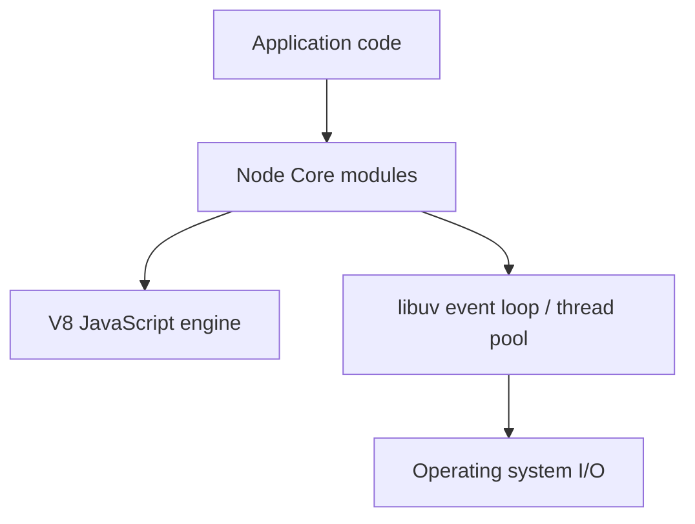
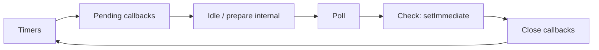
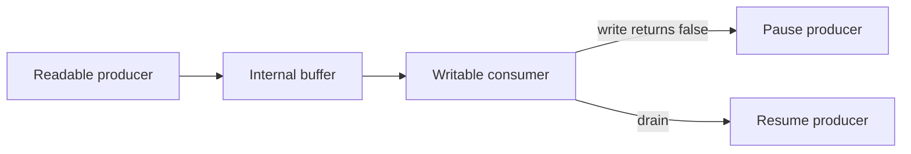
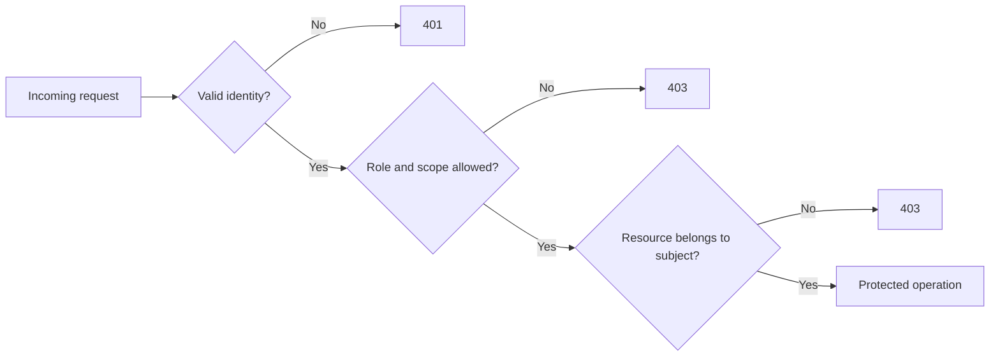
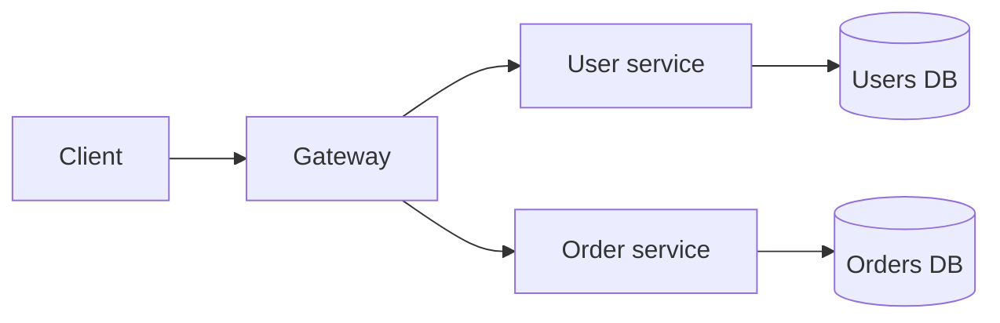
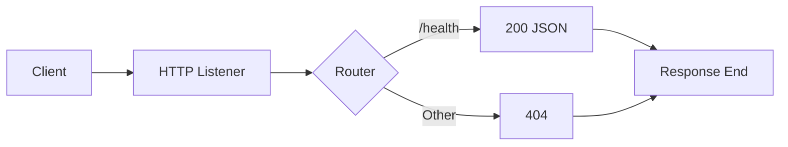
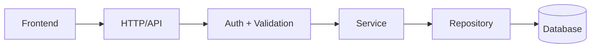
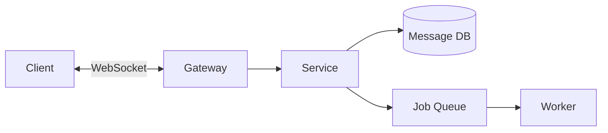

# Node.js Complete Knowledge Base - Từ nền tảng đến chuyên sâu

> **TL;DR:** Tài liệu tra cứu và giải thích toàn diện 123 chương về Node.js, từ runtime, bất đồng bộ, Core APIs, HTTP, Express, database, security đến performance và production. Nội dung trình bày khái niệm, cơ chế, ví dụ code, giải thích kết quả và lỗi thường gặp; **không có bài tập, quiz hoặc yêu cầu tự thực hành**.

> [!IMPORTANT]
> **Phạm vi nguồn:** Chỉ sử dụng [Node.js Official API Documentation](https://nodejs.org/docs/latest/api/) và [W3Schools Node.js Tutorial](https://www.w3schools.com/nodejs/default.asp), bao gồm tài liệu con thuộc hai website đó. Ví dụ và diễn giải được biên soạn lại, không sao chép nguyên văn. Các phần `Express`, `socket.io`, MySQL, MongoDB, GraphQL và GPIO cần package/phần cứng/dịch vụ ngoài Node Core.
>
> **Mốc đối chiếu: 26/10/2026.** Tại thời điểm biên soạn, tài liệu `latest` hiển thị Node v26.12.1. `node:sqlite` là *Release candidate*; `node:vfs` và `node:ffi` là *Experimental*. Trạng thái API cần được kiểm tra lại khi nâng cấp runtime.

## Mục lục

- [Cách đọc và phạm vi kiến thức](#cách-đọc-và-phạm-vi-kiến-thức)
- [Phần 0 - Tổng quan Node.js và định hướng tài liệu](#phần-0---tổng-quan-nodejs-và-định-hướng-tài-liệu)
  - [00. Node.js là gì và dùng để làm gì](#00-nodejs-là-gì-và-dùng-để-làm-gì)
  - [01. Hệ sinh thái và các lớp kiến trúc Node.js](#01-hệ-sinh-thái-và-các-lớp-kiến-trúc-nodejs)
  - [02. Node.js so với JavaScript trong browser](#02-nodejs-so-với-javascript-trong-browser)
  - [03. Phiên bản Node.js, LTS và trạng thái API](#03-phiên-bản-nodejs-lts-và-trạng-thái-api)
  - [04. Chuẩn bị môi trường và các công cụ](#04-chuẩn-bị-môi-trường-và-các-công-cụ)
  - [05. Hệ thống hóa cách tra cứu tài liệu Node.js](#05-hệ-thống-hóa-cách-tra-cứu-tài-liệu-nodejs)
- [Phần I - JavaScript Runtime và lập trình bất đồng bộ](#phần-i---javascript-runtime-và-lập-trình-bất-đồng-bộ)
  - [06. Execution Model, Call Stack và tác vụ I/O](#06-execution-model-call-stack-và-tác-vụ-io)
  - [07. Event Loop và các phase trong Node.js](#07-event-loop-và-các-phase-trong-nodejs)
  - [08. Microtasks, nextTick và thứ tự thực thi](#08-microtasks-nexttick-và-thứ-tự-thực-thi)
  - [09. Callback và quy ước error-first](#09-callback-và-quy-ước-error-first)
  - [10. Promise và bất đồng bộ trong Node.js](#10-promise-và-bất-đồng-bộ-trong-nodejs)
  - [11. Async và await trong ứng dụng máy chủ](#11-async-và-await-trong-ứng-dụng-máy-chủ)
  - [12. Timers và điều phối công việc theo thời gian](#12-timers-và-điều-phối-công-việc-theo-thời-gian)
  - [13. EventEmitter và kiến trúc hướng sự kiện](#13-eventemitter-và-kiến-trúc-hướng-sự-kiện)
  - [14. Error Handling trong Node.js](#14-error-handling-trong-nodejs)
  - [15. AsyncLocalStorage và ngữ cảnh bất đồng bộ](#15-asynclocalstorage-và-ngữ-cảnh-bất-đồng-bộ)
- [Phần II - Modules, Package Manager và phụ thuộc](#phần-ii---modules-package-manager-và-phụ-thuộc)
  - [16. CommonJS Module System](#16-commonjs-module-system)
  - [17. ECMAScript Modules](#17-ecmascript-modules)
  - [18. CommonJS và ESM interoperability](#18-commonjs-và-esm-interoperability)
  - [19. Module Resolution và package exports](#19-module-resolution-và-package-exports)
  - [20. Module API và customization hooks](#20-module-api-và-customization-hooks)
  - [21. NPM và hệ sinh thái package](#21-npm-và-hệ-sinh-thái-package)
  - [22. package.json và npm scripts](#22-packagejson-và-npm-scripts)
  - [23. Quản lý phụ thuộc và phát hành package](#23-quản-lý-phụ-thuộc-và-phát-hành-package)
- [Phần III - Runtime Globals và Core System APIs](#phần-iii---runtime-globals-và-core-system-apis)
  - [24. Globals và các Web APIs khả dụng](#24-globals-và-các-web-apis-khả-dụng)
  - [25. Process API và tiến trình Node.js](#25-process-api-và-tiến-trình-nodejs)
  - [26. Environment Variables và quản lý cấu hình](#26-environment-variables-và-quản-lý-cấu-hình)
  - [27. CLI Options và Runtime Flags](#27-cli-options-và-runtime-flags)
  - [28. Console và hệ thống log cơ bản](#28-console-và-hệ-thống-log-cơ-bản)
  - [29. Utility APIs](#29-utility-apis)
  - [30. Operating System API](#30-operating-system-api)
  - [31. Path Module và đường dẫn đa nền tảng](#31-path-module-và-đường-dẫn-đa-nền-tảng)
  - [32. URL và URLSearchParams](#32-url-và-urlsearchparams)
  - [33. Querystring, Punycode và các API cũ](#33-querystring-punycode-và-các-api-cũ)
  - [34. Buffer và Binary Data](#34-buffer-và-binary-data)
  - [35. String Decoder và Unicode](#35-string-decoder-và-unicode)
  - [36. Readline, REPL và TTY](#36-readline-repl-và-tty)
  - [37. Internationalization và ICU](#37-internationalization-và-icu)
- [Phần IV - File System, Streams và dữ liệu lớn](#phần-iv---file-system-streams-và-dữ-liệu-lớn)
  - [38. File System fundamentals](#38-file-system-fundamentals)
  - [39. fs/promises và quản lý tài nguyên file](#39-fspromises-và-quản-lý-tài-nguyên-file)
  - [40. File Watching và filesystem events](#40-file-watching-và-filesystem-events)
  - [41. Streams: Readable và Writable](#41-streams-readable-và-writable)
  - [42. Streams: Backpressure và Pipeline](#42-streams-backpressure-và-pipeline)
  - [43. Duplex, Transform và stream composition](#43-duplex-transform-và-stream-composition)
  - [44. Iterable Streams và async iteration](#44-iterable-streams-và-async-iteration)
  - [45. Web Streams API và khả năng tương tác](#45-web-streams-api-và-khả-năng-tương-tác)
  - [46. File uploads và xử lý tệp an toàn](#46-file-uploads-và-xử-lý-tệp-an-toàn)
  - [47. Zlib và nén/giải nén](#47-zlib-và-néngiải-nén)
  - [48. Virtual File System - API chuyên biệt](#48-virtual-file-system---api-chuyên-biệt)
- [Phần V - Network Protocols và HTTP Server](#phần-v---network-protocols-và-http-server)
  - [49. Networking fundamentals và mô hình giao thức](#49-networking-fundamentals-và-mô-hình-giao-thức)
  - [50. TCP Socket và node:net](#50-tcp-socket-và-nodenet)
  - [51. DNS Lookup và Resolve](#51-dns-lookup-và-resolve)
  - [52. UDP và Datagram](#52-udp-và-datagram)
  - [53. TLS/SSL và kết nối mã hóa](#53-tlsssl-và-kết-nối-mã-hóa)
  - [54. HTTP Core: request, response, status, header](#54-http-core-request-response-status-header)
  - [55. Xây dựng HTTP Server bằng Node Core](#55-xây-dựng-http-server-bằng-node-core)
  - [56. HTTP Client, connection pool và Agent](#56-http-client-connection-pool-và-agent)
  - [57. HTTPS và HTTPS Server](#57-https-và-https-server)
  - [58. HTTP/2 và Multiplexing](#58-http2-và-multiplexing)
  - [59. Fetch API trong Node.js](#59-fetch-api-trong-nodejs)
  - [60. WebSocket và Socket.IO](#60-websocket-và-socketio)
- [Phần VI - Thiết kế ứng dụng Backend và giao tiếp API](#phần-vi---thiết-kế-ứng-dụng-backend-và-giao-tiếp-api)
  - [61. Các framework Node.js và vai trò của Express](#61-các-framework-nodejs-và-vai-trò-của-express)
  - [62. Express.js nền tảng](#62-expressjs-nền-tảng)
  - [63. Middleware Architecture](#63-middleware-architecture)
  - [64. REST API Design và HTTP Semantics](#64-rest-api-design-và-http-semantics)
  - [65. Authentication và Authorization trong API](#65-authentication-và-authorization-trong-api)
  - [66. Frontend Integration, CORS và Proxy](#66-frontend-integration-cors-và-proxy)
  - [67. API Validation, Error Contract và Rate Limiting](#67-api-validation-error-contract-và-rate-limiting)
  - [68. GraphQL trong hệ sinh thái Node.js](#68-graphql-trong-hệ-sinh-thái-nodejs)
  - [69. Ứng dụng real-time: chat, notifications, presence](#69-ứng-dụng-real-time-chat-notifications-presence)
  - [70. Microservices và communication patterns](#70-microservices-và-communication-patterns)
- [Phần VII - Database Integration và Data Access](#phần-vii---database-integration-và-data-access)
  - [71. Cơ sở dữ liệu trong Node.js và connection management](#71-cơ-sở-dữ-liệu-trong-nodejs-và-connection-management)
  - [72. MySQL: kết nối, database và table](#72-mysql-kết-nối-database-và-table)
  - [73. MySQL: CRUD, filter, order và pagination](#73-mysql-crud-filter-order-và-pagination)
  - [74. MongoDB: document, collection và kết nối](#74-mongodb-document-collection-và-kết-nối)
  - [75. MongoDB: CRUD, query và aggregation](#75-mongodb-crud-query-và-aggregation)
  - [76. SQLite built-in API trong Node.js](#76-sqlite-built-in-api-trong-nodejs)
  - [77. Kiến trúc Data Access và lỗi thường gặp](#77-kiến-trúc-data-access-và-lỗi-thường-gặp)
- [Phần VIII - Security, Cryptography và Runtime Isolation](#phần-viii---security-cryptography-và-runtime-isolation)
  - [78. Threat Model và Node.js Security Fundamentals](#78-threat-model-và-nodejs-security-fundamentals)
  - [79. Cryptography bằng node:crypto](#79-cryptography-bằng-nodecrypto)
  - [80. Web Crypto API và chuẩn SubtleCrypto](#80-web-crypto-api-và-chuẩn-subtlecrypto)
  - [81. Permission Model và giới hạn truy cập](#81-permission-model-và-giới-hạn-truy-cập)
  - [82. Secrets, Credentials và cấu hình bảo mật](#82-secrets-credentials-và-cấu-hình-bảo-mật)
  - [83. Network Security và bảo vệ HTTP API](#83-network-security-và-bảo-vệ-http-api)
  - [84. File, Serialization và Dynamic Code Risks](#84-file-serialization-và-dynamic-code-risks)
  - [85. Dependencies, Deprecated APIs và cập nhật phiên bản](#85-dependencies-deprecated-apis-và-cập-nhật-phiên-bản)
- [Phần IX - Testing, Debugging và Diagnostics](#phần-ix---testing-debugging-và-diagnostics)
  - [86. Assertions và mô hình kiểm thử Node](#86-assertions-và-mô-hình-kiểm-thử-node)
  - [87. Node.js Built-in Test Runner](#87-nodejs-built-in-test-runner)
  - [88. Mocks, Test Coverage và Testing Strategies](#88-mocks-test-coverage-và-testing-strategies)
  - [89. Debugger, Inspector và Source Maps](#89-debugger-inspector-và-source-maps)
  - [90. Advanced Debugging và Error Reports](#90-advanced-debugging-và-error-reports)
  - [91. Logging và Observability](#91-logging-và-observability)
  - [92. Diagnostics Channel và Trace Events](#92-diagnostics-channel-và-trace-events)
  - [93. Code Quality: Linting, Formatting và Reviews](#93-code-quality-linting-formatting-và-reviews)
- [Phần X - Performance, Parallelism và Scaling](#phần-x---performance-parallelism-và-scaling)
  - [94. Performance Model: event loop, latency và throughput](#94-performance-model-event-loop-latency-và-throughput)
  - [95. Performance Hooks và Benchmark Runner](#95-performance-hooks-và-benchmark-runner)
  - [96. V8, Garbage Collection và Memory](#96-v8-garbage-collection-và-memory)
  - [97. Worker Threads và CPU-bound Tasks](#97-worker-threads-và-cpu-bound-tasks)
  - [98. Child Process và Subprocess Management](#98-child-process-và-subprocess-management)
  - [99. Cluster Module và multi-process servers](#99-cluster-module-và-multi-process-servers)
  - [100. Cross-thread, cross-process Messaging](#100-cross-thread-cross-process-messaging)
  - [101. Scaling network and data pipelines](#101-scaling-network-and-data-pipelines)
  - [102. Monitoring bottlenecks và tuning an toàn](#102-monitoring-bottlenecks-và-tuning-an-toàn)
- [Phần XI - TypeScript, Build và Production Lifecycle](#phần-xi---typescript-build-và-production-lifecycle)
  - [103. TypeScript trong Node.js hiện đại](#103-typescript-trong-nodejs-hiện-đại)
  - [104. Build Pipeline và Module Compatibility](#104-build-pipeline-và-module-compatibility)
  - [105. Configuration, Scripts và Toolchain](#105-configuration-scripts-và-toolchain)
  - [106. Dev vs Production, CI/CD](#106-dev-vs-production-cicd)
  - [107. Deployment, Graceful Shutdown và Operations](#107-deployment-graceful-shutdown-và-operations)
  - [108. Production Observability và SRE Basics](#108-production-observability-và-sre-basics)
- [Phần XII - Các API chuyên sâu và đặc thù](#phần-xii---các-api-chuyên-sâu-và-đặc-thù)
  - [109. Node.js Native Addons và Node-API](#109-nodejs-native-addons-và-node-api)
  - [110. C++ Embedder API và FFI](#110-c-embedder-api-và-ffi)
  - [111. VM Module và JavaScript Execution Context](#111-vm-module-và-javascript-execution-context)
  - [112. WebAssembly, WASI và tương tác native](#112-webassembly-wasi-và-tương-tác-native)
  - [113. Single Executable Applications](#113-single-executable-applications)
  - [114. SQLite và Virtual File System nâng cao](#114-sqlite-và-virtual-file-system-nâng-cao)
  - [115. Deprecations, Domain và Legacy APIs](#115-deprecations-domain-và-legacy-apis)
  - [116. API Reference Mapping và chuyên mục còn lại](#116-api-reference-mapping-và-chuyên-mục-còn-lại)
- [Phần XIII - Node.js trên thiết bị, phân tích hệ thống và tra cứu](#phần-xiii---nodejs-trên-thiết-bị-phân-tích-hệ-thống-và-tra-cứu)
  - [117. Node.js cho Raspberry Pi và IoT](#117-nodejs-cho-raspberry-pi-và-iot)
  - [118. Phân tích kiến trúc Web Server tối giản](#118-phân-tích-kiến-trúc-web-server-tối-giản)
  - [119. Phân tích kiến trúc REST API có Database và Auth](#119-phân-tích-kiến-trúc-rest-api-có-database-và-auth)
  - [120. Phân tích hệ thống Realtime và Background Jobs](#120-phân-tích-hệ-thống-realtime-và-background-jobs)
  - [121. Cheat Sheet API và sơ đồ quyết định công nghệ](#121-cheat-sheet-api-và-sơ-đồ-quyết-định-công-nghệ)
  - [122. Glossary, danh mục tham chiếu và phạm vi phiên bản](#122-glossary-danh-mục-tham-chiếu-và-phạm-vi-phiên-bản)
- [Bảng đối chiếu nguồn theo nhóm](#bảng-đối-chiếu-nguồn-theo-nhóm)
- [Cheat Sheet tổng hợp](#cheat-sheet-tổng-hợp)

---

## Cách đọc và phạm vi kiến thức

**Node.js Core** nghĩa là module/API có trong runtime theo phiên bản phù hợp. **Ecosystem** là thư viện/framework phải cài riêng. **External service** là server/database/hardware nằm ngoài runtime. Ba lớp này luôn được phân biệt trong ví dụ để tránh hiểu nhầm rằng Node tự có REST framework, database server hay Socket.IO.

| Nhóm | Ví dụ | Đặc điểm |
| :--- | :--- | :--- |
| Node Core | `node:fs`, `node:http`, `node:test` | Tra cứu trực tiếp trên Official API |
| Ecosystem | Express, Socket.IO, `mongodb`, `mysql2` | Cần package bên ngoài; theo W3Schools và giao diện minh họa |
| External | MySQL Server, MongoDB Server, Raspberry Pi GPIO | Cần hệ thống/phần cứng/quyền OS độc lập |
| Version-specific | `node:sqlite`, `node:vfs`, `node:ffi` | Trạng thái release candidate/experimental theo version |

> [!NOTE]
> **Về code:** Ví dụ độc lập thường là CommonJS (`require`). Những ví dụ ESM (`import`, top-level `await`), cần hai file, package ngoài, Internet hoặc phần cứng đều được đánh dấu trong phần giải thích. Kết quả có thể phụ thuộc hệ điều hành, Node version, network và dữ liệu ví dụ. Các sơ đồ contract/pseudocode không được coi là chương trình có thể chạy độc lập.

[↑ Về đầu trang](#mục-lục)

---

## Phần 0 - Tổng quan Node.js và định hướng tài liệu

> Định vị Node.js trong hệ sinh thái JavaScript, giới hạn runtime, phiên bản và phương pháp tra cứu nguồn gốc API.

### 00. Node.js là gì và dùng để làm gì

**Khái niệm và cơ chế**

Node.js là **môi trường thực thi JavaScript ngoài trình duyệt**: mã JavaScript chạy trên engine V8 và truy cập dịch vụ hệ điều hành qua các API của Node. Node không phải một ngôn ngữ mới, cũng không đồng nghĩa Express; `node:http` có thể tạo web server mà không cần framework. Sự kết hợp giữa mô hình hướng sự kiện và I/O không chặn phù hợp với lượng lớn request chờ network/file nhưng không tự làm phép tính CPU nặng nhanh hơn.

| Tình huống | Node.js có phù hợp? | Lý do |
| :--- | :--- | :--- |
| REST API, proxy, chat, CLI | Thường có | I/O bất đồng bộ và hệ sinh thái npm |
| Nén dữ liệu, xử lý ảnh CPU nặng | Có điều kiện | Cần worker/subprocess để không chặn event loop |
| Tác vụ GPU/scientific computing | Không mặc nhiên là lựa chọn tốt nhất | Cân nhắc native workloads và thư viện chuyên dụng |

**Những khía cạnh cần hiểu**

- Node.js như một JavaScript runtime ngoài trình duyệt.
- Runtime so với ngôn ngữ, framework và web server.
- Backend, REST API, real-time, CLI, automation, IoT.
- Điểm mạnh của I/O bất đồng bộ và những giới hạn CPU-bound.
- Những bài toán không nên mặc định chọn Node.js.

**Ví dụ minh họa**

```javascript
const http = require('node:http');
const server = http.createServer((req, res) => {
  res.writeHead(200, { 'Content-Type': 'text/plain; charset=utf-8' });
  res.end('Xin chào từ Node.js');
});
server.listen(3000, '127.0.0.1');
```

**Giải thích ví dụ**

`createServer` đăng ký callback cho mỗi request; `listen` mở cổng TCP tại loopback. Khi một client gọi `http://127.0.0.1:3000`, response HTTP có status `200` và thân `Xin chào từ Node.js`. Chương trình tiếp tục chạy vì socket server còn được giữ mở.

> [!WARNING]
> Code server chỉ phục vụ tại `127.0.0.1`; muốn cho mạng ngoài truy cập cần bind thích hợp và cấu hình firewall/reverse proxy. Đừng nhầm non-blocking I/O với mã JavaScript luôn chạy song song.

**Nguồn đối chiếu:** [Node Official — Usage](https://nodejs.org/docs/latest/api/synopsis.html) · [W3Schools Node.js Tutorial](https://www.w3schools.com/nodejs/default.asp)

### 01. Hệ sinh thái và các lớp kiến trúc Node.js

**Khái niệm và cơ chế**

Node.js gồm các tầng: V8 chạy JavaScript; Node Core cung cấp module như `fs`, `http`, `crypto`; libuv điều phối event loop và một số tác vụ thread pool; hệ điều hành thực hiện networking, file I/O và scheduling. Package bên ngoài như Express đặt **trên** nền này. Một request có thể bắt đầu trên JavaScript thread, giao I/O cho môi trường hệ thống, sau đó callback được xếp lịch để JavaScript xử lý kết quả.



Thread pool libuv không phải là nơi mọi đoạn JavaScript chạy; chủ yếu hỗ trợ một số loại công việc native như filesystem, DNS và crypto tùy API.

**Những khía cạnh cần hiểu**

- V8, Node.js Core và các thư viện native.
- libuv, hệ điều hành, event loop và thread pool.
- JavaScript execution thread so với worker threads.
- Core modules và third-party packages.
- Sơ đồ kiến trúc và vòng đời một ứng dụng Node.js.

**Ví dụ minh họa**

```javascript
const { versions, platform, arch } = process;
console.log({ node: versions.node, v8: versions.v8, platform, arch });
```

**Giải thích ví dụ**

Kết quả gồm version của runtime và V8, tên nền tảng hệ điều hành cùng kiến trúc CPU. Đây là metadata runtime, không mô tả số thread JavaScript đang chạy.

> [!WARNING]
> V8 là engine; libuv là lớp hỗ trợ I/O. Không được suy ra mọi tác vụ async đều sử dụng một thread riêng.

**Nguồn đối chiếu:** [Node Official — V8](https://nodejs.org/docs/latest/api/v8.html) · [Node Official — Process](https://nodejs.org/docs/latest/api/process.html) · [W3Schools Node.js — V8](https://www.w3schools.com/nodejs/nodejs_v8_engine.asp)

### 02. Node.js so với JavaScript trong browser

**Khái niệm và cơ chế**

JavaScript trong Node và trong browser dùng cùng ngôn ngữ ECMAScript nhưng **host APIs** khác. Browser có `document`, `window`, DOM; Node có `process`, `Buffer`, `node:fs`, `node:net`. Những API chuẩn web như `fetch`, `URL`, `AbortController`, `TextEncoder` hiện tồn tại trong Node hiện đại, nhưng mức hỗ trợ phụ thuộc version.

| Tên API | Browser | Node.js |
| :--- | :--- | :--- |
| `document.querySelector` | Có trong browser DOM | Không có DOM mặc định |
| `process.env` | Không phải Web API chuẩn | Có |
| `fetch`, `URL` | Có | Có trong Node hiện đại |
| `fs.readFile` | Không | Core API |

**Những khía cạnh cần hiểu**

- Window/DOM và môi trường Node.js.
- Các global phổ biến như console, fetch, URL, Buffer, process.
- Browser APIs so với Node built-in APIs.
- Phân biệt API tiêu chuẩn web và API đặc thù Node.
- Các giới hạn khi chia sẻ code frontend/backend.

**Ví dụ minh họa**

```javascript
console.log(typeof document); // "undefined" trong Node thông thường
console.log(typeof fetch);    // "function" trong Node hiện đại
console.log(process.platform); // vd. "linux", "win32", "darwin"
```

**Giải thích ví dụ**

`typeof document` tránh ReferenceError nếu global không tồn tại. `fetch` là API gọi HTTP, không phải quyền đọc DOM; `process.platform` trả thông tin môi trường chạy.

> [!WARNING]
> Không giả định tất cả package browser dùng được trong Node: nhiều package phụ thuộc DOM, canvas hoặc browser permissions.

**Nguồn đối chiếu:** [Node Official — Globals](https://nodejs.org/docs/latest/api/globals.html) · [Node Official — Process](https://nodejs.org/docs/latest/api/process.html) · [W3Schools Node.js — Requirements](https://www.w3schools.com/nodejs/nodejs_js_requirements.asp)

### 03. Phiên bản Node.js, LTS và trạng thái API

**Khái niệm và cơ chế**

**Current** phát hành tính năng mới nhanh; **LTS** đặt trọng tâm bảo trì và độ ổn định. Phần API Official liệt kê `Added in`, thay đổi theo version và `Stability` — thông tin quan trọng hơn suy đoán rằng API xuất hiện ở mọi máy. Node v26.12.1 là mốc trang `latest` khi tài liệu này được biên soạn (26/10/2026). Một số bản LTS phổ biến có thể thiếu các API thuộc v26.

Các nhãn **Experimental**, **Release candidate** hoặc **Deprecated** cần hiểu như tín hiệu về độ ổn định, khả năng thay đổi và chi phí nâng cấp; không tự đồng nhất `experimental` với "không hoạt động" hay `deprecated` với "đã xóa".

**Những khía cạnh cần hiểu**

- Current so với LTS và chiến lược cập nhật.
- SemVer và vòng đời hỗ trợ phiên bản.
- Stability Index: stable, experimental, release candidate, deprecated.
- Compatibility và tính năng phụ thuộc phiên bản.
- Cách đọc lịch sử thay đổi API trong tài liệu chính thức.

**Ví dụ minh họa**

```javascript
console.log(`Node ${process.versions.node}`);
console.log(`V8 ${process.versions.v8}`);
console.log(`OpenSSL ${process.versions.openssl}`);
```

**Giải thích ví dụ**

Những phiên bản xuất hiện phản ánh binary hiện chạy. Sử dụng `process.versions.node` tốt hơn dự đoán theo phiên bản npm hay hệ điều hành.

> [!WARNING]
> Mốc `latest` luôn thay đổi; các ví dụ về `node:ffi`, `node:vfs`, `node:sqlite` trong tài liệu này đều có cảnh báo trạng thái riêng.

**Nguồn đối chiếu:** [Node Official — About](https://nodejs.org/docs/latest/api/documentation.html) · [Node Official — Cli](https://nodejs.org/docs/latest/api/cli.html) · [W3Schools Node.js Tutorial](https://www.w3schools.com/nodejs/default.asp)

### 04. Chuẩn bị môi trường và các công cụ

**Khái niệm và cơ chế**

Môi trường tối thiểu thường gồm Node.js, npm, terminal và editor. `node` thực thi JavaScript; `npm` tải package, quản lý dependency và scripts. Một chương trình có thể chạy bằng `node app.js` mà không cần web server hoặc IDE riêng. Một thư mục dự án có `package.json` mô tả package, dependencies, entry point và scripts.

| Thành phần | Vai trò |
| :--- | :--- |
| `node` | Runtime/CLI |
| `npm` | Package manager |
| `package.json` | Manifest cho package và scripts |
| `package-lock.json` | Cố định đồ thị phụ thuộc phục vụ cài đặt tái lập |
| `.env` | File cấu hình cục bộ khi sử dụng; cần bảo vệ secret |

**Những khía cạnh cần hiểu**

- Cài Node.js và npm; lựa chọn trình quản lý phiên bản.
- Kiểm tra node, npm và kiến trúc hệ điều hành.
- VS Code, terminal, môi trường shell.
- Cấu trúc dự án tối thiểu và các file cấu hình.
- Phân biệt môi trường development, test, production.

**Ví dụ minh họa**

```bash
node --version
npm --version
npm init -y
node -e "console.log('runtime OK')"
node --watch app.js
```

**Giải thích ví dụ**

`-e` thực thi đoạn JavaScript từ command line. `--watch` chạy lại file khi thay đổi trong môi trường hỗ trợ; không thay thế chiến lược restart production.

> [!WARNING]
> Đừng đẩy token/password hoặc `.env` chứa secret lên repository; npm và Node có vòng đời version độc lập.

**Nguồn đối chiếu:** [Node Official — Usage](https://nodejs.org/docs/latest/api/synopsis.html) · [Node Official — Cli](https://nodejs.org/docs/latest/api/cli.html) · [W3Schools Node.js — Requirements](https://www.w3schools.com/nodejs/nodejs_js_requirements.asp)

### 05. Hệ thống hóa cách tra cứu tài liệu Node.js

**Khái niệm và cơ chế**

Index Node Official là **tài liệu tham khảo API theo module**, có phân loại stability, version history, exception và ví dụ. W3Schools là tuyến tài liệu giới thiệu theo chủ đề: kiến trúc, async, modules, database, realtime, IoT. Knowledge Base này sử dụng Official để đối chiếu chữ ký API và dùng W3Schools khi giải thích cách áp dụng.

Cần phân biệt ba tầng nguồn: (1) Core API như `node:fs` có trong Node; (2) package như `express` được cài từ npm; (3) dịch vụ ngoại vi như MySQL Server phải tồn tại riêng. Khi một trang W3Schools gọi MongoDB/GraphQL, đó không có nghĩa Node tích hợp những thứ này mặc định.

**Những khía cạnh cần hiểu**

- Cách đọc phần API index chính thức.
- Phân loại Core API, package cộng đồng và framework.
- Ý nghĩa lời cảnh báo, version history và security note.
- Nguyên tắc chọn ví dụ minh họa trong Knowledge Base.
- Tiêu chuẩn chú thích phiên bản và liên kết nguồn.

**Ví dụ minh họa**

```javascript
// Core module: không cần npm install
const { basename } = require('node:path');
console.log(basename('/srv/app/server.js')); // server.js
// Package bên ngoài: cần cài dependency riêng trước khi require/import
```

**Giải thích ví dụ**

Cú pháp `node:path` nói rõ đây là built-in; import của package bên ngoài được Node tìm qua cơ chế module resolution và danh sách package.

> [!WARNING]
> Tài liệu `latest` có thể thay đổi sau ngày biên soạn. Khi tra cứu cần chú ý đường dẫn API, version support, flag khởi chạy và compatibility.

**Nguồn đối chiếu:** [Node Official — About](https://nodejs.org/docs/latest/api/documentation.html) · [Node Official — Usage](https://nodejs.org/docs/latest/api/synopsis.html) · [W3Schools Node.js Tutorial](https://www.w3schools.com/nodejs/default.asp)

[↑ Về đầu trang](#mục-lục)

---

## Phần I - JavaScript Runtime và lập trình bất đồng bộ

> Các cơ chế điều phối công việc bất đồng bộ, callback, Promise, timers và những ranh giới tránh block event loop.

### 06. Execution Model, Call Stack và tác vụ I/O

**Khái niệm và cơ chế**

JavaScript được thực thi qua **call stack**: một function đang chạy giữ quyền điều khiển cho đến khi trả về hoặc nhường bằng cơ chế bất đồng bộ. Khi bắt đầu I/O async, Node đăng ký công việc rồi tiếp tục xử lý JavaScript khác; kết quả được báo lại qua callback/Promise. **Concurrency** là quản lý nhiều công việc còn dang dở, khác **parallelism** là nhiều phép tính cùng chạy trên CPU. CPU loop dài chặn callback xử lý request của cùng event loop.

**Những khía cạnh cần hiểu**

- Call stack và luồng JavaScript chính.
- I/O non-blocking và công việc CPU-bound.
- Vai trò libuv đối với I/O và thread pool.
- Đồng thời, song song và bất đồng bộ khác nhau ra sao.
- Mối quan hệ giữa event-driven và non-blocking.

**Ví dụ minh họa**

```javascript
const fs = require('node:fs');
console.log('A');
fs.readFile(__filename, () => console.log('C: file xong'));
console.log('B'); // A, B, rồi C (nếu callback được gọi thành công)
```

**Giải thích ví dụ**

`readFile` bắt đầu I/O rồi trả quyền ngay, vì vậy `B` xuất hiện trước callback `C`. Lúc callback chạy là sau khi Node nhận thông báo công việc hoàn tất; thời điểm chính xác phụ thuộc tải hệ thống.

> [!WARNING]
> Sử dụng `readFileSync` trong handler HTTP đông request có thể chặn event loop; đừng xem mọi callback là được thực thi song song.

**Nguồn đối chiếu:** [Node Official — V8](https://nodejs.org/docs/latest/api/v8.html) · [Node Official — Process](https://nodejs.org/docs/latest/api/process.html) · [W3Schools Node.js — Eventloop](https://www.w3schools.com/nodejs/nodejs_event_loop.asp)

### 07. Event Loop và các phase trong Node.js

**Khái niệm và cơ chế**

Event loop quyết định **khi nào callback đủ điều kiện được chạy**. Các phase quan trọng gồm timers, pending callbacks, poll, check và close callbacks; Node có thêm thứ tự xử lý nextTick/microtasks. `setImmediate` liên quan check phase, còn `setTimeout` hẹn khoảng thời gian tối thiểu; thứ tự của chúng ở top-level không được bảo đảm hoàn toàn. Các thay đổi libuv theo version có thể ảnh hưởng thứ tự giữa timers và poll.



**Những khía cạnh cần hiểu**

- Timers, pending callbacks, poll, check, close callbacks.
- Chu kỳ event loop và cách callback được lập lịch.
- Thứ tự và ngoại lệ phụ thuộc môi trường hoặc phiên bản.
- Khi nào event loop bị block.
- Phân tích timeline nhiều callback cạnh tranh.

**Ví dụ minh họa**

```javascript
const fs = require('node:fs');
fs.readFile(__filename, () => {
  setTimeout(() => console.log('timeout'), 0);
  setImmediate(() => console.log('immediate'));
});
```

**Giải thích ví dụ**

Trong callback I/O, `setImmediate` thường được xử lý ở check phase trước timer 0ms của vòng sau. Phát biểu này áp dụng ngữ cảnh I/O minh họa, không nên ngoại suy thành quy tắc mọi nơi.

> [!WARNING]
> Event loop phase không phải hàng đợi FIFO toàn cục. Độ trễ timer không đúng tuyệt đối do callback khác, OS scheduling và tải CPU.

**Phân tích sâu: event loop và quy tắc lập lịch**

Event loop không phải một hàng đợi đơn. Mỗi phase xử lý loại callback khác nhau; bản thân callback JavaScript vẫn chạy đến khi nhường điều khiển. Do đó, `setTimeout(fn, 0)` có nghĩa callback **không được chạy trước ngưỡng timer**, chứ không được cam kết chạy ngay tức khắc. Callback `fs.readFile` có thời điểm hoàn thành phụ thuộc I/O; callback được xử lý sau khi có sự kiện phù hợp, không đồng nghĩa file luôn nằm trên một thread JavaScript khác.

| Ngữ cảnh | Điều thường đúng | Điều không được suy ra |
| :--- | :--- | :--- |
| Callback I/O | `setImmediate` thường chạy trước `setTimeout(0)` được đặt cùng callback | Mọi `setImmediate` luôn sớm hơn timer |
| Top-level script | Thứ tự giữa hai API có thể thay đổi | Một lần thử quyết định thứ tự cho mọi runtime |
| CPU loop kéo dài | Timer, network callbacks bị trì hoãn | Đặt timer khiến đoạn CPU-bound thành bất đồng bộ |
| Promise continuation | Chạy trong microtask checkpoint thích hợp | Promise callback là một event-loop phase riêng giống `poll` |

Điểm quan trọng là phân biệt **đăng ký công việc**, **I/O hoàn thành**, **callback đủ điều kiện**, và **callback thực thi**. Đây là bốn mốc khác nhau. Khi phân tích độ trễ, cần xác định callback nào giữ event loop và những tác vụ native nào vẫn đang chờ.

**Nguồn đối chiếu:** [Node Official — Timers](https://nodejs.org/docs/latest/api/timers.html) · [Node Official — Process](https://nodejs.org/docs/latest/api/process.html) · [W3Schools Node.js — Eventloop](https://www.w3schools.com/nodejs/nodejs_event_loop.asp)

### 08. Microtasks, nextTick và thứ tự thực thi

**Khái niệm và cơ chế**

Microtask xử lý continuation của Promise; Node còn có `process.nextTick()` với cách lập lịch riêng. Trong ngữ cảnh CommonJS thông thường, callback nextTick thường chạy trước Promise microtasks sau khi stack hiện tại kết thúc; trong một số ngữ cảnh ESM, thứ tự có thể khác vì module được đánh giá trong một job microtask. `queueMicrotask()` gần với Promise job hơn nextTick. Lạm dụng đăng ký nextTick đệ quy khiến I/O bị đói lịch (**starvation**).

**Những khía cạnh cần hiểu**

- Promise microtask queue và queueMicrotask.
- process.nextTick và mức ưu tiên cần lưu ý.
- setTimeout so với setImmediate.
- Khác biệt CommonJS và ESM liên quan đến thứ tự.
- Starvation và chiến lược tránh chiếm vòng lặp.

**Ví dụ minh họa**

```javascript
console.log('sync');
process.nextTick(() => console.log('nextTick'));
Promise.resolve().then(() => console.log('promise'));
queueMicrotask(() => console.log('microtask'));
// CommonJS top-level thường: sync -> nextTick -> promise -> microtask
```

**Giải thích ví dụ**

`sync` in tức thì. Sau stack, Node xử lý hàng nextTick và hàng microtask theo runtime semantics. Hai callback Promise và queueMicrotask được lên hàng theo thứ tự đã đăng ký.

> [!WARNING]
> Thứ tự `setTimeout(...,0)` và `setImmediate` top-level không phải hợp đồng ổn định; cần xét tình huống trước khi khẳng định output.

**Nguồn đối chiếu:** [Node Official — Process](https://nodejs.org/docs/latest/api/process.html) · [Node Official — Timers](https://nodejs.org/docs/latest/api/timers.html) · [W3Schools Node.js — Eventloop](https://www.w3schools.com/nodejs/nodejs_event_loop.asp)

### 09. Callback và quy ước error-first

**Khái niệm và cơ chế**

Một số Core APIs cung cấp hàm callback theo mẫu **error-first** `(err, value)`: nếu lỗi, `err` thường là đối tượng `Error` và dữ liệu không dùng được. `util.promisify` có thể tạo wrapper Promise cho những hàm tuân theo quy ước phù hợp. Cần phân biệt API sync (`throw` ngay), API callback (trả lỗi qua callback) và Promise API (`reject`).

**Những khía cạnh cần hiểu**

- Callback-based API và chữ ký (err, result).
- Propagation lỗi, callback hell.
- Chuyển callback thành Promise với util.promisify.
- So sánh API sync, callback và promises.
- Ví dụ xử lý file hoặc I/O với callback.

**Ví dụ minh họa**

```javascript
const fs = require('node:fs');
fs.readFile('./message.txt', 'utf8', (err, text) => {
  if (err) {
    console.error(err.code); // vd. ENOENT
    return;
  }
  console.log(text);
});
```

**Giải thích ví dụ**

`readFile` trả quyền trước khi I/O xong; callback nhận `err` khi không đọc được hoặc `text` khi thành công. `return` ngay nhánh lỗi tránh code phía sau xử lý dữ liệu chưa hợp lệ.

> [!WARNING]
> `try/catch` bọc bên ngoài `readFile(..., callback)` không tự bắt lỗi được callback đưa vào sau; phải xử lý trong callback hoặc chuyển sang Promise.

**Nguồn đối chiếu:** [Node Official — Errors](https://nodejs.org/docs/latest/api/errors.html) · [Node Official — Fs](https://nodejs.org/docs/latest/api/fs.html) · [W3Schools Node.js Tutorial](https://www.w3schools.com/nodejs/default.asp)

### 10. Promise và bất đồng bộ trong Node.js

**Khái niệm và cơ chế**

Promise biểu diễn kết quả **sẽ có hoặc thất bại**. Một Promise đã settle không đổi trạng thái. `Promise.all` thành công khi tất cả thành công, reject ngay khi một Promise reject; nó **không tự hủy** công việc còn lại. `allSettled` thu đủ kết quả; `race` lấy Promise settle đầu tiên; `any` lấy fulfill đầu tiên hoặc reject AggregateError nếu tất cả reject. Nhiều API Node có phiên bản `node:fs/promises`, `node:timers/promises`.

**Những khía cạnh cần hiểu**

- Promise lifecycle, chaining và error propagation.
- Promise.all, allSettled, race và any.
- Promise APIs tích hợp trong Node Core.
- AbortSignal và cancellation trong API hỗ trợ.
- Xử lý unhandled rejection đúng cách.

**Ví dụ minh họa**

```javascript
const { setTimeout: delay } = require('node:timers/promises');
async function getData() {
  const [a, b] = await Promise.all([delay(10, 'A'), delay(20, 'B')]);
  console.log(a + b); // AB
}
getData().catch(console.error);
```

**Giải thích ví dụ**

Hai timer bắt đầu trước `await`, nên thời gian chờ xấp xỉ timer lâu nhất chứ không phải cộng dồn. Giá trị trả về Promise được gom theo thứ tự phần tử input, không theo thứ tự hoàn thành.

> [!WARNING]
> Không bỏ trôi rejection: Promise bị reject mà không có handler có thể dẫn đến xử lý lỗi tiến trình tùy phiên bản/cấu hình.

**Nguồn đối chiếu:** [Node Official — Timers](https://nodejs.org/docs/latest/api/timers.html) · [Node Official — Util](https://nodejs.org/docs/latest/api/util.html) · [W3Schools Node.js Tutorial](https://www.w3schools.com/nodejs/default.asp)

### 11. Async và await trong ứng dụng máy chủ

**Khái niệm và cơ chế**

`async` luôn tạo hàm trả về Promise. `await` tạm ngừng continuation của hàm async, **không dừng toàn bộ tiến trình**; event loop vẫn có thể xử lý request khác. Khi công việc độc lập, khởi tạo sớm rồi `Promise.all` giúp chồng lấp I/O. Khi bước B phụ thuộc kết quả A, phải chạy tuần tự. `try/catch` trong async bắt lỗi reject được `await` cũng như `throw` đồng bộ.

**Những khía cạnh cần hiểu**

- async function và await.
- Chạy tuần tự so với đồng thời có kiểm soát.
- try/catch với async; return và throw.
- Promise-based file, network và database flows.
- Async resource cleanup và tránh bỏ quên await.

**Ví dụ minh họa**

```javascript
const { setTimeout: delay } = require('node:timers/promises');
async function main() {
  const first = delay(20, 10);
  const second = delay(20, 20);
  const values = await Promise.all([first, second]);
  console.log(values.reduce((a,b) => a+b, 0)); // 30
}
main().catch(console.error);
```

**Giải thích ví dụ**

`first` và `second` chạy đồng thời về mặt lập lịch; `await` chỉ chờ cả hai xong. Reduce tạo tổng 30. Chạy `await delay` hai lần liên tiếp sẽ đợi tuần tự.

> [!WARNING]
> `array.forEach(async ...)` không chờ các Promise được trả ra; dùng `Promise.all(array.map(...))` hoặc `for...of` với `await` tùy nhu cầu.

**Nguồn đối chiếu:** [Node Official — Errors](https://nodejs.org/docs/latest/api/errors.html) · [Node Official — Fs](https://nodejs.org/docs/latest/api/fs.html) · [W3Schools Node.js Tutorial](https://www.w3schools.com/nodejs/default.asp)

### 12. Timers và điều phối công việc theo thời gian

**Khái niệm và cơ chế**

`setTimeout` chạy một lần sau khoảng chờ **tối thiểu gần đúng**; `setInterval` lặp theo lịch nhưng có thể bị trễ; `setImmediate` xếp công việc vào check phase. `ref()`/`unref()` quyết định timer có giữ event loop sống. `node:timers/promises` cung cấp Promise cho timer và một số lựa chọn hủy qua AbortSignal.

**Những khía cạnh cần hiểu**

- setTimeout, setInterval, setImmediate.
- timers/promises API.
- timer.ref, unref và vòng đời process.
- AbortController cho timer hỗ trợ hủy.
- Timers không bảo đảm thời điểm thực thi tuyệt đối.

**Ví dụ minh họa**

```javascript
const { setTimeout: delay } = require('node:timers/promises');
const controller = new AbortController();
controller.abort();
delay(1_000, 'done', { signal: controller.signal })
  .then(console.log)
  .catch(err => console.log(err.name)); // AbortError
```

**Giải thích ví dụ**

AbortSignal đã ở trạng thái aborted nên Promise bị reject với lỗi hủy; `catch` ghi tên `AbortError`. Đây là cancellation được API timer hỗ trợ, không phải tất cả Promise đều có khả năng hủy.

> [!WARNING]
> Timer không thích hợp làm clock chính xác tuyệt đối; ưu tiên `performance.now()` hoặc đồng hồ đo khoảng thời gian phù hợp khi đo hiệu năng.

**Nguồn đối chiếu:** [Node Official — Timers](https://nodejs.org/docs/latest/api/timers.html) · [W3Schools Node.js Tutorial](https://www.w3schools.com/nodejs/default.asp)

### 13. EventEmitter và kiến trúc hướng sự kiện

**Khái niệm và cơ chế**

`EventEmitter` cho phép module phát ra thông báo (`emit`) và nhiều listener đăng ký (`on`, `once`). Việc gọi `emit` thông thường **đồng bộ**, chạy listener theo thứ tự đăng ký. Sự kiện tên `error` đặc biệt: nếu phát lỗi mà không có listener phù hợp, process có thể ném lỗi. Cảnh báo `MaxListenersExceededWarning` là dấu hiệu có thể đăng ký listener trùng/lâu sống quá mức, không phải giới hạn cứng.

**Những khía cạnh cần hiểu**

- on, once, off, emit, listeners.
- Sự kiện error và cách propagation.
- EventEmitter và async listener.
- EventTarget và EventEmitter khác nhau.
- Memory leak warnings, maxListeners, captureRejections.

**Ví dụ minh họa**

```javascript
const { EventEmitter } = require('node:events');
const bus = new EventEmitter();
bus.on('order', id => console.log('received', id));
bus.once('order', id => console.log('first order', id));
bus.emit('order', 3); // received 3; first order 3
bus.emit('order', 4); // received 4
```

**Giải thích ví dụ**

Listener `on` được gọi cả hai lần; `once` tự hủy sau lần phát đầu. Vì `emit` đồng bộ, các log xuất hiện trước khi lệnh `emit` trả quyền.

> [!WARNING]
> Listener `async` trả Promise nhưng EventEmitter cơ bản không tự `await` nó; lỗi bất đồng bộ phải được xử lý/cấu hình phù hợp.

**Nguồn đối chiếu:** [Node Official — Events](https://nodejs.org/docs/latest/api/events.html) · [W3Schools Node.js Tutorial](https://www.w3schools.com/nodejs/default.asp)

### 14. Error Handling trong Node.js

**Khái niệm và cơ chế**

Lỗi Node đến dưới nhiều kênh: `throw` đồng bộ, `Promise.reject` bất đồng bộ, callback `(err)`, hoặc event `error` trên Stream/EventEmitter. **Programmer errors** như TypeError do code sai thường cần sửa; **operational errors** như `ENOENT`, timeout là trạng thái ngoại cảnh cần phản hồi phù hợp. `Error.cause` lưu nguyên nhân gốc khi bao lỗi ở tầng cao; `error.code` thường ổn định để phân nhánh hơn so sánh nguyên văn `message`.

**Những khía cạnh cần hiểu**

- Operational error và programmer error.
- Error, Error.cause và system errors.
- Error event, exception, promise rejection.
- Stack trace và mã lỗi Node.js.
- Chiến lược chuyển lỗi thành response an toàn.

**Ví dụ minh họa**

```javascript
const fs = require('node:fs/promises');
async function load(path) {
  try { return await fs.readFile(path, 'utf8'); }
  catch (cause) { throw new Error('Cannot load config', { cause }); }
}
load('./missing.json').catch(e => {
  console.log(e.message);      // Cannot load config
  console.log(e.cause.code);   // ENOENT (nếu file không tồn tại)
});
```

**Giải thích ví dụ**

Tầng `load` cung cấp thông điệp thuộc ngữ cảnh ứng dụng và giữ nguyên `cause` giúp log nội bộ phân tích được nguyên nhân filesystem.

> [!WARNING]
> Không trả thẳng stack trace, đường dẫn nội bộ hay token ra HTTP response. `uncaughtException` không phải cơ chế tiếp tục xử lý an toàn sau lỗi bất ngờ.

**Nguồn đối chiếu:** [Node Official — Errors](https://nodejs.org/docs/latest/api/errors.html) · [Node Official — Process](https://nodejs.org/docs/latest/api/process.html) · [W3Schools Node.js Tutorial](https://www.w3schools.com/nodejs/default.asp)

### 15. AsyncLocalStorage và ngữ cảnh bất đồng bộ

**Khái niệm và cơ chế**

`AsyncLocalStorage` lưu **ngữ cảnh logic của một chuỗi bất đồng bộ** như request ID, không yêu cầu truyền tham số qua mọi function. `run(store, callback)` thiết lập ngữ cảnh rồi đưa callback chạy; `getStore()` đọc ngữ cảnh trong các continuation được liên kết. `AsyncResource` dùng khi viết abstraction async đặc biệt. Async hooks thấp tầng thường phù hợp công cụ tracing hơn code nghiệp vụ.

**Những khía cạnh cần hiểu**

- AsyncLocalStorage: run, getStore và bind.
- Request ID và correlation context.
- AsyncResource và custom async operation.
- Context propagation/loss và troubleshooting.
- Phân biệt API cấp cao ổn định với async_hooks cấp thấp.

**Ví dụ minh họa**

```javascript
const { AsyncLocalStorage } = require('node:async_hooks');
const als = new AsyncLocalStorage();
async function detail() {
  await Promise.resolve();
  console.log(als.getStore().requestId); // req-42
}
als.run({ requestId: 'req-42' }, detail);
```

**Giải thích ví dụ**

Ngữ cảnh `requestId` tiếp tục theo Promise continuation nên `detail()` không cần nhận request ID bằng tham số. Với các request song song, mỗi `run` có store riêng theo chuỗi async context.

> [!WARNING]
> Không xem AsyncLocalStorage là nơi lưu biến chia sẻ tùy tiện; giữ dữ liệu nhỏ, xác định vòng đời và xử lý context loss nếu dùng callback API tùy biến.

**Nguồn đối chiếu:** [Node Official — Async Context](https://nodejs.org/docs/latest/api/async_context.html) · [Node Official — Async Hooks](https://nodejs.org/docs/latest/api/async_hooks.html)

[↑ Về đầu trang](#mục-lục)

---

## Phần II - Modules, Package Manager và phụ thuộc

> Tổ chức code theo CJS/ESM và quản lý package, dependency graph cùng hợp đồng public exports.

### 16. CommonJS Module System

**Khái niệm và cơ chế**

CommonJS dùng `require`, `module.exports`, `exports`. Mỗi file CommonJS được bọc trong module scope, vì thế biến top-level không tự là global. Node cache module sau khi tải lần đầu theo định danh đã giải quyết; lần `require` kế tiếp thường lấy lại đối tượng exports. `module.exports = value` xuất cả giá trị, còn `exports.x = ...` cập nhật thuộc tính trên object export mặc định.

**Những khía cạnh cần hiểu**

- require, module.exports và exports.
- Module wrapper và các biến đặc thù.
- Module cache, dependency graph, circular dependency.
- JSON và core module imports.
- CJS resolution cùng lỗi thường gặp.

**Ví dụ minh họa**

```javascript
// math.cjs
module.exports = { square(x) { return x * x; } };
// app.cjs
const { square } = require('./math.cjs');
console.log(square(4)); // 16
```

**Giải thích ví dụ**

`require` đồng bộ tải, thực thi file module nếu chưa cache, rồi trả `module.exports`. `square` chỉ được export, không phải hàm toàn cục.

> [!WARNING]
> `exports = { ... }` chỉ gán lại biến cục bộ, thường không thay `module.exports`; cũng cần lưu ý circular dependencies có thể nhận exports chưa hoàn chỉnh.

**Nguồn đối chiếu:** [Node Official — Cjs](https://nodejs.org/docs/latest/api/modules.html) · [Node Official — Packages](https://nodejs.org/docs/latest/api/packages.html)

### 17. ECMAScript Modules

**Khái niệm và cơ chế**

ES Modules dùng `import`/`export` tĩnh để Node biết dependency graph; mặc định file `.mjs` là ESM, `.cjs` là CommonJS, `.js` phụ thuộc cấu hình package và syntax detection theo version. ES Module hỗ trợ `import.meta.url`, top-level await và live bindings: module nhập nhìn thấy giá trị export được cập nhật. Module resolution ESM nghiêm ngặt hơn với phần mở rộng và URL.

**Những khía cạnh cần hiểu**

- import, export, default và named export.
- Static import và dynamic import.
- import.meta và file URLs.
- Top-level await; dependency evaluation.
- Cú pháp, lỗi và hỗ trợ Node version.

**Ví dụ minh họa**

```javascript
// counter.mjs
export let count = 0;
export function increase() { count++; }
```

```javascript
// app.mjs
import { count, increase } from './counter.mjs';
increase();
console.log(count); // 1
```

**Giải thích ví dụ**

`count` là live binding; import không tạo bản snapshot `0`. `increase` trong module định nghĩa sửa `count`, module dùng nó đọc được `1`.

> [!WARNING]
> Không dùng `require` trực tiếp như biến built-in mặc định trong ESM; cần phân biệt cú pháp import với lúc module thật sự được tải/evaluate.

**Nguồn đối chiếu:** [Node Official — Esm](https://nodejs.org/docs/latest/api/esm.html) · [Node Official — Packages](https://nodejs.org/docs/latest/api/packages.html) · [W3Schools Node.js — Esm](https://www.w3schools.com/nodejs/nodejs_modules_esm.asp)

### 18. CommonJS và ESM interoperability

**Khái niệm và cơ chế**

Node hỗ trợ tương tác CommonJS và ESM, nhưng hình dạng import phụ thuộc metadata và cơ chế phân tích xuất của CommonJS. Import default của CommonJS thường tương ứng `module.exports`, named import suy diễn có giới hạn. Từ CommonJS, việc `require()` ESM chỉ được hỗ trợ trong những điều kiện cụ thể của các phiên bản Node hiện đại; đồ thị ESM có top-level await có thể làm thay đổi khả năng tải đồng bộ. `import()` bất đồng bộ là cầu nối linh hoạt.

**Những khía cạnh cần hiểu**

- Điều kiện tương tác require và import.
- package.json type và phần mở rộng .cjs/.mjs.
- Default export và named export khi tương tác.
- Circular dependency và hành vi khác nhau.
- Chiến lược chọn module format trong dự án mới.

**Ví dụ minh họa**

```javascript
// app.cjs
(async () => {
  const { readFile } = await import('node:fs/promises');
  const txt = await readFile('package.json', 'utf8');
  console.log(txt.length > 0);
})();
```

**Giải thích ví dụ**

`import()` trả Promise namespace module ngay cả trong CommonJS. Khi file tồn tại, `readFile` trả chuỗi và chương trình in `true`. Đây là kết hợp hai module systems không cần chuyển toàn bộ package.

> [!WARNING]
> Không giả định default import và named import từ CommonJS luôn tương đương; việc chỉnh `type` trong package.json có thể làm thay đổi cách Node hiểu `.js`.

**Nguồn đối chiếu:** [Node Official — Cjs](https://nodejs.org/docs/latest/api/modules.html) · [Node Official — Esm](https://nodejs.org/docs/latest/api/esm.html) · [Node Official — Packages](https://nodejs.org/docs/latest/api/packages.html) · [W3Schools Node.js — Esm](https://www.w3schools.com/nodejs/nodejs_modules_esm.asp)

### 19. Module Resolution và package exports

**Khái niệm và cơ chế**

**Module resolution** quyết định đường dẫn import/require ánh xạ đến file hoặc package nào. Built-in module có tiền tố `node:`; relative path trỏ file; bare specifier như `express` tìm trong package graph. `package.json` có `exports` để giới hạn public entry points, `imports` cho private mapping bắt đầu bằng `#`. Trường `type` giúp xác định định dạng JS trong package; ESM yêu cầu khai báo đường dẫn rõ ràng hơn CommonJS.

**Những khía cạnh cần hiểu**

- Package scope và lookup node_modules.
- main, exports, imports, type.
- Conditional exports theo môi trường.
- Subpath exports, self-reference và deep imports.
- Phân biệt resolution, loading và transformation.

**Ví dụ minh họa**

```json
{
  "name": "demo-lib",
  "type": "module",
  "exports": {
    ".": "./src/index.js",
    "./utils": "./src/utils.js"
  }
}
```

**Giải thích ví dụ**

Người dùng thư viện có thể import `demo-lib` hoặc `demo-lib/utils`; một subpath không khai báo trong `exports` bị giới hạn ngay cả khi file có trong package. Đây là cơ chế đóng gói API công khai.

> [!WARNING]
> Không dùng deep import vào `node_modules/package/internal.js` làm hợp đồng ổn định; module package có quyền thay đổi exports.

**Nguồn đối chiếu:** [Node Official — Packages](https://nodejs.org/docs/latest/api/packages.html) · [Node Official — Module](https://nodejs.org/docs/latest/api/module.html) · [Node Official — Esm](https://nodejs.org/docs/latest/api/esm.html)

### 20. Module API và customization hooks

**Khái niệm và cơ chế**

`node:module` cung cấp API cho hệ thống module, gồm một số công cụ tạo `require` theo URL và customization hooks khi cần thay đổi quá trình resolve/load. `createRequire(import.meta.url)` hữu ích cho ESM cần gọi CommonJS-compatible resolution. Hooks có thể làm hệ thống import phức tạp và có chi phí/giới hạn, vì thế không phải cách mặc định để thay thế bundler.

**Những khía cạnh cần hiểu**

- registerHooks / loader hooks theo hỗ trợ phiên bản.
- import.meta.resolve và module utilities.
- Custom resolution/loading và rủi ro bảo trì.
- Require hooks/loader compatibility.
- Khi nào cần dùng extension thay vì core app.

**Ví dụ minh họa**

```javascript
// app.mjs
import { createRequire } from 'node:module';
const require = createRequire(import.meta.url);
const pkg = require('./package.json');
console.log(pkg.name);
```

**Giải thích ví dụ**

`createRequire` tạo hàm require có điểm neo là URL của file ESM hiện tại; đoạn code đọc manifest từ đường dẫn tương đối. Lợi ích chính là kiểm soát tương thích module trong codebase lai.

> [!WARNING]
> Các hooks có stability/version requirements riêng; không dùng để chạy code không tin cậy hoặc áp đặt resolution không tương thích công cụ build.

**Nguồn đối chiếu:** [Node Official — Module](https://nodejs.org/docs/latest/api/module.html) · [Node Official — Esm](https://nodejs.org/docs/latest/api/esm.html)

### 21. NPM và hệ sinh thái package

**Khái niệm và cơ chế**

npm quản lý **dependency graph** của JavaScript packages: registry package, semantic version ranges và lockfile. Cài đặt package có thể kéo theo dependency transitive. `npm install` tôn trọng manifest nhưng có thể cập nhật lockfile; `npm ci` đòi lockfile khớp và tạo cài đặt tái lập tốt hơn cho CI. Npm chỉ là một lựa chọn package manager; bản thân Node runtime không cần npm để gọi Core APIs.

**Những khía cạnh cần hiểu**

- Registry, scoped packages, package naming.
- npm init, install, remove, update.
- dependencies, devDependencies, optional, peer dependencies.
- Global packages so với local packages.
- Semantic version, lockfile, npm ci.

**Ví dụ minh họa**

```bash
npm init -y
npm install express
npm install -D typescript
npm ci
npm ls --depth=0
```

**Giải thích ví dụ**

`express` đi vào dependencies; `typescript` vào devDependencies; `npm ci` là chế độ cài sạch từ lockfile, thường sử dụng trong pipeline; `npm ls` phản ánh package top-level đã cài.

> [!WARNING]
> Không dựa vào lockfile như biện pháp bảo mật tuyệt đối: vẫn cần audit nguồn cung ứng, lifecycle scripts và giữ dependency cập nhật.

**Nguồn đối chiếu:** [Node Official — Packages](https://nodejs.org/docs/latest/api/packages.html) · [W3Schools Node.js Tutorial](https://www.w3schools.com/nodejs/default.asp)

### 22. package.json và npm scripts

**Khái niệm và cơ chế**

`package.json` mô tả tên, version, module type, scripts và dependencies. npm scripts là các entry command được thực thi trong môi trường shell/npm có PATH thêm local `node_modules/.bin`. Chỉ có script `start` không làm app chạy tự động; deployment phải gọi hoặc quản lý tiến trình. `engines` truyền ý định version; mức cưỡng chế phụ thuộc npm/config.

**Những khía cạnh cần hiểu**

- Các trường scripts, engines, bin, files, publishConfig.
- scripts cho dev/build/test/start.
- npm lifecycle scripts và rủi ro mã thực thi.
- ESM/CJS fields và package boundaries.
- Metadata, exports, types và chuẩn đóng gói.

**Ví dụ minh họa**

```json
{
  "name": "api-server",
  "private": true,
  "type": "module",
  "scripts": { "start": "node src/server.js", "test": "node --test" },
  "engines": { "node": ">=22" }
}
```

**Giải thích ví dụ**

`npm start` sẽ chạy `node src/server.js`; `npm test` chạy Node built-in test runner. Trường `private` hỗ trợ ngăn xuất bản không chủ ý; `type: module` ảnh hưởng cách `.js` được xử lý.

> [!WARNING]
> Đặt đúng đường dẫn script và không nhúng API keys trực tiếp trong package.json; script không bảo đảm tiến trình tự restart khi crash.

**Nguồn đối chiếu:** [Node Official — Packages](https://nodejs.org/docs/latest/api/packages.html) · [W3Schools Node.js — Package](https://www.w3schools.com/nodejs/nodejs_package_json.asp)

### 23. Quản lý phụ thuộc và phát hành package

**Khái niệm và cơ chế**

Khi quản lý package, phân loại runtime dependencies, dev dependencies và peer dependencies theo **hợp đồng sử dụng**. Semantic Versioning (`major.minor.patch`) biểu diễn kỳ vọng compatibility nhưng không bảo đảm mọi bản phát hành đều không lỗi. `npm publish` phân phối artifact lên registry; nội dung public package chịu ảnh hưởng `.npmignore`, `files`, scripts và metadata. Nguy cơ supply chain tăng khi package có nhiều dependency gián tiếp và quyền thực thi install scripts.

**Những khía cạnh cần hiểu**

- Lockfile, deduplication và khả năng tái lập.
- Audit và nguy cơ supply chain.
- Version pinning và breaking changes.
- Public/private package publishing.
- Các lưu ý về deprecated module, API hoặc package.

**Ví dụ minh họa**

```json
{
  "name": "shared-utils",
  "version": "1.2.3",
  "files": ["dist"],
  "exports": "./dist/index.js",
  "peerDependencies": { "react": ">=18" }
}
```

**Giải thích ví dụ**

Manifest mô tả gói dùng chung có API ở `dist/index.js` và cần consumer cung cấp React tương thích. Peer dependency khác với việc tự đóng gói nhiều phiên bản React độc lập.

> [!WARNING]
> Xuất package là hành động công khai và không thể coi việc xóa version đã phát hành là rollback đơn giản; cần kiểm soát quyền tài khoản và token registry.

**Nguồn đối chiếu:** [Node Official — Packages](https://nodejs.org/docs/latest/api/packages.html) · [Node Official — Deprecations](https://nodejs.org/docs/latest/api/deprecations.html)

[↑ Về đầu trang](#mục-lục)

---

## Phần III - Runtime Globals và Core System APIs

> Các Core APIs để thao tác với hệ điều hành, global objects, CLI, dữ liệu nhị phân và Unicode.

### 24. Globals và các Web APIs khả dụng

**Khái niệm và cơ chế**

Global phổ biến gồm `globalThis`, `console`, `setTimeout`, `fetch`, `URL`, `AbortController`, `Buffer`, `process` (khả dụng theo runtime version). Không phải mọi API global đều thuộc ECMAScript; nhiều cái đến từ Node hoặc Web API. Vì `Buffer` có thể truy cập trực tiếp nhưng là đặc trưng Node, `import { Buffer } from 'node:buffer'` giúp thể hiện dependency rõ ràng.

**Những khía cạnh cần hiểu**

- global, globalThis, Buffer, console, process.
- URL, URLSearchParams, fetch và các global theo phiên bản.
- AbortController, EventTarget, TextEncoder.
- Tránh giả định có browser DOM.
- Tham chiếu tới Globals Reference và version history.

**Ví dụ minh họa**

```javascript
console.log(globalThis === global); // true trong Node bình thường
console.log(typeof URL);             // function
console.log(Buffer.from('A').length); // 1
```

**Giải thích ví dụ**

`globalThis` là chuẩn để truy cập global object; Node còn có alias `global` đã có lịch sử lâu đời. Buffer chứa byte UTF-8 nên chuỗi ký tự ASCII `A` dài một byte.

> [!WARNING]
> `fetch` không hiện thực DOM; tránh đọc `window`/`document` mặc định trong Node. Một số globals mới chỉ khả dụng từ phiên bản cụ thể.

**Nguồn đối chiếu:** [Node Official — Globals](https://nodejs.org/docs/latest/api/globals.html)

### 25. Process API và tiến trình Node.js

**Khái niệm và cơ chế**

`process` đại diện tiến trình Node hiện tại: arguments (`argv`), environment (`env`), current working directory (`cwd()`), process ID (`pid`), exit status và signals. Vòng đời process phụ thuộc còn handle I/O/timer được ref; `process.exit()` chấm dứt ngay có thể làm mất log chưa flush. Gán `process.exitCode` và để tiến trình thoát tự nhiên thường an toàn hơn trong nhiều trường hợp.

**Những khía cạnh cần hiểu**

- argv, argv0, execPath, cwd, chdir.
- pid, platform, arch, versions.
- exit code, signals và graceful shutdown.
- stdout/stderr/stdin.
- memoryUsage, uptime và các lifecycle events.

**Ví dụ minh họa**

```javascript
console.log(process.pid);
console.log(process.argv.slice(2));
console.log(process.cwd());
process.exitCode = 0;
```

**Giải thích ví dụ**

PID xác định process tại OS, `argv.slice(2)` lấy các tham số sau binary và script, `cwd()` cho biết working directory (khác với thư mục chứa file). `exitCode` biểu thị mã kết thúc khi không còn việc giữ event loop.

> [!WARNING]
> Không lưu trạng thái ứng dụng lâu dài trong `process.env` hoặc giả định current working directory luôn bằng thư mục project.

**Nguồn đối chiếu:** [Node Official — Process](https://nodejs.org/docs/latest/api/process.html) · [W3Schools Node.js — Process](https://www.w3schools.com/nodejs/nodejs_process_management.asp)

### 26. Environment Variables và quản lý cấu hình

**Khái niệm và cơ chế**

Environment variables là cấu hình key-value của process, thường được đưa từ shell, container hoặc orchestrator. `process.env` chứa giá trị dạng chuỗi, không tự biến `"false"` thành boolean false. Node hỗ trợ cấu hình đọc file `.env` trong các khả năng CLI/API phù hợp phiên bản; nhưng file này vẫn phải bảo vệ quyền truy cập. Cần phân biệt biến cấu hình với secret có vòng đời quay vòng và quyền đọc nghiêm ngặt.

**Những khía cạnh cần hiểu**

- process.env và cách truyền biến môi trường.
- Đọc file .env với cơ chế Node hỗ trợ.
- Development, staging, production configuration.
- Secrets và nguy cơ lộ dữ liệu cấu hình.
- Thứ tự ưu tiên và validation dữ liệu môi trường.

**Ví dụ minh họa**

```javascript
const port = Number(process.env.PORT ?? 3000);
if (!Number.isInteger(port) || port < 1 || port > 65535) {
  throw new Error('Invalid PORT');
}
console.log(port);
```

**Giải thích ví dụ**

Toán tử `??` đặt giá trị mặc định nếu biến `undefined`; `Number` chuyển chuỗi thành số và bước kiểm tra chặn cổng sai. Ví dụ `PORT=abc` dẫn đến lỗi ngay khi khởi động thay vì lỗi mạng khó chẩn đoán.

> [!WARNING]
> Không log hoặc trả secret trong error response; `process.env.DEBUG="false"` vẫn là chuỗi truthy nếu dùng trực tiếp trong điều kiện.

**Nguồn đối chiếu:** [Node Official — Env](https://nodejs.org/docs/latest/api/environment_variables.html) · [Node Official — Process](https://nodejs.org/docs/latest/api/process.html) · [W3Schools Node.js — Environment](https://www.w3schools.com/nodejs/nodejs_environment.asp)

### 27. CLI Options và Runtime Flags

**Khái niệm và cơ chế**

Node CLI có flags cho module loading, debugging, watch, test, permission model, heap/stack và experimental APIs. `--help` và `--version` là điểm tra cứu chính xác theo binary. `NODE_OPTIONS` cho phép áp dụng một tập tùy chọn CLI qua environment; không phải flag nào cũng được phép. Các flag như `--experimental-vfs` chỉ có hiệu lực ở các phiên bản có hỗ trợ.

**Những khía cạnh cần hiểu**

- node --help và các flag quan trọng.
- --inspect, --watch, --env-file và flags tùy phiên bản.
- V8 options và Node options.
- NODE_OPTIONS và phạm vi ảnh hưởng.
- Chính sách dùng experimental flags.

**Ví dụ minh họa**

```bash
node --version
node --help
node --test
node --inspect app.js
node --env-file=.env app.js
```

**Giải thích ví dụ**

`--test` kích hoạt built-in test runner; `--inspect` mở debugging endpoint; `--env-file` đọc biến từ file theo hỗ trợ runtime và có thể bị cấu hình environment bên ngoài ghi đè theo quy tắc tài liệu.

> [!WARNING]
> Không mở debug port ra Internet; inspector có quyền điều khiển tiến trình. Kiểm tra flag version trước khi đưa vào production script.

**Nguồn đối chiếu:** [Node Official — Cli](https://nodejs.org/docs/latest/api/cli.html) · [Node Official — Process](https://nodejs.org/docs/latest/api/process.html)

### 28. Console và hệ thống log cơ bản

**Khái niệm và cơ chế**

`console` cung cấp log, warn, error, table, time/timeEnd và các phương thức khác. Đây là giao diện tiện lợi để quan sát chương trình; hành vi I/O tới stdout/stderr phụ thuộc môi trường, vì thế không nên coi mọi `console.log` là ghi file đồng bộ chắc chắn. Với backend production, log có cấu trúc dễ lọc/thu thập hơn văn bản tự do. Logs cần có timestamp, correlation ID và mức độ phù hợp.

**Những khía cạnh cần hiểu**

- console.log, error, warn, table và time.
- stdout và stderr.
- Formatting, interpolation và object inspection.
- console.Console và custom streams.
- Rủi ro log bí mật hoặc dữ liệu nhạy cảm.

**Ví dụ minh họa**

```javascript
console.time('calculation');
console.table([{ id: 1, state: 'ok' }, { id: 2, state: 'wait' }]);
console.timeEnd('calculation');
console.error('demo warning');
```

**Giải thích ví dụ**

`console.table` định dạng mảng object thành bảng để đọc nhanh, còn `timeEnd` tính thời gian từ `time` cùng nhãn. Kết quả thời gian thay đổi theo tốc độ môi trường.

> [!WARNING]
> Log không nên chứa password, cookie phiên, access token hoặc full payload nhạy cảm; console không thay hệ thống quan sát có retention và access control.

**Nguồn đối chiếu:** [Node Official — Console](https://nodejs.org/docs/latest/api/console.html) · [Node Official — Util](https://nodejs.org/docs/latest/api/util.html)

### 29. Utility APIs

**Khái niệm và cơ chế**

`node:util` chứa tiện ích hỗ trợ Core APIs: `promisify` chuyển callback error-first sang Promise trong điều kiện thích hợp; `inspect` hiển thị object sâu; `format` tạo chuỗi; `types` hỗ trợ kiểm tra một số loại đối tượng đặc biệt. `TextEncoder`/`TextDecoder` xử lý mã hóa ký tự. Các tiện ích này không thay validation nghiệp vụ và không làm dữ liệu từ network trở nên đáng tin.

**Những khía cạnh cần hiểu**

- util.promisify và callbackify.
- util.inspect và inspectOptions.
- util.types và các API utility.
- TextDecoder/TextEncoder và nội dung liên quan.
- Tình huống nên dùng thư viện chuẩn thay vì package khác.

**Ví dụ minh họa**

```javascript
const { promisify, inspect } = require('node:util');
const fs = require('node:fs');
const readFile = promisify(fs.readFile);
readFile('./package.json', 'utf8')
  .then(s => console.log(s.length))
  .catch(err => console.error(inspect({ code: err.code })));
```

**Giải thích ví dụ**

`promisify` tạo function trả Promise, reject khi callback nhận lỗi. `inspect` biến object thành cách biểu diễn phục vụ debug; output không có hợp đồng JSON.

> [!WARNING]
> Chỉ promisify API tương thích pattern callback; đôi khi method đòi đúng `this` hoặc có `util.promisify.custom`.

**Nguồn đối chiếu:** [Node Official — Util](https://nodejs.org/docs/latest/api/util.html)

### 30. Operating System API

**Khái niệm và cơ chế**

`node:os` cung cấp `platform`, `arch`, `cpus`, `availableParallelism`, `totalmem`, `freemem`, `homedir`, `tmpdir`, `networkInterfaces`. Dữ liệu là phép nhìn từ tiến trình/hệ điều hành, có thể không phản ánh đầy đủ giới hạn container hoặc quota. `availableParallelism()` được định hướng để ước lượng parallelism khả dụng thay vì lấy `cpus().length` một cách cơ học.

**Những khía cạnh cần hiểu**

- CPU, memory, network interfaces, tmpdir.
- Platform constants và userInfo.
- os.availableParallelism và giới hạn phân bổ.
- Đọc system metrics đúng phạm vi.
- Khác biệt Windows, Linux, macOS.

**Ví dụ minh họa**

```javascript
const os = require('node:os');
console.log({
  platform: os.platform(),
  parallelism: os.availableParallelism(),
  temp: os.tmpdir()
});
```

**Giải thích ví dụ**

Đối tượng trả về chứa thông tin OS và số slot parallelism do runtime ước lượng. Nó có thể hữu ích để sizing worker pool ban đầu nhưng cần đo đạc tải thực tế.

> [!WARNING]
> Không tự suy ra số process tối ưu chỉ bằng số CPU; cgroup, RAM, loại workload và memory overhead đều quan trọng.

**Nguồn đối chiếu:** [Node Official — Os](https://nodejs.org/docs/latest/api/os.html)

### 31. Path Module và đường dẫn đa nền tảng

**Khái niệm và cơ chế**

`node:path` giải quyết thao tác đường dẫn filesystem: `join`, `resolve`, `basename`, `dirname`, `extname`, `parse`. Có hai biến thể `path.posix` và `path.win32` giúp thao tác cố định quy ước đường dẫn. `path.resolve` chuẩn hóa thành đường dẫn tuyệt đối dựa theo cwd; **chuẩn hóa không phải bảo đảm path an toàn**: path traversal, symlink và quyền OS vẫn cần kiểm soát.

**Những khía cạnh cần hiểu**

- basename, dirname, extname, parse, format.
- join, resolve, normalize và relative.
- path.posix, path.win32.
- __dirname trong CJS so với ESM.
- Path traversal, absolute path và phép kiểm tra an toàn.

**Ví dụ minh họa**

```javascript
const path = require('node:path');
console.log(path.basename('/var/data/report.csv')); // report.csv
console.log(path.extname('image.png'));            // .png
console.log(path.join('logs', '2026', 'app.log'));
```

**Giải thích ví dụ**

`basename` lấy tên file cuối, `extname` lấy phần mở rộng, còn `join` nối và normalize đường dẫn theo platform hiện tại. Kết quả dòng cuối là `logs/2026/app.log` trên POSIX.

> [!WARNING]
> Không nối trực tiếp tên file do user cấp với thư mục upload rồi tin rằng `join` đã ngăn traversal; cần kiểm soát root và symlink.

**Nguồn đối chiếu:** [Node Official — Path](https://nodejs.org/docs/latest/api/path.html)

### 32. URL và URLSearchParams

**Khái niệm và cơ chế**

`URL` biểu diễn URL cấu trúc gồm protocol, hostname, port, pathname, query và fragment. `URLSearchParams` cho phép thao tác query với escape/encoding chuẩn; điều này tránh việc ghép chuỗi thủ công dẫn đến sai ký tự đặc biệt. `fileURLToPath` đổi file URL thành đường dẫn hệ điều hành đúng quy ước, quan trọng trong ESM dùng `import.meta.url`.

**Những khía cạnh cần hiểu**

- WHATWG URL, URLSearchParams.
- Parse, serialize, query encoding.
- fileURLToPath, pathToFileURL.
- URL relative và origin.
- Xử lý URL hợp lệ, không dùng string concat tùy tiện.

**Ví dụ minh họa**

```javascript
const url = new URL('https://api.example.com/users?page=1');
url.searchParams.set('q', 'xin chào');
console.log(url.hostname); // api.example.com
console.log(url.searchParams.get('q')); // xin chào
```

**Giải thích ví dụ**

`searchParams.set` encode query khi serialize; khi `get` nó giải mã và trả chuỗi đầu vào. Tách parse và build URL giảm nhầm dấu `?`, `&`, `#`.

> [!WARNING]
> Khi làm HTTP client, URL do user cấp có thể gây SSRF; cần chính sách cho hostname, IP nội bộ, redirect và DNS, không chỉ validate cú pháp URL.

**Nguồn đối chiếu:** [Node Official — Url](https://nodejs.org/docs/latest/api/url.html) · [W3Schools Node.js Tutorial](https://www.w3schools.com/nodejs/default.asp)

### 33. Querystring, Punycode và các API cũ

**Khái niệm và cơ chế**

Một số API tồn tại để bảo đảm tương thích lịch sử. `node:querystring` cung cấp parse/stringify query kiểu cũ; `URLSearchParams` là lựa chọn chuẩn web trong phần lớn code mới. `node:punycode` thuộc nhóm API legacy/deprecated ở nhiều ngữ cảnh; xử lý hostname quốc tế thường thông qua WHATWG URL. Cần phân biệt "API bị deprecated" với "package hoặc module đã biến mất".

**Những khía cạnh cần hiểu**

- querystring.parse và stringify.
- So sánh querystring với URLSearchParams.
- Mã hóa tên miền quốc tế và Punycode.
- Deprecated/legacy status và lựa chọn hiện đại.
- Phân tích tác động của input không tin cậy.

**Ví dụ minh họa**

```javascript
const { URLSearchParams } = require('node:url');
const query = new URLSearchParams({ name: 'Nguyễn An', page: '2' });
console.log(query.toString()); // name=Nguy%E1%BB%85n+An&page=2
```

**Giải thích ví dụ**

Ký tự tiếng Việt được percent-encode; dấu cách thường dùng `+` theo cơ chế form encoding của URLSearchParams. Deserialize trả chuỗi người dùng nhập.

> [!WARNING]
> Không dựa vào `querystring` để parse mọi kiểu URL hiện đại; kiểm tra dữ liệu đầu vào sau khi parse.

**Nguồn đối chiếu:** [Node Official — Querystring](https://nodejs.org/docs/latest/api/querystring.html) · [Node Official — Punycode](https://nodejs.org/docs/latest/api/punycode.html) · [Node Official — Deprecations](https://nodejs.org/docs/latest/api/deprecations.html)

### 34. Buffer và Binary Data

**Khái niệm và cơ chế**

`Buffer` là vùng **byte** dùng cho dữ liệu nhị phân: socket, file, crypto, stream. Không giống `string.length` (đếm UTF-16 code units), `Buffer.byteLength(text, 'utf8')` đo độ dài byte UTF-8. `Buffer.from` tạo dữ liệu từ chuỗi/array; `Buffer.alloc` cấp phát vùng khởi tạo; tránh `Buffer.allocUnsafe` khi chưa hiểu nguy cơ lộ nội dung cũ của bộ nhớ.

**Những khía cạnh cần hiểu**

- Buffer.alloc, from và concat.
- Encoding: UTF-8, hex, base64.
- Buffer vs Uint8Array vs ArrayBuffer.
- Slice/subarray, length và byte boundaries.
- Buffer safety và không cấp phát dữ liệu không khởi tạo.

**Ví dụ minh họa**

```javascript
const { Buffer } = require('node:buffer');
const text = 'Việt';
const b = Buffer.from(text, 'utf8');
console.log(b.length); // 6 bytes: V(1) + i(1) + ệ(3) + t(1)
console.log(b.toString('utf8')); // Việt
```

**Giải thích ví dụ**

Chuỗi `Việt` có V(1), i(1), ệ(3), t(1) = **6 bytes**; độ dài UTF-8 khác số ký tự nhìn thấy. Buffer mã hóa/giải mã khi gọi `toString`.

> [!WARNING]
> Đừng dùng số ký tự JS để định giới hạn byte của upload; với bí mật nên cân nhắc `Buffer.fill(0)` khi phù hợp và tránh log nội dung.

**Nguồn đối chiếu:** [Node Official — Buffer](https://nodejs.org/docs/latest/api/buffer.html)

### 35. String Decoder và Unicode

**Khái niệm và cơ chế**

`node:string_decoder` hỗ trợ giải mã chuỗi từ dữ liệu byte **chia thành chunk**, giữ lại phần byte UTF-8 chưa đủ để không tạo ký tự lỗi. Đây là vấn đề thường gặp khi đọc stream nhị phân rồi tự `toString()` từng chunk. Trong nhiều trường hợp hiện đại, `TextDecoder` hoặc `stream.setEncoding('utf8')` cũng xử lý việc decode đúng cách.

**Những khía cạnh cần hiểu**

- StringDecoder cho chuỗi UTF-8 chia chunk.
- UTF-8 multibyte và lỗi cắt giữa ký tự.
- TextDecoder API và stream decoding.
- Byte length so với string length.
- Use case network/file streams và tránh mất dữ liệu.

**Ví dụ minh họa**

```javascript
const { StringDecoder } = require('node:string_decoder');
const decoder = new StringDecoder('utf8');
const bytes = Buffer.from('€'); // E2 82 AC
console.log(decoder.write(bytes.subarray(0, 2))); // ''
console.log(decoder.write(bytes.subarray(2)));    // €
console.log(decoder.end()); // ''
```

**Giải thích ví dụ**

Hai byte đầu chưa đủ tạo ký tự Euro `€`, nên `write` tạm giữ; khi byte cuối đến, decoder tạo đúng một ký tự. Nếu tự decode độc lập từng chunk, có thể phát sinh ký tự thay thế.

> [!WARNING]
> Đừng nhầm ranh giới chunk với ranh giới ký tự Unicode hay message của một giao thức streaming.

**Nguồn đối chiếu:** [Node Official — String Decoder](https://nodejs.org/docs/latest/api/string_decoder.html) · [Node Official — Buffer](https://nodejs.org/docs/latest/api/buffer.html)

### 36. Readline, REPL và TTY

**Khái niệm và cơ chế**

`node:readline` đọc từng dòng từ Readable stream, hữu ích cho CLI và input terminal. `node:repl` cung cấp Read-Eval-Print Loop tương tác, trong khi `node:tty` nhận biết/điều khiển một số thuộc tính terminal như `isTTY`. Một shell không tương tác hoặc output qua pipe có thể không có TTY, vì thế định dạng màu hoặc prompt phải thích nghi. `readline/promises` đưa giao diện nhập bất đồng bộ.

**Những khía cạnh cần hiểu**

- Interactive prompt với readline.
- readline/promises.
- REPL, context, history và evaluation.
- isTTY, terminal color, kích cỡ màn hình.
- CLI UX và khác biệt môi trường không tương tác.

**Ví dụ minh họa**

```javascript
const readline = require('node:readline');
const rl = readline.createInterface({ input: process.stdin, output: process.stdout });
rl.question('Tên: ', name => {
  console.log(`Xin chào ${name}`);
  rl.close();
});
```

**Giải thích ví dụ**

`question` hiển thị prompt, chờ một dòng kết thúc bằng Enter, rồi gọi callback với chuỗi. `rl.close()` giải phóng interface, tránh giữ tiến trình chờ input.

> [!WARNING]
> Không giả định `process.stdout.isTTY` luôn true; khi dùng pipe hoặc CI, prompt tương tác có thể làm chương trình treo.

**Nguồn đối chiếu:** [Node Official — Readline](https://nodejs.org/docs/latest/api/readline.html) · [Node Official — Repl](https://nodejs.org/docs/latest/api/repl.html) · [Node Official — Tty](https://nodejs.org/docs/latest/api/tty.html)

### 37. Internationalization và ICU

**Khái niệm và cơ chế**

Internationalization (i18n) trong Node phụ thuộc triển khai `Intl` và dữ liệu ICU. `Intl.DateTimeFormat`, `Intl.NumberFormat`, `Intl.Collator` thể hiện quy tắc locale, timezone và so sánh chuỗi. **Timezone phải chỉ định rõ** nếu đầu ra cần ổn định giữa các máy; `new Date()` là thời điểm, còn định dạng ngày/giờ là bước trình bày. Locale không thay đổi nội dung gốc trong database.

**Những khía cạnh cần hiểu**

- Intl.DateTimeFormat, NumberFormat, Collator.
- Timezones, locales và ICU support.
- Node Intl support theo cách build.
- Unicode và normalization.
- Lỗi thường gặp khi xử lý ngày giờ, ngôn ngữ, tiền tệ.

**Ví dụ minh họa**

```javascript
const amount = 1250000;
console.log(new Intl.NumberFormat('vi-VN', {
  style: 'currency', currency: 'VND'
}).format(amount));
const d = new Date('2026-01-01T00:00:00Z');
console.log(new Intl.DateTimeFormat('en-US', { timeZone: 'UTC' }).format(d));
```

**Giải thích ví dụ**

Formatter đầu biến số thành chuỗi tiền Việt Nam theo quy tắc locale; formatter sau luôn hiển thị ngày 1/1/2026 ở UTC, bất kể timezone máy chủ. Dấu phân cách có thể khác theo dữ liệu ICU/version.

> [!WARNING]
> Không tự tạo quy tắc format tiền tệ bằng thay dấu chấm/phẩy thủ công; dữ liệu ICU và môi trường triển khai có thể khác.

**Nguồn đối chiếu:** [Node Official — Intl](https://nodejs.org/docs/latest/api/intl.html)

[↑ Về đầu trang](#mục-lục)

---

## Phần IV - File System, Streams và dữ liệu lớn

> Truy cập tệp, stream theo chunk, backpressure, compression và virtual filesystem chuyên biệt.

### 38. File System fundamentals

**Khái niệm và cơ chế**

`node:fs` làm việc với filesystem theo ba họ API: đồng bộ (`readFileSync`), callback (`readFile`) và Promise (`node:fs/promises`). File có thể không tồn tại, bị khóa hoặc bị từ chối bởi OS. `readFile` đọc trọn file vào bộ nhớ; khi file lớn nên cân nhắc `createReadStream`. Tính nguyên tử và thứ tự cập nhật dữ liệu file không được đảm bảo chỉ bằng việc gọi nhiều method async.

**Những khía cạnh cần hiểu**

- Đọc, ghi, nối, xóa, đổi tên file.
- fs sync, callback, promises.
- File descriptors, stat và permissions.
- Tạo thư mục, thư mục tạm, path handling.
- Race conditions và chiến lược an toàn.

**Ví dụ minh họa**

```javascript
const fs = require('node:fs');
fs.writeFile('./note.txt', 'Node.js', 'utf8', err => {
  if (err) return console.error(err.code);
  fs.readFile('./note.txt', 'utf8', (readErr, text) => {
    if (readErr) return console.error(readErr.code);
    console.log(text); // Node.js
  });
});
```

**Giải thích ví dụ**

Callback `writeFile` hoàn thành rồi mới bắt đầu `readFile`, bảo đảm thứ tự logic của ví dụ. Encoding `utf8` khiến dữ liệu đọc ra là string chứ không phải Buffer.

> [!WARNING]
> Không chạy nhiều write vào cùng một file mà không kiểm soát thứ tự; thao tác file có race condition và phải kiểm soát permission/path.

**Nguồn đối chiếu:** [Node Official — Fs](https://nodejs.org/docs/latest/api/fs.html) · [W3Schools Node.js — Fs](https://www.w3schools.com/nodejs/nodejs_filesystem.asp)

### 39. fs/promises và quản lý tài nguyên file

**Khái niệm và cơ chế**

`node:fs/promises` cung cấp `readFile`, `writeFile`, `mkdir`, `stat`, `open` và `FileHandle`. `FileHandle` đại diện tài nguyên OS cần được đóng (`close`) kể cả có lỗi. `withFileTypes` ở `readdir` hoặc metadata từ `stat` giúp phân biệt file/directory. `readFile` tiện nhưng không phù hợp với mọi kích thước file; stream có thể hiệu quả hơn.

**Những khía cạnh cần hiểu**

- readFile, writeFile, mkdir, readdir.
- FileHandle và lifecycle.
- Directory iteration và traversal.
- AbortSignal trong các API hỗ trợ.
- Đóng handle đúng lúc và tránh rò rỉ tài nguyên.

**Ví dụ minh họa**

```javascript
const { open } = require('node:fs/promises');
async function inspectFile(path) {
  const handle = await open(path, 'r');
  try {
    const stat = await handle.stat();
    return stat.size;
  } finally {
    await handle.close();
  }
}
```

**Giải thích ví dụ**

`open` tạo file descriptor; `stat().size` trả kích thước byte; `finally` đóng handle bất kể đọc metadata thành công hoặc exception. Kết quả trả là số bytes.

> [!WARNING]
> Rò rỉ file descriptor gây `EMFILE`; `close` không nên bị bỏ quên khi xử lý nhiều file hoặc khi có exception.

**Nguồn đối chiếu:** [Node Official — Fs](https://nodejs.org/docs/latest/api/fs.html)

### 40. File Watching và filesystem events

**Khái niệm và cơ chế**

`fs.watch` gửi sự kiện khi filesystem nhận thay đổi, nhưng tên file/sự kiện và độ tin cậy phụ thuộc platform. `fs.watchFile` theo dõi bằng polling và có tradeoff latency/tài nguyên. Sự kiện có thể gộp, thiếu hoặc bị phát nhiều lần; hệ thống index/sync quan trọng nên phối hợp quét lại trạng thái và debounce thay vì suy ra chính xác một thay đổi từ một event.

**Những khía cạnh cần hiểu**

- fs.watch so với watchFile.
- Platform-specific behavior.
- Debounce sự kiện và duplicate changes.
- Use cases như hot reload và sync.
- Lưu ý không phụ thuộc watcher cho nguồn dữ liệu quan trọng.

**Ví dụ minh họa**

```javascript
const { watch } = require('node:fs');
const watcher = watch('.', (eventType, filename) => {
  console.log(eventType, filename?.toString() ?? '(unknown)');
});
setTimeout(() => watcher.close(), 2_000);
```

**Giải thích ví dụ**

Watcher theo dõi thư mục hiện tại, log kiểu sự kiện và filename nếu OS báo, sau khoảng 2 giây thì đóng. Chuỗi log không cố định vì phụ thuộc có file thay đổi hay không.

> [!WARNING]
> Không dùng filesystem event làm bản ghi sự kiện bền vững; filename có thể không có và thao tác rename có thể gây nhiều sự kiện.

**Nguồn đối chiếu:** [Node Official — Fs](https://nodejs.org/docs/latest/api/fs.html)

### 41. Streams: Readable và Writable

**Khái niệm và cơ chế**

Node Streams chia dữ liệu thành **chunk** và hỗ trợ đọc/ghi dần. `Readable` phát/cho đọc chunk; `Writable` nhận chunk. Chế độ binary dùng Buffer/Uint8Array hoặc string tùy cấu hình, còn object mode truyền object JS. Stream giúp xử lý file/video/network lớn mà không cần giữ toàn bộ payload trong RAM.

**Những khía cạnh cần hiểu**

- Stream là gì và tại sao cần.
- Readable, Writable, Duplex, Transform.
- Flowing/pause mode, data/readable event.
- Object mode và highWaterMark.
- Kết thúc, hủy và xử lý lỗi stream.

**Ví dụ minh họa**

```javascript
const { Readable } = require('node:stream');
const stream = Readable.from(['Node', '.', 'js']);
stream.on('data', chunk => console.log(chunk));
stream.on('end', () => console.log('finished'));
```

**Giải thích ví dụ**

`Readable.from` tạo stream phát ba chunk. Event `end` xuất hiện khi đã đọc hết dữ liệu; một `error` event phải được xử lý trong pipeline thực tế.

> [!WARNING]
> Đừng giả định mỗi chunk tương ứng một dòng hay một HTTP message; chunk boundaries do stream quyết định.

**Nguồn đối chiếu:** [Node Official — Stream](https://nodejs.org/docs/latest/api/stream.html) · [W3Schools Node.js — Stream](https://www.w3schools.com/nodejs/nodejs_streams.asp)

### 42. Streams: Backpressure và Pipeline

**Khái niệm và cơ chế**

**Backpressure** là cơ chế điều tiết khi tốc độ producer vượt consumer. `Writable.write(chunk)` trả `false` khi nội bộ cần ngưng đưa thêm dữ liệu; `drain` báo khả năng tiếp tục. `pipeline` nối các stream, chuyển tiếp lỗi và hỗ trợ đóng/cleanup hợp lý. Sử dụng `.pipe()` đơn giản nhưng `pipeline` thường tốt hơn khi cần error propagation.

**Những khía cạnh cần hiểu**

- Backpressure và bộ nhớ ổn định.
- pipe và pipeline.
- pipeline Promises API.
- finished, cleanup và abort.
- Tại sao pipeline an toàn hơn tự nối event.

**Ví dụ minh họa**

```javascript
const { pipeline } = require('node:stream/promises');
const fs = require('node:fs');
async function copyLargeFile() {
  await pipeline(
    fs.createReadStream('./input.bin'),
    fs.createWriteStream('./output.bin')
  );
}
```

**Giải thích ví dụ**

`createReadStream` cung cấp chunk đầu vào, WriteStream nhận chunk theo khả năng ghi, pipeline điều phối backpressure và trả Promise hoàn thành hoặc reject. Không có bước nạp toàn bộ file vào bộ nhớ.

> [!WARNING]
> Không phớt lờ sự kiện `error` và kết thúc stream; nếu consumer chậm mà producer bỏ qua `write(false)` có thể dùng quá nhiều RAM.

**Phân tích sâu: backpressure khi truyền dữ liệu lớn**

Một Readable phát dữ liệu nhanh hơn đích ghi sẽ khiến bộ nhớ bị dồn nếu producer cứ gửi chunk vô hạn. Node Streams giải quyết bằng tín hiệu: lời gọi `writable.write(chunk)` trả `false` báo rằng producer nên chờ event `drain`, hoặc để `pipeline` tự điều phối. `highWaterMark` là ngưỡng buffering nội bộ, **không phải giới hạn cứng** cho tổng RAM và không nên hiểu là kích thước cố định của mỗi chunk.



Với file lớn, `readFile` nạp toàn bộ nội dung trước khi trả kết quả; `createReadStream` cho phép xử lý tăng dần. Một pipeline đúng cần xét ba trường hợp: hoàn tất bình thường, nguồn thất bại, và đích ghi thất bại. `stream/promises.pipeline` trả về Promise nên caller có thể dùng `try/catch` để kiểm soát cả chuỗi; đó là lý do nó thường an toàn hơn việc chỉ ghép `source.pipe(destination)` mà không theo dõi lỗi.

**Nguồn đối chiếu:** [Node Official — Stream](https://nodejs.org/docs/latest/api/stream.html) · [W3Schools Node.js — Stream](https://www.w3schools.com/nodejs/nodejs_streams.asp)

### 43. Duplex, Transform và stream composition

**Khái niệm và cơ chế**

`Duplex` vừa đọc vừa ghi (chẳng hạn TCP socket). `Transform` là Duplex có quan hệ output với input, ví dụ nén, mã hóa, đổi chữ. `PassThrough` chuyển dữ liệu qua gần như nguyên vẹn. Khi phân tích stream cần phân biệt chiều đọc của nguồn và chiều ghi của đích, cũng như completion và cleanup khi có lỗi.

**Những khía cạnh cần hiểu**

- Transform streams và PassThrough.
- Xây custom Readable/Writable/Transform.
- Async generator và compose.
- Stream error propagation.
- Ví dụ dữ liệu lớn: CSV, hình ảnh, log.

**Ví dụ minh họa**

```javascript
const { Transform, Readable } = require('node:stream');
const upper = new Transform({
  transform(chunk, encoding, done) {
    done(null, chunk.toString().toUpperCase());
  }
});
Readable.from(['hi', ' node']).pipe(upper).on('data', x => console.log(x.toString()));
```

**Giải thích ví dụ**

Transform gọi `done` để báo chunk đã xử lý và đưa chunk output sang phía đọc. Kết quả gồm `HI` và ` NODE` theo đầu vào hiện tại.

> [!WARNING]
> Nếu tự viết Transform phải hoàn tất callback đúng một lần hoặc dùng pattern async tương thích; sai sẽ gây treo pipeline.

**Nguồn đối chiếu:** [Node Official — Stream](https://nodejs.org/docs/latest/api/stream.html)

### 44. Iterable Streams và async iteration

**Khái niệm và cơ chế**

Readable stream trong Node có thể được tiêu thụ bằng `for await...of`, biến luồng chunk thành async iterator. Cách này dễ đọc, hỗ trợ backpressure một cách tự nhiên khi consumer `await`, và thuận lợi khi gom dữ liệu có giới hạn. Việc kết thúc sớm vòng lặp có thể hủy/destroy stream tùy iterator options, vì vậy ảnh hưởng đến phần còn lại của dữ liệu.

**Những khía cạnh cần hiểu**

- for await...of trên Readable.
- Iterable stream operators và functional composition.
- Transform bằng async iterators.
- Cancellation và consumption.
- Khác nhau giữa iterable streams và EventEmitter-based streams.

**Ví dụ minh họa**

```javascript
const { Readable } = require('node:stream');
(async () => {
  let output = '';
  for await (const chunk of Readable.from(['a','b','c'])) {
    output += chunk;
  }
  console.log(output); // abc
})();
```

**Giải thích ví dụ**

Iterator cung cấp mỗi chunk qua Promise khi nó sẵn sàng, vòng `for await` chờ lần lượt, và cuối cùng ghép chuỗi thành `abc`.

> [!WARNING]
> Gom mọi chunk vào string sẽ chiếm bộ nhớ theo kích thước dữ liệu; streaming xử lý từng chunk mới duy trì lợi ích memory.

**Nguồn đối chiếu:** [Node Official — Stream Iter](https://nodejs.org/docs/latest/api/stream_iter.html) · [Node Official — Stream](https://nodejs.org/docs/latest/api/stream.html)

### 45. Web Streams API và khả năng tương tác

**Khái niệm và cơ chế**

WHATWG/Web Streams có `ReadableStream`, `WritableStream`, `TransformStream`, thường gặp khi dùng `fetch().body`. Node Streams có API EventEmitter/pipe và helper chuyển đổi như `Readable.fromWeb`, `Readable.toWeb`. Hai loại có nguyên lý backpressure gần nhau nhưng giao diện và semantics không hoàn toàn đồng nhất.

**Những khía cạnh cần hiểu**

- ReadableStream, WritableStream, TransformStream.
- Reader, writer và stream locking.
- Backpressure theo Web Streams.
- fromWeb/toWeb interop với Node streams.
- Tích hợp fetch body và web-compatible APIs.

**Ví dụ minh họa**

```javascript
const { Readable } = require('node:stream');
const webStream = new ReadableStream({
  start(controller) {
    controller.enqueue(new TextEncoder().encode('ok'));
    controller.close();
  }
});
const nodeStream = Readable.fromWeb(webStream);
nodeStream.on('data', chunk => console.log(chunk.toString())); // ok
```

**Giải thích ví dụ**

Web Stream tạo một Uint8Array UTF-8 rồi đóng; `Readable.fromWeb` chuyển sang Node Readable, nơi `data` nhận Buffer/typed array và giải mã thành `ok`.

> [!WARNING]
> Không gọi `getReader()` song song trên stream đang locked; chuyển đổi Node/Web stream phụ thuộc trạng thái stream và có options tương ứng.

**Nguồn đối chiếu:** [Node Official — Webstreams](https://nodejs.org/docs/latest/api/webstreams.html) · [Node Official — Stream](https://nodejs.org/docs/latest/api/stream.html)

### 46. File uploads và xử lý tệp an toàn

**Khái niệm và cơ chế**

File upload là luồng **dữ liệu không tin cậy** từ network đến lưu trữ. Node Core cung cấp HTTP streams và filesystem APIs; xử lý `multipart/form-data` hoàn chỉnh thường cần parser ở tầng application/package. Giới hạn kích thước, whitelist loại file dựa trên kiểm tra nội dung, tên file an toàn, thư mục tách biệt và quyền truy cập hạn chế. Tránh dùng nguyên tên file client gửi để ghi vào filesystem.

**Những khía cạnh cần hiểu**

- Streaming request body và multipart ecosystem.
- Size limits và kiểm tra loại nội dung.
- Tên file, path traversal và file permissions.
- Temporary storage và cleanup.
- Tránh load cả file lớn vào memory.

**Ví dụ minh họa**

```javascript
const path = require('node:path');
const crypto = require('node:crypto');
const original = '../../avatar.png';
const safeName = crypto.randomUUID() + path.extname(path.basename(original));
console.log(safeName.endsWith('.png')); // true
```

**Giải thích ví dụ**

`basename` loại đường dẫn ở ví dụ, `randomUUID` tạo tên lưu trữ khó trùng, `extname` chỉ lấy extension. Đây là **một bước tạo tên**, không kiểm chứng file an toàn hay nội dung ảnh thật.

> [!WARNING]
> Chặn upload chỉ dựa vào extension/MIME client cung cấp là không đủ; cần giới hạn dung lượng, tránh ZIP bomb và phục vụ file với Content-Type phù hợp.

**Nguồn đối chiếu:** [Node Official — Fs](https://nodejs.org/docs/latest/api/fs.html) · [Node Official — Stream](https://nodejs.org/docs/latest/api/stream.html) · [W3Schools Node.js — Examples](https://www.w3schools.com/nodejs/nodejs_real_world_examples.asp)

### 47. Zlib và nén/giải nén

**Khái niệm và cơ chế**

`node:zlib` hỗ trợ gzip, deflate, Brotli và các thuật toán nén được runtime cung cấp. API sync thích hợp payload nhỏ nhưng có thể block event loop; bản stream giúp xử lý file lớn với backpressure. `Content-Encoding` HTTP phải phản ánh payload nén, còn `Accept-Encoding` mô tả khả năng giải nén của client.

**Những khía cạnh cần hiểu**

- Gzip, Deflate, Brotli.
- Compression Streams và pipeline.
- CPU vs network tradeoff.
- Streaming compression và error handling.
- Kiểm soát decompression bombs và input size.

**Ví dụ minh họa**

```javascript
const zlib = require('node:zlib');
const input = Buffer.from('aaaaa'.repeat(100));
const compressed = zlib.gzipSync(input);
const restored = zlib.gunzipSync(compressed);
console.log(restored.equals(input)); // true
```

**Giải thích ví dụ**

`gzipSync` sinh dữ liệu nén, `gunzipSync` giải nén; `equals` xác nhận byte giống đầu vào. Kích thước nén phụ thuộc entropy dữ liệu; chuỗi lặp thường nén tốt.

> [!WARNING]
> Đặt giới hạn khi giải nén dữ liệu từ nguồn ngoài; một tệp nhỏ có thể giải nén thành dữ liệu rất lớn.

**Nguồn đối chiếu:** [Node Official — Zlib](https://nodejs.org/docs/latest/api/zlib.html) · [Node Official — Stream](https://nodejs.org/docs/latest/api/stream.html)

### 48. Virtual File System - API chuyên biệt

**Khái niệm và cơ chế**

`node:vfs` là API **Experimental** trong Node v26, mô phỏng filesystem bằng provider (mặc định in-memory) với interface gần `node:fs`. Nó hữu ích cho fixtures, tests, embedded assets và self-contained runtime, nhưng **không là security sandbox**. Việc mount redirect một tập thao tác qua namespace riêng, không ngăn process dùng các tài nguyên khác. Runtime yêu cầu flag `--experimental-vfs` theo tài liệu v26.

**Những khía cạnh cần hiểu**

- VFS, in-memory file systems và mount providers.
- Chương trình có fixtures, archives, test assets.
- Tương thích API node:fs.
- VFS không phải ranh giới bảo mật.
- API thử nghiệm: kiểm tra Node phiên bản và startup flags.

**Ví dụ minh họa**

```javascript
// Node v26.x với --experimental-vfs
const vfs = require('node:vfs');
const memory = vfs.create();
memory.writeFileSync('/hello.txt', 'VFS example');
console.log(memory.readFileSync('/hello.txt', 'utf8')); // VFS example
```

**Giải thích ví dụ**

Instance memory độc lập chứa file ảo ở đường dẫn POSIX `/hello.txt`; không có file hệ điều hành thật được ghi trong ví dụ. API được đánh dấu Experimental và có thể thay đổi.

> [!WARNING]
> `node:vfs` không cách ly code không tin cậy. Không dùng VFS thay container, OS permissions hoặc sandbox hệ điều hành.

**Nguồn đối chiếu:** [Node Official — Vfs](https://nodejs.org/docs/latest/api/vfs.html) · [Node Official — Fs](https://nodejs.org/docs/latest/api/fs.html)

[↑ Về đầu trang](#mục-lục)

---

## Phần V - Network Protocols và HTTP Server

> Network stack: socket, DNS, TLS, HTTP server/client, HTTP/2, fetch và realtime transport.

### 49. Networking fundamentals và mô hình giao thức

**Khái niệm và cơ chế**

Các lớp mạng hỗ trợ các nhu cầu khác nhau: TCP là luồng byte có thứ tự; UDP là datagram không bảo đảm tới nơi; TLS thêm mã hóa và xác thực peer; HTTP xây dựng semantics request/response trên transport. WebSocket duy trì kênh hai chiều trên kết nối; Socket.IO có lớp protocol riêng. Hiểu ranh giới này giúp chọn API đúng thay vì nhầm HTTP message với raw TCP packets.

| Cơ chế | Đơn vị logic | Điểm cần lưu ý |
| :--- | :--- | :--- |
| TCP | Byte stream | Không giữ message boundary |
| UDP | Datagram | Mất/giao sai thứ tự có thể xảy ra |
| HTTP | Request/response | Status, headers, body |
| WebSocket | Frames/messages | Quản lý kết nối dài và heartbeat |

**Những khía cạnh cần hiểu**

- TCP/IP, ports, sockets và request-response.
- DNS, TLS và HTTP quan hệ thế nào.
- Persistent connection, keep-alive.
- Latency, throughput, timeout.
- Chọn giao thức phù hợp cho ứng dụng.

**Ví dụ minh họa**

```javascript
const net = require('node:net');
console.log(net.isIP('127.0.0.1')); // 4
console.log(net.isIP('::1'));       // 6
console.log(net.isIP('not-ip'));    // 0
```

**Giải thích ví dụ**

`net.isIP` phân loại input có đúng cú pháp IPv4/IPv6, không thử truy cập IP hoặc xác nhận địa chỉ được phép. Đây là bước parse network address.

> [!WARNING]
> TCP không đảm bảo mỗi lần `socket.write` tương ứng một lần nhận `data`; protocol ứng dụng phải tự framing thông điệp.

**Nguồn đối chiếu:** [Node Official — Net](https://nodejs.org/docs/latest/api/net.html) · [Node Official — Dns](https://nodejs.org/docs/latest/api/dns.html) · [Node Official — Http](https://nodejs.org/docs/latest/api/http.html)

### 50. TCP Socket và node:net

**Khái niệm và cơ chế**

`node:net` triển khai TCP server/client và IPC. `net.createServer` nhận socket kết nối; một socket phát `data`, `end`, `error`, `close`. Socket là Duplex stream, nên payload có thể đến thành nhiều chunk. Server TCP không cung cấp HTTP request object; cần tự định nghĩa framing, encoding, authentication khi viết protocol riêng.

**Những khía cạnh cần hiểu**

- net.createServer, net.createConnection.
- Socket events, lifecycle.
- Half-close, timeout, backpressure.
- Binary framing, message boundaries.
- Error handling và connection cleanup.

**Ví dụ minh họa**

```javascript
const net = require('node:net');
const server = net.createServer(socket => {
  socket.setEncoding('utf8');
  socket.on('data', data => socket.write(data.toUpperCase()));
});
server.listen(9000, '127.0.0.1');
```

**Giải thích ví dụ**

Mỗi client kết nối được server cấp socket. Khi nhận chunk, server trả nội dung chữ hoa qua kết nối TCP; không có HTTP headers. Không có lời bảo đảm từng `data` callback nhận trọn một thông điệp ứng dụng.

> [!WARNING]
> TCP service thiếu authentication/TLS sẽ dễ bị đọc lén khi phơi ra mạng; cần quản lý timeout, connection limit, backpressure.

**Nguồn đối chiếu:** [Node Official — Net](https://nodejs.org/docs/latest/api/net.html)

### 51. DNS Lookup và Resolve

**Khái niệm và cơ chế**

`node:dns` có `lookup` và các hàm `resolve*` nhưng semantics khác nhau: `dns.lookup` sử dụng name resolution của OS (có thể bao gồm hosts file), trong khi `dns.resolve*` hướng truy vấn DNS records. Kết quả có thể thay đổi theo resolver cache, TTL, family và mạng. Một hostname có thể trả nhiều IP và thay đổi theo thời gian.

**Những khía cạnh cần hiểu**

- dns.lookup so với dns.resolve.
- Caching, TTL, address family.
- DNS promises API.
- DNS failures, timeouts và retries.
- DNS và hệ quả khi kết nối tới host không tin cậy.

**Ví dụ minh họa**

```javascript
const dns = require('node:dns/promises');
(async () => {
  const addresses = await dns.lookup('localhost', { all: true });
  console.log(addresses); // danh sách { address, family }, tùy OS
})().catch(console.error);
```

**Giải thích ví dụ**

Lời gọi hỏi resolver của OS về `localhost`, có thể nhận `127.0.0.1`, `::1` hoặc các cấu hình khác. Dùng `{all:true}` để không giả định chỉ có một địa chỉ.

> [!WARNING]
> DNS resolution không xác thực máy đích đáng tin. Với HTTP client truy cập URL từ user, DNS rebinding/SSRF là vấn đề bảo mật riêng.

**Nguồn đối chiếu:** [Node Official — Dns](https://nodejs.org/docs/latest/api/dns.html)

### 52. UDP và Datagram

**Khái niệm và cơ chế**

`node:dgram` tạo UDP socket nhận/gửi datagram. Khác TCP, UDP không duy trì session byte stream và không cam kết datagram được giao, không bị nhân bản hoặc đúng thứ tự. Ứng dụng dùng UDP cần tự thiết kế timeout, sequence number, retry và giới hạn kích thước thông điệp khi cần độ tin cậy.

**Những khía cạnh cần hiểu**

- dgram.createSocket và message events.
- Connectionless semantics.
- Multicast/broadcast basics.
- Packet loss, ordering và packet sizing.
- Phân biệt TCP/UDP cho IoT, streaming, telemetry.

**Ví dụ minh họa**

```javascript
const dgram = require('node:dgram');
const socket = dgram.createSocket('udp4');
socket.on('message', (msg, rinfo) => {
  console.log(msg.toString(), rinfo.address);
});
socket.bind(41234, '127.0.0.1');
```

**Giải thích ví dụ**

`bind` mở cổng UDP local; khi datagram tới sẽ có Buffer `msg` và metadata `rinfo`. Không có thông báo gửi thành công ở cấp ứng dụng chỉ vì socket đã bind.

> [!WARNING]
> UDP service public cần kiểm soát amplification, spoofing và kích cỡ gói; không dùng datagram như stream có `end`.

**Nguồn đối chiếu:** [Node Official — Dgram](https://nodejs.org/docs/latest/api/dgram.html)

### 53. TLS/SSL và kết nối mã hóa

**Khái niệm và cơ chế**

`node:tls` cung cấp kết nối TCP được TLS bảo vệ. TLS sử dụng certificate để xác thực danh tính server, thỏa thuận khóa và bảo vệ tính bí mật/toàn vẹn trong transit. `tls.connect` tạo encrypted socket; `tls.createServer` tạo server cần private key/certificate. **Chấp nhận tất cả certificate** để "cho chạy" phá hủy cơ chế xác thực và tạo nguy cơ MITM.

**Những khía cạnh cần hiểu**

- TLSSocket, secureConnect và certificates.
- CA trust chain và hostname validation.
- Mutual TLS và SNI.
- ALPN, protocol negotiation.
- Cấu hình cipher/protocol và rủi ro vô hiệu hóa verification.

**Ví dụ minh họa**

```javascript
const tls = require('node:tls');
const socket = tls.connect(443, 'example.com', {
  servername: 'example.com'
}, () => {
  console.log(socket.authorized);
  socket.end();
});
socket.on('error', console.error);
```

**Giải thích ví dụ**

Client bắt tay TLS tới server trên cổng 443; `servername` phục vụ SNI và xác thực theo hostname. `authorized` cho biết trạng thái xác thực certificate trong socket.

> [!WARNING]
> Không đặt `rejectUnauthorized:false` trong production để né lỗi TLS. Key private phải bảo vệ và certificate có vòng đời gia hạn.

**Nguồn đối chiếu:** [Node Official — Tls](https://nodejs.org/docs/latest/api/tls.html)

### 54. HTTP Core: request, response, status, header

**Khái niệm và cơ chế**

HTTP trao đổi **request** (method, URL, headers, body) và **response** (status, headers, body). GET đọc tài nguyên; POST thường tạo/gửi xử lý; PUT thay thế; PATCH sửa một phần; DELETE yêu cầu xóa. Semantics còn gắn với caching, idempotency và content negotiation. Server phải kiểm tra method, `Content-Type`, giới hạn body và không tin dữ liệu client.

| Status | Ý nghĩa cơ bản |
| :--- | :--- |
| 200 | Yêu cầu thành công |
| 201 | Đã tạo resource |
| 400 | Request không hợp lệ |
| 401 | Chưa xác thực hợp lệ |
| 403 | Không được phép |
| 404 | Không tìm thấy |
| 500 | Lỗi phía server |

**Những khía cạnh cần hiểu**

- http.IncomingMessage và ServerResponse.
- HTTP methods, status codes, request target.
- Headers, body và chunked transfer.
- Streaming request/response.
- HTTP keep-alive, abort và timeout.

**Ví dụ minh họa**

```javascript
const http = require('node:http');
http.createServer((req, res) => {
  res.writeHead(200, { 'Content-Type': 'application/json' });
  res.end(JSON.stringify({ method: req.method, path: req.url }));
}).listen(3000);
```

**Giải thích ví dụ**

Server phản hồi JSON mô tả method/path của request. `req.url` là phần request target, không luôn là URL tuyệt đối; khi parse cần cung cấp base URL nếu dùng `new URL()`.

> [!WARNING]
> Content-Length, chunked transfer, keep-alive và proxy semantics ảnh hưởng thực tế; đừng ghép JSON bằng chuỗi từ input user.

**Phân tích sâu: các thuộc tính của HTTP method**

| Method | Safe theo ngữ nghĩa HTTP | Idempotent theo ngữ nghĩa HTTP | Ví dụ sử dụng |
| :--- | :---: | :---: | :--- |
| GET | Có | Có | Đọc tài nguyên |
| HEAD | Có | Có | Đọc metadata, không có response body |
| POST | Không | Không mặc định | Tạo resource / thực thi hành động |
| PUT | Không | Có | Thay thế trạng thái resource |
| PATCH | Không | Không mặc định | Cập nhật một phần |
| DELETE | Không | Có | Yêu cầu xóa resource |

*Safe* nghĩa là client không yêu cầu thay đổi trạng thái như tác dụng chính; *idempotent* nghĩa là lặp lại cùng request có hiệu ứng mong muốn tương đương một lần (response có thể khác). Đây là **ngữ nghĩa giao thức**, không bảo đảm ứng dụng triển khai đúng. Các API như thanh toán bằng POST thường cần idempotency key riêng để an toàn khi retry.

Một response JSON tối thiểu cần `Content-Type: application/json; charset=utf-8`; server cần giới hạn kích thước body khi đọc stream request và kiểm soát timeout. Với REST API, response nên phân biệt `400` (request không hợp lệ), `401` (chưa xác thực), `403` (không được phép), `404` (không tìm thấy), `409` (xung đột), `429` (quá nhiều request), `500` (lỗi server). Không nên lộ stack trace, SQL hoặc token cho client khi xảy ra lỗi.

**Nguồn đối chiếu:** [Node Official — Http](https://nodejs.org/docs/latest/api/http.html) · [W3Schools Node.js — Http](https://www.w3schools.com/nodejs/nodejs_http.asp)

### 55. Xây dựng HTTP Server bằng Node Core

**Khái niệm và cơ chế**

`http.createServer` cung cấp `IncomingMessage` (Readable) và `ServerResponse` (Writable). Vì request body được stream, cần gom với giới hạn hoặc parse theo luồng. Response phải kết thúc bằng `end` hoặc cơ chế stream/pipeline. Routing raw Node thường kiểm tra `req.method` và pathname; framework như Express chỉ gói các quy tắc này thành interface tiện hơn.

**Những khía cạnh cần hiểu**

- http.createServer.
- Routing thủ công và phân tích URL.
- JSON response và content-type.
- Request body limits, malformed payload.
- Server lifecycle, error và graceful shutdown.

**Ví dụ minh họa**

```javascript
const http = require('node:http');
http.createServer((req,res) => {
  const url = new URL(req.url, 'http://localhost');
  if (req.method === 'GET' && url.pathname === '/health') {
    res.writeHead(200, { 'Content-Type':'application/json' });
    return res.end('{"ok":true}');
  }
  res.writeHead(404); res.end('Not Found');
}).listen(3000);
```

**Giải thích ví dụ**

GET `/health` nhận JSON `{"ok":true}`; các route khác trả 404. `new URL` cung cấp pathname không lẫn query. `return` ngăn code trả response hai lần.

> [!WARNING]
> Không gom request body không giới hạn trong RAM; không quên HTTP timeouts, error handlers, graceful shutdown.

**Nguồn đối chiếu:** [Node Official — Http](https://nodejs.org/docs/latest/api/http.html) · [W3Schools Node.js — Http](https://www.w3schools.com/nodejs/nodejs_http.asp)

### 56. HTTP Client, connection pool và Agent

**Khái niệm và cơ chế**

Node có `http.request`/`https.request` cho outgoing requests, với `Agent` quản lý reuse sockets, keep-alive và pooling. API hiện đại `fetch` cũng là lựa chọn phổ biến nhưng không chia sẻ y hệt Agent/interface của `http.request`. Chiến lược client cần timeout, AbortSignal, idempotent retry và giới hạn số kết nối tới downstream.

**Những khía cạnh cần hiểu**

- http.request và http.get.
- http.Agent, keepAlive và sockets.
- Connection reuse và timeout.
- Proxy/redirect không tự động đảm bảo.
- AbortController trong HTTP flow.

**Ví dụ minh họa**

```javascript
const http = require('node:http');
const req = http.get('http://127.0.0.1:3000/health', res => {
  let data = '';
  res.setEncoding('utf8');
  res.on('data', chunk => data += chunk);
  res.on('end', () => console.log(res.statusCode, data));
});
req.on('error', console.error);
```

**Giải thích ví dụ**

`http.get` phát GET tới HTTP server local; response stream tới qua `data` và hoàn tất ở `end`. Khi server `/health` tồn tại, output có status 200 và JSON tương ứng.

> [!WARNING]
> Client raw http không tự timeout tổng giao dịch theo một giá trị an toàn cho mọi tình huống; cần đặt giới hạn phù hợp và tránh giữ socket vô thời hạn.

**Nguồn đối chiếu:** [Node Official — Http](https://nodejs.org/docs/latest/api/http.html) · [Node Official — Https](https://nodejs.org/docs/latest/api/https.html)

### 57. HTTPS và HTTPS Server

**Khái niệm và cơ chế**

`node:https` là HTTP chạy qua TLS. `https.createServer` yêu cầu key/certificate; `https.get` kiểm tra certificate server theo trust store và hostname mặc định. TLS giải quyết tính bí mật/toàn vẹn trên đường truyền nhưng không tự cung cấp authorization hoặc bảo đảm payload hợp lệ. HTTP headers như HSTS thuộc chính sách ứng dụng/edge.

**Những khía cạnh cần hiểu**

- https.createServer và certificate configuration.
- Secure server vs reverse proxy termination.
- HTTPS clients, certificate validation.
- Security headers và redirect HTTP to HTTPS.
- TLS certificate renewal và deployment concerns.

**Ví dụ minh họa**

```javascript
const https = require('node:https');
https.get('https://example.com', res => {
  console.log(res.statusCode);
  res.resume(); // tiêu thụ body, tránh giữ socket không cần thiết
}).on('error', console.error);
```

**Giải thích ví dụ**

Khi kết nối và chứng chỉ hợp lệ, callback nhận response và in status thực tế (có thể thay đổi theo website). `res.resume()` cho phép stream tiếp tục tới kết thúc khi không cần đọc body.

> [!WARNING]
> Ví dụ phụ thuộc kết nối Internet và website; không vô hiệu xác thực TLS để bỏ qua lỗi. Rate limit và timeout vẫn cần thiết.

**Nguồn đối chiếu:** [Node Official — Https](https://nodejs.org/docs/latest/api/https.html) · [Node Official — Tls](https://nodejs.org/docs/latest/api/tls.html)

### 58. HTTP/2 và Multiplexing

**Khái niệm và cơ chế**

HTTP/2 hỗ trợ multiplexing nhiều stream logic trên một kết nối, header compression và server push từng tồn tại nhưng khả năng hỗ trợ/chính sách thay đổi theo client. `node:http2` cung cấp session/stream API khác HTTP/1 `IncomingMessage` thông thường. Các giới hạn stream, flow control và header handling ảnh hưởng thiết kế hiệu năng. Với ứng dụng web, reverse proxy có thể quản lý HTTP/2 ở biên.

**Những khía cạnh cần hiểu**

- HTTP/2 sessions và streams.
- Pseudo-headers và khác biệt HTTP/1.1.
- Multiplexing, flow control.
- Secure/cleartext mode và ALPN.
- Tình huống nên/không nên dùng HTTP/2 trực tiếp.

**Ví dụ minh họa**

```javascript
const http2 = require('node:http2');
const server = http2.createServer();
server.on('stream', (stream, headers) => {
  stream.respond({ ':status': 200, 'content-type': 'text/plain' });
  stream.end('hello h2c');
});
server.listen(3001);
```

**Giải thích ví dụ**

Server tạo HTTP/2 cleartext (h2c) trên cổng 3001, xử lý mỗi stream bằng callback `stream`. Trên Internet phổ biến dùng TLS với `createSecureServer` và negotiation phù hợp.

> [!WARNING]
> Đừng giả định mọi browser truy cập HTTP/2 cleartext trực tiếp; môi trường production thường yêu cầu TLS/ALPN.

**Nguồn đối chiếu:** [Node Official — Http2](https://nodejs.org/docs/latest/api/http2.html)

### 59. Fetch API trong Node.js

**Khái niệm và cơ chế**

`fetch` trong Node hiện đại theo interface Web Fetch: trả `Response` với `status`, `ok`, `headers`, `json()`, `text()`, `body` Web Stream. **HTTP status 404/500 không tự reject Promise**, chỉ network error/abort thường reject. `AbortController` cấp timeout/hủy; cần kiểm soát redirect, body size và URL đích.

**Những khía cạnh cần hiểu**

- fetch, Request, Response, Headers.
- JSON và streaming response body.
- AbortSignal, timeouts, errors.
- Fetch vs core http request.
- Server-side fetch security và truy cập internal network.

**Ví dụ minh họa**

```javascript
async function load() {
  const res = await fetch('https://example.com', {
    signal: AbortSignal.timeout(5_000)
  });
  if (!res.ok) throw new Error(`HTTP ${res.status}`);
  console.log((await res.text()).length);
}
load().catch(console.error);
```

**Giải thích ví dụ**

`fetch` tải trang qua HTTP(S), `ok` xác nhận status trong nhóm thành công và `text()` tiêu thụ body một lần. Độ dài thay đổi theo nội dung website; timeout abort nếu vượt thời gian cho phép.

> [!WARNING]
> Dữ liệu trả từ server bên ngoài không đáng tin; cần validate JSON và giới hạn tải về. Đặc biệt cảnh giác SSRF với URL do user chỉ định.

**Nguồn đối chiếu:** [Node Official — Globals](https://nodejs.org/docs/latest/api/globals.html) · [Node Official — Webstreams](https://nodejs.org/docs/latest/api/webstreams.html)

### 60. WebSocket và Socket.IO

**Khái niệm và cơ chế**

**WebSocket** là protocol hai chiều tồn tại lâu trên một kết nối; **Socket.IO** là thư viện/protocol cấp cao với rooms, acknowledgements, reconnection, fallback theo cấu hình. Một client WebSocket thuần **không tương thích trực tiếp** với Socket.IO server vì khác framing/handshake tầng ứng dụng. Node hiện đại có WebSocket client API nhưng khả năng built-in server phụ thuộc version/API; server thực tế thường dùng thư viện riêng.

**Những khía cạnh cần hiểu**

- Handshake, connection và message lifecycle.
- WebSocket protocol so với thư viện WebSocket.
- Socket.IO là thư viện/protocol riêng, không đồng nghĩa WebSocket thuần.
- Broadcast, rooms, reconnect, heartbeat.
- Authentication, rate limits và backpressure.

**Ví dụ minh họa**

```javascript
// Socket.IO là package ngoài, ví dụ minh họa
const { Server } = require('socket.io');
const io = new Server(3002, { cors: { origin: 'https://app.example' } });
io.on('connection', socket => {
  socket.on('chat', msg => {
    if (typeof msg === 'string') io.emit('chat', msg);
  });
});
```

**Giải thích ví dụ**

Khi client Socket.IO gửi event `chat`, server kiểm tra payload là string và phát lại cho các client đang kết nối. Phát chung bằng `io.emit` khác `socket.broadcast.emit`, không đại diện persistence hoặc authorization.

> [!WARNING]
> Ví dụ cần cài `socket.io`; CORS chỉ kiểm soát browser origin trong một số ngữ cảnh, không thay authentication/authorization hoặc rate limiting.

**Nguồn đối chiếu:** [Node Official — Http](https://nodejs.org/docs/latest/api/http.html) · [W3Schools Node.js — Websocket](https://www.w3schools.com/nodejs/nodejs_websockets.asp)

[↑ Về đầu trang](#mục-lục)

---

## Phần VI - Thiết kế ứng dụng Backend và giao tiếp API

> Thiết kế backend theo route, middleware, REST, auth, validation, GraphQL và kiến trúc đa dịch vụ.

### 61. Các framework Node.js và vai trò của Express

**Khái niệm và cơ chế**

Framework là lớp tổ chức HTTP routing, middleware và ứng dụng; Node Core vẫn là runtime xử lý I/O. **Express** là framework HTTP tối giản, không tự kèm database, ORM hay cơ chế xác thực hoàn chỉnh. Trong thiết kế backend, quy mô ứng dụng và yêu cầu quản trị quyết định có cần framework hay chỉ `node:http`. Chọn abstraction dựa trên nhu cầu thay vì giả định Express là một phần bắt buộc của Node.

**Những khía cạnh cần hiểu**

- Core http so với Express và framework khác.
- Abstraction, routing, middleware.
- Khi nào framework tăng tốc phát triển.
- Chi phí abstraction và dependency risks.
- Phân định rõ third-party framework vs Node Core.

**Ví dụ minh họa**

```javascript
// Cùng ý tưởng phản hồi route /
// Node Core: http.createServer((req,res) => res.end('OK'));
// Express (cài riêng):
const express = require('express');
const app = express();
app.get('/', (req,res) => res.send('OK'));
app.listen(3000);
```

**Giải thích ví dụ**

Express đăng ký handler cho GET `/` và trừu tượng hóa bước tạo response. Việc mở socket HTTP cuối cùng vẫn dựa trên cơ chế runtime Node và network stack.

> [!WARNING]
> Framework không loại bỏ nhu cầu kiểm soát body size, errors, input validation, secrets hoặc observability.

**Nguồn đối chiếu:** [Node Official — Http](https://nodejs.org/docs/latest/api/http.html) · [W3Schools Node.js — Frameworks](https://www.w3schools.com/nodejs/nodejs_frameworks.asp)

### 62. Express.js nền tảng

**Khái niệm và cơ chế**

Ứng dụng Express có thể tổ chức router thành nhóm endpoint, dùng `express.json()` parse JSON, `res.status(...).json(...)` tạo response có Content-Type thích hợp, và middleware xử lý các concern chung. Thứ tự đăng ký route/middleware ảnh hưởng behavior, vì request đi qua pipeline theo sequence. Query params, route params và body là input riêng biệt cần validate.

**Những khía cạnh cần hiểu**

- app, request, response, router.
- Methods GET/POST/PUT/PATCH/DELETE.
- Query, params và body.
- Route order và request lifecycle.
- Basic security & trust proxy considerations.

**Ví dụ minh họa**

```javascript
const express = require('express');
const app = express();
app.use(express.json({ limit: '64kb' }));
app.get('/users/:id', (req,res) => {
  res.json({ id: req.params.id, source: 'route-param' });
});
app.listen(3000);
```

**Giải thích ví dụ**

GET `/users/42` trả JSON với `id` là chuỗi `"42"`, chưa phải number. Middleware JSON phục vụ request body phù hợp, không tự validate field types.

> [!WARNING]
> Không giả định `req.params.id` có kiểu đúng chỉ vì tên là `id`; parse và validate trước khi dùng truy vấn database.

**Nguồn đối chiếu:** [Node Official — Http](https://nodejs.org/docs/latest/api/http.html) · [W3Schools Node.js — Express](https://www.w3schools.com/nodejs/nodejs_express.asp)

### 63. Middleware Architecture

**Khái niệm và cơ chế**

Express middleware là function nhận `req`, `res`, `next`; nó có thể xử lý response hoặc chuyển quyền sang middleware tiếp. Authentication, logging, parse, rate limits và error handling thường nằm ở các lớp khác nhau. Middleware error nhận bốn tham số `(err, req, res, next)` trong mô hình truyền thống. Cách framework bắt Promise rejection phụ thuộc Express version, vì vậy cần đọc tài liệu đúng version.

**Những khía cạnh cần hiểu**

- Middleware pipeline, next và control flow.
- Middleware toàn cục, router và error middleware.
- Parsing, CORS, auth, logging.
- Order-dependent behavior.
- Async errors và tránh response hai lần.

**Ví dụ minh họa**

```javascript
const express = require('express');
const app = express();
app.use((req, res, next) => {
  const started = Date.now();
  res.on('finish', () => console.log(req.method, Date.now() - started));
  next();
});
app.get('/', (req,res) => res.send('ok'));
```

**Giải thích ví dụ**

Middleware ghi thời điểm bắt đầu và đăng ký listener `finish`; `next()` cho route xử lý, sau khi response hoàn thành callback sẽ ghi latency tương đối. Không phải log này bao gồm toàn bộ network latency phía client.

> [!WARNING]
> Gọi `next()` sau khi đã `res.end()` hoặc trả response nhiều lần có thể gây lỗi headers sent; middleware không kết thúc/không next có thể làm request treo.

**Phân tích sâu: thứ tự middleware quyết định hành vi của Express**

Express chạy middleware theo thứ tự đăng ký khi middleware phù hợp request. `next()` chuyển quyền cho phần tiếp theo; `res.send()`/`res.json()` hoàn tất response thông thường; `next(err)` chuyển lỗi vào error-handling middleware. Middleware không gọi `next` hoặc không gửi response có thể khiến client chờ cho đến timeout.

```javascript
const express = require('express');
const app = express();
app.use(express.json({ limit: '32kb' }));
app.use((req, res, next) => {
  req.requestStart = performance.now();
  next();
});
app.get('/health', (req, res) => res.json({ ok: true }));
app.use((req, res) => res.status(404).json({ error: 'NOT_FOUND' }));
app.use((err, req, res, next) => {
  console.error(err);
  if (res.headersSent) return next(err);
  res.status(500).json({ error: 'INTERNAL_ERROR' });
});
```

Vì route `/health` đứng trước 404 fallback, request `GET /health` trả `200`. Đường dẫn khác sẽ nhận `404`. Middleware cuối có **bốn tham số** để Express nhận diện là error handler. Ví dụ này minh họa pipeline tối giản, không có authentication hoặc request logging đầy đủ.

**Nguồn đối chiếu:** [Node Official — Http](https://nodejs.org/docs/latest/api/http.html) · [W3Schools Node.js — Middleware](https://www.w3schools.com/nodejs/nodejs_middleware.asp)

### 64. REST API Design và HTTP Semantics

**Khái niệm và cơ chế**

REST tổ chức thao tác xung quanh **resources** như `/users` và `/users/42`, khai thác HTTP verbs, status code, caching và idempotency. Một API có thể dùng JSON nhưng không vì vậy tự trở thành REST hoàn chỉnh. Query params dùng lọc/sắp xếp/phân trang; response nên nhất quán schema lỗi, pagination metadata. Authorization áp dụng cho mỗi resource, không chỉ kiểm tra người dùng đã đăng nhập.

**Những khía cạnh cần hiểu**

- Resource URI, HTTP method semantics.
- Status codes và idempotency.
- JSON responses, pagination, filtering, sorting.
- Validation, consistent error response.
- API versioning, backward compatibility và documentation.

**Ví dụ minh họa**

```text
// Minh họa contract HTTP
GET    /api/users?limit=20       -> 200 + danh sách
GET    /api/users/42             -> 200 hoặc 404
POST   /api/users                -> 201 + resource/Location
PATCH  /api/users/42             -> 200 hoặc 204
DELETE /api/users/42             -> 204 hoặc 404
```

**Giải thích ví dụ**

Một resource giữ URL ổn định; verb chỉ định hành động và status mô tả kết quả. Ví dụ là sơ đồ contract, không phải chương trình JavaScript chạy trực tiếp.

> [!WARNING]
> Không trả 200 cho mọi lỗi rồi giấu trạng thái vào JSON; cần phân biệt lỗi client, authentication, authorization và lỗi server.

**Nguồn đối chiếu:** [Node Official — Http](https://nodejs.org/docs/latest/api/http.html) · [W3Schools Node.js — Rest](https://www.w3schools.com/nodejs/nodejs_rest_api.asp)

### 65. Authentication và Authorization trong API

**Khái niệm và cơ chế**

**Authentication** xác minh chủ thể là ai; **authorization** quyết định chủ thể có quyền trên resource cụ thể hay không. Cookie session cần thiết kế Secure, HttpOnly, SameSite, CSRF protection khi phù hợp; bearer token cần TLS, expiry, audience và chính sách thu hồi. Secret hoặc role do client gửi **không** đáng tin. Node Core cung cấp crypto và HTTP, còn hệ thống auth hoàn chỉnh là trách nhiệm kiến trúc ứng dụng.

**Những khía cạnh cần hiểu**

- Identity, authentication, authorization.
- Session/cookie vs bearer token.
- Access token, refresh token, JWT ở mức hệ sinh thái.
- Password hashing và phân quyền.
- Auth middleware, expiry, revocation và common attacks.

**Ví dụ minh họa**

```javascript
function authorizeOwner(req, resource) {
  if (!req.user) return { status: 401, error: 'Unauthenticated' };
  if (req.user.id !== resource.ownerId) {
    return { status: 403, error: 'Forbidden' };
  }
  return { status: 200, allowed: true };
}
```

**Giải thích ví dụ**

Khi request chưa có danh tính đã xác thực, trả 401; đã xác thực nhưng không sở hữu tài nguyên, trả 403. Quyền dựa trên user đã được middleware/server xác minh và ownerId từ dữ liệu server.

> [!WARNING]
> Không lấy `req.user` từ JSON body do client tự khai; cần có bước session/token validation, identity binding và kiểm soát quyền chi tiết.

**Phân tích sâu: quy trình xác thực và phân quyền**

Một request điển hình qua ba tầng độc lập: **(1) xác minh credential** để gắn danh tính đã xác thực vào request; **(2) kiểm tra vai trò/quyền** như `orders:read`; **(3) kiểm tra quyền theo từng bản ghi**, ví dụ `order.ownerId === user.id`. Chỉ kiểm tra vai trò `USER` là chưa đủ: hai người cùng vai trò không được đọc đơn hàng của nhau.



Cookie session phù hợp ứng dụng trình duyệt nhưng cần quan tâm CSRF; bearer token trong Authorization header giúp API độc lập hơn nhưng phải bảo vệ chống lộ token và xác minh signature, thuật toán, issuer, audience, expiration theo mô hình dùng token. `HttpOnly` làm JavaScript trên trang không đọc được cookie qua `document.cookie`, nhưng không tự thay thế CSRF defense, content security hay phân quyền server. Refresh token cần chính sách rotation/revocation phù hợp; đừng đánh đồng JWT với một hệ thống quản lý phiên hoàn chỉnh.

**Nguồn đối chiếu:** [Node Official — Crypto](https://nodejs.org/docs/latest/api/crypto.html) · [Node Official — Permissions](https://nodejs.org/docs/latest/api/permissions.html) · [W3Schools Node.js — Auth](https://www.w3schools.com/nodejs/nodejs_api_auth.asp)

### 66. Frontend Integration, CORS và Proxy

**Khái niệm và cơ chế**

Frontend gọi backend qua HTTP(S); nếu khác origin, browser áp dụng **CORS** lên request do script gửi. CORS là chính sách của browser, không phải tường lửa API. Preflight `OPTIONS` có thể diễn ra khi request cross-origin cần kiểm tra điều kiện. Reverse proxy có thể gom frontend và API về cùng origin; proxy cũng cần cấu hình forwarded headers, trust proxy, TLS và body limits phù hợp.

**Những khía cạnh cần hiểu**

- Same-origin policy và CORS headers.
- Preflight OPTIONS.
- Proxy, reverse proxy và API base URL.
- Credentialed requests, cookies và SameSite.
- Lỗi CORS vs DNS/network/auth errors.

**Ví dụ minh họa**

```javascript
// Ví dụ middleware response header cho một origin xác định
function cors(req, res, next) {
  res.setHeader('Access-Control-Allow-Origin', 'https://app.example');
  res.setHeader('Vary', 'Origin');
  next();
}
```

**Giải thích ví dụ**

Response header cho phép một origin được browser chấp nhận theo trường hợp phù hợp. Middleware minh họa chỉ giải quyết một phần CORS; preflight và credentialed requests có yêu cầu khác.

> [!WARNING]
> `Access-Control-Allow-Origin: *` không hợp lệ khi dùng credentialed CORS; đừng xem CORS là authentication. Cấu hình dev proxy khác cấu hình bảo mật production.

**Nguồn đối chiếu:** [Node Official — Http](https://nodejs.org/docs/latest/api/http.html) · [W3Schools Node.js — Examples](https://www.w3schools.com/nodejs/nodejs_real_world_examples.asp)

### 67. API Validation, Error Contract và Rate Limiting

**Khái niệm và cơ chế**

Input validation nằm ở ranh giới nhận dữ liệu: query, path, body, headers và dữ liệu ngoài service. Format lỗi nên có mã ổn định, thông điệp phù hợp và request/correlation ID; chi tiết stack chỉ lưu server-side. **Rate limiting** bảo vệ tài nguyên khỏi burst/abuse; giới hạn theo IP đơn thuần có thể không công bằng sau NAT hoặc reverse proxy. Payload size và timeout thường cần cả ở reverse proxy lẫn ứng dụng.

**Những khía cạnh cần hiểu**

- Input schema validation và trust boundary.
- Error normalization, correlation ID.
- Request size/time limits.
- Rate limiting và abuse prevention.
- Avoid leaking stack traces qua API.

**Ví dụ minh họa**

```javascript
function parseLimit(raw) {
  const n = Number(raw ?? 20);
  if (!Number.isSafeInteger(n) || n < 1 || n > 100) {
    return { ok: false, error: { code: 'INVALID_LIMIT' } };
  }
  return { ok: true, value: n };
}
console.log(parseLimit('50')); // { ok:true, value:50 }
```

**Giải thích ví dụ**

Parser từ query string tạo số nguyên an toàn và giới hạn tối đa 100 để tránh endpoint đọc quá nhiều dữ liệu. Thông điệp lỗi ổn định (`INVALID_LIMIT`) hữu ích cho frontend xử lý.

> [!WARNING]
> Rate limit cần kết hợp kiểm tra identity, endpoint cost và proxy IP trust; validation không chỉ là kiểm tra kiểu primitive.

**Phân tích sâu: một hợp đồng lỗi API có cấu trúc**

Lỗi API nên có cấu trúc ổn định để frontend không phải parse câu chữ tự do. Một mẫu response tham khảo:

```json
{
  "error": {
    "code": "INVALID_INPUT",
    "message": "Dữ liệu không hợp lệ",
    "details": [{ "field": "email", "reason": "invalid_format" }],
    "requestId": "req_20261026_001"
  }
}
```

**`code`** là mã máy đọc; **`message`** là thông điệp hiển thị hoặc tra cứu; **`details`** chứa lỗi theo trường nếu thích hợp; **`requestId`** liên kết thông tin lỗi phía client với log nội bộ. Response không nên chứa truy vấn SQL, stack trace, access token hoặc password.

Validation có nhiều tầng: kiểm tra cú pháp/kiểu ở HTTP boundary, business invariants trong service, ràng buộc duy nhất và quan hệ tại database. Tránh coi validation ở frontend là đủ; frontend giúp UX, nhưng server không được tin dữ liệu từ client. Rate limit cũng không chỉ là đếm requests: key cần gắn theo IP, user hoặc API key tùy mô hình, và phải xét reverse proxy, mạng chia sẻ, tải phân tán cũng như hiệu ứng retry.

**Nguồn đối chiếu:** [Node Official — Errors](https://nodejs.org/docs/latest/api/errors.html) · [Node Official — Http](https://nodejs.org/docs/latest/api/http.html) · [W3Schools Node.js — Rest](https://www.w3schools.com/nodejs/nodejs_rest_api.asp)

### 68. GraphQL trong hệ sinh thái Node.js

**Khái niệm và cơ chế**

GraphQL cho client mô tả trường dữ liệu cần lấy thông qua schema, query và mutation; runtime Node thường dùng package GraphQL server bên ngoài. Resolver có thể gọi nhiều service/database. Lợi ích là schema tập trung và truy vấn linh hoạt; tradeoff gồm query complexity, N+1 fetches, caching, authorization theo field và giới hạn depth/complexity.

GraphQL **không thay thế authentication**: resolver vẫn phải kiểm tra quyền truy cập đến object/field. Subscription là cơ chế realtime bổ sung với transport tương ứng.

**Những khía cạnh cần hiểu**

- Schema, query, mutation, resolver.
- REST vs GraphQL.
- Context, authentication, field-level authorization.
- N+1 queries và data loading.
- Query depth/complexity và resource limits.

**Ví dụ minh họa**

```graphql
# Query GraphQL minh họa, không phải JavaScript
query GetUser($id: ID!) {
  user(id: $id) { id name }
}
# Variables: { "id": "42" }
```

**Giải thích ví dụ**

Client yêu cầu đúng hai field `id` và `name` của `user`. GraphQL engine validate theo schema và gọi resolver tương ứng; cú pháp `ID!` nghĩa biến bắt buộc.

> [!WARNING]
> Hạn chế query độ sâu/độ phức tạp và tránh tải database hàng loạt; đừng trả field nhạy cảm chỉ vì nó được khai trong schema.

**Nguồn đối chiếu:** [Node Official — Http](https://nodejs.org/docs/latest/api/http.html) · [W3Schools Node.js — Graphql](https://www.w3schools.com/nodejs/nodejs_graphql.asp)

### 69. Ứng dụng real-time: chat, notifications, presence

**Khái niệm và cơ chế**

Ứng dụng realtime có các khái niệm **connection**, room/topic, presence, message delivery, acknowledgement, reconnect và authorization. Khi server chạy nhiều process/instances, memory của mỗi tiến trình không tự đồng bộ; broadcast toàn hệ thống cần cơ chế chia sẻ/adapter hoặc message broker. Message cần ID/deduplication nếu yêu cầu delivery semantics cụ thể; server không nên xem socket còn mở đồng nghĩa user đang thực sự online.

**Những khía cạnh cần hiểu**

- WebSocket/Socket.IO message routing.
- Rooms, online presence và heartbeat.
- Delivery semantics và replay strategy.
- Horizontal scaling cho realtime.
- Rủi ro đồng bộ trạng thái, auth, flood.

**Ví dụ minh họa**

```javascript
// Mẫu Socket.IO (thư viện cài ngoài)
io.on('connection', socket => {
  socket.on('join-room', roomId => {
    // roomId phải qua kiểm tra authorization ở ứng dụng thật
    socket.join(roomId);
  });
  socket.on('message', ({ roomId, text }) => {
    socket.to(roomId).emit('message', { text });
  });
});
```

**Giải thích ví dụ**

`join` gắn socket với room; `socket.to(roomId).emit` gửi message đến các socket khác trong room, không gửi lại socket nguồn. Đoạn này minh họa routing, chưa xử lý persistence/delivery guarantee.

> [!WARNING]
> Phải xác thực membership trước khi join/gửi vào room; mọi room ID và payload từ client đều có thể bị giả mạo.

**Nguồn đối chiếu:** [Node Official — Events](https://nodejs.org/docs/latest/api/events.html) · [W3Schools Node.js — Websocket](https://www.w3schools.com/nodejs/nodejs_websockets.asp)

### 70. Microservices và communication patterns

**Khái niệm và cơ chế**

Microservices tách hệ thống thành các dịch vụ có ranh giới trách nhiệm và triển khai độc lập; chúng giao tiếp qua HTTP request/response hoặc asynchronous messaging. Lợi ích là độc lập nâng cấp/scale, nhưng chi phí gồm network latency, partial failure, tracing, distributed consistency, versioning và retry policy. Chia nhỏ chỉ khi domain và quy mô vận hành thực sự cần, thay vì xem microservices là mặc định của Node.

**Những khía cạnh cần hiểu**

- Monolith, modular monolith, microservices.
- HTTP, events và queue ở mức kiến trúc.
- Data consistency và distributed tracing.
- Timeout, retry, circuit breaker, idempotency.
- Những chi phí vận hành khi chia service.

**Ví dụ minh họa**



**Giải thích ví dụ**

Client đến gateway; các service sở hữu logic/dữ liệu riêng. Khi Order service cần thông tin user, một call mạng hoặc cache có thể trở thành điểm lỗi mới. Đây là sơ đồ kiến trúc, không ngụ ý transaction tự đồng bộ giữa database.

> [!WARNING]
> Retries phải giới hạn và phù hợp idempotency; thiếu timeout/circuit-breaking có thể tạo cascading failures.

**Nguồn đối chiếu:** [Node Official — Child Process](https://nodejs.org/docs/latest/api/child_process.html) · [Node Official — Http](https://nodejs.org/docs/latest/api/http.html) · [W3Schools Node.js — Examples](https://www.w3schools.com/nodejs/nodejs_real_world_examples.asp)

[↑ Về đầu trang](#mục-lục)

---

## Phần VII - Database Integration và Data Access

> Database connections, MySQL, MongoDB, SQLite và quản lý data access một cách nhất quán.

### 71. Cơ sở dữ liệu trong Node.js và connection management

**Khái niệm và cơ chế**

Node kết nối database qua driver/package hoặc built-in API tùy loại DB. Driver quản lý protocol, connection pool, conversion dữ liệu; database server là dịch vụ độc lập (trừ embedded engines như SQLite). Pool giảm chi phí tạo kết nối nhưng phải có giới hạn; transactions bảo đảm atomicity theo phạm vi database, không tự bao phủ HTTP calls hay nhiều DB khác nhau. Prepared statements/parameter binding tách dữ liệu khỏi cú pháp truy vấn, giảm SQL injection.

**Những khía cạnh cần hiểu**

- Database client libraries và pool.
- I/O async, transaction boundaries.
- Prepared statements và parameterization.
- Connections, retry và error handling.
- Data validation và separation of concerns.

**Ví dụ minh họa**

```javascript
// Khung thuật toán dùng bất kỳ SQL driver hỗ trợ pool
async function findUser(pool, id) {
  const connection = await pool.getConnection();
  try {
    return await connection.execute('SELECT * FROM users WHERE id = ?', [id]);
  } finally {
    connection.release();
  }
}
```

**Giải thích ví dụ**

Connection lấy từ pool và được trả lại bằng `finally`, kể cả truy vấn bị lỗi. Dấu `?` đại diện placeholder do driver hỗ trợ; tên method/return shape là kiểu thường gặp của mysql2, không thuộc Core API.

> [!WARNING]
> Đừng mở một connection không giới hạn cho mỗi request; đặt pool size, connection timeout, query timeout và xử lý shutdown.

**Nguồn đối chiếu:** [Node Official — Sqlite](https://nodejs.org/docs/latest/api/sqlite.html) · [W3Schools Node.js — Mysql](https://www.w3schools.com/nodejs/nodejs_mysql.asp)

### 72. MySQL: kết nối, database và table

**Khái niệm và cơ chế**

MySQL là hệ quản trị database bên ngoài; Node kết nối qua driver cài thêm như `mysql`/`mysql2` tùy tài liệu hoặc stack. Các bước gồm cấu hình host/port/user/database, tạo connection/pool, chạy DDL/DML và xử lý lỗi. Account database chỉ nên có quyền cần thiết; secret được cấp qua môi trường triển khai. Với backend traffic thực, pool thường quan trọng hơn kết nối đơn dùng mãi.

**Những khía cạnh cần hiểu**

- MySQL client, connection và configuration.
- CREATE DATABASE/TABLE và schema.
- Connection pool và timeout.
- Column types, primary/foreign keys.
- Query parameterization để tránh SQL injection.

**Ví dụ minh họa**

```javascript
// Ví dụ mysql2/promise - package ngoài
const mysql = require('mysql2/promise');
const pool = mysql.createPool({
  host: '127.0.0.1', user: 'app', password: process.env.DB_PASSWORD,
  database: 'shop', waitForConnections: true, connectionLimit: 10
});
(async () => {
  const [rows] = await pool.query('SELECT 1 AS ok');
  console.log(rows[0].ok); // 1
  await pool.end();
})().catch(console.error);
```

**Giải thích ví dụ**

Tạo pool tối đa 10 connection mở đồng thời để truy cập database `shop`. Câu `SELECT 1` trả một hàng có cột `ok`; `await` chờ network I/O. Dòng `await` là ví dụ đặt trong async function hoặc ESM top-level.

> [!WARNING]
> Package `mysql2` không có sẵn trong Node; server MySQL phải chạy. Không gắn credential vào Git hay mở DB công khai không kiểm soát.

**Nguồn đối chiếu:** [W3Schools Node.js — Mysql](https://www.w3schools.com/nodejs/nodejs_mysql.asp)

### 73. MySQL: CRUD, filter, order và pagination

**Khái niệm và cơ chế**

SQL CRUD gồm INSERT, SELECT, UPDATE, DELETE. Dữ liệu từ HTTP input phải truyền qua parameters thay vì nối chuỗi vào câu SQL. Pagination bằng `LIMIT/OFFSET` dễ hiểu nhưng có thể tốn chi phí tại offset lớn và kém ổn định nếu dữ liệu đổi; keyset pagination dựa trên cursor/sort key thích hợp hơn cho nhiều feed. Sort column cho phép client chọn phải qua whitelist vì parameter binding không dùng để thay tên cột.

**Những khía cạnh cần hiểu**

- INSERT, SELECT, UPDATE, DELETE.
- WHERE, ORDER BY, LIMIT.
- JOIN và aggregate data.
- Transaction và consistency.
- Mapping SQL rows thành domain objects.

**Ví dụ minh họa**

```javascript
// mysql2/promise; giả sử pool đã được tạo
async function listUsers(pool, page = 1) {
  const limit = 20;
  const offset = (page - 1) * limit;
  const [rows] = await pool.execute(
    'SELECT id, name FROM users ORDER BY id LIMIT ? OFFSET ?',
    [limit, offset]
  );
  return rows;
}
```

**Giải thích ví dụ**

Câu lệnh sort ổn định theo ID rồi trả tối đa 20 bản ghi của trang tương ứng. `[limit, offset]` được truyền riêng làm tham số. Validation `page >= 1` còn cần ở tầng API.

> [!WARNING]
> Không dùng `ORDER BY ${req.query.sort}` trực tiếp; cần whitelist cột. Giới hạn query time, data range và transaction khi cập nhật liên quan.

**Nguồn đối chiếu:** [W3Schools Node.js — Mysql](https://www.w3schools.com/nodejs/nodejs_mysql.asp)

### 74. MongoDB: document, collection và kết nối

**Khái niệm và cơ chế**

MongoDB là document database, lưu document kiểu BSON trong collections. Node dùng MongoDB driver ngoài hoặc thư viện cấp cao do dự án chọn. `_id` định danh document; schema linh hoạt không đồng nghĩa không cần validation. Client có connection pool và có thể sử dụng database/collection handle để query. Cần hiểu khác biệt giữa embedded document và reference để cân bằng thao tác đọc, kích thước document và tính nhất quán.

**Những khía cạnh cần hiểu**

- Document model vs relational model.
- MongoDB driver, connection pooling.
- Database, collection, BSON và ObjectId.
- Indexes và query performance.
- Schema validation và data modeling.

**Ví dụ minh họa**

```javascript
// Package ngoài: mongodb
const { MongoClient } = require('mongodb');
const client = new MongoClient(process.env.MONGO_URI);
(async () => {
  await client.connect();
  try {
    const users = client.db('app').collection('users');
    console.log(users.collectionName); // users
  } finally { await client.close(); }
})().catch(console.error);
```

**Giải thích ví dụ**

`MongoClient` tạo kết nối tới MongoDB server, `db`/`collection` chọn namespace logic, không tự động tạo schema quan hệ như SQL. Đoạn code giả định ESM top-level await hoặc async function.

> [!WARNING]
> URI thường chứa credential nên không log; quản lý indexes, pool, schema validation và connection cleanup trong lifecycle của ứng dụng.

**Nguồn đối chiếu:** [W3Schools Node.js — Mongodb](https://www.w3schools.com/nodejs/nodejs_mongodb.asp)

### 75. MongoDB: CRUD, query và aggregation

**Khái niệm và cơ chế**

MongoDB CRUD dùng `insertOne`, `find`, `findOne`, `updateOne`, `deleteOne`, aggregation pipeline cho xử lý theo nhiều stage. Filter là document query: toán tử `$gte`, `$in`, `$match`, `$group`, `$sort`, `$limit` có ý nghĩa riêng. Driver trả cursor; một cursor lớn không nên `toArray()` vô hạn. Một số thao tác cập nhật cần `matchedCount`/`modifiedCount` để phân biệt không tìm thấy với không thay đổi.

**Những khía cạnh cần hiểu**

- insertOne/many, find, update, delete.
- Projection, sort, skip/limit.
- Query operators và indexes.
- Lookup/aggregation cơ bản.
- Transactions và concurrency considerations.

**Ví dụ minh họa**

```javascript
// users là Collection từ mongodb package
const cursor = users.find({ age: { $gte: 18 } })
  .sort({ _id: 1 })
  .limit(10);
(async () => {
  const docs = await cursor.toArray();
  console.log(docs.length <= 10); // true
})().catch(console.error);
```

**Giải thích ví dụ**

Filter chọn document có `age >= 18`, sắp tăng theo `_id`, lấy tối đa 10 kết quả rồi đưa vào mảng. Kết quả có thể rỗng hoặc ít hơn 10 tùy dữ liệu.

> [!WARNING]
> Không cho client gửi object filter MongoDB tùy ý rồi chuyển thẳng sang DB; cần lọc toán tử cho phép, chỉ số index và giới hạn kích thước truy vấn.

**Nguồn đối chiếu:** [W3Schools Node.js — Mongodb](https://www.w3schools.com/nodejs/nodejs_mongodb.asp)

### 76. SQLite built-in API trong Node.js

**Khái niệm và cơ chế**

`node:sqlite` là Core API được thêm trong Node v22.5.0 và ở mức **Release candidate** trong Node v26.12.1. Nó nhúng SQLite trong cùng process, thích hợp dữ liệu local và ứng dụng không cần server DB. `DatabaseSync` và `StatementSync` dùng API đồng bộ; truy vấn lớn trên thread chính có thể chặn event loop. Prepared statement với bind parameters phòng SQL injection tốt hơn nối chuỗi.

**Những khía cạnh cần hiểu**

- node:sqlite, Database và prepared statements.
- Parameter binding và transactions.
- In-memory vs file-backed database.
- Synchronous API và tác động lên event loop.
- API release candidate theo Node v26 được khảo sát.

**Ví dụ minh họa**

```javascript
// Node version có node:sqlite (xem Stability trong docs)
const { DatabaseSync } = require('node:sqlite');
const db = new DatabaseSync(':memory:');
db.exec('CREATE TABLE items(id INTEGER PRIMARY KEY, name TEXT)');
const insert = db.prepare('INSERT INTO items(name) VALUES (?)');
insert.run('book');
console.log(db.prepare('SELECT name FROM items').get().name); // book
db.close();
```

**Giải thích ví dụ**

Database `:memory:` sống trong process hiện tại, bảng tạo bằng SQL, `run('book')` bind tham số và `get()` trả hàng đầu. `db.close()` đóng DB.

> [!WARNING]
> API v26 vẫn chưa được đánh dấu stable; cần xem version. `DatabaseSync` là synchronous: nếu truy vấn nặng, cân nhắc worker hoặc mô hình khác.

**Phân tích sâu: giới hạn của SQLite nhúng**

`node:sqlite` cho phép thao tác cơ sở dữ liệu SQLite không cần server DB riêng. Cơ chế `DatabaseSync` và statement đồng bộ đơn giản nhưng mỗi thao tác nặng được gọi trực tiếp có thể giữ JavaScript thread đến khi hoàn tất. Trong server nhiều request, cần tránh query blocking kéo dài; nếu workload nặng, cân nhắc worker hoặc kiến trúc DB phù hợp hơn.

| Tình huống | SQLite embedded | MySQL/MongoDB qua driver |
| :--- | :--- | :--- |
| Công cụ local, cấu hình, cache có cấu trúc | Rất phù hợp | Có thể quá phức tạp |
| Nhiều ứng dụng truy cập DB tập trung | Cần đánh giá giới hạn deployment | Thường phù hợp hơn |
| Tạo DB độc lập trong memory | `:memory:` tiện lợi | Thường cần server riêng |
| Quản lý pool kết nối network | Không giống DB network | Driver/pool là vấn đề chính |

Dùng prepared statement và binding tham số cho dữ liệu người dùng thay vì nối chuỗi SQL. Phân biệt riêng **trạng thái API Node** (Release Candidate trong tài liệu v26.12.1) với **độ trưởng thành của SQLite engine** — hai khái niệm không giống nhau.

**Nguồn đối chiếu:** [Node Official — Sqlite](https://nodejs.org/docs/latest/api/sqlite.html)

### 77. Kiến trúc Data Access và lỗi thường gặp

**Khái niệm và cơ chế**

Data Access Layer tách controller, service và thao tác database. Controller chuẩn hóa HTTP; service giữ use case/transaction boundary; repository/query layer tương tác DB. Separation làm lỗi dễ định vị, nhất quán phương thức và dễ kiểm thử. Tránh abstraction quá rộng chỉ bọc mọi câu query mà không tăng độ rõ ràng; quan trọng nhất là quản lý lifecycle connection, transaction và domain invariants.

**Những khía cạnh cần hiểu**

- Repository/DAO và separation of concerns.
- Schema migrations, connection lifetime.
- Retry chỉ với thao tác đủ an toàn.
- Mapping errors từ database lên API.
- Tránh N+1 query, data leakage và lock contention.

**Ví dụ minh họa**

```javascript
// Mô hình dependency đơn giản
function createUserService(userRepository) {
  return {
    async getDisplayName(id) {
      const user = await userRepository.findById(id);
      if (!user) return null;
      return user.name.trim();
    }
  };
}
```

**Giải thích ví dụ**

Service không biết dùng MySQL, MongoDB hay stub; chỉ cần repository có `findById`. Nhờ vậy tầng domain xử lý trường hợp không tồn tại và chuẩn hóa tên độc lập với HTTP handler.

> [!WARNING]
> Không bắt exception database rồi biến tất cả thành 404. Phân biệt constraint violation, timeout, connection failure và không tìm thấy resource.

**Nguồn đối chiếu:** [Node Official — Sqlite](https://nodejs.org/docs/latest/api/sqlite.html) · [W3Schools Node.js — Mysql](https://www.w3schools.com/nodejs/nodejs_mysql.asp) · [W3Schools Node.js — Mongodb](https://www.w3schools.com/nodejs/nodejs_mongodb.asp)

[↑ Về đầu trang](#mục-lục)

---

## Phần VIII - Security, Cryptography và Runtime Isolation

> Các ranh giới tin cậy, Node cryptography, quyền runtime, secrets và phòng ngừa lỗ hổng.

### 78. Threat Model và Node.js Security Fundamentals

**Khái niệm và cơ chế**

Security threat model bắt đầu từ tài sản, entry points, trust boundaries và tác nhân tấn công: HTTP input, file upload, package dependencies, filesystem, database, outbound HTTP. Đặc điểm Node có event loop chung khiến các phép xử lý regex/JSON/file sync tốn CPU có thể thành điểm DoS. Quyền OS của process là ranh giới quan trọng; không dựa vào `eval` hoặc `vm` làm sandbox.

**Những khía cạnh cần hiểu**

- Trust boundaries và dữ liệu không tin cậy.
- OWASP-related web attack surface trong Node services.
- Dependency supply-chain risks.
- DoS qua I/O, CPU hoặc memory.
- Defense in depth và nguyên tắc least privilege.

**Ví dụ minh họa**

```javascript
function safeId(raw) {
  if (!/^[a-zA-Z0-9_-]{1,64}$/.test(raw)) {
    throw new Error('Invalid identifier');
  }
  return raw;
}
console.log(safeId('user_42')); // user_42
```

**Giải thích ví dụ**

Whitelist ràng buộc identifier đơn giản ở boundary. Mục đích là chặn ký tự ngoài domain cho ID, không phải bộ lọc phổ quát chống mọi injection.

> [!WARNING]
> Không dùng một regex duy nhất làm toàn bộ security architecture; output encoding, query parameters, authorization và resource limits vẫn cần.

**Nguồn đối chiếu:** [Node Official — Permissions](https://nodejs.org/docs/latest/api/permissions.html) · [Node Official — Crypto](https://nodejs.org/docs/latest/api/crypto.html) · [W3Schools Node.js — Security](https://www.w3schools.com/nodejs/nodejs_security.asp)

### 79. Cryptography bằng node:crypto

**Khái niệm và cơ chế**

`node:crypto` cung cấp random bytes/UUID, hashing, HMAC, signing/verification, key derivation và encryption. **Hash** một chiều không phải encryption; **HMAC** kiểm tra tính toàn vẹn với secret; **digital signature** dựa trên cặp khóa. Password cần thuật toán dẫn xuất chuyên dụng, salt và cấu hình cost phù hợp, không hash SHA-256 đơn thuần. Mã hóa phải dùng mode, nonce/IV và key management đúng cách.

**Những khía cạnh cần hiểu**

- Hash, HMAC, signature và verification.
- Secure random values.
- PBKDF2, scrypt và password storage.
- Encryption vs hashing vs encoding.
- Key and IV management, anti-patterns.

**Ví dụ minh họa**

```javascript
const crypto = require('node:crypto');
const secret = Buffer.from('secret-key');
const message = 'user=42';
const tag = crypto.createHmac('sha256', secret)
  .update(message).digest('hex');
console.log(tag.length); // 64 ký tự hex
```

**Giải thích ví dụ**

HMAC-SHA-256 tạo mã xác thực 32 byte biểu diễn dưới dạng 64 ký tự hex. Thay đổi message hoặc secret làm tag thay đổi; receiver phải có cùng secret và so sánh an toàn khi thích hợp.

> [!WARNING]
> `secret-key` trong ví dụ chỉ là minh họa; không hardcode key thực. HMAC không mã hóa nội dung và không chứng minh danh tính nếu khóa bị lộ.

**Nguồn đối chiếu:** [Node Official — Crypto](https://nodejs.org/docs/latest/api/crypto.html)

### 80. Web Crypto API và chuẩn SubtleCrypto

**Khái niệm và cơ chế**

Web Crypto API (`globalThis.crypto.subtle`) cung cấp Promise interface cho digest, sign, verify, deriveKey, encrypt/decrypt bằng các thuật toán được chuẩn hóa. `CryptoKey` mô tả key với usages và extractability. Web Crypto hữu ích khi muốn chia sẻ cách gọi giữa browser/Node, nhưng key storage và chính sách thuật toán cần được thiết kế riêng. `subtle.digest` trả ArrayBuffer thay vì hex string.

**Những khía cạnh cần hiểu**

- crypto.webcrypto, subtle APIs.
- Key generation/import/export.
- Digest, encrypt/decrypt, sign/verify.
- Algorithm constraints.
- So sánh Web Crypto và node:crypto.

**Ví dụ minh họa**

```javascript
const bytes = new TextEncoder().encode('hello');
(async () => {
  const digest = await crypto.subtle.digest('SHA-256', bytes);
  const hex = Buffer.from(digest).toString('hex');
  console.log(hex.length); // 64
})().catch(console.error);
```

**Giải thích ví dụ**

TextEncoder chuyển ký tự thành UTF-8 bytes; SHA-256 cho digest 32 byte; Buffer biểu diễn thành hex. Đoạn code cần top-level await trong ESM hoặc nằm trong async function.

> [!WARNING]
> Digest thuần không đủ để lưu password; cần password hashing/KDF với salt và tham số cost. Tránh tự thiết kế crypto protocol.

**Nguồn đối chiếu:** [Node Official — Webcrypto](https://nodejs.org/docs/latest/api/webcrypto.html)

### 81. Permission Model và giới hạn truy cập

**Khái niệm và cơ chế**

Node Permission Model cung cấp cơ chế hạn chế một số quyền của tiến trình theo flag/API được hỗ trợ từng version: filesystem, subprocess, worker, addons, network và quyền khác có thể khác nhau theo mốc release. Đây là **defense in depth**, không phải hàng rào bảo mật chống mã độc tuyệt đối. Quyền container/OS và sandbox vẫn quyết định mức cách ly cuối. Trạng thái permission có thể đọc qua `process.permission` ở version hỗ trợ.

**Những khía cạnh cần hiểu**

- File system access controls.
- Child process, worker, FFI restrictions theo phiên bản.
- Permission flags và feature support.
- Không coi permission model là sandbox tuyệt đối.
- Attack surface và giới hạn isolation.

**Ví dụ minh họa**

```bash
// Ví dụ cú pháp CLI minh họa; kiểm tra node --help theo version
node --permission --allow-fs-read=./config.json app.js
# Một số API có thể bị từ chối nếu permission không cấp
```

**Giải thích ví dụ**

Flag bật permission restrictions, whitelist chỉ cho phép read một path cụ thể theo semantics phiên bản. Các loại quyền/flag thay đổi, do đó chính bản Node đang chạy quyết định chương trình được phép làm gì.

> [!WARNING]
> Không coi permission model là sandbox an toàn cho code từ Internet; cô lập bằng user/container/VM và tối thiểu quyền vẫn cần thiết.

**Phân tích sâu: Permission Model không phải sandbox chống mã độc**

Flag `--permission` giới hạn khả năng truy cập một số tài nguyên mà Node kiểm soát. Đây là cơ chế giảm tác động của lỗi cấu hình hoặc quyền không cần thiết, nhưng tài liệu Node nói rõ nó không cam kết chống lại mã độc chạy trong cùng process. Cách sử dụng đúng thường là cấp *chính xác* file/directory/network access mà chương trình cần, thay vì trao toàn quyền.

Trong Node v26, mô hình còn có khả năng chạy ở chế độ kiểm tra (audit) cho mục tiêu quan sát vi phạm quyền trước khi enforcing; điều kiện và flag phải đối chiếu đúng version. Cần phân biệt Node Permission Model với Linux user permissions, container isolation, sandbox của hệ điều hành và authorization của API. Một API backend dùng `--permission` vẫn phải xác thực người dùng, tránh SQL injection, kiểm soát upload và mã hóa kết nối.

**Nguồn đối chiếu:** [Node Official — Permissions](https://nodejs.org/docs/latest/api/permissions.html) · [Node Official — Process](https://nodejs.org/docs/latest/api/process.html)

### 82. Secrets, Credentials và cấu hình bảo mật

**Khái niệm và cơ chế**

Secrets gồm DB password, private key, API token và session signing keys. Nguyên tắc vận hành là không ghi vào code/repo, phân quyền read, rotate định kỳ, tránh log, tránh đưa secrets vào query string. Environment variables tiện vận hành nhưng có thể lộ qua công cụ debug, dump hoặc quyền đọc process. Config không nhạy cảm (PORT, LOG_LEVEL) và secrets nên có chính sách khác nhau.

**Những khía cạnh cần hiểu**

- Environment variables và external secret stores.
- Rotation, revocation và least privilege.
- Cookie/token/key hygiene.
- Tránh logging sensitive data.
- Kiểm soát cấu hình prod và bảo vệ build artifacts.

**Ví dụ minh họa**

```javascript
const token = process.env.API_TOKEN;
if (typeof token !== 'string' || token.length < 20) {
  throw new Error('Missing or invalid API_TOKEN configuration');
}
console.log('Token configured:', Boolean(token)); // không in token thật
```

**Giải thích ví dụ**

Ứng dụng fail fast nếu không có token phù hợp và chỉ log trạng thái cấu hình. Độ dài không xác nhận token hợp lệ, chỉ minh họa sanity check.

> [!WARNING]
> Không đặt token thực trong ví dụ/screenshot; mọi log, trace, report và HTTP error payload đều có thể thành kênh rò rỉ.

**Nguồn đối chiếu:** [Node Official — Env](https://nodejs.org/docs/latest/api/environment_variables.html) · [Node Official — Process](https://nodejs.org/docs/latest/api/process.html) · [W3Schools Node.js — Security](https://www.w3schools.com/nodejs/nodejs_security.asp)

### 83. Network Security và bảo vệ HTTP API

**Khái niệm và cơ chế**

An toàn HTTP gồm TLS, timeouts, header/body limits, CORS phù hợp, chống brute-force/rate abuse, reverse proxy được cấu hình và xác thực/ủy quyền đúng. Node server là nơi request data từ nguồn không tin cậy đi vào. Request smuggling, slow client và outbound SSRF cần được xét ở boundary, kể cả ứng dụng dùng Express. Rate limiting riêng chưa đủ cho DoS CPU-bound trên event loop.

**Những khía cạnh cần hiểu**

- TLS certificates và validation.
- Input validation, injection, SSRF, CSRF, CORS.
- Request body/timeouts, proxy trust.
- Secure headers và session cookie options.
- Authentication & rate limiting.

**Ví dụ minh họa**

```javascript
const http = require('node:http');
const server = http.createServer((req,res) => res.end('ok'));
server.requestTimeout = 30_000;
server.headersTimeout = 10_000;
server.maxRequestsPerSocket = 100;
server.listen(3000);
```

**Giải thích ví dụ**

Thiết lập timeout/giới hạn để giảm chi phí giữ tài nguyên quá lâu: giới hạn thời gian nhận request/headers và số request trên một socket. Giá trị chỉ là minh họa, cần tune theo đường truyền và proxy.

> [!WARNING]
> Nếu proxy trước Node có timeout ngược nhau sẽ gây disconnect khó hiểu; phải xem version docs để hiểu giới hạn và defaults.

**Nguồn đối chiếu:** [Node Official — Http](https://nodejs.org/docs/latest/api/http.html) · [Node Official — Https](https://nodejs.org/docs/latest/api/https.html) · [Node Official — Tls](https://nodejs.org/docs/latest/api/tls.html) · [W3Schools Node.js — Security](https://www.w3schools.com/nodejs/nodejs_security.asp)

### 84. File, Serialization và Dynamic Code Risks

**Khái niệm và cơ chế**

File path traversal, unsafe deserialization, dynamic code evaluation và prototype pollution là các lớp rủi ro khác nhau. JSON.parse chỉ parse dữ liệu, không kiểm chứng shape. `vm` không phải sandbox bảo mật. Việc tạo command string từ user input rồi gửi cho shell tạo shell injection; `spawn` với argument array và `shell:false` hạn chế một nhóm lỗi nhưng cũng cần whitelist lệnh và policy quyền.

**Những khía cạnh cần hiểu**

- Path traversal và file-upload validation.
- Prototype pollution và object merge.
- Unsafe deserialization và command injection.
- vm module không phải security sandbox.
- Cách xử lý dữ liệu nhập/đường dẫn không tin cậy.

**Ví dụ minh họa**

```javascript
const { spawn } = require('node:child_process');
const child = spawn(process.execPath, ['-e', 'console.log(2+2)'], {
  shell: false, stdio: ['ignore', 'pipe', 'pipe']
});
child.stdout.on('data', buf => console.log(buf.toString().trim())); // 4
```

**Giải thích ví dụ**

`spawn` gọi binary Node hiện tại, truyền arguments theo mảng và không nhờ shell parse chuỗi. Child chạy code constant rồi trả kết quả qua stdout.

> [!WARNING]
> Không đưa chuỗi script, executable path hay arguments nguy hiểm do user điều khiển vào child process. `shell:false` không bảo đảm an toàn nếu lệnh tự có capability mạnh.

**Nguồn đối chiếu:** [Node Official — Fs](https://nodejs.org/docs/latest/api/fs.html) · [Node Official — Vm](https://nodejs.org/docs/latest/api/vm.html) · [W3Schools Node.js — Security](https://www.w3schools.com/nodejs/nodejs_security.asp)

### 85. Dependencies, Deprecated APIs và cập nhật phiên bản

**Khái niệm và cơ chế**

Dependency là mã chạy trong process và có thể mang CVE/supply-chain attack. Danh sách deprecated APIs trong Node Official chỉ rõ tính năng nên thay thế, nhưng bỏ API cũ còn tùy migration path. Lockfile giảm bất định version, không đảm bảo package an toàn. Quá trình nâng cấp cần đánh giá breaking changes, quyền runtime, integration tests và số liệu production.

**Những khía cạnh cần hiểu**

- Known vulnerabilities, lockfile & audit.
- Package lifecycle scripts.
- Node.js security release và LTS.
- Domain legacy/deprecated.
- Lập kế hoạch migration API cũ.

**Ví dụ minh họa**

```bash
npm outdated
npm audit
npm ls --depth=0
node --version
```

**Giải thích ví dụ**

`npm outdated` liệt kê package có bản mới theo hệ sinh thái npm; `npm audit` đối chiếu advisory; `npm ls` hiển thị dependencies; version runtime cho biết mức tương thích Core APIs.

> [!WARNING]
> Không chạy `npm audit fix --force` trên production một cách mù quáng: có thể gây upgrade phá tương thích hoặc không sửa được lỗi logic.

**Nguồn đối chiếu:** [Node Official — Deprecations](https://nodejs.org/docs/latest/api/deprecations.html) · [Node Official — Domain](https://nodejs.org/docs/latest/api/domain.html) · [W3Schools Node.js — Security](https://www.w3schools.com/nodejs/nodejs_security.asp)

[↑ Về đầu trang](#mục-lục)

---

## Phần IX - Testing, Debugging và Diagnostics

> Kiểm thử, tracing, debugger, báo cáo lỗi, logging, metrics và chất lượng code.

### 86. Assertions và mô hình kiểm thử Node

**Khái niệm và cơ chế**

`node:assert` cung cấp assertions cho chương trình/tests, thường dùng `assert.strict` với `deepStrictEqual`, `throws`, `rejects`. Assertion thể hiện kỳ vọng nội bộ; khác validation cho input HTTP vì exception assertion không phải error contract của người dùng. Một unit test tốt kiểm tra hành vi có giá trị, không chỉ `true === true`.

**Những khía cạnh cần hiểu**

- node:assert, assert/strict.
- Kiểm tra giá trị, object và exception.
- Synchronous vs async assertions.
- Điều kiện kiểm thử có ý nghĩa.
- Không dùng assert thay validation runtime.

**Ví dụ minh họa**

```javascript
const assert = require('node:assert/strict');
function add(a,b) { return a+b; }
assert.equal(add(2,3), 5);
assert.deepEqual([1,2].map(x=>x*2), [2,4]);
assert.throws(() => JSON.parse('{bad}'), SyntaxError);
```

**Giải thích ví dụ**

Ba assertion đi qua vì tổng, mảng biến đổi và ngoại lệ parse JSON đúng kỳ vọng. Nếu assertion thất bại, Node ném AssertionError làm test thất bại.

> [!WARNING]
> Đừng dùng assert thay kiểm tra dữ liệu từ bên ngoài; cần trả response kiểm soát được thay vì để lỗi assertion trở thành 500 khó hiểu.

**Nguồn đối chiếu:** [Node Official — Assert](https://nodejs.org/docs/latest/api/assert.html) · [Node Official — Test](https://nodejs.org/docs/latest/api/test.html)

### 87. Node.js Built-in Test Runner

**Khái niệm và cơ chế**

Node built-in Test Runner (`node:test`) hỗ trợ khai báo `test`, nested subtests, hooks, asynchronous assertions và CLI `node --test`. Đây là core tooling, không nhất thiết cài Jest/Mocha. Test độc lập cần quản lý state, temp files, ports và cleanup để không phụ thuộc thứ tự. Test runner hỗ trợ các chế độ concurrency/isolation khác nhau theo version.

**Những khía cạnh cần hiểu**

- node:test, test, describe, it.
- Subtests và test hooks.
- Concurrent tests và isolation.
- Test discovery, reporters, filtering.
- Built-in runner so với third-party test frameworks.

**Ví dụ minh họa**

```javascript
// math.test.cjs
const test = require('node:test');
const assert = require('node:assert/strict');
test('sum of two numbers', () => {
  assert.equal(2 + 3, 5);
});
// terminal: node --test
```

**Giải thích ví dụ**

Test runner phát hiện file test và báo pass/fail; callback chạy assertion `2+3=5`. Với async test, function có thể trả Promise và test runner chờ kết quả.

> [!WARNING]
> Không thiết kế test phụ thuộc Internet tùy hứng, thời gian chính xác tuyệt đối hoặc thứ tự thực thi toàn suite.

**Nguồn đối chiếu:** [Node Official — Test](https://nodejs.org/docs/latest/api/test.html) · [W3Schools Node.js — Test Runner](https://www.w3schools.com/nodejs/nodejs_test_runner.asp)

### 88. Mocks, Test Coverage và Testing Strategies

**Khái niệm và cơ chế**

Mocking giúp thay thế dependency/time/network để kiểm tra hành vi có thể tái lập. Node Test Runner có `mock` API (theo version) và coverage reporting. Unit test tập trung một đơn vị logic; integration test xác minh DB/API; end-to-end đi qua hệ thống thực. Coverage đo phần code được đi qua, không chứng minh behavior đúng hoặc các nhánh security đã được kiểm soát.

**Những khía cạnh cần hiểu**

- Mock timers, functions, modules theo hỗ trợ version.
- Unit, integration, end-to-end.
- Coverage interpretation.
- Deterministic async testing.
- Test database/API và external dependencies ở mức kiến trúc.

**Ví dụ minh họa**

```javascript
const test = require('node:test');
const assert = require('node:assert/strict');
test('service calls repository once', t => {
  const repo = { find: t.mock.fn(() => ({ id: 7 })) };
  const user = repo.find(7);
  assert.equal(user.id, 7);
  assert.equal(repo.find.mock.callCount(), 1);
});
```

**Giải thích ví dụ**

`t.mock.fn` ghi lại invocation của function; assertion cuối xác nhận số lần gọi đúng một, trong khi assertion dữ liệu kiểm tra kết quả stub trả về.

> [!WARNING]
> Mock quá mức có thể kiểm tra implementation thay vì behavior; cần bổ sung integration tests để phát hiện lỗi ở DB/network boundaries.

**Nguồn đối chiếu:** [Node Official — Test](https://nodejs.org/docs/latest/api/test.html) · [W3Schools Node.js — Testing](https://www.w3schools.com/nodejs/nodejs_testing.asp)

### 89. Debugger, Inspector và Source Maps

**Khái niệm và cơ chế**

Node tích hợp V8 inspector/debugger để hỗ trợ breakpoints, inspect variables, CPU/heap profiling và debugging trong VS Code/Chrome DevTools. `--inspect` mở inspector WebSocket endpoint; `--inspect-brk` dừng sớm trước khi chạy code. Source maps ánh xạ vị trí trong JavaScript đã build sang TypeScript/source gốc khi toolchain phát hành map phù hợp.

**Những khía cạnh cần hiểu**

- node inspect, --inspect/--inspect-brk.
- Chrome DevTools protocol.
- Breakpoints, watch, call stack.
- Source maps cho transpiled code.
- Tránh public exposure của inspector port.

**Ví dụ minh họa**

```bash
node --inspect app.js
node --inspect-brk app.js
node --enable-source-maps dist/app.js
```

**Giải thích ví dụ**

`--inspect` cho phép debugger attach; `--inspect-brk` thích hợp phân tích giai đoạn startup; `--enable-source-maps` hỗ trợ ánh xạ stack trace nếu có source map hợp lệ.

> [!WARNING]
> Inspector có thể thực thi code và đọc memory process; không expose debug port ra network không tin cậy.

**Nguồn đối chiếu:** [Node Official — Debugger](https://nodejs.org/docs/latest/api/debugger.html) · [Node Official — Inspector](https://nodejs.org/docs/latest/api/inspector.html)

### 90. Advanced Debugging và Error Reports

**Khái niệm và cơ chế**

Khi lỗi khó tái hiện, Node Diagnostics Report có thể ghi trạng thái process, heap/thread/runtime metadata; tracing và inspector giúp hiểu logic. Error stack chỉ là điểm bắt đầu; cần tái dựng correlation ID, input boundary và timeline. Việc crash dump/report có thể chứa đường dẫn, environment và dữ liệu nhạy cảm. Report flags và điểm kích hoạt phụ thuộc version.

**Những khía cạnh cần hiểu**

- Stack traces, error codes và structured errors.
- Diagnostic report và process.report.
- Crash/uncaught exceptions investigation.
- Heap snapshots/CPU profiles trong debug.
- Giới hạn của log và cách phân biệt symptoms vs root cause.

**Ví dụ minh họa**

```javascript
const process = require('node:process');
console.log(process.report?.getReport().header.nodejsVersion);
// Trong môi trường kiểm soát: process.report.writeReport();
```

**Giải thích ví dụ**

`getReport` trả object chứa metadata chẩn đoán; in `nodejsVersion` giúp gắn sự cố với runtime. `writeReport` thực sự tạo file nếu gọi; ví dụ để comment tránh ghi báo cáo không cần thiết.

> [!WARNING]
> Không gửi diagnostic reports công khai vì có thể có thông tin cấu hình nhạy cảm; thiết lập quyền đọc/retention an toàn.

**Nguồn đối chiếu:** [Node Official — Errors](https://nodejs.org/docs/latest/api/errors.html) · [Node Official — Report](https://nodejs.org/docs/latest/api/report.html) · [W3Schools Node.js — Testing](https://www.w3schools.com/nodejs/nodejs_testing.asp)

### 91. Logging và Observability

**Khái niệm và cơ chế**

Observability gồm **logs** (sự kiện), **metrics** (giá trị theo thời gian) và **traces** (quan hệ request xuyên services). Một HTTP access log có method, path template, status, duration, request ID; log có cấu trúc giúp query và alert dễ hơn văn bản tự do. Metrics như error rate, p95 latency, event loop utilization và memory mô tả sức khỏe hệ thống. Node cung cấp API nền tảng, còn thu thập/lưu trữ dashboard thường cần hệ thống bên ngoài.

**Những khía cạnh cần hiểu**

- Structured logs, severity, correlation IDs.
- Metrics, traces và logs.
- AsyncLocalStorage for request context.
- Health/readiness checks.
- Không thu thập dữ liệu nhạy cảm không cần thiết.

**Ví dụ minh họa**

```javascript
const started = performance.now();
// Giả định một đoạn xử lý request
const durationMs = performance.now() - started;
console.log(JSON.stringify({
  event: 'request_end', status: 200,
  durationMs: Math.round(durationMs * 100) / 100
}));
```

**Giải thích ví dụ**

Log JSON một dòng giữ tên field ổn định để log collector parse. `performance.now()` là đồng hồ thời gian trôi qua dùng đo duration; không phải timestamp wall-clock.

> [!WARNING]
> Không đưa toàn bộ request body/cookies vào logs. Log có cardinality cao, thiếu sampling hoặc không giới hạn retention có thể gây chi phí lớn.

**Nguồn đối chiếu:** [Node Official — Console](https://nodejs.org/docs/latest/api/console.html) · [Node Official — Async Context](https://nodejs.org/docs/latest/api/async_context.html) · [W3Schools Node.js — Monitoring](https://www.w3schools.com/nodejs/nodejs_monitoring_observability.asp)

### 92. Diagnostics Channel và Trace Events

**Khái niệm và cơ chế**

`node:diagnostics_channel` cho phép publisher/subscriber sự kiện chẩn đoán có chủ đề, có chi phí thấp khi không có subscriber trong nhiều trường hợp. Trace events là cơ chế thấp hơn để quan sát runtime; các channel names và payload của subsystem có mức ổn định riêng. Observability instruments không nên làm thay đổi logic nghiệp vụ hoặc gửi dữ liệu nhạy cảm không kiểm soát.

**Những khía cạnh cần hiểu**

- diagnostics_channel publish/subscribe.
- Trace event categories.
- Tracing performance vs overhead.
- Instrumentation trong packages/frameworks.
- Phân tích event timeline.

**Ví dụ minh họa**

```javascript
const dc = require('node:diagnostics_channel');
const channel = dc.channel('app.orders');
const onMessage = message => console.log(message.id);
dc.subscribe('app.orders', onMessage);
channel.publish({ id: 42 }); // 42
dc.unsubscribe('app.orders', onMessage);
```

**Giải thích ví dụ**

Publisher đẩy object lên channel cùng tên, subscriber đang đăng ký nhận giá trị ID. Các event này không lưu bền và không tự phân phối sang process khác.

> [!WARNING]
> Instrumentation cần hạn chế thông tin cá nhân và chi phí listener; diagnostics channel không thay thế message broker.

**Nguồn đối chiếu:** [Node Official — Diagnostics](https://nodejs.org/docs/latest/api/diagnostics_channel.html) · [Node Official — Tracing](https://nodejs.org/docs/latest/api/tracing.html)

### 93. Code Quality: Linting, Formatting và Reviews

**Khái niệm và cơ chế**

Code quality gồm style thống nhất, kiểm tra static analysis, code review, dependency hygiene và kiểm soát error flow. ESLint/formatter là công cụ ecosystem, không nằm trong Node Core APIs; còn Node Test Runner và inspector thuộc runtime. Lint rules có thể bắt unused variables, Promise không được xử lý (tùy tool/config) và những pattern nguy hiểm; nhưng không chứng minh logic an toàn.

**Những khía cạnh cần hiểu**

- Lint/format là tooling chứ không phải Node Core API.
- Type checking so với linting.
- ESM/CJS coding conventions.
- Review async lifecycle và error propagation.
- Security checks trong pipeline.

**Ví dụ minh họa**

```json
{
  "scripts": {
    "test": "node --test",
    "lint": "eslint .",
    "format:check": "prettier --check ."
  }
}
```

**Giải thích ví dụ**

Manifest định nghĩa ba entry command; chỉ `node --test` là Core CLI. `eslint`/`prettier` cần có package cài riêng phù hợp. Không có tool nào tự hiểu đầy đủ domain invariants.

> [!WARNING]
> Tránh biến lint thành thay thế cho review về authorization, SQL injection, race conditions và vận hành thực tế.

**Nguồn đối chiếu:** [Node Official — Cli](https://nodejs.org/docs/latest/api/cli.html) · [W3Schools Node.js — Testing](https://www.w3schools.com/nodejs/nodejs_testing.asp)

[↑ Về đầu trang](#mục-lục)

---

## Phần X - Performance, Parallelism và Scaling

> Hiểu độ trễ, throughput, GC, CPU-bound, worker/child/cluster và điều tiết luồng dữ liệu.

### 94. Performance Model: event loop, latency và throughput

**Khái niệm và cơ chế**

Node xử lý I/O tốt khi event loop không bị chiếm CPU lâu. **Latency** là thời gian một request, **throughput** là số request/giây, **concurrency** là số công việc đang hoạt động. Tăng throughput không tự giảm tail latency (p95/p99): một callback CPU-blocking có thể đẩy hàng đợi request lên và làm tất cả trễ. Queueing, network và DB locks đều ảnh hưởng performance tổng thể.

**Những khía cạnh cần hiểu**

- Event-loop lag, event-loop utilization.
- Throughput vs p95/p99 latency.
- CPU-bound vs I/O-bound workload.
- Backpressure và contention.
- Benchmark pitfalls và workload realistic.

**Ví dụ minh họa**

```javascript
const { performance } = require('node:perf_hooks');
const begin = performance.now();
let sum = 0;
for (let i = 0; i < 1_000_000; i++) sum += i;
console.log({ sum, elapsedMs: performance.now() - begin });
```

**Giải thích ví dụ**

Loop CPU chạy trực tiếp trên JavaScript thread, không nhường event loop trong khi tính toán. Thời gian phụ thuộc CPU/JIT/OS; đây là ví dụ về CPU-bound, không phải benchmark chuẩn.

> [!WARNING]
> Không kết luận "Node chậm" hoặc "Node nhanh" chỉ từ một microbenchmark; cần đo p95/p99 với tải và điều kiện mạng thực tế.

**Nguồn đối chiếu:** [Node Official — Perf Hooks](https://nodejs.org/docs/latest/api/perf_hooks.html) · [W3Schools Node.js — Workers](https://www.w3schools.com/nodejs/nodejs_worker_threads.asp)

### 95. Performance Hooks và Benchmark Runner

**Khái niệm và cơ chế**

`node:perf_hooks` gồm `performance.now`, performance marks/measures, eventLoopUtilization và histogram utilities. Event Loop Utilization (ELU) đo tỷ lệ thời gian loop bận so với idle trong khoảng lấy mẫu; ELU cao có thể là work hữu ích hoặc blocking và cần thêm dữ liệu. Node có benchmark runner với API/CLI riêng theo phiên bản; benchmark ổn định đòi warm-up, thống kê và ít nhiễu hệ thống.

**Những khía cạnh cần hiểu**

- PerformanceObserver, marks và measures.
- Performance timing và eventLoopUtilization.
- Built-in benchmark runner theo version.
- Benchmark warmup, JIT và noise.
- Đọc kết quả, phân biệt đo lường và tối ưu hóa.

**Ví dụ minh họa**

```javascript
const { performance } = require('node:perf_hooks');
performance.mark('begin');
JSON.stringify({ a: 1, b: 2 });
performance.mark('end');
performance.measure('serialize', 'begin', 'end');
console.log(performance.getEntriesByName('serialize')[0].duration);
```

**Giải thích ví dụ**

`measure` ghi thời gian giữa hai mark; log đưa ra số milliseconds. Một phép đo quá nhỏ dễ bị nhiễu bởi JIT và scheduler, không có ý nghĩa hiệu năng production nếu đứng một mình.

> [!WARNING]
> Đừng nhầm ELU với CPU utilization của cả máy; các process khác, thread pool và worker vẫn đóng góp vào tải tổng.

**Nguồn đối chiếu:** [Node Official — Perf Hooks](https://nodejs.org/docs/latest/api/perf_hooks.html) · [Node Official — Benchmark](https://nodejs.org/docs/latest/api/bench.html)

### 96. V8, Garbage Collection và Memory

**Khái niệm và cơ chế**

V8 quản lý heap JavaScript và garbage collection. Memory usage gồm heap objects, external buffers, native allocations, stack và nhiều thành phần khác; RSS không bằng heapUsed. Garbage collector tự thu hồi object không còn reachable, nhưng **memory leak vẫn xảy ra** khi còn reference từ cache không giới hạn, timers, event listeners hoặc closure. Việc tăng heap limit không sửa nguyên nhân giữ reference.

**Những khía cạnh cần hiểu**

- V8 heap vs native memory vs Buffer.
- Garbage collection và allocation patterns.
- Heap snapshots, memoryUsage, GC metrics.
- Memory leaks từ timers, closures, listeners.
- Memory pressure, OOM, worker limits.

**Ví dụ minh họa**

```javascript
const v8 = require('node:v8');
const mem = process.memoryUsage();
console.log({
  heapUsedMB: (mem.heapUsed / 1024 / 1024).toFixed(1),
  rssMB: (mem.rss / 1024 / 1024).toFixed(1),
  heapLimit: v8.getHeapStatistics().heap_size_limit
});
```

**Giải thích ví dụ**

`heapUsed` là bộ nhớ JavaScript heap được dùng; `rss` là resident set của process, có thể cao hơn nhiều. `heap_size_limit` phản ánh giới hạn V8 heap hiện tại, không phải tổng RAM khả dụng.

> [!WARNING]
> Không chỉ dựa vào `global.gc()` để "giải phóng leak"; cần tìm đối tượng giữ reference qua heap snapshots/metrics.

**Nguồn đối chiếu:** [Node Official — V8](https://nodejs.org/docs/latest/api/v8.html) · [Node Official — Process](https://nodejs.org/docs/latest/api/process.html)

### 97. Worker Threads và CPU-bound Tasks

**Khái niệm và cơ chế**

`node:worker_threads` tạo **JavaScript thread song song** cho tác vụ CPU-heavy; mỗi worker có V8 isolate và message port riêng, không chia sẻ object JS thông thường. Dữ liệu trao đổi bằng structured clone, transfer list hoặc SharedArrayBuffer/Atomics. Worker có startup/memory overhead, nên pool thường tốt hơn tạo mới mỗi request. Workers không tự làm I/O thường nhanh hơn event loop Node vốn đã hỗ trợ non-blocking.

**Những khía cạnh cần hiểu**

- Worker và workerData.
- postMessage, MessagePort, transferList.
- SharedArrayBuffer, Atomics basics.
- Worker pool và scheduling overhead.
- Khi nào worker hiệu quả hơn process hoặc async I/O.

**Ví dụ minh họa**

```javascript
// main.cjs
const { Worker } = require('node:worker_threads');
const worker = new Worker('./worker.cjs', { workerData: 6 });
worker.on('message', value => console.log(value)); // 36
worker.on('error', console.error);
// worker.cjs
// const { parentPort, workerData } = require('node:worker_threads');
// parentPort.postMessage(workerData ** 2);
```

**Giải thích ví dụ**

Worker nhận `workerData=6`, tính bình phương độc lập rồi gửi message `36`. Phần sau là nội dung file worker riêng; ví dụ có hai file, không phải một chương trình một file.

> [!WARNING]
> Không chuyển object lớn giữa workers liên tục nếu chi phí serialization lớn hơn lợi ích song song; cần thiết kế lifecycle/timeout/termination.

**Phân tích sâu: khi nào dùng Worker Threads**

Worker thread có JavaScript execution context riêng và xử lý công việc song song trên CPU; nó không biến code I/O nhanh hơn một cách tự động. Việc khởi tạo worker, serializing message và truyền dữ liệu đều có overhead. Vì thế, mô hình **worker pool** phù hợp hơn việc tạo worker mới cho từng request nhỏ. Với payload lớn, `Transferable` như `ArrayBuffer` hoặc shared memory có thể giảm copy nhưng cần thiết kế ownership và synchronization cẩn thận.

| Lựa chọn | Có JS execution thread riêng? | Không gian bộ nhớ | Điểm mạnh |
| :--- | :---: | :--- | :--- |
| Callback/Promise | Không tự tạo thread JS mới | Cùng process/context | Đa nhiệm I/O |
| Worker Threads | Có | Cùng process, heap JS chủ yếu tách riêng | CPU-bound song song |
| Child Process | Có process riêng | Tách biệt hệ điều hành | Cách ly crash/biến môi trường |
| Cluster | Các worker processes riêng | Không có shared in-memory state mặc định | Nhiều HTTP workers |

Một request cần CPU xử lý ảnh nên chuyển dữ liệu đến worker pool và trả kết quả qua message. Đặt phép tính nặng ngay trong HTTP handler sẽ chặn event loop của process đang phục vụ những request khác.

**Nguồn đối chiếu:** [Node Official — Worker](https://nodejs.org/docs/latest/api/worker_threads.html) · [W3Schools Node.js — Workers](https://www.w3schools.com/nodejs/nodejs_worker_threads.asp)

### 98. Child Process và Subprocess Management

**Khái niệm và cơ chế**

`node:child_process` tạo **tiến trình hệ điều hành** độc lập bằng `spawn`, `exec`, `execFile`, `fork`. `spawn` stream stdout/stderr, phù hợp output lớn; `exec` gom output trong buffer và dùng shell theo semantics; `fork` đặc thù tạo Node child với IPC channel. Process isolation mạnh hơn worker về address space nhưng có overhead lớn. Signals/exit codes cần xử lý theo OS.

**Những khía cạnh cần hiểu**

- spawn, exec, execFile, fork.
- Shell vs no-shell; command injection.
- stdin/stdout/stderr và IPC.
- Timeouts, signals, cleanup.
- Cách xử lý output lớn mà không gây memory spike.

**Ví dụ minh họa**

```javascript
const { spawn } = require('node:child_process');
const p = spawn(process.execPath, ['-e', 'console.log("child")']);
p.stdout.on('data', data => console.log(data.toString().trim()));
p.on('close', code => console.log('exit', code));
```

**Giải thích ví dụ**

Child là Node process riêng, gửi chữ `child` qua stdout và sau đó `close` với exit code 0 nếu thành công. Parent không cùng JS heap với child.

> [!WARNING]
> Không dùng `exec` để nhúng input user vào command string; quản lý `maxBuffer`, timeout, kill signal và quyền của child.

**Nguồn đối chiếu:** [Node Official — Child Process](https://nodejs.org/docs/latest/api/child_process.html)

### 99. Cluster Module và multi-process servers

**Khái niệm và cơ chế**

`node:cluster` cho phép nhiều Node worker **process** chia sẻ lắng nghe network port, tận dụng nhiều CPU cores cho HTTP service theo mô hình multi-process. Mỗi process có memory/cache độc lập; cluster không tự đồng bộ session, socket rooms hoặc in-memory counters. Worker crash có thể được phát hiện và thay thế; orchestration/container platform cũng có thể scale thành nhiều replica thay vì dùng cluster trong process.

**Những khía cạnh cần hiểu**

- Primary/worker processes.
- Load balancing và server port sharing.
- Cluster vs worker_threads.
- Worker lifecycle, restarts.
- Session affinity và stateful services.

**Ví dụ minh họa**

```javascript
const cluster = require('node:cluster');
const http = require('node:http');
if (cluster.isPrimary) {
  for (let i = 0; i < 2; i++) cluster.fork();
} else {
  http.createServer((req,res) => res.end(`pid=${process.pid}`))
      .listen(3000);
}
```

**Giải thích ví dụ**

Primary tạo hai worker processes; cả hai tham gia phục vụ port theo cơ chế cluster. Response `pid=` cho thấy request được xử lý bởi worker nào, có thể khác giữa các lần gọi.

> [!WARNING]
> Không dùng biến JS trong worker làm session store toàn cluster. Cần xử lý shutdown/restart và phân phối kết nối theo runtime/platform.

**Nguồn đối chiếu:** [Node Official — Cluster](https://nodejs.org/docs/latest/api/cluster.html)

### 100. Cross-thread, cross-process Messaging

**Khái niệm và cơ chế**

Inter-process communication có thể dùng IPC channel của child process, MessagePort với worker threads, hoặc network/messaging giữa service. Structured cloning của worker hỗ trợ nhiều kiểu dữ liệu, nhưng không chia sẻ function/closure thông thường. `SharedArrayBuffer` với `Atomics` cung cấp bộ nhớ dùng chung và đồng bộ hóa cấp thấp: sai thiết kế có thể gây race/deadlock. Messages có thể có serialization/copy overhead.

**Những khía cạnh cần hiểu**

- Structured clone, transfer vs shared memory.
- IPC message contract và serialization.
- Cancellation, timeout, request ID.
- Race conditions và synchronization.
- Lifecycle và xử lý dead worker.

**Ví dụ minh họa**

```javascript
const { MessageChannel } = require('node:worker_threads');
const { port1, port2 } = new MessageChannel();
port2.on('message', data => {
  console.log(data.answer); // 42
  port1.close(); port2.close();
});
port1.postMessage({ answer: 42 });
```

**Giải thích ví dụ**

MessageChannel tạo hai đầu giao tiếp; `postMessage` gửi structured data qua port còn lại. Đóng hai port giúp process không giữ thêm handle không cần thiết.

> [!WARNING]
> Không biến SharedArrayBuffer thành cache shared mutable tổng quát nếu không quản lý Atomics/memory model; message passing dễ an toàn hơn.

**Nguồn đối chiếu:** [Node Official — Worker](https://nodejs.org/docs/latest/api/worker_threads.html) · [Node Official — Child Process](https://nodejs.org/docs/latest/api/child_process.html) · [Node Official — Cluster](https://nodejs.org/docs/latest/api/cluster.html)

### 101. Scaling network and data pipelines

**Khái niệm và cơ chế**

Scaling một data pipeline gồm giới hạn tài nguyên ở mọi stage: input HTTP, queue, transform, DB pool, stream output. Backpressure ở stream chỉ kiểm soát một đoạn; ứng dụng còn cần admission control, batching và giới hạn concurrency. Nếu producer gửi 1000 request DB trong khi pool chỉ có 10 connection, hàng đợi có thể tăng latency; giải pháp không chỉ là tăng pool size mà còn điều phối concurrency và hiệu quả query.

**Những khía cạnh cần hiểu**

- Connection pooling và keep-alive.
- Pipeline/backpressure & streaming.
- Rate limiting & caching.
- Horizontal scaling và stateless design.
- Nút thắt ở database, disk, network.

**Ví dụ minh họa**

```javascript
// Bộ giới hạn concurrency tối giản minh họa
async function inBatches(items, size, work) {
  const output = [];
  for (let i=0; i<items.length; i+=size) {
    output.push(...await Promise.all(items.slice(i,i+size).map(work)));
  }
  return output;
}
```

**Giải thích ví dụ**

Mỗi batch chạy tối đa `size` Promise đồng thời, chờ chúng settle thành công trước batch sau. Cách này giới hạn đỉnh concurrency, nhưng nếu một task reject, Promise.all reject và các task cùng batch vẫn có thể tiếp tục.

> [!WARNING]
> Batching không thay retry/backoff, timeout, queue capacity hay bảo vệ memory cho tải vô hạn.

**Nguồn đối chiếu:** [Node Official — Net](https://nodejs.org/docs/latest/api/net.html) · [Node Official — Http](https://nodejs.org/docs/latest/api/http.html) · [Node Official — Stream](https://nodejs.org/docs/latest/api/stream.html)

### 102. Monitoring bottlenecks và tuning an toàn

**Khái niệm và cơ chế**

Tuning an toàn dựa vào bằng chứng: p95 latency, CPU, heap/RSS, ELU, GC pause, open handles, DB pool wait, downstream latency và error rate. Một bottleneck I/O được giải khác bottleneck CPU; tăng worker vô hạn có thể làm RAM tăng và contention nặng. Dùng đo đạc trước/sau với tải tương đương và giới hạn rollback khi điều chỉnh config.

**Những khía cạnh cần hiểu**

- Flamegraphs và CPU profiling concept.
- Metrics, load testing, heap analysis.
- Giới hạn của microbenchmarks.
- Event loop lag root causes.
- Hiệu năng vs bảo trì và độ an toàn.

**Ví dụ minh họa**

```javascript
const { performance } = require('node:perf_hooks');
const before = performance.eventLoopUtilization();
setTimeout(() => {
  console.log(performance.eventLoopUtilization(before));
}, 1000);
```

**Giải thích ví dụ**

API trả chênh lệch thông số busy/idle/ELU trong khoảng mẫu (phụ thuộc trạng thái loop). Một số có thể rất thấp khi chương trình chỉ đang chờ timer.

> [!WARNING]
> Không xem một metrics đơn lẻ là kết luận bottleneck. Khi đo phải kiểm soát warm-up, tải, version và môi trường triển khai.

**Nguồn đối chiếu:** [Node Official — Perf Hooks](https://nodejs.org/docs/latest/api/perf_hooks.html) · [Node Official — Report](https://nodejs.org/docs/latest/api/report.html) · [W3Schools Node.js — Monitoring](https://www.w3schools.com/nodejs/nodejs_monitoring_observability.asp)

[↑ Về đầu trang](#mục-lục)

---

## Phần XI - TypeScript, Build và Production Lifecycle

> Tích hợp TypeScript, toolchain, CI/CD, release và vận hành lâu dài.

### 103. TypeScript trong Node.js hiện đại

**Khái niệm và cơ chế**

Node hiện đại có khả năng **type stripping** cho một số cú pháp TypeScript: xóa annotation kiểu để thực thi JavaScript, nhưng không thay type checking của `tsc` và không chuyển đổi đầy đủ mọi cú pháp TypeScript có runtime semantics. Import resolution vẫn tuân thủ Node; TS types không thay đổi giá trị runtime. Khi dùng enum/parameter property/decorators hoặc syntax cần transform, cần xem chế độ runtime và build tool/version tương ứng.

**Những khía cạnh cần hiểu**

- Built-in type stripping trong Node mới.
- Không đồng nghĩa có type checking khi chạy.
- Giới hạn cú pháp và tsconfig với type stripping.
- So sánh node, tsc, tsx theo mục tiêu.
- Cấu hình NodeNext và ESM extensions.

**Ví dụ minh họa**

```typescript
// app.ts (Node hỗ trợ type stripping)
type User = { id: number; name: string };
const user: User = { id: 1, name: 'An' };
console.log(user.name);
// node app.ts (trên phiên bản Node hỗ trợ)
```

**Giải thích ví dụ**

Runtime bỏ `type User` và annotation, rồi chạy biểu thức JavaScript, in `An`. Nó **không** kiểm tra rằng dữ liệu từ API thật sự đúng kiểu User; `tsc --noEmit` vẫn cần cho type checking.

> [!WARNING]
> Tính năng TypeScript trong Node phụ thuộc version và cú pháp được hỗ trợ; import path alias trong tsconfig không tự được runtime giải quyết.

**Nguồn đối chiếu:** [Node Official — Typescript](https://nodejs.org/docs/latest/api/typescript.html) · [W3Schools Node.js — Typescript](https://www.w3schools.com/nodejs/nodejs_typescript.asp)

### 104. Build Pipeline và Module Compatibility

**Khái niệm và cơ chế**

Build pipeline có thể gồm type-check (`tsc --noEmit`), transpilation, bundling, source maps và output artifact. CommonJS/ESM cần nhất quán trong `package.json`, file extensions, `tsconfig` và cách deploy. Bundler có thể cho phép import alias mà Node runtime không biết nếu output chưa rewrite. Source map phục vụ debug; output JS mới thực sự chạy khi pipeline transpile syntax chưa được runtime hỗ trợ.

**Những khía cạnh cần hiểu**

- Transpilation vs bundling.
- Source maps và debugging.
- External dependencies vs bundled artifacts.
- Node ESM/CJS build outputs.
- Browser-targeted vs Node-targeted builds.

**Ví dụ minh họa**

```json
{
  "compilerOptions": {
    "target": "ES2022",
    "module": "NodeNext",
    "moduleResolution": "NodeNext",
    "strict": true,
    "outDir": "dist"
  }
}
```

**Giải thích ví dụ**

Cấu hình mẫu yêu cầu TypeScript kiểm tra module theo cơ chế Node, bật strict mode và đặt output tại `dist`. Nó không tự cài TypeScript hoặc biến mọi package thành ESM.

> [!WARNING]
> Không triển khai trực tiếp source `.ts` với giả định mọi cú pháp TS đều chạy trong Node; xác nhận compatibility và toolchain.

**Nguồn đối chiếu:** [Node Official — Esm](https://nodejs.org/docs/latest/api/esm.html) · [Node Official — Cjs](https://nodejs.org/docs/latest/api/modules.html) · [Node Official — Packages](https://nodejs.org/docs/latest/api/packages.html)

### 105. Configuration, Scripts và Toolchain

**Khái niệm và cơ chế**

Toolchain thống nhất từ local đến CI gồm Node version, lockfile, scripts, environment schema và cấu hình lint/test/build. `npm ci` giúp cài theo lockfile; `node --test` chạy test core; `NODE_ENV` chỉ là convention môi trường nếu app/thư viện đọc nó. Config phải fail fast khi thiếu giá trị thiết yếu và tránh thay đổi process globals ở runtime một cách không kiểm soát.

**Những khía cạnh cần hiểu**

- Dev/test/build/start scripts.
- .env, flags, NODE_OPTIONS.
- Watch mode, diagnostics, profiling.
- Reproducible builds và lockfile.
- Quản lý Node versions nhất quán theo dự án.

**Ví dụ minh họa**

```json
{
  "scripts": {
    "check": "node --test",
    "start": "node src/server.mjs"
  },
  "engines": { "node": ">=22" },
  "type": "module"
}
```

**Giải thích ví dụ**

Manifest cho biết npm commands và kỳ vọng Node version; `npm run check` khởi chạy Test Runner trước khi deploy, nhưng không tự có test nếu dự án thiếu file phù hợp.

> [!WARNING]
> Nên pin runtime qua cơ chế quản lý version của tổ chức; `engines` một mình không cưỡng chế mọi môi trường.

**Nguồn đối chiếu:** [Node Official — Cli](https://nodejs.org/docs/latest/api/cli.html) · [Node Official — Env](https://nodejs.org/docs/latest/api/environment_variables.html) · [W3Schools Node.js — Package](https://www.w3schools.com/nodejs/nodejs_package_json.asp)

### 106. Dev vs Production, CI/CD

**Khái niệm và cơ chế**

Development nhấn mạnh nhanh và dễ debug; production nhấn mạnh reproducibility, least privilege, observability và rollback. CI/CD thường kiểm tra lint/type/test, build artifact và triển khai theo môi trường; bí mật đến từ secret store hoặc runner config, không ghi trong source. Ứng dụng cần quy ước health/readiness, migration DB và chính sách release độc lập với lệnh `npm start`.

**Những khía cạnh cần hiểu**

- NODE_ENV và các môi trường.
- Continuous Integration vs Continuous Delivery.
- Quality gates: lint, tests, vulnerabilities.
- Secret injection và release artifacts.
- Deployment strategy, rollback và health checks.

**Ví dụ minh họa**

```bash
# Quy trình minh họa, cú pháp shell
npm ci
npm test
npm run build  # chỉ hợp lệ khi package.json có script build
npm prune --omit=dev
node dist/server.js
```

**Giải thích ví dụ**

Cài đặt từ lockfile, chạy test, build khi có script, bỏ dependencies chỉ dùng phát triển nếu chiến lược artifact cho phép, rồi chạy entry point. Một số dự án build trong stage riêng thay vì prune tại nơi chạy.

> [!WARNING]
> Không coi deploy thành công chỉ vì process đã chạy; readiness, migration và dữ liệu thật có thể chưa sẵn sàng.

**Nguồn đối chiếu:** [Node Official — Process](https://nodejs.org/docs/latest/api/process.html) · [W3Schools Node.js — Deployment](https://www.w3schools.com/nodejs/nodejs_deployment_modern.asp)

### 107. Deployment, Graceful Shutdown và Operations

**Khái niệm và cơ chế**

Graceful shutdown gồm ngừng nhận kết nối mới, hoàn tất hoặc hủy request đang xử lý trong deadline, đóng pool DB và ghi nốt logs. Signal như SIGTERM do hệ điều hành/orchestrator gửi có thể được Node xử lý. `server.close()` dừng listener và đóng connection theo semantics version; các long-lived websockets/keep-alive có vòng đời riêng. Thiết kế phải có hard timeout để tránh treo vô hạn.

**Những khía cạnh cần hiểu**

- Hosting Node service, process managers, containers.
- Reverse proxy và TLS termination.
- Signals, draining connections và cleanup.
- Horizontal scaling, logs, monitoring.
- Backup, migrations và post-deploy incidents.

**Ví dụ minh họa**

```javascript
const http = require('node:http');
const server = http.createServer((req,res) => res.end('ok'));
server.listen(3000);
process.once('SIGTERM', () => {
  server.close(err => {
    if (err) process.exitCode = 1;
  });
});
```

**Giải thích ví dụ**

Khi nhận SIGTERM, chương trình ngừng server theo hành vi `close`, sau đó callback nhận lỗi nếu có. Trong ứng dụng thực cần đóng DB pool, websocket và giới hạn thời gian shutdown.

> [!WARNING]
> Không gọi `process.exit(0)` ngay khi nhận SIGTERM vì có thể cắt request/log; cần quản lý deadline và unhandled errors.

**Phân tích sâu: trình tự shutdown an toàn**

Một lần deploy/scale-down thường gửi tín hiệu kết thúc. Ứng dụng nên lần lượt **ngừng nhận request mới**, **đợi request đang xử lý trong một deadline**, **đóng DB pool/message queues**, rồi **kết thúc process**. Các kết nối WebSocket lâu dài cần cách kết thúc riêng. `process.exit()` tức thì có thể làm mất log hoặc response chưa flush; vì thế không phải bước mặc định ngay sau khi nhận SIGTERM.

| Tình huống | Hậu quả nếu bỏ qua | Hướng xử lý |
| :--- | :--- | :--- |
| Request đang ghi DB | Trạng thái dang dở | Đợi transaction/abort có kiểm soát |
| Server còn nhận request mới | Không bao giờ cạn request | Ngừng listener/readiness trước |
| WebSocket giữ kết nối lâu | Process không thoát | Đóng/terminate theo deadline |
| External worker/queue đang chạy | Task bị bỏ giữa chừng | Ack/retry và durable queue |
| Shutdown không có deadline | Deployment treo vô hạn | Grace period + hard timeout có chủ đích |

Readiness probe và liveness probe khác mục tiêu: readiness cho biết replica có thể nhận traffic, liveness giúp phát hiện tiến trình cần restart. Cả hai cần dựa trên nhu cầu triển khai chứ không chỉ kiểm tra rằng TCP port đang mở.

**Nguồn đối chiếu:** [Node Official — Process](https://nodejs.org/docs/latest/api/process.html) · [Node Official — Http](https://nodejs.org/docs/latest/api/http.html) · [W3Schools Node.js — Deployment](https://www.w3schools.com/nodejs/nodejs_deployment_modern.asp)

### 108. Production Observability và SRE Basics

**Khái niệm và cơ chế**

SRE cho Node.js quan tâm availability, error budget, SLI/SLO, request latency, saturation và alert hữu ích. Metrics cần phân tách endpoint/route template và status class nhưng tránh cardinality quá cao từ user ID. Lỗi 5xx, timeout tới DB, event loop delay, memory leak và worker restarts đều góp vào cảnh báo. Health check đơn giản chưa đủ kiểm tra readiness cho traffic; readiness cần phụ thuộc khả năng phục vụ request.

**Những khía cạnh cần hiểu**

- SLI, SLO, error budgets ở mức tổng quan.
- Structured logging/metrics/tracing.
- Alerting, incident response và runbooks.
- Profiling overhead và sampling.
- Capacity planning, saturation signals.

**Ví dụ minh họa**

```javascript
// Ví dụ summary trạng thái ứng dụng (không phải metrics server đầy đủ)
function snapshot() {
  const m = process.memoryUsage();
  return {
    uptimeSeconds: Math.round(process.uptime()),
    rssBytes: m.rss,
    heapUsedBytes: m.heapUsed
  };
}
console.log(snapshot());
```

**Giải thích ví dụ**

`process.uptime()` đo thời gian tiến trình sống; `memoryUsage` cho quan sát RAM tại thời điểm lấy mẫu. Không có trường nào tự cho biết request latency hay database readiness.

> [!WARNING]
> Không đặt user email/token/path chi tiết thành metric label; log và metric có thời gian lưu, quyền đọc và giới hạn chi phí khác nhau.

**Nguồn đối chiếu:** [Node Official — Report](https://nodejs.org/docs/latest/api/report.html) · [Node Official — Diagnostics](https://nodejs.org/docs/latest/api/diagnostics_channel.html) · [W3Schools Node.js — Monitoring](https://www.w3schools.com/nodejs/nodejs_monitoring_observability.asp)

[↑ Về đầu trang](#mục-lục)

---

## Phần XII - Các API chuyên sâu và đặc thù

> Các API hệ thống đặc thù có ràng buộc phiên bản, ABI hoặc yêu cầu native host.

### 109. Node.js Native Addons và Node-API

**Khái niệm và cơ chế**

Native addon cho phép Node gọi code C/C++ được biên dịch thành binary module. **Node-API (N-API)** cung cấp giao diện ABI ổn định hơn để addon hỗ trợ nhiều phiên bản Node mà không gắn chặt vào chi tiết engine V8. Addon cần build đúng architecture/OS và có nguy cơ crash process nếu native code sai; chi phí phân phối/supply chain khác package JS thuần.

**Những khía cạnh cần hiểu**

- Native addons C/C++ và JavaScript binding.
- ABI stability với Node-API.
- Cơ chế build native extension.
- Native memory management.
- Tradeoff performance, portability, security.

**Ví dụ minh họa**

```javascript
// JavaScript phía tiêu thụ một addon đã biên dịch
const addon = require('./build/Release/addon.node');
console.log(addon.add(2, 3)); // giả sử addon export hàm add
```

**Giải thích ví dụ**

File `.node` là native library được Node tải; ví dụ `add` chỉ tồn tại nếu addon cụ thể có export này. Không thể thực thi ví dụ nếu chưa có addon binary phù hợp.

> [!WARNING]
> Native addon chạy trong cùng process và thường có quyền tương đương server; không tải binary từ nguồn không tin cậy.

**Nguồn đối chiếu:** [Node Official — Addons](https://nodejs.org/docs/latest/api/addons.html) · [Node Official — Napi](https://nodejs.org/docs/latest/api/n-api.html)

### 110. C++ Embedder API và FFI

**Khái niệm và cơ chế**

C++ Embedder API liên quan nhúng Node runtime vào ứng dụng host native. **FFI (`node:ffi`)** trong Node v26 là API **Experimental** để tải dynamic library và gọi native symbols từ JavaScript, với nguy cơ crash/corrupt memory nếu chữ ký ABI hoặc pointer sai. Khác Node-API addon build module, FFI gọi symbol ở thư viện đã tồn tại mà không cần wrapper addon theo cùng cách. Vì đây là ABI-level interface, memory ownership, lifetime và platform conventions là điều kiện tiên quyết.

**Những khía cạnh cần hiểu**

- Nhúng Node.js runtime trong ứng dụng C++.
- FFI gọi thư viện native và khác biệt với addon.
- Type signatures, pointers và native memory.
- Build support, flags và compatibility.
- Rủi ro crash/corruption; FFI hiện experimental.

**Ví dụ minh họa**

```text
// Pseudocode: không đại diện chữ ký ổn định của node:ffi
// host native library -> exported C symbol
// Node FFI loader -> khai báo ABI signature -> call symbol
// Kết quả native -> convert về JavaScript value
```

**Giải thích ví dụ**

Sơ đồ mô tả chuỗi crossing boundary; không giả lập một lời gọi Node FFI cụ thể khi chưa xác nhận ABI và version của thư viện native. Kỹ thuật này không phù hợp cho code không tin cậy.

> [!WARNING]
> Node v26 đánh dấu `node:ffi` Experimental; gọi sai pointer/ABI có thể làm sập process. C++ Embedder API là API riêng, không đồng nhất với FFI.

**Nguồn đối chiếu:** [Node Official — Embedder](https://nodejs.org/docs/latest/api/embedding.html) · [Node Official — Ffi](https://nodejs.org/docs/latest/api/ffi.html)

### 111. VM Module và JavaScript Execution Context

**Khái niệm và cơ chế**

`node:vm` tạo các **JavaScript execution contexts** khác nhau, hỗ trợ đánh giá code qua `Script`, `runInNewContext`, `createContext`. Context separation có ích cho tooling/template testing nhưng Node Official cảnh báo đây **không phải security mechanism**. Code không tin cậy có thể khai thác bề mặt host nếu thiết kế sai; cần isolation OS/process/container thay vì tự phát minh sandbox bằng `vm`.

**Những khía cạnh cần hiểu**

- vm.Script, Context, runInNewContext.
- Compile vs execute code.
- Context isolation vs real security sandbox.
- Timeout và giới hạn resource.
- Không dùng vm để chạy mã không tin cậy như sandbox.

**Ví dụ minh họa**

```javascript
const vm = require('node:vm');
const sandbox = { x: 4 };
vm.createContext(sandbox);
const answer = vm.runInContext('x * 2', sandbox);
console.log(answer); // 8
```

**Giải thích ví dụ**

`vm` đánh giá biểu thức trong context có biến `x=4`, trả `8`. Sandbox object là môi trường bindings cho evaluation; đây không phải rào chắn chống mã độc.

> [!WARNING]
> Không chạy code tùy ý từ user bằng `vm` và cho rằng đã cô lập hệ thống; module này không cung cấp sandbox bảo mật.

**Nguồn đối chiếu:** [Node Official — Vm](https://nodejs.org/docs/latest/api/vm.html)

### 112. WebAssembly, WASI và tương tác native

**Khái niệm và cơ chế**

WebAssembly có thể chạy bytecode wasm trong Node; giao diện JavaScript `WebAssembly.compile`, `instantiate` liên kết imports/exports theo ABI. WASI cung cấp interface kiểu hệ điều hành cho một số wasm modules, nhưng mức quyền/cách ly còn tùy host. Wasm phù hợp một số tác vụ native cross-platform, không tự động nhanh hơn JavaScript hay thay quyền kiểm soát bộ nhớ và resource limits.

**Những khía cạnh cần hiểu**

- WebAssembly module và linear memory.
- WASI system interface.
- Khác biệt WebAssembly và Node native addon.
- Portability, lifecycle và quyền truy cập.
- Node WASI limitations và stability warnings.

**Ví dụ minh họa**

```javascript
console.log(typeof WebAssembly.instantiate); // function
// WebAssembly.instantiate(bytes, imports) -> Promise của instance/result
// Exported functions phụ thuộc nội dung module .wasm cụ thể
```

**Giải thích ví dụ**

Runtime có API WebAssembly; để chạy hàm thật cần bytecode module hợp lệ và import object phù hợp. Các hàm export từ wasm không tự hiểu object JS tùy ý nếu chưa có lớp chuyển đổi ABI.

> [!WARNING]
> Không coi wasm/WASI như sandbox hoàn chỉnh để chạy code không tin cậy; giới hạn memory, quyền file/network và tính tương thích là trách nhiệm host.

**Nguồn đối chiếu:** [Node Official — Wasi](https://nodejs.org/docs/latest/api/wasi.html) · [W3Schools Node.js — Webassembly](https://www.w3schools.com/nodejs/nodejs_webassembly.asp)

### 113. Single Executable Applications

**Khái niệm và cơ chế**

Single Executable Applications (SEA) đóng gói code/assets Node thành một executable theo API/tooling của version cụ thể. Mục tiêu là đơn giản hóa phân phối nhưng binary vẫn phụ thuộc OS/architecture và có thể cần native components. Asset loading và đường dẫn/module resolution không nhất thiết giống dự án từ filesystem bình thường. Bản Node v26 có cơ chế VFS hỗ trợ một số tình huống SEA theo cấu hình phiên bản.

**Những khía cạnh cần hiểu**

- Đóng gói Node app thành executable.
- Embedded scripts/assets.
- Compatibility, platform differences.
- Distribution, updates và security concerns.
- Những hạn chế theo phiên bản và cấu hình build.

**Ví dụ minh họa**

```json
{
  "main": "dist/main.js",
  "output": "sea-prep.blob"
}
```

**Giải thích ví dụ**

Manifest mô tả entry script và đường dẫn blob trung gian trong workflow SEA cổ điển. Các phiên bản Node có thể bổ sung/sửa các tùy chọn; cấu hình không tự sinh executable nếu thiếu bước build theo tài liệu SEA.

> [!WARNING]
> SEA không bảo vệ source/secret tuyệt đối; không nhúng token bí mật cố định trong binary rồi giả định không thể trích xuất.

**Nguồn đối chiếu:** [Node Official — Sea](https://nodejs.org/docs/latest/api/single-executable-applications.html)

### 114. SQLite và Virtual File System nâng cao

**Khái niệm và cơ chế**

SQLite embedded có thể tích hợp Virtual File System backend ở tầng filesystem trong các tình huống đặc biệt. Tuy nhiên `node:sqlite` và `node:vfs` là **hai API riêng**: module sqlite thao tác DB, còn vfs mô phỏng filesystem theo provider. Tài liệu v26 ghi `node:vfs` là Experimental và có flag; `node:sqlite` ở mức Release candidate. Khi kết hợp, cần đọc chính xác khả năng tương tác/version, backup, transaction và đường dẫn mount.

**Những khía cạnh cần hiểu**

- node:sqlite API vs database client packages.
- VFS providers, mounts và isolated test fixtures.
- Synchronous overhead và memory constraints.
- Stability theo từng module.
- Kiểm tra giới hạn trước khi đưa vào production.

**Ví dụ minh họa**

```javascript
// Minh họa hai vai trò riêng trong Node v26
const { DatabaseSync } = require('node:sqlite');
const database = new DatabaseSync(':memory:');
database.exec('CREATE TABLE events(id INTEGER)');
console.log(database.prepare('SELECT count(*) AS n FROM events').get().n); // 0
database.close();
```

**Giải thích ví dụ**

SQLite sử dụng database trong bộ nhớ và thực thi `SELECT count(*)` trả 0 khi bảng mới chưa có row. Không có VFS mount trong ví dụ này; dùng VFS tùy tình huống chuyên biệt chứ không phải bắt buộc.

> [!WARNING]
> Không đánh đồng API virtual filesystem với quyền truy cập dữ liệu/isolated environment. Với SQLite đồng bộ, truy vấn lớn có thể làm event loop bị block.

**Nguồn đối chiếu:** [Node Official — Sqlite](https://nodejs.org/docs/latest/api/sqlite.html) · [Node Official — Vfs](https://nodejs.org/docs/latest/api/vfs.html)

### 115. Deprecations, Domain và Legacy APIs

**Khái niệm và cơ chế**

Node duy trì **deprecations** để hướng người dùng rời API cũ. `node:domain` là mô hình xử lý lỗi legacy, không phải nền tảng thiết kế async error handling mới; AsyncLocalStorage và các kênh xử lý lỗi hiện đại phù hợp hơn cho vấn đề tương ứng. Deprecated APIs có thể còn chạy lâu để tương thích, nhưng thường không nên chọn cho dự án mới. Mỗi thông báo deprecation có thể mang mã và mốc version.

**Những khía cạnh cần hiểu**

- Ý nghĩa runtime vs documentation-only deprecation.
- Domain module và nguyên nhân tránh dùng cho app mới.
- Punycode/querystring API alternatives.
- Migration planning và backward compatibility.
- Không xóa API chỉ vì tên legacy mà không xác minh.

**Ví dụ minh họa**

```bash
node --trace-deprecation app.js
node --throw-deprecation app.js
```

**Giải thích ví dụ**

`--trace-deprecation` thêm stack trace khi phát deprecation warning, giúp tìm nơi gọi API cũ; `--throw-deprecation` nâng cảnh báo lên exception trong bối cảnh hỗ trợ. Sử dụng trong chẩn đoán/CI phù hợp thay vì thay đổi tùy tiện production.

> [!WARNING]
> Không tự loại bỏ mọi deprecated API mà chưa xem breaking impact; cần đánh giá replacement tương ứng và thử nghiệm hệ thống.

**Nguồn đối chiếu:** [Node Official — Deprecations](https://nodejs.org/docs/latest/api/deprecations.html) · [Node Official — Domain](https://nodejs.org/docs/latest/api/domain.html) · [Node Official — Punycode](https://nodejs.org/docs/latest/api/punycode.html) · [Node Official — Querystring](https://nodejs.org/docs/latest/api/querystring.html)

### 116. API Reference Mapping và chuyên mục còn lại

**Khái niệm và cơ chế**

Node Official index còn bao phủ các module chuyên biệt chưa thể khai triển ngang nhau trong tài liệu tổng hợp: `assert`, `async_hooks`, `benchmark`, `inspector`, `trace_events`, `report`, `tty`, `readline`, `repl`, `util`, `v8`, `wasi`, `zlib`, `crypto`, `permissions`, `sqlite`, `vfs`, `ffi`. Mỗi module có use case, API surface, status/version riêng. **Bản đồ tham chiếu** nên đi từ vấn đề thực tế đến đúng tài liệu thay vì ghi nhớ tất cả hàm.

| Vấn đề | Nhóm API |
| :--- | :--- |
| Test và so sánh | `node:test`, `node:assert` |
| Tracing và report | `node:diagnostics_channel`, `node:inspector`, report |
| Files và stream | `node:fs`, `node:stream`, `node:zlib` |
| Networking và crypto | `node:net`, `node:http`, `node:tls`, `node:crypto` |
| Tính song song | `node:worker_threads`, `node:child_process`, `node:cluster` |

**Những khía cạnh cần hiểu**

- Node API index là nguồn liệt kê tối cao cho từng module.
- Phân loại các API stable/experimental/deprecated.
- Cross-reference theo nhóm chức năng.
- So sánh Node LTS với nhánh current.
- Cách theo dõi thay đổi mà không lỗi thời tài liệu.

**Ví dụ minh họa**

```javascript
const builtin = require('node:module').builtinModules;
console.log(builtin.includes('fs')); // true
console.log(builtin.some(name => name.includes('http'))); // true
```

**Giải thích ví dụ**

`builtinModules` liệt kê các module built-in runtime biết theo version, giúp phân biệt Core API và package. Tên và aliases có thể khác nhau nên tham khảo index chính thức.

> [!WARNING]
> Đừng tự suy luận API có mặt chỉ từ tên module trong `builtinModules`; một số API nằm sau flags hoặc có stability khác nhau.

**Nguồn đối chiếu:** [Node Official — About](https://nodejs.org/docs/latest/api/documentation.html) · [Node Official — Usage](https://nodejs.org/docs/latest/api/synopsis.html)

[↑ Về đầu trang](#mục-lục)

---

## Phần XIII - Node.js trên thiết bị, phân tích hệ thống và tra cứu

> Áp dụng Node trên thiết bị và phân tích kiến trúc server, API, realtime, cùng bảng tra cứu tổng hợp.

### 117. Node.js cho Raspberry Pi và IoT

**Khái niệm và cơ chế**

Node trên Raspberry Pi chạy JavaScript trong Linux/OS của thiết bị, có thể kết nối GPIO, cảm biến và websocket dashboard qua package/bindings theo board. GPIO có khái niệm input/output, pull-up/down, mức điện áp và debouncing. W3Schools trình bày các ví dụ LED, button, flowing LEDs, RGB LED điều khiển qua WebSocket. Node Core không tích hợp API chung cho mọi loại GPIO; phần hardware phải dùng thư viện, quyền thiết bị và sơ đồ chân phù hợp.

**Những khía cạnh cần hiểu**

- Raspberry Pi setup và tương tác môi trường Linux.
- GPIO, LED, pushbutton, RGB LED.
- Các thư viện GPIO thuộc hệ sinh thái thiết bị.
- WebSocket để điều khiển thiết bị.
- Nguồn điện, quyền hardware, bảo mật điều khiển từ xa.

**Ví dụ minh họa**

```javascript
// Pseudocode theo tư duy sự kiện, không phải API GPIO built-in
button.on('press', () => {
  led.write(true);
  console.log('LED on');
});
button.on('release', () => led.write(false));
```

**Giải thích ví dụ**

Event `press`/`release` là abstraction do thư viện phần cứng cung cấp; handler phản ứng với input để thay đổi output. Mục tiêu minh họa event-driven design, không giả định Node có sẵn global `button`/`led`.

> [!WARNING]
> Không nối GPIO trực tiếp tới tải điện quá mức hoặc thiết bị sai mức điện áp. Wiring, điện trở, nguồn và quyền truy cập `/dev` phải đúng phần cứng.

**Nguồn đối chiếu:** [W3Schools Node.js — Raspberry](https://www.w3schools.com/nodejs/nodejs_raspberrypi.asp) · [Node Official — Net](https://nodejs.org/docs/latest/api/net.html) · [Node Official — Dgram](https://nodejs.org/docs/latest/api/dgram.html)

### 118. Phân tích kiến trúc Web Server tối giản

**Khái niệm và cơ chế**

Web server tối giản bằng `node:http` có pipeline: socket nhận request → HTTP parser → handler → tạo headers/status → write response → giải phóng hoặc giữ kết nối. Đối với `/health`, handler chỉ trả trạng thái; với static file cần bảo vệ path, content type, cache và streaming. Thiết kế cốt lõi là resource lifecycle và error handling ngay cả khi chỉ có một route.



**Những khía cạnh cần hiểu**

- Server không framework: từ request đến response.
- Routing, JSON, error boundary, input validation.
- Streaming response và graceful shutdown.
- Điểm nghẽn khi mở rộng.
- Nhận xét code minh họa thay vì giao nhiệm vụ.

**Ví dụ minh họa**

```javascript
const http = require('node:http');
const server = http.createServer((req, res) => {
  const isHealth = req.method === 'GET' && req.url === '/health';
  res.writeHead(isHealth ? 200 : 404, {
    'Content-Type': 'application/json; charset=utf-8'
  });
  res.end(JSON.stringify(isHealth ? { ok: true } : { error: 'NOT_FOUND' }));
});
server.listen(3000, '127.0.0.1');
```

**Giải thích ví dụ**

Request đúng GET `/health` nhận JSON 200; phần còn lại JSON 404. Dù đơn giản, ví dụ thể hiện routing, status/header và kết thúc response; log, timeout, shutdown cần thêm cho production.

> [!WARNING]
> Health 200 không chứng minh DB hoặc các phụ thuộc quan trọng sẵn sàng; readiness có semantics sâu hơn liveness.

**Nguồn đối chiếu:** [Node Official — Http](https://nodejs.org/docs/latest/api/http.html) · [Node Official — Stream](https://nodejs.org/docs/latest/api/stream.html) · [W3Schools Node.js — Examples](https://www.w3schools.com/nodejs/nodejs_real_world_examples.asp)

### 119. Phân tích kiến trúc REST API có Database và Auth

**Khái niệm và cơ chế**

REST API hoàn chỉnh phân tách HTTP Controller → Validation/Auth → Service → Repository → Database, với error mapping và logs. SQL/MongoDB là nguồn dữ liệu; client không gửi truy vấn tùy ý trực tiếp. Authentication ràng buộc danh tính, authorization kiểm tra quyền trên từng bản ghi. Một write request có thể thất bại sau khi DB commit nhưng trước HTTP response; idempotency và retry strategy cần được thiết kế ở boundary.



**Những khía cạnh cần hiểu**

- Luồng Controller-Service-Repository.
- Authentication/authorization và database access.
- Validation, transactions và error contract.
- Observability, pagination và caching.
- Diễn giải luồng end-to-end và tradeoffs.

**Ví dụ minh họa**

```javascript
// Khung controller (đã có middleware xác thực)
async function getOrder(req, res, next) {
  try {
    const order = await orderService.findById(req.params.id);
    if (!order) return res.status(404).json({ code: 'NOT_FOUND' });
    if (order.ownerId !== req.user.id) return res.sendStatus(403);
    return res.json({ id: order.id, total: order.total });
  } catch (err) { next(err); }
}
```

**Giải thích ví dụ**

Service lấy order từ DB; controller tách rõ not-found (404), không có quyền (403), hợp lệ (200). `next(err)` chuyển lỗi không dự kiến tới error middleware; ví dụ yêu cầu `orderService` và middleware auth đã được định nghĩa từ trước.

> [!WARNING]
> Không xác thực id/role bằng dữ liệu client tự khai. Với hệ đa tenant, mọi query nên gắn tenant scope tại tầng data access.

**Nguồn đối chiếu:** [Node Official — Http](https://nodejs.org/docs/latest/api/http.html) · [Node Official — Crypto](https://nodejs.org/docs/latest/api/crypto.html) · [W3Schools Node.js — Examples](https://www.w3schools.com/nodejs/nodejs_real_world_examples.asp)

### 120. Phân tích hệ thống Realtime và Background Jobs

**Khái niệm và cơ chế**

Realtime architecture kết hợp socket gateway, persistence, pub/sub và background jobs. Gửi qua socket không đồng nghĩa dữ liệu đã lưu; cần xác định delivery guarantee, message IDs, acknowledgement và replay khi reconnect. Background job xử lý tác vụ chậm ngoài request-response (email/thumbnail); queue bền vững thường nằm ngoài Node Core. Multiple workers cần shared broker để presence và room events đồng nhất.



**Những khía cạnh cần hiểu**

- Chat, notification, presence và socket lifecycle.
- Fan-out, reconnect và message delivery semantics.
- Worker pool cho tác vụ CPU-bound.
- Consistency và idempotency khi mở rộng.
- Những lỗi thiết kế thường gặp và cách nhận diện.

**Ví dụ minh họa**

```javascript
// Phân tích thứ tự nghiệp vụ, pseudocode
async function sendMessage(clientId, payload) {
  const stored = await repository.insert(payload);
  await realtime.publish({ id: stored.id, ...payload });
  return { id: stored.id, deliveredToGateway: true };
}
```

**Giải thích ví dụ**

Persist trước rồi publish cung cấp message ID bền vững; `deliveredToGateway` **không** có nghĩa mọi recipient đã nhận hoặc đọc. Muốn tin cậy hơn cần outbox/retry/idempotency phù hợp.

> [!WARNING]
> Không broadcast message trước khi kiểm tra membership/authorization; lỗi giữa DB commit và publish là vấn đề consistency thực sự.

**Nguồn đối chiếu:** [Node Official — Events](https://nodejs.org/docs/latest/api/events.html) · [Node Official — Worker](https://nodejs.org/docs/latest/api/worker_threads.html) · [W3Schools Node.js — Examples](https://www.w3schools.com/nodejs/nodejs_real_world_examples.asp)

### 121. Cheat Sheet API và sơ đồ quyết định công nghệ

**Khái niệm và cơ chế**

Cheat Sheet gắn use case với công cụ: async filesystem → `fs/promises`; file lớn → `stream/pipeline`; binary → `Buffer`; HTTP Core → `http`/`https`; TLS → `tls`; CPU tasks → worker; subprocess → child_process; tests → `node:test`; parsing URL → `URL`; tracing → diagnostics channel. Framework/database packages chỉ thêm khi domain cần.

| Nhu cầu | Lựa chọn điển hình | Điểm phải kiểm tra |
| :--- | :--- | :--- |
| File nhỏ | `fs/promises.readFile` | Encoding, size |
| File lớn | Stream + pipeline | Backpressure, cleanup |
| HTTP Client | `fetch` | Timeout, status, SSRF |
| CPU-heavy | Worker Threads | Pool, serialization |
| Realtime | WebSocket/Socket.IO | Auth, reconnect, scale |
| Embedded database | `node:sqlite` | Stability, blocking |

**Những khía cạnh cần hiểu**

- Bảng đối chiếu yêu cầu - Node API tương ứng.
- Sync vs async vs threads vs processes.
- CJS vs ESM; HTTP vs WebSocket.
- fs.readFile vs createReadStream.
- Module stability, security và version note.

**Ví dụ minh họa**

```javascript
// Từ vấn đề đến API Core
const { pipeline } = require('node:stream/promises');
const { readFile } = require('node:fs/promises');
const { randomUUID } = require('node:crypto');
console.log(typeof pipeline, typeof readFile, typeof randomUUID);
// function function function
```

**Giải thích ví dụ**

Ba imports cung cấp các hành vi khác nhau: streaming có error propagation, đọc file dạng Promise và tạo định danh ngẫu nhiên. Import module không chạy tác vụ I/O cho đến khi function được gọi.

> [!WARNING]
> Cheat Sheet là bảng định hướng, không thay tài liệu API đúng version; ở các API Experimental phải đọc ghi chú tương thích.

**Nguồn đối chiếu:** [Node Official — About](https://nodejs.org/docs/latest/api/documentation.html) · [W3Schools Node.js Tutorial](https://www.w3schools.com/nodejs/default.asp)

### 122. Glossary, danh mục tham chiếu và phạm vi phiên bản

**Khái niệm và cơ chế**

Glossary giúp đọc tài liệu Node đúng ngữ cảnh. **Runtime:** môi trường chạy JS; **V8:** JS engine; **libuv:** lớp I/O/event loop; **event loop:** cơ chế lập lịch callbacks; **microtask:** continuation queue; **thread pool:** tập worker native cho một số tác vụ; **worker thread:** JS thread độc lập; **backpressure:** điều tiết producer; **stream:** dữ liệu theo chunk; **CJS/ESM:** hệ module; **ABI:** giao diện binary; **FFI:** gọi native symbols; **LTS:** phát hành hỗ trợ dài hạn; **deprecated:** API đang có định hướng loại bỏ/thay thế.

| Phân loại | Ví dụ | Nguồn |
| :--- | :--- | :--- |
| Node Core | `node:fs`, `node:http`, `node:test` | Official API |
| Ecosystem npm | Express, Socket.IO, MySQL/Mongo drivers | W3Schools hướng dẫn áp dụng |
| External service | MySQL Server, MongoDB Server, gateway/broker | Hệ thống triển khai |
| Platform/OS | Signals, sockets, GPIO device drivers | Node API + host environment |

**Những khía cạnh cần hiểu**

- Giải nghĩa thuật ngữ quan trọng Việt-Anh.
- Bản đồ liên kết Node Official API theo module.
- Nhóm bài W3Schools đã đưa vào.
- Phân biệt Node Core và ecosystem libraries.
- Cách kiểm tra URL, version, experimental status trong tài liệu gốc.

**Ví dụ minh họa**

```javascript
console.log(process.versions.node);
console.log(require('node:module').builtinModules.includes('fs'));
// Ví dụ output phụ thuộc bản Node: "26.x.y", true
```

**Giải thích ví dụ**

Version Node cho biết mốc đối chiếu API, danh sách builtins xác nhận `fs` thuộc runtime. Thư viện bên ngoài được resolve qua package manager, không xuất hiện chỉ vì W3Schools có bài giới thiệu.

> [!WARNING]
> Mốc Node v26.12.1 của tài liệu này chỉ là snapshot; mọi link `/docs/latest/api/` luôn trỏ sang nội dung mới theo thời gian.

**Nguồn đối chiếu:** [Node Official — About](https://nodejs.org/docs/latest/api/documentation.html) · [W3Schools Node.js Tutorial](https://www.w3schools.com/nodejs/default.asp)

[↑ Về đầu trang](#mục-lục)

---

## Bảng đối chiếu nguồn theo nhóm

Các liên kết nguồn chi tiết đã được đặt trực tiếp trong từng chương. Bảng sau là điểm vào các nhóm tài liệu chính, không phải tuyên bố đã kiểm tra mọi URL con theo thời gian thực.

| Nhóm kiến thức | Node Official API | W3Schools Node.js |
| :--- | :--- | :--- |
| Runtime & errors | [Process](https://nodejs.org/docs/latest/api/process.html), [Errors](https://nodejs.org/docs/latest/api/errors.html) | [Tutorial](https://www.w3schools.com/nodejs/default.asp) |
| Modules | [CommonJS](https://nodejs.org/docs/latest/api/modules.html), [ESM](https://nodejs.org/docs/latest/api/esm.html) | [Modules](https://www.w3schools.com/nodejs/default.asp) |
| Files & Streams | [File system](https://nodejs.org/docs/latest/api/fs.html), [Stream](https://nodejs.org/docs/latest/api/stream.html) | [Node filesystem & stream lessons](https://www.w3schools.com/nodejs/default.asp) |
| Network & HTTP | [HTTP](https://nodejs.org/docs/latest/api/http.html), [Net](https://nodejs.org/docs/latest/api/net.html), [TLS](https://nodejs.org/docs/latest/api/tls.html) | [Express, REST, WebSockets lessons](https://www.w3schools.com/nodejs/default.asp) |
| Database | [SQLite](https://nodejs.org/docs/latest/api/sqlite.html) | [MySQL, MongoDB tutorials](https://www.w3schools.com/nodejs/default.asp) |
| Test & performance | [Test runner](https://nodejs.org/docs/latest/api/test.html), [Perf hooks](https://nodejs.org/docs/latest/api/perf_hooks.html) | [Testing and Performance](https://www.w3schools.com/nodejs/default.asp) |
| Special APIs | [VFS](https://nodejs.org/docs/latest/api/vfs.html), [FFI](https://nodejs.org/docs/latest/api/ffi.html), [WASI](https://nodejs.org/docs/latest/api/wasi.html) | [Advanced and hardware](https://www.w3schools.com/nodejs/default.asp) |

[↑ Về đầu trang](#mục-lục)

---

## Cheat Sheet tổng hợp

| Bài toán | API/công cụ | Ý tưởng cốt lõi | Cảnh báo |
| :--- | :--- | :--- | :--- |
| Đọc file nhỏ | `fs/promises.readFile` | Trả Promise chứa dữ liệu | File quá lớn sẽ chiếm RAM |
| Đọc/ghi file lớn | `createReadStream`, `pipeline` | Xử lý theo chunk và backpressure | Xử lý error, hủy stream |
| Event handling | `EventEmitter` | Listener + `emit` đồng bộ | Lỗi `error` và listener leaks |
| Schedule tác vụ | `setTimeout`, `timers/promises` | Hẹn chạy theo cơ chế event loop | Timer không đúng tuyệt đối |
| Bất đồng bộ độc lập | `Promise.all` | Chồng lấp I/O | Không tự hủy Promise còn lại |
| Request ID | `AsyncLocalStorage` | Ngữ cảnh theo chuỗi async | Tránh context loss và data bloat |
| Parse URL | `URL`, `URLSearchParams` | Cấu trúc + encoding chuẩn | SSRF nếu URL do user cấp |
| Binary data | `Buffer` | Dữ liệu theo byte | Unicode byte length khác ký tự |
| TCP/UDP | `node:net`, `node:dgram` | Stream vs datagram | Tự định nghĩa framing và reliability |
| HTTP Server | `node:http` | Request/response streams | Header/body limits, timeouts |
| HTTPS Client | `fetch`/`node:https` | TLS + HTTP | Check `response.ok`, TLS |
| Routing REST | Express (package ngoài) | Middleware + routing | Auth/validation không tự có |
| SQL Database | MySQL driver (ngoài) | Pool + parameterized queries | Không nối query từ input |
| Document DB | MongoDB driver (ngoài) | Collections + query + cursor | Indexes và query shape |
| Embedded SQL | `node:sqlite` | SQLite cùng process | RC và API sync blocking |
| Hash/Signature | `node:crypto` | HMAC/digest/signature | Không nhầm password hashing |
| Tests | `node:test`, `node:assert` | Test cases + assertions | Coverage không bằng đúng logic |
| CPU-heavy | `worker_threads` | JS threads song song | Worker pool và serialization |
| External process | `child_process` | Process isolation | Injection/cleanup/timeouts |
| Multi-core HTTP | `cluster` / replicas | Nhiều process cùng phục vụ | Memory không chia sẻ |
| Memory diagnostics | `process.memoryUsage`, `node:v8` | RSS, heap, GC | RSS khác heapUsed |
| Debugging | `--inspect`, source maps | Breakpoints và stack mapping | Không expose inspector |
| Production | SIGTERM, `server.close` | Graceful shutdown | Deadline và DB pool |
| Native boundary | Node-API, `node:ffi` | ABI, native code | Crash/memory corruption |
| Virtual FS | `node:vfs` | FS in-memory/provider | Experimental, không sandbox |

**Tài liệu gốc:** [Node.js Official API Documentation](https://nodejs.org/docs/latest/api/) · [W3Schools Node.js Tutorial](https://www.w3schools.com/nodejs/default.asp).

[↑ Về đầu trang](#mục-lục)

