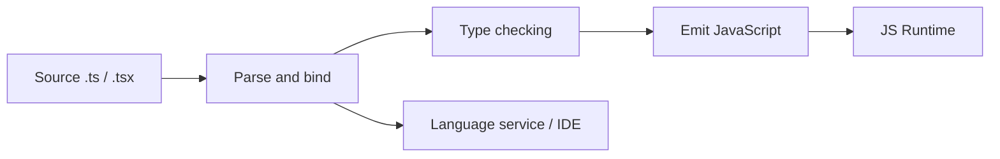
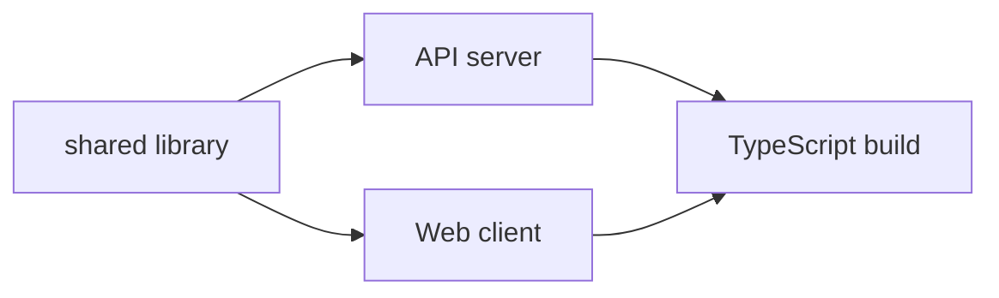

# TypeScript Tổng hợp kiến thức

> **TL;DR:** Tài liệu tham khảo TypeScript gồm 40 chương, đi từ nguyên lý type system và cú pháp nền tảng đến type manipulation, declaration files, modules, React/Node.js và compiler. Nội dung được biên soạn lại từ **TypeScript Official Documentation** và **W3Schools TypeScript**, tập trung vào **kiến thức, giải thích cơ chế, code minh họa và phân tích ví dụ**; không có bài tập hoặc lời yêu cầu người đọc tự thực hành.

**Phạm vi:** 8 phần · 40 chương (00–39) · **Ngôn ngữ:** Tiếng Việt ·**Nguồn:** TypeScript Handbook và W3Schools TypeScript

> [!IMPORTANT]
> Các ví dụ được tác giả biên soạn lại để minh họa kiến thức từ tài liệu gốc, không phải trích nguyên văn. TypeScript kiểm tra kiểu ở compile-time; dữ liệu từ mạng, file hoặc người dùng vẫn cần xác thực tại runtime. Một số ví dụ phụ thuộc môi trường hoặc phiên bản sẽ ghi rõ giả định.

## Mục lục

- [Nguồn tài liệu và nguyên tắc biên soạn](#nguồn-tài-liệu-và-nguyên-tắc-biên-soạn)
- [Phần 0. Tổng quan và nền tảng TypeScript](#phần-0-tổng-quan-và-nền-tảng-typescript)
  - [Chương 00. TypeScript là gì và vì sao cần type system](#chương-00-typescript-là-gì-và-vì-sao-cần-type-system)
  - [Chương 01. Cách TypeScript hoạt động](#chương-01-cách-typescript-hoạt-động)
  - [Chương 02. Công cụ và môi trường TypeScript](#chương-02-công-cụ-và-môi-trường-typescript)
- [Phần I. Kiến thức nền tảng về kiểu dữ liệu](#phần-i-kiến-thức-nền-tảng-về-kiểu-dữ-liệu)
  - [Chương 03. Type annotations và các kiểu dữ liệu cơ bản](#chương-03-type-annotations-và-các-kiểu-dữ-liệu-cơ-bản)
  - [Chương 04. Các kiểu đặc biệt](#chương-04-các-kiểu-đặc-biệt)
  - [Chương 05. Type inference và literal types](#chương-05-type-inference-và-literal-types)
  - [Chương 06. Arrays và tuples](#chương-06-arrays-và-tuples)
  - [Chương 07. Object types và index signatures](#chương-07-object-types-và-index-signatures)
  - [Chương 08. Type aliases và interfaces](#chương-08-type-aliases-và-interfaces)
  - [Chương 09. Union intersection và literal unions](#chương-09-union-intersection-và-literal-unions)
  - [Chương 10. Functions và kiểu hàm](#chương-10-functions-và-kiểu-hàm)
  - [Chương 11. Null undefined và strict null checks](#chương-11-null-undefined-và-strict-null-checks)
- [Phần II. Type safety và cơ chế suy luận kiểu](#phần-ii-type-safety-và-cơ-chế-suy-luận-kiểu)
  - [Chương 12. Narrowing và control flow analysis](#chương-12-narrowing-và-control-flow-analysis)
  - [Chương 13. Type guards và type predicates](#chương-13-type-guards-và-type-predicates)
  - [Chương 14. Type assertions và satisfies operator](#chương-14-type-assertions-và-satisfies-operator)
  - [Chương 15. Structural typing và type compatibility](#chương-15-structural-typing-và-type-compatibility)
  - [Chương 16. Generics nền tảng và ứng dụng](#chương-16-generics-nền-tảng-và-ứng-dụng)
  - [Chương 17. Class types và hướng đối tượng](#chương-17-class-types-và-hướng-đối-tượng)
- [Phần III. Type manipulation nâng cao](#phần-iii-type-manipulation-nâng-cao)
  - [Chương 18. Enums và các phương án thay thế](#chương-18-enums-và-các-phương-án-thay-thế)
  - [Chương 19. Keyof typeof và indexed access types](#chương-19-keyof-typeof-và-indexed-access-types)
  - [Chương 20. Conditional types và infer](#chương-20-conditional-types-và-infer)
  - [Chương 21. Mapped types](#chương-21-mapped-types)
  - [Chương 22. Template literal types](#chương-22-template-literal-types)
  - [Chương 23. Utility types](#chương-23-utility-types)
  - [Chương 24. Thiết kế kiểu phức hợp và reusable types](#chương-24-thiết-kế-kiểu-phức-hợp-và-reusable-types)
- [Phần IV. Các cơ chế nâng cao của ngôn ngữ](#phần-iv-các-cơ-chế-nâng-cao-của-ngôn-ngữ)
  - [Chương 25. Declaration merging và namespaces](#chương-25-declaration-merging-và-namespaces)
  - [Chương 26. Decorators](#chương-26-decorators)
  - [Chương 27. Symbols iterators generators và mixins](#chương-27-symbols-iterators-generators-và-mixins)
- [Phần V. Modules declaration files và tương thích JavaScript](#phần-v-modules-declaration-files-và-tương-thích-javascript)
  - [Chương 28. ES modules và module resolution](#chương-28-es-modules-và-module-resolution)
  - [Chương 29. Declaration files và Definitely Typed](#chương-29-declaration-files-và-definitely-typed)
  - [Chương 30. TypeScript trong dự án JavaScript hiện có](#chương-30-typescript-trong-dự-án-javascript-hiện-có)
  - [Chương 31. JSX DOM Node.js và React](#chương-31-jsx-dom-nodejs-và-react)
- [Phần VI. Async runtime và compiler tooling](#phần-vi-async-runtime-và-compiler-tooling)
  - [Chương 32. Async programming và error handling](#chương-32-async-programming-và-error-handling)
  - [Chương 33. Tsconfig và strict compiler options](#chương-33-tsconfig-và-strict-compiler-options)
  - [Chương 34. TypeScript CLI và tích hợp build tools](#chương-34-typescript-cli-và-tích-hợp-build-tools)
  - [Chương 35. Project references và tổ chức codebase lớn](#chương-35-project-references-và-tổ-chức-codebase-lớn)
- [Phần VII. Thực tiễn kỹ thuật và hệ thống tra cứu](#phần-vii-thực-tiễn-kỹ-thuật-và-hệ-thống-tra-cứu)
  - [Chương 36. Những giới hạn và hiểu nhầm về TypeScript](#chương-36-những-giới-hạn-và-hiểu-nhầm-về-typescript)
  - [Chương 37. Best practices trong thiết kế hệ thống kiểu](#chương-37-best-practices-trong-thiết-kế-hệ-thống-kiểu)
  - [Chương 38. Phân tích các mô hình ứng dụng TypeScript](#chương-38-phân-tích-các-mô-hình-ứng-dụng-typescript)
  - [Chương 39. Cheat sheet glossary và thay đổi phiên bản](#chương-39-cheat-sheet-glossary-và-thay-đổi-phiên-bản)
- [Thuật ngữ cốt lõi](#thuật-ngữ-cốt-lõi)
- [Ghi chú tương thích và phiên bản](#ghi-chú-tương-thích-và-phiên-bản)
- [Cheat Sheet tổng hợp](#cheat-sheet-tổng-hợp)

---

## Nguồn tài liệu và nguyên tắc biên soạn
| Nguồn | Nội dung ưu tiên | Điểm mạnh |
| :--- | :--- | :--- |
| [TypeScript Official Documentation](https://www.typescriptlang.org/docs/handbook/typescript-in-5-minutes.html) | Handbook, Reference, Modules, Type Manipulation, Compiler/TSConfig, Release Notes | Mô tả chính thức các quy tắc kiểm tra kiểu và khác biệt phiên bản |
| [W3Schools TypeScript](https://www.w3schools.com/typescript/typescript_intro.php) | Types, classes, generics, guards, async, React, Node.js, cấu hình | Lộ trình ngắn gọn, ví dụ trực quan và tình huống triển khai |

Tài liệu này không thay thế toàn văn từng website: các mục được **tổng hợp và diễn giải độc lập**, gộp chủ đề trùng lặp và bổ sung ví dụ có lời giải ngay trong bài. Mỗi chương trỏ về tối thiểu một tài liệu chính thức và một mục W3Schools liên quan. Các ví dụ `ts`, `tsx`, `json`, `bash` thể hiện các ngữ cảnh khác nhau; **đoạn mã ở các chương khác nhau không mặc nhiên cùng tồn tại trong một file**. Dòng comment bắt đầu bằng `//` đôi khi diễn giải lỗi type-check và không phải luôn là lệnh đang được chạy.

> [!NOTE]
> JavaScript runtime, DOM và React là những nền tảng liên quan nhưng **TypeScript không tự tạo** DOM, Node runtime hoặc React. Những đoạn tích hợp chạy trong môi trường có thư viện và compiler/bundler phù hợp. Các liên kết có thể thay đổi theo thời gian; thời điểm đối chiếu nguồn là tháng 10/2026.

[↑ Về đầu trang](#mục-lục)

---

## Phần 0. Tổng quan và nền tảng TypeScript
Phần này làm rõ TypeScript như một công cụ kiểm tra kiểu đặt trên JavaScript, tách compile-time khỏi runtime và giải thích vai trò các công cụ phát triển.

### Chương 00. TypeScript là gì và vì sao cần type system

**Khái niệm và nguyên lý**
**TypeScript** mở rộng JavaScript bằng một hệ thống kiểu tĩnh. Một chương trình JavaScript hợp lệ về cú pháp thông thường cũng có thể được đưa vào dự án TypeScript, nhưng TypeScript có thể cảnh báo những thao tác có nguy cơ sai kiểu. Nó đặc biệt hữu ích khi chỉnh sửa codebase lớn: editor suy luận hình dạng dữ liệu, kiểm tra tham số hàm và hỗ trợ refactor một cách nhất quán.

| Khía cạnh | JavaScript | TypeScript |
| :--- | :--- | :--- |
| Kiểm tra kiểu | Chủ yếu lúc thực thi | Có phân tích kiểu trước khi thực thi |
| Cú pháp kiểu | Không | `: string`, `interface`, `type`... |
| Chạy trực tiếp trên engine JS | Có | Thường cần bước loại bỏ/biến đổi cú pháp TS |
| Bảo đảm dữ liệu HTTP đúng cấu trúc | Không tự động | Cũng không tự động |

**Type system** mô tả tập giá trị và phép toán được cho phép. **Static type checking** là kiểm tra bằng phân tích mã; **runtime** mới là lúc biểu thức thực sự chạy. Một kiểu `User` không phải đối tượng để kiểm tra `instanceof` khi đã biên dịch: đa số khai báo kiểu bị xóa (**type erasure**). TypeScript không thay thế validation cho dữ liệu ngoài hệ thống. Việc gán `JSON.parse(...) as User` chỉ khiến trình biên dịch tin vào lời khai của lập trình viên.

**Phạm vi kiến thức được đề cập**
- Sự khác biệt giữa JavaScript và TypeScript; TypeScript là syntactic superset của JavaScript.
- Static typing, type checking, type safety và ý nghĩa trong dự án lớn.
- Vai trò của TypeScript đối với chất lượng code, khả năng bảo trì và IDE.
- TypeScript kiểm tra kiểu trước khi chạy nhưng không tự động xác thực dữ liệu lúc runtime.
- Các khái niệm compile-time, runtime, type erasure và JavaScript output.

**Ví dụ và phân tích kết quả**

```typescript
interface User { id: number; name: string }
function display(user: User): string {
  return `${user.id}: ${user.name.toUpperCase()}`;
}
console.log(display({ id: 7, name: "An" })); // 7: AN
// display({ id: "7", name: "An" }); // TS báo lỗi: id phải là number
```

**Giải thích ví dụ:** `interface User` tạo hợp đồng kiểu cho đối số. Hàm `display` nhận object hợp lệ và trả về chuỗi. Cách kiểm tra này diễn ra trước khi chạy; JavaScript đầu ra không còn `interface` và annotation, nhưng vẫn còn `toUpperCase()` hoạt động ở runtime.

> [!WARNING]
> Không đồng nhất "biên dịch thành công" với "không có lỗi runtime". Kiểm tra tĩnh chỉ có thể tin vào thông tin kiểu và định nghĩa thư viện đang có.

**Nguồn đối chiếu:** [TypeScript Official Documentation](https://www.typescriptlang.org/docs/handbook/2/basic-types.html) · [W3Schools TypeScript](https://www.w3schools.com/typescript/typescript_intro.php).

---

### Chương 01. Cách TypeScript hoạt động

**Khái niệm và nguyên lý**
Một file `.ts` chứa cú pháp TypeScript tiêu chuẩn; `.tsx` cho phép cú pháp JSX; `.d.ts` mô tả giao diện kiểu mà không chứa implementation thông thường. Bộ công cụ TypeScript cần **parse**, dựng cấu trúc ký hiệu, phân tích/kiểm tra tương thích kiểu rồi **emit** JavaScript hoặc chỉ thực hiện type-check nếu `noEmit` được bật. Một transpiler chỉ xóa cú pháp kiểu chưa chắc thực hiện type-check.



Kiểu thuần như `type` và `interface` biến mất trong JavaScript đầu ra; nhưng `class`, `enum` thông thường và nhiều decorator có ý nghĩa runtime. Lệnh `tsc` có thể vẫn phát sinh JS khi có lỗi kiểu trừ khi cấu hình cấm phát sinh trên lỗi (`noEmitOnError`). `target` ảnh hưởng cú pháp JavaScript đầu ra, không làm môi trường tự có polyfill cho mọi API.

**Phạm vi kiến thức được đề cập**
- Quan hệ giữa file `.ts`, `.tsx`, `.d.ts` và JavaScript.
- Quy trình phân tích, kiểm tra kiểu, biên dịch và chạy code.
- Type annotations bị loại bỏ khi biên dịch và các cấu trúc có runtime output.
- Trình biên dịch `tsc`, môi trường chạy JavaScript và lỗi compile-time so với runtime.
- Các ví dụ chuyển mã TypeScript sang JavaScript và giải thích kết quả.

**Ví dụ và phân tích kết quả**

```typescript
// price.ts
interface Price { amount: number }
const price: Price = { amount: 100 };
console.log(price.amount * 2);
```
```javascript
// Đầu ra minh họa khi giữ cú pháp JS hiện đại:
const price = { amount: 100 };
console.log(price.amount * 2);
```

**Giải thích ví dụ:** `interface` và `: Price` chỉ là thông tin cho compiler; phép nhân còn lại và in `200`. File JavaScript đầu ra không có runtime class `Price`. Cần phân biệt lỗi do compiler tìm thấy và lỗi khi chương trình thực thi.

> [!WARNING]
> TypeScript không thay thế Babel/bundler trong tất cả cấu hình. Công cụ emit JS và công cụ đóng gói module đảm nhiệm các khâu khác nhau.

**Nguồn đối chiếu:** [TypeScript Official Documentation](https://www.typescriptlang.org/docs/handbook/2/basic-types.html) · [W3Schools TypeScript](https://www.w3schools.com/typescript/typescript_intro.php).

---

### Chương 02. Công cụ và môi trường TypeScript

**Khái niệm và nguyên lý**
Công cụ nền gồm **Node.js** (môi trường thường dùng cho toolchain), **npm** (quản lý package), **typescript** (gói chứa `tsc` và language server) và VS Code. Một dự án nên có phiên bản TypeScript trong `devDependencies`, bảo đảm CI và máy thành viên sử dụng chung phiên bản.

| Công cụ | Chức năng | Ví dụ |
| :--- | :--- | :--- |
| `tsc` | Type-check và có thể emit JS | `npx tsc --noEmit` |
| `tsc --watch` | Kiểm tra/biên dịch theo thay đổi | `npx tsc -w` |
| VS Code language service | IntelliSense, rename, diagnostics | Gợi ý tham số và member |
| Runtime/bundler | Chạy/đóng gói JavaScript | Browser, Node.js, bundler |

`npx tsc --init` tạo cấu hình ban đầu; khi có `tsconfig.json`, `npx tsc -p .` xem dự án như một đơn vị. Khác với gọi `tsc file.ts` (có thể bỏ qua tsconfig theo cơ chế CLI), kiểm tra toàn dự án dùng `-p`. IDE hữu ích nhưng kết quả chuẩn nên đến từ cùng version compiler ở CI.

**Phạm vi kiến thức được đề cập**
- Node.js, npm và TypeScript compiler trong tài liệu nguồn.
- Biên dịch một file, tổ chức dự án và chế độ `watch`.
- Tích hợp TypeScript trong VS Code: IntelliSense, diagnostic, navigation.
- Phân biệt `tsc`, công cụ bundling và môi trường thực thi.
- Các vấn đề cấu hình thường gặp ở dự án mới.

**Ví dụ và phân tích kết quả**

```bash
npm init -y
npm install --save-dev typescript
npx tsc --init
npx tsc --noEmit
npx tsc --watch
```

**Giải thích ví dụ:** Chuỗi lệnh mô tả một thiết lập phổ biến: cài TypeScript nội bộ, tạo config, chạy kiểm tra mà không sinh `.js`, sau đó theo dõi thay đổi. Nó không tự động tạo server hay chạy trình duyệt.

> [!WARNING]
> Khi báo lỗi không nhất quán giữa editor và CLI, hãy kiểm tra TypeScript version của VS Code workspace và `npx tsc -v`.

**Nguồn đối chiếu:** [TypeScript Official Documentation](https://www.typescriptlang.org/docs/handbook/2/basic-types.html) · [W3Schools TypeScript](https://www.w3schools.com/typescript/typescript_getstarted.php).

---
[↑ Về đầu trang](#mục-lục)

---

## Phần I. Kiến thức nền tảng về kiểu dữ liệu
Những type cơ bản là ngôn ngữ chung cho phần còn lại của TypeScript. Các ví dụ tập trung vào cách compiler suy luận và kiểm tra dữ liệu.

### Chương 03. Type annotations và các kiểu dữ liệu cơ bản

**Khái niệm và nguyên lý**
**Type annotation** cho compiler biết kiểu mong đợi tại vị trí khai báo. Những primitive quen thuộc dùng từ khóa viết thường `string`, `number`, `boolean`; `bigint` và `symbol` có vai trò riêng. Tránh dùng wrapper như `String` hoặc `Number` thay primitive type vì wrapper có ngữ nghĩa object khác.

| Type | Giá trị minh họa | Ghi chú |
| :--- | :--- | :--- |
| `string` | `"hello"` | Văn bản Unicode |
| `number` | `12`, `3.5`, `NaN` | Không tách int/float |
| `boolean` | `true` | Logic |
| `bigint` | `123n` | Số nguyên lớn; không trộn trực tiếp với `number` |
| `symbol` | `Symbol("id")` | Giá trị định danh riêng biệt |

Annotation dùng cho biến (`let x: number`), tham số (`(x: number)`) và kiểu trả về (`: string`). TypeScript thường **suy luận** được kiểu từ giá trị ban đầu; annotation nên làm rõ hợp đồng ở ranh giới API hơn là lặp lại điều hiển nhiên. Compiler phát hiện lỗi sai kiểu trước khi gọi code, nhưng không sinh phép kiểm tra cho tham số khi chạy.

**Phạm vi kiến thức được đề cập**
- Khai báo biến có chú thích kiểu và cơ chế kiểm tra kiểu.
- `string`, `number`, `boolean`, `bigint`, `symbol` và biểu diễn tương ứng.
- Kiểu của biến, tham số, giá trị trả về và thuộc tính object.
- Sai kiểu dữ liệu, kiểu không tương thích và thông báo lỗi tương ứng.

**Ví dụ và phân tích kết quả**

```typescript
const title: string = "TypeScript";
const price: number = 199.5;
const available: boolean = true;
function formatPrice(value: number): string {
  return `${value.toFixed(2)} USD`;
}
console.log(formatPrice(price)); // "199.50 USD"
// formatPrice("199"); // TS2345: string không gán được cho number
```

**Giải thích ví dụ:** `value.toFixed(2)` là API của number trả về string. Compiler cho phép gọi hàm vì `price` có kiểu `number`; truyền chuỗi bị từ chối trước khi chạy.

> [!WARNING]
> Type annotation không chuyển đổi chuỗi thành số: `const n = "3" as unknown as number` vẫn là chuỗi ở runtime.

**Nguồn đối chiếu:** [TypeScript Official Documentation](https://www.typescriptlang.org/docs/handbook/2/everyday-types.html) · [W3Schools TypeScript](https://www.w3schools.com/typescript/typescript_simple_types.php).

---

### Chương 04. Các kiểu đặc biệt

**Khái niệm và nguyên lý**
Các kiểu đặc biệt diễn tả mức độ compiler **biết gì** về giá trị:

| Kiểu | Ý nghĩa | Tình huống |
| :--- | :--- | :--- |
| `any` | Bỏ phần lớn kiểm tra kiểu đối với giá trị | Biên giới chuyển đổi code cũ, cần hạn chế |
| `unknown` | Giá trị chưa được kiểm chứng; phải narrow | Dữ liệu mạng, catch, input ngoài |
| `never` | Không có giá trị nào; nhánh bất khả thi | Exhaustiveness, hàm không kết thúc bình thường |
| `void` | Không sử dụng giá trị trả về | Callback chỉ gây tác dụng phụ |
| `object` | Loại trừ primitive | Tham số mong object hoặc function |

`unknown` an toàn hơn `any`: không thể tùy tiện đọc thuộc tính/call khi chưa kiểm tra. `never` là subtype của mọi kiểu nhưng không thể gán một giá trị thông thường cho nó. `{}` và `Object` không có nghĩa "object rỗng": dưới strict null checks, chúng chấp nhận hầu hết giá trị không nullish; hãy mô tả chính xác shape cần dùng. `void` trong kiểu callback cho phép người gọi bỏ qua kết quả, không khẳng định callback runtime không trả gì.

**Phạm vi kiến thức được đề cập**
- `any`, `unknown`, `never`, `void`, `undefined` và `null`.
- Khác biệt giữa `any` và `unknown`; ý nghĩa của `never`.
- `object`, `Object`, `{}` và sự khác nhau trong ngữ cảnh kiểu.
- Tình huống sử dụng đúng, giới hạn và nguy cơ bỏ qua kiểm tra kiểu.

**Ví dụ và phân tích kết quả**

```typescript
function describe(value: unknown): string {
  if (typeof value === "string") return value.toUpperCase();
  if (typeof value === "number") return value.toFixed(1);
  return "Unsupported";
}
console.log(describe(3));        // "3.0"
console.log(describe("hello"));  // "HELLO"
```

**Giải thích ví dụ:** Nhánh `typeof` thu hẹp `unknown` thành `string` hoặc `number` để TypeScript cho phép gọi đúng phương thức. Nhánh cuối thể hiện đầu vào có thể mang bất kỳ kiểu khác.

> [!WARNING]
> `any` lây lan vào những phép tính phía sau khiến lỗi không bị phát hiện; dùng `unknown` tại boundary và type guard trước khi đọc.

**Nguồn đối chiếu:** [TypeScript Official Documentation](https://www.typescriptlang.org/docs/handbook/2/everyday-types.html) · [W3Schools TypeScript](https://www.w3schools.com/typescript/typescript_special_types.php).

---

### Chương 05. Type inference và literal types

**Khái niệm và nguyên lý**
**Type inference** là suy luận kiểu từ expression và ngữ cảnh. `let status = "idle"` thường widening thành `string` vì có thể gán lại; `const status = "idle"` giữ literal type `"idle"`. Thuộc tính object thường vẫn được suy luận thành kiểu rộng vì object có thể bị mutate. **Contextual typing** đi từ kiểu mong đợi (chẳng hạn tham số callback) xuống biểu thức để suy luận kiểu thích hợp.

`as const` yêu cầu compiler giữ literal, đánh dấu thuộc tính object `readonly` và biến array literal thành readonly tuple; đó vẫn **không phải deep freeze ở runtime**. Literal unions là cách mô hình hóa domain giá trị như `"idle" | "loading" | "done"`.

| Cú pháp | Kiểu thông thường suy luận |
| :--- | :--- |
| `let status = "idle"` | `string` |
| `const status = "idle"` | `"idle"` |
| `const obj = { status: "idle" }` | `{ status: string }` |
| `const obj = { status: "idle" } as const` | `{ readonly status: "idle" }` |

**Phạm vi kiến thức được đề cập**
- Suy luận kiểu tự động từ biến, hàm, object và biểu thức.
- Literal types và sự khác biệt giữa kiểu rộng với kiểu hẹp.
- Widening, `const` và `let`; contextual typing.
- `as const` và tác động lên literals, object, tuple.
- Cơ chế suy luận kiểu khi không khai báo annotation.

**Ví dụ và phân tích kết quả**

```typescript
const modes = ["light", "dark"] as const;
type Mode = (typeof modes)[number]; // "light" | "dark"
function setMode(mode: Mode) {
  return `mode=${mode}`;
}
console.log(setMode("dark")); // "mode=dark"
// setMode("auto");           // không thuộc union Mode
```

**Giải thích ví dụ:** `typeof modes` đọc kiểu của biến ở type context; `[number]` lấy union kiểu phần tử tuple. Nhờ đó `Mode` không bị định nghĩa trùng danh sách literal có thật.

> [!WARNING]
> Giữ literal quá chặt có thể làm API khó dùng. Khi cần mutation hoặc giá trị mở rộng, kiểu rộng là lựa chọn phù hợp.

**Nguồn đối chiếu:** [TypeScript Official Documentation](https://www.typescriptlang.org/docs/handbook/2/everyday-types.html) · [W3Schools TypeScript](https://www.w3schools.com/typescript/typescript_explicit_inference.php).

---

### Chương 06. Arrays và tuples

**Khái niệm và nguyên lý**
**Array** có số phần tử thay đổi và thường có cùng kiểu thành phần: `number[]` tương đương `Array<number>`. **Tuple** mô tả vị trí có ý nghĩa: `[string, number]`; có thể có tên (`[name: string, age: number]`), optional element và rest element. `ReadonlyArray<T>` hoặc `readonly T[]` ngăn mutation *qua tham chiếu đó* ở compile-time, không đóng băng object tại runtime.

| Kiểu | Ý nghĩa |
| :--- | :--- |
| `string[]` | Mảng chuỗi độ dài linh hoạt |
| `[string, number]` | Tuple hai vị trí |
| `[string, number?]` | Phần tử thứ hai tùy chọn |
| `readonly [number, number]` | Không ghi vào tuple ở type-check |

`array[100]` có thể trả `undefined` trong JavaScript kể cả khi TypeScript biết array có các phần tử `number`; option `noUncheckedIndexedAccess` yêu cầu xét khả năng vắng mặt. Một tuple bị sửa qua cast hoặc API ngoại lai vẫn có nguy cơ không đúng cấu trúc runtime.

**Phạm vi kiến thức được đề cập**
- `T[]` và `Array<T>`; kiểu phần tử và các phép xử lý mảng.
- Tuples: vị trí, nhãn, phần tử optional và rest.
- `readonly` arrays và `readonly` tuples.
- Sự khác nhau giữa mảng nhiều phần tử cùng kiểu và tuple có cấu trúc cố định.
- Suy luận kiểu và các tình huống lỗi phổ biến với tuple.

**Ví dụ và phân tích kết quả**

```typescript
const grades: number[] = [8, 9, 10];
const employee: [name: string, salary: number] = ["Mai", 1500];
function sum(values: readonly number[]): number {
  return values.reduce((total, value) => total + value, 0);
}
console.log(sum(grades)); // 27
console.log(employee[0]); // "Mai"
```

**Giải thích ví dụ:** `readonly number[]` vẫn cho phép `.reduce()` vì chỉ đọc; không cho `.push()` trong thân `sum`. Tuple `employee` gán kiểu riêng cho mỗi index, nên `employee[1]` là number.

> [!WARNING]
> `readonly` là bảo vệ compile-time nông (shallow); không mặc nhiên tạo immutable object hoặc ngăn thay đổi qua alias khác.

**Nguồn đối chiếu:** [TypeScript Official Documentation](https://www.typescriptlang.org/docs/handbook/2/objects.html) · [W3Schools TypeScript](https://www.w3schools.com/typescript/typescript_tuples.php).

---

### Chương 07. Object types và index signatures

**Khái niệm và nguyên lý**
**Object types** mô tả các thuộc tính với tên và kiểu; `?` cho phép vắng mặt, `readonly` giới hạn ghi qua đường truy cập kiểu. **Index signature** nhận khóa động, ví dụ `{ [key: string]: number }`. Thuộc tính được khai báo rõ cũng phải tương thích kiểu giá trị của string index signature vì JavaScript có thể truy cập bằng chính tên đó.

**Excess property checking** kiểm tra các thuộc tính thừa trên object literal mới khi gán vào shape được khai báo, nhằm bắt lỗi typo. Không nên nhầm với bảo đảm object thực tế không có trường bổ sung: structural typing cho phép gán biến có nhiều trường vào interface yêu cầu ít trường.

**Readonly không làm deep immutable**: nếu property readonly trỏ tới object lồng nhau, các field bên trong vẫn có thể đổi, tùy shape được khai báo.

**Phạm vi kiến thức được đề cập**
- Khai báo cấu trúc object với các kiểu thuộc tính.
- Optional properties, `readonly`, excess property checks.
- Index signatures cho object có tập khóa động.
- Kết hợp known properties với dynamic keys và các ràng buộc kiểu.
- Nested object types và những giới hạn của kiểu cấu trúc.

**Ví dụ và phân tích kết quả**

```typescript
interface Product {
  readonly id: string;
  name: string;
  discount?: number;
}
const p: Product = { id: "P1", name: "Keyboard" };
const off = p.discount ?? 0;
const inventory: Record<string, number> = { P1: 5, P2: 2 };
console.log(`${p.name}: ${inventory[p.id]}, off=${off}`);
// Keyboard: 5, off=0
```

**Giải thích ví dụ:** `discount?: number` đồng nghĩa giá trị đọc có thể `undefined`; `?? 0` dùng 0 khi không có giá trị. `Record<string, number>` là cách biểu diễn đơn giản của dynamic key/value map.

> [!WARNING]
> Đối với dictionary key không chắc tồn tại, cần xét `undefined` ở runtime; `noUncheckedIndexedAccess` làm điều đó rõ hơn trên type.

**Nguồn đối chiếu:** [TypeScript Official Documentation](https://www.typescriptlang.org/docs/handbook/2/objects.html) · [W3Schools TypeScript](https://www.w3schools.com/typescript/typescript_object_types.php).

---

### Chương 08. Type aliases và interfaces

**Khái niệm và nguyên lý**
`interface` mô tả contract của object/class; `type` có thể đặt tên cho **bất kỳ kiểu nào** (union, primitive, tuple, conditional type...). Cả hai có thể biểu diễn object shape, nhưng không hoàn toàn thay thế nhau. `interface` hỗ trợ **declaration merging** khi nhiều khai báo trùng tên trong cùng phạm vi; `type` thì không. `interface extends` và `type A = B & C` có những khác biệt khi kiểm tra mâu thuẫn thuộc tính.

| Tiêu chí | `interface` | `type` |
| :--- | :--- | :--- |
| Object contract | Có | Có |
| Union/tuple/primitive alias | Không trực tiếp | Có |
| Declaration merging | Có | Không |
| Kế thừa/hợp thành | `extends` | Intersection `&` |

Chọn cách biểu đạt hợp lý theo ngữ nghĩa: contract mở rộng dành cho object công khai thường hợp `interface`; union trạng thái, mapped/conditional type thường cần `type`. Không nên ép mọi vấn đề vào một từ khóa.

**Phạm vi kiến thức được đề cập**
- `type` alias và `interface`: cú pháp, phạm vi áp dụng.
- Object shape, extension, intersection và tái sử dụng contract.
- Khả năng khai báo lại và declaration merging của interface.
- Khi nào ưu tiên interface, khi nào cần type alias.
- Các trường hợp tương thích và không tương thích.

**Ví dụ và phân tích kết quả**

```typescript
interface Identified { id: number }
interface Customer extends Identified { name: string }
type CustomerId = Customer["id"]; // number
type Status = "active" | "blocked";
const customer: Customer = { id: 5, name: "Lan" };
const status: Status = "active";
console.log(customer.id, status); // 5 active
```

**Giải thích ví dụ:** `Customer` thừa hưởng trường `id` từ `Identified`. `CustomerId` dùng indexed access để suy ra kiểu number, còn `Status` là union không thể mô tả trực tiếp bằng `interface`.

> [!WARNING]
> Declaration merging đôi khi hợp lý cho mở rộng typings, nhưng có thể làm contract thay đổi ngoài ý muốn nếu khai báo cùng tên bị phân tán.

**Nguồn đối chiếu:** [TypeScript Official Documentation](https://www.typescriptlang.org/docs/handbook/2/objects.html) · [W3Schools TypeScript](https://www.w3schools.com/typescript/typescript_aliases_and_interfaces.php).

---

### Chương 09. Union intersection và literal unions

**Khái niệm và nguyên lý**
**Union `A | B`** nghĩa là giá trị có thể thuộc một trong các phương án; vì vậy chỉ các thao tác được bảo đảm an toàn cho mọi phương án mới thực hiện trực tiếp được. **Intersection `A & B`** yêu cầu giá trị thỏa mãn *đồng thời* cả hai contract. Kết hợp hai field cùng tên nhưng có kiểu bất khả dung hòa có thể dẫn đến `never` ở field đó.

**Discriminated union** dùng một thuộc tính literal chung (ví dụ `kind`) để TypeScript nhận biết biến thể chính xác; đây là cách biểu diễn trạng thái hiệu quả hơn tập field optional độc lập trong nhiều trường hợp.

| Mẫu | Diễn giải |
| :--- | :--- |
| `"on" | "off"` | Hai giá trị được phép |
| `{id: number} & {name: string}` | Object có cả hai trường |
| `{kind: "a"; x: number} | {kind: "b"; y: string}` | Hai trạng thái được phân biệt bởi `kind` |

**Phạm vi kiến thức được đề cập**
- Union types `A | B` và intersection types `A & B`.
- String, numeric và boolean literal unions.
- Discriminated unions như một mô hình biểu diễn trạng thái.
- Truy cập thuộc tính an toàn trong union và các lỗi dễ mắc.
- So sánh union, intersection, enum và literal types.

**Ví dụ và phân tích kết quả**

```typescript
type Result =
  | { ok: true; data: string }
  | { ok: false; error: string };
function message(result: Result): string {
  return result.ok ? result.data : `Error: ${result.error}`;
}
console.log(message({ ok: true, data: "Saved" })); // Saved
```

**Giải thích ví dụ:** Trong nhánh `result.ok === true`, compiler narrow thành nhánh có `data`; nhánh còn lại có `error`. Không cần ép kiểu bằng `as` và không thể tạo kết quả thành công thiếu dữ liệu bắt buộc.

> [!WARNING]
> Union không mặc nhiên nghĩa là object được truy cập mọi thuộc tính của từng thành viên; phải narrow trước.

**Nguồn đối chiếu:** [TypeScript Official Documentation](https://www.typescriptlang.org/docs/handbook/2/everyday-types.html) · [W3Schools TypeScript](https://www.w3schools.com/typescript/typescript_union_types.php).

---

### Chương 10. Functions và kiểu hàm

**Khái niệm và nguyên lý**
Hàm trong TypeScript có thể có **parameter annotations** và **return type annotation**; return type cũng được suy luận từ các `return`. Một tham số optional `x?: number` có kiểu nhận `number | undefined`, còn default parameter tự tạo hành vi runtime khi argument là `undefined`. Rest parameter (`...args: T[]`) nhận danh sách argument có số lượng linh hoạt.

**Function type expression** `(x: number) => string` là một kiểu hàm; **call signature** có thể gắn property lên callable object; **construct signature** dùng `new (...) => T`. **Overload signatures** mô tả nhiều cách gọi nhưng implementation signature không phải API gọi công khai. `this` parameter trong function declaration là annotation của TypeScript và không tồn tại lúc chạy.

**Phạm vi kiến thức được đề cập**
- Type annotations cho tham số và kiểu trả về.
- Optional, default, rest parameters.
- Function type expressions, call signatures, construct signatures.
- Overloads, generic functions và kiểu `this`.
- Callbacks, `void`, `never` và sự suy luận kiểu trong hàm.

**Ví dụ và phân tích kết quả**

```typescript
function convert(value: number): string;
function convert(value: string): number;
function convert(value: string | number): string | number {
  return typeof value === "number" ? String(value) : Number(value);
}
const text = convert(12);     // string
const numeric = convert("8"); // number
console.log(text, numeric);   // "12" 8
```

**Giải thích ví dụ:** Hai chữ ký overload công khai liên kết kiểu đối số với kiểu trả về chính xác. Bên trong, implementation xử lý union và trả kiểu phù hợp. Gọi `convert(true)` bị báo lỗi.

> [!WARNING]
> Với callback, `void` thường nghĩa là bên gọi bỏ qua kết quả, chứ không chứng minh implementation không trả một giá trị nào.

**Nguồn đối chiếu:** [TypeScript Official Documentation](https://www.typescriptlang.org/docs/handbook/2/functions.html) · [W3Schools TypeScript](https://www.w3schools.com/typescript/typescript_functions.php).

---

### Chương 11. Null undefined và strict null checks

**Khái niệm và nguyên lý**
Khi **`strictNullChecks` bật**, `null` và `undefined` là kiểu riêng không tùy tiện gán cho `string` hoặc `number`. Trường optional thường đọc như `T | undefined`. **Optional chaining `?.`** dừng tại giá trị nullish và trả `undefined`; **nullish coalescing `??`** dùng giá trị dự phòng khi bên trái là `null` hoặc `undefined`, không thay thế `0`, `false`, `""`.

`value!` là **non-null assertion**, chỉ làm compiler bỏ khả năng nullish, không kiểm tra lúc chạy. `NonNullable<T>` loại `null | undefined` khỏi union ở type level. Cần phân biệt **missing property** và property hiện hữu có giá trị `undefined`; `exactOptionalPropertyTypes` khiến sự khác biệt đó được kiểm tra chặt hơn.

**Phạm vi kiến thức được đề cập**
- `null` và `undefined` khi bật hoặc tắt `strictNullChecks`.
- Optional properties, optional parameters và giá trị vắng mặt.
- Optional chaining, nullish coalescing trong code TypeScript.
- `NonNullable<T>` và non-null assertion `!`.
- Phân biệt lỗi kiểm tra tĩnh và lỗi truy cập `null` ở runtime.

**Ví dụ và phân tích kết quả**

```typescript
type Profile = { nickname?: string; score: number | null };
function summary(profile: Profile): string {
  const name = profile.nickname?.trim() ?? "Anonymous";
  const score = profile.score ?? 0;
  return `${name}: ${score}`;
}
console.log(summary({ score: null })); // Anonymous: 0
console.log(summary({ nickname: "  Lan ", score: 0 })); // Lan: 0
```

**Giải thích ví dụ:** `?.trim()` chỉ chạy nếu nickname không nullish. Với `score = 0`, `??` giữ nguyên 0, khác `||` có thể coi 0 là falsy và dùng fallback.

> [!WARNING]
> `user!.name` không làm `user` khác `null` lúc chạy. Không dùng `!` để thay cho một nhánh kiểm tra thực sự.

**Nguồn đối chiếu:** [TypeScript Official Documentation](https://www.typescriptlang.org/docs/handbook/2/everyday-types.html) · [W3Schools TypeScript](https://www.w3schools.com/typescript/typescript_null.php).

---
[↑ Về đầu trang](#mục-lục)

---

## Phần II. Type safety và cơ chế suy luận kiểu
Sau khi có type primitives, TypeScript có thể chứng minh một thao tác an toàn qua control flow, contract, generics và class hierarchy.

### Chương 12. Narrowing và control flow analysis

**Khái niệm và nguyên lý**
**Narrowing** là quá trình compiler thu hẹp khả năng kiểu của biến theo điều kiện và luồng điều khiển. TypeScript không chỉ đọc annotation ban đầu mà còn phân tích các nhánh `if`, `return`, phép gán và reachability. Trong `if (typeof x === "string")`, x là string; sau khi nhánh return kết thúc, compiler cũng có thể biết nhánh còn lại không còn string.

Các kỹ thuật gồm `typeof` (primitive), `instanceof` (constructor), toán tử `"field" in object` (property existence), equality (`===`, `!==`) và truthiness. **Discriminated union** có thể exhaustively checked bằng `never`; thêm một biến thể chưa xử lý làm nhánh `never` báo lỗi. Tuy vậy `typeof null === "object"` là đặc điểm JavaScript phải xét khi dùng guard; object có thể bị mutate từ nơi khác giữa các thời điểm.

**Phạm vi kiến thức được đề cập**
- Type narrowing theo các nhánh điều kiện và luồng chương trình.
- `typeof`, `instanceof`, `in`, equality và truthiness checks.
- Control flow analysis, assignments và reachability.
- Discriminated union narrowing và exhaustiveness với `never`.
- Giới hạn khi dữ liệu thay đổi hoặc kiểm tra không đủ chính xác.

**Ví dụ và phân tích kết quả**

```typescript
type Shape =
  | { kind: "circle"; radius: number }
  | { kind: "rectangle"; width: number; height: number };
function area(shape: Shape): number {
  switch (shape.kind) {
    case "circle": return Math.PI * shape.radius ** 2;
    case "rectangle": return shape.width * shape.height;
    default: {
      const unreachable: never = shape;
      return unreachable;
    }
  }
}
console.log(area({ kind: "rectangle", width: 2, height: 3 })); // 6
```

**Giải thích ví dụ:** Sau khi đọc `kind`, compiler chỉ cho truy cập `radius` trong circle và `width/height` trong rectangle. Nếu thêm `{kind:"triangle"...}`, nhánh default không còn `never`, báo thiếu xử lý.

> [!WARNING]
> Truthiness không tương đương "khác null": `0`, `""`, `false` đều falsy nhưng đôi khi là giá trị hợp lệ.

**Nguồn đối chiếu:** [TypeScript Official Documentation](https://www.typescriptlang.org/docs/handbook/2/narrowing.html) · [W3Schools TypeScript](https://www.w3schools.com/typescript/typescript_type_guards.php).

---

### Chương 13. Type guards và type predicates

**Khái niệm và nguyên lý**
**Type guard** là điều kiện runtime cho phép type checker thu hẹp kiểu. TypeScript hỗ trợ các guard tích hợp (`typeof`, `instanceof`, `in`, discriminant). **User-defined type predicate** viết dưới dạng `value is SpecificType`, cho phép thuật toán narrowing nhận kết quả từ hàm kiểm tra tùy chỉnh. `asserts value is T` dùng trong assertion function: nếu hàm trở lại bình thường, compiler coi condition đã đúng.

Điểm then chốt là **compiler tin chữ ký của guard**; chữ ký mạnh nhưng implementation kiểm tra thiếu sẽ làm mất an toàn. Với dữ liệu không tin cậy từ mạng, guard phải xác nhận các thuộc tính runtime thực tế, kể cả nested shape nếu mã về sau sử dụng các field đó.

**Phạm vi kiến thức được đề cập**
- Built-in type guards và custom type guards.
- Type predicates qua cú pháp `value is Type`.
- Assertion functions và `asserts`.
- Phân biệt kiểm tra runtime thật với type assertion không kiểm tra runtime.
- Ví dụ đọc dữ liệu đầu vào dạng `unknown` an toàn.

**Ví dụ và phân tích kết quả**

```typescript
type Account = { id: number; email: string };
function isAccount(input: unknown): input is Account {
  if (typeof input !== "object" || input === null) return false;
  const object = input as Record<string, unknown>;
  return typeof object.id === "number" &&
         typeof object.email === "string";
}
const payload: unknown = { id: 7, email: "a@example.com" };
if (isAccount(payload)) console.log(payload.email.toUpperCase());
// A@EXAMPLE.COM
```

**Giải thích ví dụ:** Guard kiểm tra input không null và là object trước khi đọc field. `as Record<string, unknown>` chỉ được dùng cục bộ để đọc field, sau đó kiểm tra cả hai kiểu; `payload` được narrow thành `Account` trong nhánh `if`.

> [!WARNING]
> Một guard giả như `function isUser(x: unknown): x is User { return true; }` làm compiler tin sai; nó không cung cấp runtime safety.

**Nguồn đối chiếu:** [TypeScript Official Documentation](https://www.typescriptlang.org/docs/handbook/2/narrowing.html) · [W3Schools TypeScript](https://www.w3schools.com/typescript/typescript_type_guards.php).

---

### Chương 14. Type assertions và satisfies operator

**Khái niệm và nguyên lý**
**Type assertion `as T`** không phải cast chuyển dữ liệu ở runtime; nó bảo compiler diễn giải expression theo kiểu được khai báo khi quan hệ kiểu cho phép. Có thể double assertion qua `unknown`, nhưng đó là cách ép vượt kiểm tra, cần tránh. **`satisfies`** kiểm tra giá trị có tương thích contract hay không mà không đơn thuần thay kiểu expression bằng contract. Trong một số ví dụ nó vẫn tác động contextual typing của expression, nên không nên mô tả rằng hoàn toàn giữ nguyên mọi suy luận.

| Cú pháp | Ý nghĩa | Có validate runtime? |
| :--- | :--- | :---: |
| `value as T` | Khẳng định kiểu | Không |
| `value satisfies T` | Kiểm tra kiểu tương thích | Không |
| `value as const` | Ưu tiên literal và readonly types | Không |
| `value!` | Bỏ null/undefined khỏi kiểu | Không |
| `Number(value)` | Chuyển đổi JavaScript thực sự | Có thao tác chuyển đổi |

Dạng `<T>value` gây xung đột JSX trong `.tsx`; dùng `as` phổ biến hơn.

**Phạm vi kiến thức được đề cập**
- Type assertion `as` và cú pháp góc nhọn trong ngữ cảnh không dùng JSX.
- `satisfies` để kiểm tra tương thích mà giữ suy luận kiểu.
- `as const`, non-null assertion và các dạng assertion.
- Khác biệt giữa ép kiểu tại compile-time và chuyển đổi giá trị JavaScript tại runtime.
- Nguy cơ lạm dụng assertion hoặc bỏ qua type checker.

**Ví dụ và phân tích kết quả**

```typescript
type Palette = Record<"primary" | "secondary", string | number[]>;
const palette = {
  primary: "blue",
  secondary: [255, 200, 0],
} satisfies Palette;
const color = palette.primary.toUpperCase(); // phương thức của string
console.log(color); // BLUE
```

**Giải thích ví dụ:** `palette` bắt buộc có hai key với giá trị string hoặc number array. TypeScript vẫn cho `.toUpperCase()` trên `primary` do giá trị được suy luận là string. Nếu thiếu `secondary`, `satisfies` báo lỗi ngay.

> [!WARNING]
> Không dùng `as ApiResponse` cho kết quả `fetch().json()` để thay cho validation; dữ liệu thực có thể hoàn toàn khác.

**Nguồn đối chiếu:** [TypeScript Official Documentation](https://www.typescriptlang.org/docs/handbook/2/everyday-types.html) · [W3Schools TypeScript](https://www.w3schools.com/typescript/typescript_casting.php).

---

### Chương 15. Structural typing và type compatibility

**Khái niệm và nguyên lý**
TypeScript dùng **structural type system**: một giá trị tương thích nếu có hình dạng đủ thỏa mãn contract, không cần cùng tên class/interface. Đây là cách mô hình hóa các object JavaScript vốn linh hoạt. Quan hệ này gọi là **assignability**, không phải logic đẳng thức đơn giản của tập trường.

Object từ biến có thể chứa nhiều field hơn type yêu cầu, nhưng literal mới được gán trực tiếp thường bị **excess property check**. Tính tương thích của function liên quan số lượng tham số, kiểu return và variance. Với `strictFunctionTypes`, những tham số function trong nhiều trường hợp được kiểm tra contravariant; method parameters có ngoại lệ bivariant lịch sử. `private`/`protected` của class TypeScript cũng làm compatibility khác object public thông thường.

**Phạm vi kiến thức được đề cập**
- Structural type system: xét hình dạng thay vì tên loại.
- Assignability của object, interface và function.
- Excess property checks, optional properties và generic compatibility.
- Variance và tính tương thích tham số hàm ở mức khái quát.
- Trường hợp type checker chấp nhận cấu trúc nhưng runtime vẫn có rủi ro.

**Ví dụ và phân tích kết quả**

```typescript
interface HasId { id: number }
const fullUser = { id: 8, name: "Minh" };
const item: HasId = fullUser;  // hợp lệ, có ít nhất id: number
console.log(item.id);        // 8
// const wrong: HasId = { id: 8, name: "Minh" };
// Excess property check trên object literal mới
```

**Giải thích ví dụ:** `HasId` không yêu cầu object phải chỉ có một field: `fullUser` chứa field `name` vẫn gán được cho `item`. Ngược lại, literal mới có thuộc tính thừa bị kiểm tra để phát hiện lỗi đánh máy.

> [!WARNING]
> Đừng coi interface là runtime schema hay "kiểm tra chỉ được phép có các field này". Structural typing không cấm extra fields trên tất cả giá trị.

**Nguồn đối chiếu:** [TypeScript Official Documentation](https://www.typescriptlang.org/docs/handbook/type-compatibility.html) · [W3Schools TypeScript](https://www.w3schools.com/typescript/typescript_aliases_and_interfaces.php).

---

### Chương 16. Generics nền tảng và ứng dụng

**Khái niệm và nguyên lý**
**Generic type parameter** (`<T>`) biểu diễn mối quan hệ giữa các kiểu mà không cần nhân bản logic. `function identity<T>(value: T): T` không có nghĩa là nhận bất cứ kiểu nào rồi trả một kiểu bất kỳ; nó duy trì **cùng kiểu T** giữa input và output. `extends` trên generic parameter là **constraint kiểu**, khác ngữ nghĩa kế thừa class ở runtime.

**Generic inference** suy ra `T` từ đối số; `K extends keyof T` ràng buộc key hợp lệ. Các generic function, class, interface và type alias có thể dùng nhiều type parameter, default parameter, constraints. Generic bị **erased** trong JS nên không tự làm validation hay tạo constructor của `T`.

**Phạm vi kiến thức được đề cập**
- Generic functions, generic interfaces, generic aliases và generic classes.
- Type parameters, constraints và default parameters.
- `extends` trong generic constraints và mối liên hệ với `keyof`.
- Suy luận type arguments và khi nào cần ghi kiểu rõ ràng.
- Các mẫu hàm, container và API tổng quát được giải thích theo ví dụ.

**Ví dụ và phân tích kết quả**

```typescript
function getProperty<T, K extends keyof T>(obj: T, key: K): T[K] {
  return obj[key];
}
const book = { title: "TS Handbook", pages: 300 };
const title = getProperty(book, "title"); // string
const pages = getProperty(book, "pages"); // number
console.log(title, pages); // TS Handbook 300
// getProperty(book, "author"); // lỗi: "author" không thuộc keyof book
```

**Giải thích ví dụ:** `T` suy ra từ `book`; `K` từ từng key literal. Compiler suy ra kiểu return tùy key đã chọn (`string` hoặc `number`). Ở runtime, code chỉ đọc `obj[key]`.

> [!WARNING]
> Dùng generic khi các vị trí kiểu cần liên hệ với nhau; một hàm `function log<T>(x: T): void` mà không cần quan hệ gì thêm chưa chắc tốt hơn `unknown`.

**Nguồn đối chiếu:** [TypeScript Official Documentation](https://www.typescriptlang.org/docs/handbook/2/generics.html) · [W3Schools TypeScript](https://www.w3schools.com/typescript/typescript_basic_generics.php).

---

### Chương 17. Class types và hướng đối tượng

**Khái niệm và nguyên lý**
Class TypeScript hỗ trợ field annotations, constructor, `implements`, `extends`, `abstract`, `readonly`, getters/setters và access modifiers. `implements I` yêu cầu instance class thỏa shape của `I`; không sinh hành vi mới. `abstract` cấm khởi tạo class trừu tượng theo type-check, nhưng phần ràng buộc này không phải một runtime access-control framework.

**`public`** mặc định; **`protected`** được dùng từ class con; **`private`** chỉ cho phép truy cập trong class theo TypeScript và chủ yếu erased; còn **JavaScript `#private`** là runtime-private thực sự. `readonly` ngăn assignment qua type-check sau khởi tạo nhưng không freeze đối tượng. Override nên tường minh bằng `override`, có thể bật `noImplicitOverride`.

**Phạm vi kiến thức được đề cập**
- Class fields, constructors và methods trong TypeScript.
- `public`, `protected`, `private`, `readonly`, parameter properties.
- Inheritance, `extends`, `implements`, abstract classes và interface contracts.
- `static`, getters, setters, method override và polymorphism.
- Khác biệt giữa kiểm tra quyền truy cập của TypeScript và hành vi JavaScript.

**Ví dụ và phân tích kết quả**

```typescript
abstract class Shape {
  constructor(public readonly color: string) {}
  abstract area(): number;
}
class Square extends Shape {
  constructor(color: string, private side: number) { super(color); }
  override area(): number { return this.side * this.side; }
}
const shape: Shape = new Square("red", 4);
console.log(shape.color, shape.area()); // red 16
```

**Giải thích ví dụ:** Class `Square` triển khai `area()` theo contract abstract. `private side` sử dụng parameter property để vừa khai báo vừa gán field; `shape` có kiểu `Shape` nhưng gọi phương thức override ở runtime theo tính đa hình.

> [!WARNING]
> Đừng nhầm TypeScript `private` với JavaScript `#private`. Nếu ranh giới truy cập cần bảo vệ ở runtime, dùng cơ chế JS phù hợp.

**Nguồn đối chiếu:** [TypeScript Official Documentation](https://www.typescriptlang.org/docs/handbook/2/classes.html) · [W3Schools TypeScript](https://www.w3schools.com/typescript/typescript_classes.php).

---
[↑ Về đầu trang](#mục-lục)

---

## Phần III. Type manipulation nâng cao
Type manipulation mô hình hóa quan hệ giữa những kiểu đã có. Phần này minh họa "lập trình với kiểu" mà không lẫn với JavaScript runtime.

### Chương 18. Enums và các phương án thay thế

**Khái niệm và nguyên lý**
**Enum** cung cấp tên cho các giá trị hữu hạn. Numeric enum thường tự tăng (`A = 0, B = 1`) và có thể sinh **reverse mapping** từ number sang tên; string enum không có reverse mapping tương tự. Enum thường tồn tại ở runtime dưới dạng JavaScript object, khác literal union hoặc type alias. `const enum` có thể được inline ở một số kiểu build, nhưng gặp vấn đề với transpiler, isolated modules và thư viện phát hành ambient const enum.

Một lựa chọn thường dễ hiểu trong ứng dụng web là **literal union** hoặc **object `as const` + union suy ra từ giá trị**, vì tương tác tự nhiên với JSON và tránh phát sinh enum runtime không cần thiết.

**Phạm vi kiến thức được đề cập**
- Numeric enums, string enums, heterogeneous enums.
- Constant members, computed members, `const enum` và tác động cấu hình.
- Kết quả JavaScript được phát sinh từ enum.
- So sánh enum với string literal union và object `as const`.

**Ví dụ và phân tích kết quả**

```typescript
enum StatusCode { Ok = 200, NotFound = 404 }
console.log(StatusCode.Ok);       // 200
console.log(StatusCode[404]);     // "NotFound" (numeric enum)

const Payment = { Pending: "pending", Paid: "paid" } as const;
type PaymentStatus = (typeof Payment)[keyof typeof Payment];
const status: PaymentStatus = Payment.Paid;
console.log(status);              // "paid"
```

**Giải thích ví dụ:** `StatusCode` là enum có object runtime, còn `PaymentStatus` chỉ là type union `"pending" | "paid"`. `Payment` object thật vẫn tồn tại runtime; `as const` chỉ tác động suy luận kiểu.

> [!WARNING]
> Không mặc định numeric enum kiểm tra chặt mọi number trong mọi phiên bản/thiết lập; chú ý đặc tính tương thích với bit-flag và giá trị số.

**Nguồn đối chiếu:** [TypeScript Official Documentation](https://www.typescriptlang.org/docs/handbook/enums.html) · [W3Schools TypeScript](https://www.w3schools.com/typescript/typescript_enums.php).

---

### Chương 19. Keyof typeof và indexed access types

**Khái niệm và nguyên lý**
**`keyof T`** trả tập kiểu khóa của object; **`typeof value` trong type context** lấy kiểu từ biến hoặc property đã khai báo; **`T[K]` indexed access** trả kiểu giá trị ở key. Đây là các cơ chế **type manipulation** chỉ hoạt động tại compile-time. Cú pháp JavaScript `typeof value` trong expression là phép runtime trả string như `"number"`, `"object"`.

Nếu object có index signature kiểu string, `keyof` có thể là `string | number` vì JavaScript chuyển key số sang chuỗi. Kết hợp ba toán tử cho phép giữ đồng bộ type contract với dữ liệu thật mà không định nghĩa lặp lại.

**Phạm vi kiến thức được đề cập**
- `keyof T` và tập khóa của object type.
- `typeof` trong type context so với JavaScript `typeof` ở runtime.
- `T[K]` để truy xuất kiểu của thuộc tính.
- Kết hợp `keyof`, `typeof`, indexed access với generic constraints.
- Ví dụ tạo type phụ thuộc cấu trúc giá trị đã khai báo.

**Ví dụ và phân tích kết quả**

```typescript
const permissions = { read: true, write: false, admin: false };
type Permission = keyof typeof permissions; // "read" | "write" | "admin"
type Flag = (typeof permissions)[Permission]; // boolean
function allowed(key: Permission): Flag {
  return permissions[key];
}
console.log(allowed("read")); // true
// allowed("delete"); // lỗi type-check
```

**Giải thích ví dụ:** `typeof permissions` lấy shape của object; `keyof` tạo union ba khóa; `[...]` lấy kiểu giá trị tương ứng là boolean. Runtime vẫn chỉ index vào object thông thường.

> [!WARNING]
> Đừng nhầm `keyof` là `Object.keys()`; `keyof` không tạo mảng key runtime, mà tạo một type.

**Nguồn đối chiếu:** [TypeScript Official Documentation](https://www.typescriptlang.org/docs/handbook/2/keyof-types.html) · [W3Schools TypeScript](https://www.w3schools.com/typescript/typescript_keyof.php).

---

### Chương 20. Conditional types và infer

**Khái niệm và nguyên lý**
**Conditional type** có dạng `T extends U ? X : Y`: nếu kiểu `T` assignable cho `U`, lấy `X`, ngược lại `Y`. Đây là **điều kiện mức kiểu**, khác `if` thực thi lúc runtime. Với tham số kiểu "naked" như `T extends ...`, conditional type thường **phân phối qua union**: `F<A | B>` tương đương `F<A> | F<B>` trong trường hợp đó. Bọc trong tuple `[T] extends [U]` có thể ngăn tính phân phối.

**`infer`** khai báo một type variable được suy ra từ mẫu phù hợp. Nhờ nó có thể trích kiểu phần tử của array, kiểu return của function hoặc giá trị đã được Promise resolve. Recursive conditional types dùng được cho cấu trúc lồng nhau, nhưng quá sâu ảnh hưởng performance và thông báo lỗi.

**Phạm vi kiến thức được đề cập**
- Cú pháp `T extends U ? X : Y`.
- Conditional types phân phối qua union (distributive conditional types).
- `infer` để trích xuất thành phần kiểu.
- Điều kiện lồng nhau, kiểm soát phân phối và các giới hạn đọc hiểu.
- Ví dụ xây dựng kiểu cho giá trị trả về hoặc dữ liệu lồng nhau.

**Ví dụ và phân tích kết quả**

```typescript
type ElementOf<T> = T extends readonly (infer U)[] ? U : T;
type A = ElementOf<string[]>;  // string
type B = ElementOf<number>;    // number
type C = ElementOf<string[] | boolean>; // string | boolean

type IsString<T> = [T] extends [string] ? true : false;
type D = IsString<"a" | 1>;    // false, không distribute
```

**Giải thích ví dụ:** Với `string[]`, `infer U` khớp kiểu phần tử `string`. Union `string[] | boolean` phân phối nên cho `string | boolean`. Khi dùng tuple wrapper với `IsString`, cả union được so một lần nên cho `false`. Các type alias này không phát sinh JS.

> [!WARNING]
> Tránh conditional types lồng quá nhiều nếu có thể biểu diễn contract rõ ràng hơn bằng discriminated union hoặc interface.

**Nguồn đối chiếu:** [TypeScript Official Documentation](https://www.typescriptlang.org/docs/handbook/2/conditional-types.html) · [W3Schools TypeScript](https://www.w3schools.com/typescript/typescript_conditional_types.php).

---

### Chương 21. Mapped types

**Khái niệm và nguyên lý**
**Mapped type** chuyển đổi object type bằng cách duyệt tập key: `{ [K in keyof T]: ... }`. Modifier `readonly` và `?` có thể được thêm hoặc loại bằng `+`/`-`. **Key remapping** viết `as` trong mapped type để đổi tên hoặc lọc key (ánh xạ thành `never` sẽ bỏ key). Kết hợp conditional type và indexed access cho phép phát sinh các contract liên quan mà không sao chép field.

Mapped types chỉ biến đổi **type**, không duyệt object runtime hay thay đổi giá trị thực. Các utility như `Partial<T>` và `Readonly<T>` xây dựng bằng cơ chế tương tự; chúng thường chỉ nông theo cấp thuộc tính hiện tại.

**Phạm vi kiến thức được đề cập**
- Duyệt qua khóa của object bằng mapped types.
- `readonly` và optional modifiers; `+` và `-` modifiers.
- Key remapping với `as`.
- Kết hợp `keyof`, conditional types và mapped types.
- Ứng dụng tạo các biến thể của một object contract.

**Ví dụ và phân tích kết quả**

```typescript
type MutableRequired<T> = {
  -readonly [K in keyof T]-?: T[K];
};
type EventMethods<T> = {
  [K in keyof T as `on${Capitalize<string & K>}`]: (v: T[K]) => void;
};
type Settings = { readonly theme?: string; timeout?: number };
type WritableSettings = MutableRequired<Settings>;
type Handlers = EventMethods<{ save: boolean; update: number }>;
// Handlers: { onSave: (v: boolean) => void; onUpdate: (v: number) => void }
```

**Giải thích ví dụ:** `-readonly` và `-?` loại hai modifier. Ở `EventMethods`, `as` biến `save` thành `onSave`; kiểu đối số callback lấy từ `T[K]`. Đây là phép tính kiểu; không có object `Handlers` được tạo ở runtime.

> [!WARNING]
> Đừng kỳ vọng `Readonly<T>` giữ an toàn khi dữ liệu được mutate qua alias khác hoặc tạo deep readonly tự động.

**Nguồn đối chiếu:** [TypeScript Official Documentation](https://www.typescriptlang.org/docs/handbook/2/mapped-types.html) · [W3Schools TypeScript](https://www.w3schools.com/typescript/typescript_mapped_types.php).

---

### Chương 22. Template literal types

**Khái niệm và nguyên lý**
**Template literal type** dùng backtick ở **vị trí type** để kết hợp string literal và union. Ví dụ `` `get${Capitalize<K>}` `` tạo tên method từ union key. Nếu nhiều union xuất hiện trong placeholder, compiler tạo kết hợp các phần tử (cross-product). Các intrinsic string type `Uppercase`, `Lowercase`, `Capitalize`, `Uncapitalize` thao tác ở compile-time, khác `.toUpperCase()` thực thi runtime.

Template literal types hữu ích cho event names, route name hoặc quy ước key, nhưng những tập hợp rất lớn dễ tăng độ phức tạp compiler; với số lượng kết hợp lớn nên dùng generated source hoặc cách biểu diễn đơn giản hơn.

**Phạm vi kiến thức được đề cập**
- Kết hợp các string literal types ở mức type.
- Union expansion và string interpolation trong type.
- Intrinsic string manipulation: `Uppercase`, `Lowercase`, `Capitalize`, `Uncapitalize`.
- Kết hợp với mapped types để tạo tên thuộc tính và sự kiện.
- Giới hạn độ phức tạp và tính dễ đọc.

**Ví dụ và phân tích kết quả**

```typescript
type Entity = "user" | "post";
type Action = "created" | "deleted";
type EventName = `${Entity}:${Action}`;
// "user:created" | "user:deleted" | "post:created" | "post:deleted"
function publish(event: EventName) {
  console.log(event);
}
publish("user:created"); // user:created
// publish("user:updated"); // không nằm trong union
```

**Giải thích ví dụ:** Compiler hình thành tích Descartes từ hai union để kiểm tra literal. Khi chạy, `publish` chỉ là hàm JavaScript nhận string và in string, không có danh sách event runtime được tạo từ kiểu.

> [!WARNING]
> Phần phức tạp của template literal type là ở số biến thể kiểu và khả năng bảo trì, không phải chi phí của một phép nội suy JavaScript lúc chạy.

**Nguồn đối chiếu:** [TypeScript Official Documentation](https://www.typescriptlang.org/docs/handbook/2/template-literal-types.html) · [W3Schools TypeScript](https://www.w3schools.com/typescript/typescript_advanced_types.php).

---

### Chương 23. Utility types

**Khái niệm và nguyên lý**
**Utility types** là các generic type được cung cấp sẵn, giúp biến đổi contract nhất quán. Phân nhóm theo mục đích:

| Nhóm | Utility | Ý nghĩa |
| :--- | :--- | :--- |
| Thuộc tính object | `Partial<T>`, `Required<T>`, `Readonly<T>` | Điều chỉnh tùy chọn và quyền ghi |
| Chọn key | `Pick<T,K>`, `Omit<T,K>` | Lấy/bỏ thuộc tính |
| Dictionary | `Record<K,V>` | Ánh xạ key sang value |
| Union | `Exclude<T,U>`, `Extract<T,U>`, `NonNullable<T>` | Lọc thành viên union |
| Function | `Parameters<F>`, `ReturnType<F>` | Lấy tuple tham số / return |
| Constructor | `ConstructorParameters<C>`, `InstanceType<C>` | Phân tích constructor |
| Promise | `Awaited<T>` | Mở Promise-like đệ quy |
| Call context | `ThisParameterType<T>`, `OmitThisParameter<T>`, `ThisType<T>` | Xử lý ngữ cảnh `this` |
| Inference | `NoInfer<T>` | Chặn việc suy luận từ vị trí đánh dấu |

`Uppercase<T>` và những thao tác chuỗi thuộc nhóm intrinsic utility. `Readonly<T>` là shallow readonly type; `Partial<T>` không tự tạo bản sao object. Những type này không thay đổi dữ liệu runtime.

**Phạm vi kiến thức được đề cập**
- `Partial`, `Required`, `Readonly`, `Pick`, `Omit`, `Record`.
- `Exclude`, `Extract`, `NonNullable`.
- `Parameters`, `ReturnType`, `ConstructorParameters`, `InstanceType`.
- `Awaited`, `ThisParameterType`, `OmitThisParameter`, `NoInfer` và các utility liên quan.
- Giải thích triển khai và tình huống phù hợp của từng nhóm.

**Ví dụ và phân tích kết quả**

```typescript
interface Order { id: number; total: number; note?: string }
type OrderPatch = Partial<Pick<Order, "total" | "note">>;
type OrderRequired = Required<Order>;
type OrderWithoutNote = Omit<Order, "note">;
type State = Record<"idle" | "loading", boolean>;
function total(order: Order): number { return order.total; }
type TotalType = ReturnType<typeof total>; // number
const patch: OrderPatch = { total: 250 };
console.log(patch.total); // 250
```

**Giải thích ví dụ:** `Pick` tạo tập key được phép cập nhật; `Partial` cho từng key thành optional. `Required<Order>` yêu cầu cả `note`. `ReturnType` lấy số từ chữ ký hàm `total` mà không gọi hàm tại runtime.

> [!WARNING]
> `Partial<Order>` không tương đương schema bảo đảm hợp lệ cho mọi update. Những ràng buộc nghiệp vụ như total phải dương vẫn cần validation.

**Nguồn đối chiếu:** [TypeScript Official Documentation](https://www.typescriptlang.org/docs/handbook/utility-types.html) · [W3Schools TypeScript](https://www.w3schools.com/typescript/typescript_utility_types.php).

---

### Chương 24. Thiết kế kiểu phức hợp và reusable types

**Khái niệm và nguyên lý**
TypeScript phát huy giá trị khi một **nguồn sự thật về contract** sinh ra những type liên quan, thay vì tạo nhiều type được duy trì bằng tay. Ví dụ một API có union response thành công/lỗi, model entity và biến thể form cập nhật. Có thể dùng generics mô tả quan hệ input/output; mapped types cho view cập nhật, conditional types cho giá trị biến đổi. Tuy nhiên mọi tầng trừu tượng đều có chi phí đọc code và thông báo lỗi.

**Discriminated union** thích hợp biểu diễn finite states và ràng buộc `data` chỉ tồn tại ở trạng thái thành công. **Phân tách domain type** và **wire format** đặc biệt quan trọng: `Date` trong domain không tương đương timestamp string JSON truyền trên mạng. `satisfies` có thể kiểm tra object cấu hình mà giữ suy luận literal; `unknown` là điểm khởi đầu phù hợp cho dữ liệu chưa tin cậy.

**Phạm vi kiến thức được đề cập**
- Kết hợp generics, unions, mapped types và conditional types.
- Discriminated unions cho trạng thái và dữ liệu có nhiều biến thể.
- Đọc hiểu kiểu lồng nhau và phân tích lỗi suy luận kiểu.
- Cân bằng giữa tính chính xác của type system và khả năng bảo trì.
- Thảo luận các giới hạn compile-time của advanced types.

**Ví dụ và phân tích kết quả**

```typescript
type ApiResult<T> =
  | { status: "success"; data: T }
  | { status: "error"; message: string };
type User = { id: number; name: string; createdAt: Date };
type UserPatch = Partial<Pick<User, "name">>;
function display(result: ApiResult<User>): string {
  return result.status === "success"
    ? result.data.name
    : `Failed: ${result.message}`;
}
console.log(display({ status: "error", message: "Not found" }));
// Failed: Not found
```

**Giải thích ví dụ:** `ApiResult<T>` gắn dữ liệu vào nhánh success; trong error chỉ có `message`. `UserPatch` cho phép không có `name` khi cập nhật, nhưng không cho `id`. `createdAt: Date` là model trong chương trình, không có nghĩa JSON ngoài mạng tự sinh đối tượng Date.

> [!WARNING]
> Đừng lồng conditional types dày đặc chỉ để tránh viết một interface rõ ràng. Mục tiêu là giảm sai lệch contract, không tối thiểu hóa số dòng type.

**Nguồn đối chiếu:** [TypeScript Official Documentation](https://www.typescriptlang.org/docs/handbook/2/types-from-types.html) · [W3Schools TypeScript](https://www.w3schools.com/typescript/typescript_advanced_types.php).

---
[↑ Về đầu trang](#mục-lục)

---

## Phần IV. Các cơ chế nâng cao của ngôn ngữ
Các cơ chế nâng cao không chỉ mang tính cú pháp; một số tạo hoặc thay đổi hành vi runtime và cần chú ý phiên bản/cấu hình.

### Chương 25. Declaration merging và namespaces

**Khái niệm và nguyên lý**
**Declaration merging** kết hợp những khai báo cùng tên khi quy tắc ngôn ngữ cho phép. Hai `interface` cùng tên thường hợp thành một contract; method overload của nhiều interface được sắp theo quy tắc merging. **Namespace** có thể ghép declaration của hàm/class/enum để thêm các member xuất ra.

Trong code TypeScript hiện đại, **ES modules** thường là cơ chế chia code chính; `namespace` vẫn có ích trong một số typings và mã kế thừa. **Module augmentation** (`declare module "pkg"`) mở rộng declaration của thư viện bên ngoài, nhưng không tự thay đổi implementation của thư viện. Nếu khai báo trường mới mà runtime không tạo trường đó, chương trình vẫn có thể gặp lỗi.

**Phạm vi kiến thức được đề cập**
- Những khai báo TypeScript có thể hợp nhất và quy tắc merging.
- Interface merging, namespace merging và module augmentation.
- Namespace so với ES modules.
- Khi nào declaration merging tạo lợi ích và khi nào gây khó hiểu.

**Ví dụ và phân tích kết quả**

```typescript
interface Settings { theme: "dark" | "light" }
interface Settings { lang: string }
const settings: Settings = { theme: "dark", lang: "vi" };
console.log(settings.lang); // vi

namespace Formatter {
  export function upper(text: string) { return text.toUpperCase(); }
}
console.log(Formatter.upper("ts")); // TS
```

**Giải thích ví dụ:** Hai khai báo `Settings` hợp nhất thành contract bắt buộc có `theme` và `lang`. `namespace Formatter` ở runtime có thể tạo namespace object (tùy emit); khác `interface`, nó có implementation JavaScript.

> [!WARNING]
> Declaration merging có thể thay đổi kiểu thông qua import side effects của typings; tránh augmentation tràn lan nếu không có lý do rõ ràng.

**Nguồn đối chiếu:** [TypeScript Official Documentation](https://www.typescriptlang.org/docs/handbook/declaration-merging.html) · [W3Schools TypeScript](https://www.w3schools.com/typescript/typescript_declaration_merging.php).

---

### Chương 26. Decorators

**Khái niệm và nguyên lý**
**Decorator** là hàm can thiệp hoặc tùy biến class/member ở quá trình class được định nghĩa (runtime). TypeScript 5.0 hỗ trợ mô hình decorators mới theo hướng chuẩn ECMAScript bên cạnh cơ chế **legacy experimental decorators** dùng `experimentalDecorators`. Hai mô hình khác chữ ký hàm, khả năng hỗ trợ parameter decorators và `emitDecoratorMetadata`; không thể coi chúng tương đương.

Decorator **không phải type annotation**: tác động có thể còn lại ở runtime. Trong mô hình mới, decorator cho method nhận `(value, context)` và có thể trả function thay thế. Kiểu `ClassMethodDecoratorContext` giúp mô tả ngữ cảnh nhưng decorator thực tế vẫn có thể thay đổi hành vi. Các thư viện dựa trên legacy decorators thường cần cấu hình riêng và không tự tương thích decorators mới.

**Phạm vi kiến thức được đề cập**
- Decorators là gì; ngữ cảnh class và class members.
- Sự khác nhau giữa các thế hệ decorator và cách thiết lập tương thích.
- Runtime behavior của decorators so với các type annotations.
- Ví dụ áp dụng decorator và phân tích tác động lên code.

**Ví dụ và phân tích kết quả**

```typescript
// Ví dụ decorators chuẩn TypeScript 5.0+ (không dùng legacy mode)
function logged(
  method: (this: Greeter, name: string) => string,
  context: ClassMethodDecoratorContext<Greeter, (this: Greeter, name: string) => string>
) {
  return function (this: Greeter, name: string) {
    console.log(`Calling ${String(context.name)}`);
    return method.call(this, name);
  };
}
class Greeter {
  @logged
  greet(name: string) { return `Hello ${name}`; }
}
console.log(new Greeter().greet("Lan"));
// Calling greet
// Hello Lan
```

**Giải thích ví dụ:** Decorator `logged` được áp dụng cho method `greet`; nó trả một method wrapper in tên rồi gọi implementation gốc, giữ `this`. Type system kiểm tra chữ ký; hành vi log là JavaScript runtime thực sự.

> [!WARNING]
> Đối với các framework legacy, cần kiểm tra tài liệu version và flag `experimentalDecorators`, `emitDecoratorMetadata`; không sao chép decorator từ chuẩn mới sang legacy mà không chỉnh.

**Nguồn đối chiếu:** [TypeScript Official Documentation](https://www.typescriptlang.org/docs/handbook/release-notes/typescript-5-0.html) · [W3Schools TypeScript](https://www.w3schools.com/typescript/typescript_decorators.php).

---

### Chương 27. Symbols iterators generators và mixins

**Khái niệm và nguyên lý**
`symbol` là primitive định danh duy nhất ở JavaScript. TypeScript bổ sung **`unique symbol`** khi danh tính symbol cụ thể cần đi vào kiểu. Các protocol `Iterable<T>` và `Iterator<T, TReturn, TNext>` mô tả cách object phát các phần tử. `Generator<T, TReturn, TNext>` là một loại iterator có trạng thái, được viết bởi `function*` và `yield`.

**Mixins** là mô hình kết hợp hành vi với class thông qua hàm trả class mở rộng. Generic constructor constraints thường giữ được constructor input hoặc instance type; tuy vậy mixins làm hierarchy phức tạp hơn, đặc biệt khi abstract classes, private fields hoặc decorator tham gia. Chọn composition rõ ràng khi không cần dynamic subclass.

**Phạm vi kiến thức được đề cập**
- `symbol` và `unique symbol` trong type system.
- `Iterable`, `Iterator`, `Generator` và các tham số kiểu.
- `for...of`, `yield`, `yield*` dưới góc độ typing.
- Mixin patterns với class expressions và generic constructors.
- Các hạn chế và vấn đề tương thích khi sử dụng.

**Ví dụ và phân tích kết quả**

```typescript
function* numbers(): Generator<number, string, unknown> {
  yield 1;
  yield 2;
  return "done";
}
const iterator = numbers();
console.log(iterator.next()); // { value: 1, done: false }
console.log(iterator.next()); // { value: 2, done: false }
console.log(iterator.next()); // { value: "done", done: true }

const KEY: unique symbol = Symbol("key");
const data: { [KEY]: number } = { [KEY]: 42 };
console.log(data[KEY]); // 42
```

**Giải thích ví dụ:** Generator trả về `number` trong các lần `yield`, rồi `string` khi `return`. `Generator<number,string,unknown>` lần lượt chỉ kiểu yielded, returned và input truyền vào `.next()`. `unique symbol` bảo vệ key khỏi bị nhầm với symbol khác lúc type-check.

> [!WARNING]
> Trong `for...of`, return value cuối của generator không được lặp như các giá trị `yield`. Đừng nhầm iterator protocol với Promise/asynchronous iterator.

**Nguồn đối chiếu:** [TypeScript Official Documentation](https://www.typescriptlang.org/docs/handbook/iterators-and-generators.html) · [W3Schools TypeScript](https://www.w3schools.com/typescript/typescript_advanced_types.php).

---
[↑ Về đầu trang](#mục-lục)

---

## Phần V. Modules declaration files và tương thích JavaScript
Một dự án TypeScript tồn tại trong hệ module và thư viện JavaScript thực. Phần này phân biệt rõ declaration, import, runtime code và môi trường host.

### Chương 28. ES modules và module resolution

**Khái niệm và nguyên lý**
ES modules dùng `export`, `import` và `import type` để chia code theo module scope. **Type-only imports** thường bị xóa khi emit và không tạo dependency JS runtime; import giá trị giữ lại tùy cấu hình emit. `export { x } from ...` tái xuất (re-export), `export default` xác định export mặc định.

**Module resolution** là thuật toán compiler tìm nguồn type/declaration của một import. Điều đó phải tương ứng cơ chế mà **runtime/bundler** sẽ dùng để tải module. Node.js ESM/CJS dựa trên định dạng module, `package.json` và extension; `nodenext` hợp mô hình Node hiện đại, `bundler` hợp nhiều môi trường bundler. Chọn `module`/`moduleResolution` như một cặp phù hợp với host thực tế; TypeScript không tự sửa mọi lỗi khi chạy nếu hai bên bất đồng.

| Kiểu module | Đặc điểm |
| :--- | :--- |
| ESM | `import`/`export`, module scope |
| CommonJS | `require`, `module.exports` |
| Type-only import | Chỉ phục vụ type checker, không import runtime |

**Phạm vi kiến thức được đề cập**
- `import`, `export`, default export, type-only imports và re-exports.
- Sự khác nhau giữa ESM, CommonJS và module scope.
- Module resolution và vai trò của `module`, `moduleResolution`.
- Interop giữa CommonJS và ESM; các lỗi import thường gặp.
- Mối liên hệ giữa runtime module loader và cấu hình compiler.

**Ví dụ và phân tích kết quả**

```typescript
// models.ts
export interface User { id: number; name: string }
export const APP_NAME = "Portal";

// main.ts
import type { User } from "./models.js";
import { APP_NAME } from "./models.js";
const user: User = { id: 1, name: "Lan" };
console.log(APP_NAME, user.name); // Portal Lan
```

**Giải thích ví dụ:** Trong Node ESM cấu hình phù hợp, source `.ts` có thể ghi specifier `.js` để trỏ tới output thực sau build. `User` import chỉ có ở type-check; `APP_NAME` là runtime binding.

> [!WARNING]
> Không mặc định TypeScript rewrite tùy ý mọi relative import extension. Module resolution phải phù hợp với cách code thật được chạy và công cụ build.

**Nguồn đối chiếu:** [TypeScript Official Documentation](https://www.typescriptlang.org/docs/handbook/modules/introduction.html) · [W3Schools TypeScript](https://www.w3schools.com/typescript/typescript_intro.php).

---

### Chương 29. Declaration files và Definitely Typed

**Khái niệm và nguyên lý**
File `.d.ts` chứa **ambient declarations** mô tả tên, kiểu và API có thể tồn tại tại runtime nhưng không triển khai logic. `declare` báo cho compiler tin một tên đã được cấp bởi môi trường/thư viện. Package `@types/<name>` từ hệ sinh thái **Definitely Typed** bổ sung type declaration cho nhiều thư viện JavaScript không tự đóng gói typings. Package đã chứa `types`/`typings` riêng thường không cần `@types` tách biệt.

**Module declaration** dùng `declare module "library" { ... }` khi mô tả thư viện; **global declaration** có thể thêm type cho môi trường toàn cục. **Module augmentation** mở rộng các khai báo hiện hữu nhưng không bổ sung implementation. Tuyên bố sai có thể khiến compiler chấp nhận code chắc chắn lỗi khi chạy, nên typings cần phản ánh API runtime thật.

**Phạm vi kiến thức được đề cập**
- Vai trò của `.d.ts` và ambient declarations.
- Declare module, global declarations, module augmentation.
- Khái niệm `@types` và Definitely Typed.
- Typings cho thư viện JavaScript và cách TypeScript xác định declarations.
- Các nguyên tắc viết declaration rõ ràng và ổn định.

**Ví dụ và phân tích kết quả**

```typescript
// math-lib.d.ts (ví dụ giả định có math-lib.js thật lúc chạy)
declare module "math-lib" {
  export function double(value: number): number;
}

// src.ts
import { double } from "math-lib";
const n: number = double(10);
console.log(n); // 20 NẾU thư viện runtime triển khai đúng
```

**Giải thích ví dụ:** `math-lib.d.ts` chỉ thông báo cho compiler rằng module `math-lib` export hàm `double(number): number`. Nó không tạo `math-lib.js`, không cài package và không chứng minh hàm trả đúng giá trị. Kết quả 20 phụ thuộc implementation runtime tương ứng.

> [!WARNING]
> Không khai báo module chung kiểu `any` chỉ để loại bỏ lỗi cấu hình; tốt hơn tìm declaration chính xác hoặc viết định nghĩa tối thiểu phản ánh API thật.

**Nguồn đối chiếu:** [TypeScript Official Documentation](https://www.typescriptlang.org/docs/handbook/declaration-files/introduction.html) · [W3Schools TypeScript](https://www.w3schools.com/typescript/typescript_definitely_typed.php).

---

### Chương 30. TypeScript trong dự án JavaScript hiện có

**Khái niệm và nguyên lý**
TypeScript có thể cung cấp dịch vụ kiểu cho **dự án JavaScript** trước khi chuyển mọi file sang `.ts`. `allowJs` cho phép `.js` nằm trong dự án TypeScript; `checkJs` bật báo lỗi kiểu trong file JavaScript; `// @ts-check` bật cho một file. **JSDoc** (`@param`, `@returns`, `@typedef`, `@template`) mô tả kiểu trong comment mà không cần đổi cú pháp runtime.

Chuyển dần từ JavaScript sang TypeScript thường gặp các vấn đề: thư viện thiếu typings, dữ liệu `any` quá rộng, API DOM trả `null`, chức năng module resolution khác môi trường hiện tại. Bởi vậy migration có thể giữ file `.js` với JSDoc rồi chuyển dần các module có contract rõ. File `.d.ts` có thể tạo hợp đồng public khi implementation vẫn là JS.

**Phạm vi kiến thức được đề cập**
- `allowJs`, `checkJs` và JSDoc type annotations.
- Triển khai kiểm tra kiểu JavaScript trước khi đổi sang `.ts`.
- Khác biệt giữa TypeScript syntax và JSDoc typing.
- Chuyển dần file `.js` sang `.ts` và các vấn đề về types.
- Những lỗi phổ biến khi di chuyển ứng dụng JavaScript.

**Ví dụ và phân tích kết quả**

```javascript
// @ts-check
/**
 * @param {number} price
 * @param {number} quantity
 * @returns {number}
 */
function total(price, quantity) {
  return price * quantity;
}
console.log(total(5, 3)); // 15
// total("5", 3);         // JS vẫn có thể chạy, TS checker cảnh báo
```

**Giải thích ví dụ:** Đây vẫn là mã JavaScript hợp lệ, không có TypeScript syntax. Editor/compiler đọc JSDoc để biết mỗi tham số là number; runtime bỏ qua comment và thực hiện phép nhân JS như bình thường.

> [!WARNING]
> `allowJs` không tự bật kiểm tra đầy đủ; cần xem `checkJs`, tsconfig, phạm vi file include và các chỉ thị bỏ qua kiểm tra.

**Nguồn đối chiếu:** [TypeScript Official Documentation](https://www.typescriptlang.org/docs/handbook/type-checking-javascript-files.html) · [W3Schools TypeScript](https://www.w3schools.com/typescript/typescript_jsdoc.php).

---

### Chương 31. JSX DOM Node.js và React

**Khái niệm và nguyên lý**
Với JSX, TypeScript dùng file `.tsx` và lựa chọn `jsx` để mô tả cách tạo output. Trong DOM, `document.querySelector()` thường trả `Element | null`; compiler yêu cầu kiểm tra null trước khi đọc property. `EventTarget` là kiểu rộng, không hứa có `.value`, vì vậy event target của input cần được narrow hoặc dùng event type phù hợp.

**React** dùng type của props để kiểm tra dữ liệu giữa component, inference của `useState` để gắn state và event types cho callback. React typings đến từ thư viện type tương ứng; TypeScript không tự định nghĩa riêng JSX/React cho mọi phiên bản. **Node.js** sử dụng runtime APIs (`process`, `Buffer`, `fs`) và typings thuộc `@types/node` hoặc declaration tương ứng. Browser DOM types và Node globals khác nhau, có thể xung đột khi compiler tải cả hai tập ambient declarations.

**Phạm vi kiến thức được đề cập**
- TypeScript và JSX, file `.tsx`, kiểu của props và events.
- Typed DOM APIs: HTMLElement, event targets và nullability.
- TypeScript trong React: components, props, state và event handlers.
- TypeScript trong Node.js: module conventions và type definitions.
- Các điểm khác biệt giữa kiểu dữ liệu của trình duyệt và Node.js.

**Ví dụ và phân tích kết quả**

```tsx
// Counter.tsx - giả định React và typings đã có
import { useState } from "react";
interface CounterProps { initial: number; label?: string }
export function Counter({ initial, label = "Count" }: CounterProps) {
  const [count, setCount] = useState(initial);
  return (
    <button onClick={() => setCount(value => value + 1)}>
      {label}: {count}
    </button>
  );
}
// <Counter initial={3} /> hợp lệ, initial="3" sẽ báo lỗi kiểu.
```

**Giải thích ví dụ:** `initial` phải là number, vì vậy `count` suy luận là number. Callback `setCount(value => value + 1)` nhận giá trị state trước đó, trả số mới. Cú pháp JSX và React code cần bundler/runtime thích hợp mới render lên browser.

> [!WARNING]
> Tránh đặt `const target = event.target as HTMLInputElement` khi không chắc element thật; với DOM query nên kiểm tra null/type trước.

**Nguồn đối chiếu:** [TypeScript Official Documentation](https://www.typescriptlang.org/docs/handbook/jsx.html) · [W3Schools TypeScript](https://www.w3schools.com/typescript/typescript_react.php).

---
[↑ Về đầu trang](#mục-lục)

---

## Phần VI. Async runtime và compiler tooling
Compiler options, toolchain và nhiều project references quyết định kết quả kiểm tra, JS emit và cách tổ chức dự án lớn.

### Chương 32. Async programming và error handling

**Khái niệm và nguyên lý**
Một hàm `async` luôn trả về **Promise**; `async function f(): Promise<number>` mô tả kiểu giá trị được resolve. `await` tháo một lớp Promise-like theo ngữ nghĩa tương ứng `Awaited<T>`. `Promise.all` tạo Promise kết quả từ nhiều tác vụ; việc chạy tuần tự (`await` từng bước) và song song (tạo promise trước rồi `Promise.all`) cho thời gian và hành vi lỗi khác nhau.

`catch` nhận giá trị được `throw`; trong JavaScript có thể `throw` string, object hoặc Error. Với kiểm tra strict, catch variable thường ở kiểu `unknown`: phải dùng `instanceof Error` hoặc guard phù hợp. `fetch(...).json()` trả dữ liệu runtime; việc gán type bằng assertion không thay thế validation.

**Phạm vi kiến thức được đề cập**
- Kiểu `Promise<T>`, `async` functions và `await`.
- Suy luận kiểu kết quả và xử lý lỗi bất đồng bộ.
- Error values trong `catch` và sử dụng `unknown`.
- Kiểu dữ liệu từ API và sự khác nhau giữa type assertion với validation.
- Các ví dụ phân tích control flow bất đồng bộ và thông báo lỗi.

**Ví dụ và phân tích kết quả**

```typescript
async function compute(): Promise<number> {
  const [a, b] = await Promise.all([
    Promise.resolve(4),
    Promise.resolve(6),
  ]);
  return a + b;
}
compute().then(value => console.log(value)); // 10

try { throw "offline"; }
catch (error: unknown) {
  console.log(error instanceof Error ? error.message : String(error));
}
// offline
```

**Giải thích ví dụ:** `Promise.all` giải quyết cả hai promise và inference giữ kết quả của chúng là number nên phép cộng hợp lệ. Ở nhánh catch, guard xử lý cả Error lẫn giá trị không phải Error, vì JS có thể throw bất kỳ thứ gì.

> [!WARNING]
> TypeScript không biến `fetch` thành API trả dữ liệu có schema chuẩn. Thiếu kiểm tra `response.ok` hoặc validation payload có thể gây lỗi logic/runtime.

**Nguồn đối chiếu:** [TypeScript Official Documentation](https://www.typescriptlang.org/docs/handbook/2/everyday-types.html) · [W3Schools TypeScript](https://www.w3schools.com/typescript/typescript_async.php).

---

### Chương 33. Tsconfig và strict compiler options

**Khái niệm và nguyên lý**
`tsconfig.json` định nghĩa ranh giới project và compiler options. `files` liệt kê file cụ thể, `include` là glob, `exclude` ảnh hưởng quá trình đưa file nguồn vào nhưng không nhất thiết chặn file bị import vào project. `extends` dùng lại config và có quy tắc ghi đè cấu hình; compiler options quyết định kiểm tra và emit. Một số chế độ tương tác với nhau, vì thế config phải xuất phát từ runtime mục tiêu.

| Option | Vai trò |
| :--- | :--- |
| `strict` | Tập hợp các lựa chọn type-check chặt |
| `noImplicitAny` | Cảnh báo inferred any không được kiểm soát |
| `strictNullChecks` | Phân biệt nullable types |
| `noUncheckedIndexedAccess` | Index access có thể thêm `undefined` |
| `exactOptionalPropertyTypes` | Phân biệt missing với explicit undefined |
| `target`, `lib` | Cú pháp emit / khai báo API môi trường |
| `module`, `moduleResolution` | Dạng module và cách tìm module |
| `rootDir`, `outDir`, `declaration` | Cấu trúc output và declaration emit |

**Lưu ý phiên bản:** tài liệu TypeScript 6.0 thay đổi một số default quan trọng như `strict: true`, `module: esnext`, `types: []` và `rootDir` tính theo thư mục config. Khai báo các option quan trọng tường minh giúp tránh thay đổi khi nâng version.

**Phạm vi kiến thức được đề cập**
- Cấu trúc `tsconfig.json`, `include`, `exclude`, `files`, `extends`.
- `strict`, `noImplicitAny`, `strictNullChecks`, `noUncheckedIndexedAccess`.
- `target`, `lib`, `module`, `moduleResolution`, `jsx`.
- `rootDir`, `outDir`, `noEmit`, `declaration`, `sourceMap`.
- Tác động của cấu hình lên kết quả type-checking và output.

**Ví dụ và phân tích kết quả**

```json
{
  "compilerOptions": {
    "target": "ES2022",
    "module": "NodeNext",
    "moduleResolution": "NodeNext",
    "rootDir": "./src",
    "outDir": "./dist",
    "strict": true,
    "noUncheckedIndexedAccess": true,
    "declaration": true,
    "sourceMap": true
  },
  "include": ["src/**/*.ts"]
}
```

**Giải thích ví dụ:** Config này minh họa project NodeNext có thư mục src/dist và chế độ type checking chặt. `declaration: true` sinh typings `.d.ts`, `sourceMap` trợ giúp ánh xạ vị trí debug; cấu hình chỉ có ý nghĩa nếu runtime/package.json hợp chuẩn module đã chọn.

> [!WARNING]
> Đừng copy tsconfig React sang Node mà không điều chỉnh `lib`, module resolution và runtime APIs. `target` mới không polyfill API thiếu trên môi trường cũ.

**Nguồn đối chiếu:** [TypeScript Official Documentation](https://www.typescriptlang.org/docs/handbook/tsconfig-json.html) · [W3Schools TypeScript](https://www.w3schools.com/typescript/typescript_config.php).

---

### Chương 34. TypeScript CLI và tích hợp build tools

**Khái niệm và nguyên lý**
TypeScript compiler CLI phục vụ **type-check và JavaScript/declaration emit**; bundler phục vụ gom, tối ưu và xử lý graph module/assets. Nhiều tool transpile TypeScript nhanh nhưng **không type-check**: CI nên có tác vụ type-check độc lập. Babel TypeScript transform, SWC hoặc esbuild thường xóa type annotations và xử lý cú pháp; không có nghĩa đã đảm bảo các contract kiểu đúng.

| Lệnh | Ý nghĩa |
| :--- | :--- |
| `tsc --noEmit` | Kiểm tra mà không sinh JS |
| `tsc -p ./tsconfig.json` | Dùng project config |
| `tsc --watch` | Quan sát file và biên dịch/kiểm tra lại |
| `tsc --showConfig` | Hiển thị config đã hợp nhất |
| `tsc --traceResolution` | Truy vết cách tìm module |
| `tsc -b` | Build các project references |

Source maps giúp liên hệ code output với `.ts`. Incremental compilation lưu thông tin phụ trợ để build sau tiết kiệm công việc. Compiler dù mạnh vẫn không quản lý server deployment và không là replacement cho runtime.

**Phạm vi kiến thức được đề cập**
- Các tùy chọn dòng lệnh thường gặp của `tsc`.
- Watch mode, incremental compilation và cấu trúc output.
- Vai trò của TypeScript với Babel và các công cụ build.
- Sự khác nhau giữa transpilation, type checking, bundling.
- Những nguyên nhân phổ biến khiến cấu hình compiler và runtime không khớp.

**Ví dụ và phân tích kết quả**

```bash
npx tsc --version
npx tsc --noEmit -p tsconfig.json
npx tsc --showConfig
npx tsc --traceResolution -p tsconfig.json
```

**Giải thích ví dụ:** Các lệnh này in version, kiểm tra project, xem config thực tế và giải thích vì sao import được hoặc không được resolve. Chúng không cài packages còn thiếu và không chạy ứng dụng.

> [!WARNING]
> Tránh `npx tsc src/index.ts` rồi tin mọi option tsconfig đang có hiệu lực; khi truyền file trực tiếp, hành vi đọc project config khác việc dùng `-p`.

**Nguồn đối chiếu:** [TypeScript Official Documentation](https://www.typescriptlang.org/docs/handbook/compiler-options.html) · [W3Schools TypeScript](https://www.w3schools.com/typescript/typescript_tooling.php).

---

### Chương 35. Project references và tổ chức codebase lớn

**Khái niệm và nguyên lý**
**Project References** chia một codebase thành nhiều project TypeScript có quan hệ phụ thuộc được khai báo bằng `references`. Các project con thường bật `composite`; khi build qua `tsc -b`, TypeScript xác định thứ tự project cần build và tận dụng output/declarations của project phụ thuộc. Đây là cách phát triển library/package lớn mà vẫn có ranh giới và build cache rõ ràng.

`declaration` quan trọng khi package A cung cấp API type cho B; `composite` đặt ra những yêu cầu về cấu hình đường dẫn và declaration. `paths`/`baseUrl` chỉ hỗ trợ compiler resolution và không mặc nhiên rewrite import runtime. Trong monorepo, cấu trúc package, exports, tooling và runtime loader phải đồng bộ với graph references.

**Phạm vi kiến thức được đề cập**
- `composite`, `references` và build mode.
- Declaration output và quan hệ phụ thuộc giữa các package.
- Tái sử dụng config và kiểm soát nhiều dự án con.
- Trade-offs về tốc độ build, editor performance và độ phức tạp.
- Các sơ đồ cấu trúc package và cách TypeScript xử lý phụ thuộc.

**Ví dụ và phân tích kết quả**


```json
{
  "files": [],
  "references": [
    { "path": "./packages/shared" },
    { "path": "./apps/server" },
    { "path": "./apps/web" }
  ]
}
```
```bash
npx tsc -b
```

**Giải thích ví dụ:** Config root này làm "solution" tham chiếu ba project con. `tsc -b` xây theo graph khai báo, không phải ba project thực thi đồng thời. Trong thực tế server/web còn cần thiết lập bundler, types, package exports riêng.

> [!WARNING]
> Khi cấu hình references, không coi nó như package manager hoặc build system cho assets không phải TypeScript; nó tổ chức compiler project graph.

**Nguồn đối chiếu:** [TypeScript Official Documentation](https://www.typescriptlang.org/docs/handbook/project-references.html) · [W3Schools TypeScript](https://www.w3schools.com/typescript/typescript_config.php).

---
[↑ Về đầu trang](#mục-lục)

---

## Phần VII. Thực tiễn kỹ thuật và hệ thống tra cứu
Phần cuối hệ thống hóa những giới hạn, nguyên tắc thiết kế type và các mẫu ứng dụng được phân tích trọn vẹn thay cho bài tập.

### Chương 36. Những giới hạn và hiểu nhầm về TypeScript

**Khái niệm và nguyên lý**
TypeScript không kiểm chứng dữ liệu JSON/network ở runtime và **không bảo đảm tuyệt đối không có lỗi**. Type safety còn phụ thuộc vào annotations, declarations và escape hatches (`any`, assertions, `@ts-ignore`). Structural typing cho phép object có field thừa; declaration files có thể sai so với implementation thật. Cả TypeScript lẫn JavaScript có những hành vi đặc biệt như `NaN`, mutation, async concurrency.

| Hiểu nhầm | Cơ chế thực tế |
| :--- | :--- |
| `as User` là parse/validate User | Chỉ là type assertion |
| `private` luôn ngăn runtime access | TS private thường bị erased; JS `#private` có runtime bảo vệ |
| `readonly` đóng băng object | Chỉ chặn ghi qua type checking |
| `interface` tạo class JS | Interface bị xóa |
| `enum` luôn bị xóa | Enum thông thường thường sinh runtime object |
| `strict` kiểm tra tất cả dữ liệu | Chỉ phân tích mã theo quy tắc checker và declarations |

Nên tách rõ **static confidence** và **runtime trust boundary** trong mọi thiết kế API và ứng dụng nhận dữ liệu ngoài.

**Phạm vi kiến thức được đề cập**
- Type checking không đồng nghĩa runtime validation.
- Type assertions không chuyển đổi giá trị thực tế.
- `any` và các cách vô hiệu hóa type safety.
- Khác biệt giữa nominal typing và structural typing.
- Các vấn đề declaration không khớp runtime, null và tương thích thư viện.

**Ví dụ và phân tích kết quả**

```typescript
type Person = { name: string };
const raw = '{"name": 42}';
const person = JSON.parse(raw) as Person;
// TypeScript cho phép dòng sau vì đã tin assertion.
// Nhưng ở runtime name là number, không có toUpperCase().
// console.log(person.name.toUpperCase()); // TypeError tại runtime
console.log(typeof person.name); // number
```

**Giải thích ví dụ:** `JSON.parse` trả dữ liệu đã parse chứ không kiểm tra schema Person. `as Person` không thay giá trị 42 thành string. Đây là lý do boundary nên dùng `unknown` và validation runtime trước khi sử dụng field.

> [!WARNING]
> Tắt kiểm tra bằng `any` hoặc assertion chỉ để "hết gạch đỏ" có thể chuyển lỗi sớm thành lỗi runtime khó tìm hơn.

**Nguồn đối chiếu:** [TypeScript Official Documentation](https://www.typescriptlang.org/docs/handbook/2/basic-types.html) · [W3Schools TypeScript](https://www.w3schools.com/typescript/typescript_best_practices.php).

---

### Chương 37. Best practices trong thiết kế hệ thống kiểu

**Khái niệm và nguyên lý**
Một hệ thống kiểu dễ bảo trì ưu tiên **type inference** cho biến nội bộ rõ ràng và annotation cho public API/boundary; dùng **discriminated union** cho trạng thái hữu hạn, `unknown` cho dữ liệu chưa xác thực, `never` cho exhaustiveness và **generic** khi thực sự có quan hệ giữa các type positions. Contract public nên dễ đọc trước khi quá trừu tượng.

| Tình huống | Công cụ ưu tiên | Lý do |
| :--- | :--- | :--- |
| API state có success/error | Discriminated union | Tránh data/error cùng tồn tại bất hợp lý |
| Đọc dữ liệu ngoài | `unknown` + guard | Không tự tin vào schema |
| Entity DTO | `interface`/`type` rõ ràng | Contract dễ tra cứu |
| Hàm giữ kiểu input | Generic `<T>` | Bảo toàn quan hệ type |
| Cập nhật một vài field | `Pick` + `Partial` | Tránh lặp shape |
| Domain choices | Literal union hoặc enum có chủ ý | Bắt các trường hợp chưa xử lý |

Để refactor ổn định, hạn chế any, tránh assertion chồng, bật kiểm tra chặt và dùng type guards ở ranh giới. Khi type error quá khó hiểu do nesting, giảm số tầng generic/conditional types là quyết định thiết kế hợp lý.

**Phạm vi kiến thức được đề cập**
- Ưu tiên inference hoặc annotation trong các ngữ cảnh thích hợp.
- Thiết kế public API contracts và sử dụng `unknown` tại ranh giới dữ liệu.
- Giữ type definitions rõ ràng; hạn chế generics và type manipulation quá phức tạp.
- So sánh interface, type alias, enum, union và generic theo mục đích sử dụng.
- Quản lý các lỗi cấu hình TypeScript và refactor code an toàn.

**Ví dụ và phân tích kết quả**

```typescript
type LoadState<T> =
  | { state: "idle" }
  | { state: "loading" }
  | { state: "ready"; data: T }
  | { state: "failed"; error: string };
function renderState(state: LoadState<string>): string {
  if (state.state === "ready") return state.data;
  if (state.state === "failed") return state.error;
  return state.state;
}
console.log(renderState({ state: "ready", data: "Loaded" })); // Loaded
```

**Giải thích ví dụ:** State union chỉ cho data ở `ready` và error ở `failed`; compiler giúp code render không đọc một field vắng mặt. Đây là contract đơn giản hơn object có bốn field optional.

> [!WARNING]
> Best practices luôn theo ngữ cảnh: không nhất thiết biến toàn bộ object thành readonly hoặc mọi hàm thành generic.

**Nguồn đối chiếu:** [TypeScript Official Documentation](https://www.typescriptlang.org/docs/handbook/2/narrowing.html) · [W3Schools TypeScript](https://www.w3schools.com/typescript/typescript_best_practices.php).

---

### Chương 38. Phân tích các mô hình ứng dụng TypeScript

**Khái niệm và nguyên lý**
Các mô hình dưới đây gộp những cơ chế quan trọng của TypeScript thành **case study có lời giải sẵn**. Mẫu API response liên hệ discriminated unions và generics; mẫu cập nhật dữ liệu liên hệ Pick/Partial; mẫu callback trong UI thể hiện function types; mẫu validation liên hệ `unknown` và type guards. Các ví dụ là minh họa kiến thức, không phải yêu cầu viết project.

Mục đích của type design là loại bỏ **trạng thái dữ liệu bất hợp lệ ở compile-time** trong giới hạn TypeScript, đồng thời đặt **validation runtime** ở nơi nhận dữ liệu mà checker không thể tự biết tính đúng đắn. Một API `Promise<ApiResult<User>>` phân biệt hai tầng: Promise là sự kiện bất đồng bộ; ApiResult là trạng thái nghiệp vụ sau khi resolve. Promise rejection lại là một kênh lỗi thứ ba cần xử lý.

**Phạm vi kiến thức được đề cập**
- Mẫu dữ liệu API có trạng thái thành công, lỗi và tải dữ liệu.
- Kiểu cho hàm xử lý danh sách và generic response.
- Kiểu cho props của component, callbacks và event handlers.
- Kiểu cho module công khai và declaration files.
- Mỗi mẫu có code hoàn chỉnh, giải thích input, output và cơ chế type-checking; không có bài tập.

**Ví dụ và phân tích kết quả**

```typescript
type ApiResult<T> =
  | { ok: true; data: T }
  | { ok: false; message: string };
interface User { id: number; name: string }
function isUser(value: unknown): value is User {
  if (typeof value !== "object" || value === null) return false;
  const v = value as Record<string, unknown>;
  return typeof v.id === "number" && typeof v.name === "string";
}
function parseUser(raw: unknown): ApiResult<User> {
  return isUser(raw)
    ? { ok: true, data: raw }
    : { ok: false, message: "Invalid user payload" };
}
const result = parseUser({ id: 3, name: "Lan" });
console.log(result.ok ? result.data.name : result.message); // Lan
```

**Giải thích ví dụ:** `parseUser` xác thực runtime shape trước khi tạo nhánh thành công. Ở nhánh `ok: true`, compiler biết `result.data` là User; ở nhánh false chỉ có message. Đây là điểm giao giữa runtime validation và static narrowing; khi model có nested field phải mở rộng guard tương ứng.

> [!WARNING]
> Một guard chỉ kiểm tra các field minh họa, không tự bảo vệ được prototype pollution, ràng buộc business hoặc các field lồng nhau. Dữ liệu đầu vào cần validation phù hợp ngữ cảnh.

**Nguồn đối chiếu:** [TypeScript Official Documentation](https://www.typescriptlang.org/docs/handbook/2/narrowing.html) · [W3Schools TypeScript](https://www.w3schools.com/typescript/typescript_advanced_types.php).

---

### Chương 39. Cheat sheet glossary và thay đổi phiên bản

**Khái niệm và nguyên lý**
**Cheat sheet** tóm tắt các khái niệm quan trọng khi tra cứu. Ngoài syntax, cần hiểu sự khác biệt giữa **TypeScript version** và **JavaScript runtime target**: TypeScript có thể biết cú pháp/type mới nhưng môi trường JS cũ chưa hỗ trợ API đó. Compiler option không phải polyfill và thư viện `.d.ts` không phải implementation.

**Bảng tra cứu ký hiệu**

| Cú pháp | Ý nghĩa |
| :--- | :--- |
| `x: T` | Annotation |
| `A \| B` | Union |
| `A & B` | Intersection |
| `keyof T` | Union keys |
| `typeof x` (type) | Kiểu của biến |
| `T[K]` | Kiểu thuộc tính |
| `<T extends U>` | Generic constraint |
| `T extends U ? X : Y` | Conditional type |
| `[K in keyof T]` | Mapped type |
| `infer U` | Suy luận kiểu trong conditional |
| `as T` | Assertion kiểu |
| `satisfies T` | Check compatibility giữ inference của expression |
| `as const` | Giữ literal, readonly inference |
| `unknown` | Chưa biết kiểu, cần guard |
| `never` | Không có giá trị khả dĩ |

**Theo tài liệu phiên bản chính thức:** TypeScript 4.9 giới thiệu `satisfies`; TypeScript 5.0 hỗ trợ decorators chuẩn mới, `const` type parameters, `moduleResolution: bundler`; 5.2 thêm `using`/explicit resource management; 5.4 bổ sung utility `NoInfer`; TypeScript 6.0 thay đổi các mặc định compiler và deprecate một số tùy chọn cũ. Cấu hình và công cụ có thể thay đổi theo phiên bản thực tế của dự án.

**Phạm vi kiến thức được đề cập**
- Bảng tra cứu nhanh các ký hiệu và toán tử TypeScript.
- Bảng tổng hợp Utility Types, Compiler Options và nhóm type guards.
- Thuật ngữ: narrowing, inference, assignability, type erasure, declaration.
- Tổng quan những thay đổi quan trọng trong tài liệu TypeScript 5.x và 6.x.
- Giới hạn của tính năng phụ thuộc phiên bản và chú thích tương thích.

**Ví dụ và phân tích kết quả**

```typescript
const routes = {
  home: "/",
  profile: "/profile",
} as const;
type RouteKey = keyof typeof routes;      // "home" | "profile"
type RoutePath = (typeof routes)[RouteKey]; // "/" | "/profile"
const path: RoutePath = routes.profile;
console.log(path); // /profile
```

**Giải thích ví dụ:** Đây là tổng kết kết hợp `as const`, `typeof`, `keyof`, indexed access: một object runtime trở thành nguồn để TypeScript suy ra cả tập key và tập path ở compile-time. Không có union type object nào tồn tại khi code chạy.

> [!WARNING]
> Khi nâng TypeScript từ 5.x lên 6.x, đừng giả định default compiler vẫn như cũ; luôn kiểm tra release notes và cấu hình hiện tại của project.

**Nguồn đối chiếu:** [TypeScript Official Documentation](https://www.typescriptlang.org/docs/handbook/release-notes/typescript-6-0.html) · [W3Schools TypeScript](https://www.w3schools.com/typescript/typescript_5_updates.php).

---
[↑ Về đầu trang](#mục-lục)

---

## Thuật ngữ cốt lõi
| Thuật ngữ | Ý nghĩa ngắn gọn |
| :--- | :--- |
| **Assignability** | Quan hệ một kiểu có thể dùng ở vị trí yêu cầu kiểu khác hay không |
| **Annotation** | Thông tin kiểu khai báo tường minh |
| **Inference** | Compiler suy ra kiểu từ giá trị/ ngữ cảnh |
| **Narrowing** | Thu hẹp khả năng kiểu dựa trên guard và control flow |
| **Literal type** | Kiểu là một hoặc vài giá trị cụ thể |
| **Generic** | Kiểu tham số hóa duy trì quan hệ input/output |
| **Structural typing** | Tương thích theo hình dạng/thành phần |
| **Type erasure** | Thông tin kiểu thuần thường mất khi emit JS |
| **Discriminated union** | Union được phân biệt bằng field literal chung |
| **Declaration file** | File `.d.ts` mô tả API ở mức type |
| **Ambient declaration** | Khai báo API được giả định tồn tại ở nơi khác |
| **Module resolution** | Cách compiler tìm file/module/type của import |
| **Type guard** | Kiểm tra runtime làm cơ sở cho static narrowing |
| **Type assertion** | Lời khẳng định kiểu cho checker, không convert runtime |
| **Mapped/Conditional type** | Phép biến đổi kiểu ở compile-time |
| **Runtime validation** | Kiểm tra dữ liệu có cấu trúc hợp lệ lúc chương trình chạy |

[↑ Về đầu trang](#mục-lục)

---

## Ghi chú tương thích và phiên bản
TypeScript có quá trình phát triển nhanh; ví dụ trong tài liệu ưu tiên cú pháp phổ biến và **đánh dấu các tính năng phụ thuộc phiên bản**. `satisfies` có từ TypeScript 4.9; decorators chuẩn mới có từ TypeScript 5.0, khác legacy decorators; `NoInfer` có từ TypeScript 5.4. [TypeScript 5.0 release notes](https://www.typescriptlang.org/docs/handbook/release-notes/typescript-5-0.html), [TypeScript 5.4 release notes](https://www.typescriptlang.org/docs/handbook/release-notes/typescript-5-4.html), [TypeScript 6.0 release notes](https://www.typescriptlang.org/docs/handbook/release-notes/typescript-6-0.html).

> [!IMPORTANT]
> TypeScript 6.0 đã thay đổi các mặc định được nêu trong release notes chính thức: `strict` mặc định bật, `module` mặc định `esnext`, `target` mặc định ES2025 tại thời điểm phát hành và `types` mặc định `[]`. `rootDir` của dự án có config cũng có quy tắc mới. Các tutorial TypeScript 5.x có thể mô tả mặc định khác; **giá trị đặt tường minh trong tsconfig luôn rõ ràng hơn khi so sánh môi trường**.

`target` quyết định emit syntax, `lib` điều khiển những API được khai báo; cả hai không tự tải polyfill. `moduleResolution` phải khớp cơ chế loader/bundler. Source map giúp debug nhưng không bảo đảm logic đúng. Code sample trong chương dùng một số khai báo giả lập thư viện; các ví dụ này chú thích rõ phần runtime cần tồn tại.

[↑ Về đầu trang](#mục-lục)

---

## Cheat Sheet tổng hợp
| Mục tiêu | Cú pháp/cấu hình điển hình | Đọc hiểu đúng |
| :--- | :--- | :--- |
| Khai báo biến có kiểu | `const id: number = 1` | Type annotation bị erase |
| Mô hình hóa shape | `interface User { id: number }` | Kiểm tra tĩnh, không phải runtime validator |
| Các trạng thái | `type State = "idle" \| "done"` | Literal union |
| Giá trị chưa tin cậy | `unknown` + guard | Cần runtime check |
| Quan hệ input/output | `function id<T>(x: T): T` | Generic giữ kiểu |
| Lấy keys | `keyof T` | Type-level key union |
| Lấy type từ biến | `typeof variable` (type context) | Type-level query |
| Lấy type field | `T[K]` | Indexed access type |
| Kiểu theo điều kiện | `T extends U ? X : Y` | Conditional type |
| Mô hình hóa thuộc tính | `{ [K in keyof T]: ... }` | Mapped type |
| Bắt lỗi thiếu nhánh | `const _: never = value` | Exhaustiveness check |
| Kiểm tra config/literal | `value satisfies Contract` | Type compatibility, không validate runtime |
| Cập nhật vài field | `Partial<Pick<T, K>>` | Derived type nông |
| Không sinh JS khi check | `tsc --noEmit` | Compiler type-check |
| Dự án nhiều package | `tsc -b` | Project references graph |
| Viết JS có typing | `// @ts-check` + JSDoc | Chưa cần đổi `.js` thành `.ts` |
| Chỉ import kiểu | `import type { T } from "..."` | Không sinh dependency giá trị |

> [!TIP]
> Ba câu hỏi giúp phân biệt ngữ nghĩa: **(1) Cấu trúc này có tồn tại lúc chạy không? (2) Compiler suy ra/kiểm tra kiểu dựa vào thông tin gì? (3) Dữ liệu runtime có thể đi ngược giả định kiểu ở đâu?**

**Nguồn tra cứu tổng hợp:** [Handbook](https://www.typescriptlang.org/docs/handbook/intro.html) · [Utility Types](https://www.typescriptlang.org/docs/handbook/utility-types.html) · [TSConfig Reference](https://www.typescriptlang.org/tsconfig/) · [W3Schools TypeScript](https://www.w3schools.com/typescript/typescript_intro.php).

[↑ Về đầu trang](#mục-lục)
